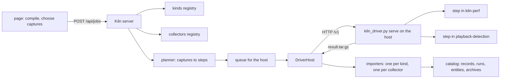
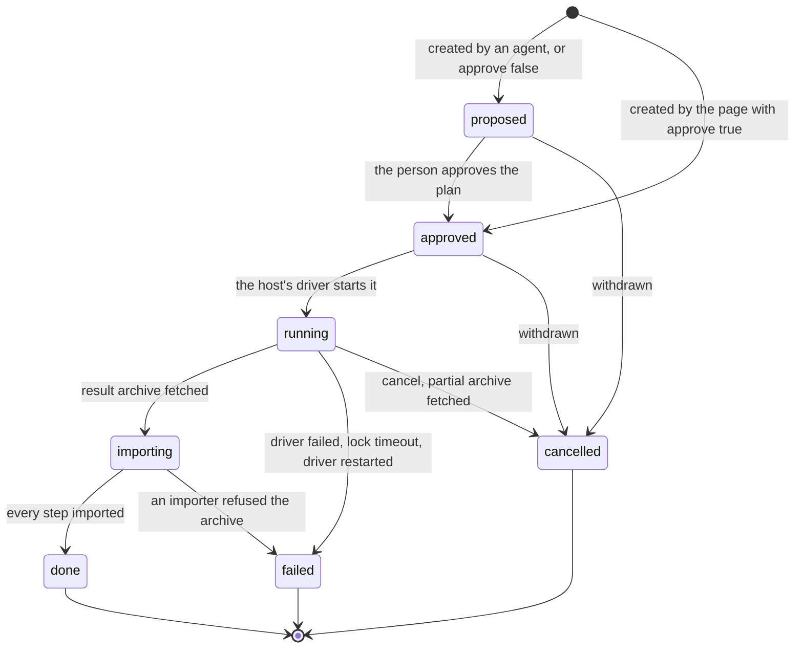
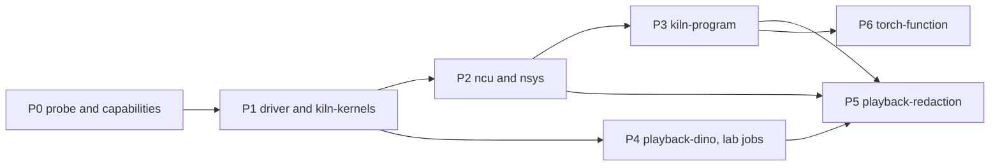

# Intern guide: one execution core for Kiln and Perf Lab

This guide designs the part of the Kiln workbench that runs code on GPU hosts. Today two separate mechanisms do this
job: Kiln's CUDA executor, which runs generated kernels, and Perf Lab's runner, which runs Python workloads. A third
mechanism, an SSH container executor for Perf Lab, was designed in ticket ML-PERF-003 and never built. This guide
replaces all three with one core: a host runs a small generic **driver**, the driver runs **steps** inside
**environments**, each step runs one **workload kind** observed by a set of **collectors**, and the Kiln server plans
the steps, imports the results and stores them in one catalog. ML-PERF-003 is closed as superseded by this ticket;
its design carries over almost unchanged as the part of this core that runs Playback code (§26).

By the end of the guide you should be able to explain what runs on a GPU host when a person presses Measure or runs a
lab experiment, how a host reports what it can run, how a new kind of workload or a new profiler is added without
touching the rest, and in which order to build it.

## Part 0. How to read this guide

### 0.1 Path conventions

| Prefix | Means                                                                                                                                                     |
| ------ | --------------------------------------------------------------------------------------------------------------------------------------------------------- |
| `K/`   | the Kiln repository, `/Volumes/SSD/code/kiln`                                                                                                             |
| `PL/`  | Perf Lab as received, `K/lab-workbench` (read-only reference; its own pnpm root)                                                                          |
| `PB/`  | a Playback checkout (for the redaction work: `/Volumes/SSD/code/playback-kiln-002`)                                                                       |
| `M3/`  | the ML-PERF-003 ticket in Playback, `ttmp/2026/10/12/ML-PERF-003--running-perf-lab-experiments-on-the-dgx-an-ssh-executor-for-containerized-gpu-captures` |
| `T2/`  | the KILN-002 ticket, `K/ttmp/2026/10/20/KILN-002--…`                                                                                                      |

`file.ts:120` means line 120 of that file at Kiln commit `0857384` (2026-10-20).

### 0.2 Status tags

Every mechanism in this guide carries one of three tags, because the guide mixes code that runs today with code that
does not exist yet:

- **[exists]**: in the repository and exercised by tests or by a run recorded in a diary.
- **[designed]**: specified in ML-PERF-003's guide, not implemented. This guide adopts it unless it says otherwise.
- **[new]**: proposed here.

### 0.3 Structure

- **Part I** states the problem and defines the vocabulary, in the order in which the terms depend on each other.
- **Part II** describes what exists: Kiln's executor, the `kiln-program/1` launcher, Perf Lab's runner, Kiln's port of
  Perf Lab's data, and ML-PERF-003's design. It ends with a gap analysis.
- **Part III** is the design. It opens with the core model (§11) and the list of what the model removes (§12.2), then
  covers hosts and the driver API, environments, capability documents, workload kinds, collectors, identity, plans and
  the driver, import, jobs, the page, security and the API.
- **Part IV** is the implementation plan, the test strategy, risks and how to run things.

---

## Part I. The problem and the vocabulary

### 1. Executive summary

A performance question about GPU code becomes useful only when someone runs the code on the GPU in question and
records what happened in a form that can be compared later. The workbench has three kinds of such questions, and each
needs code to run on a host such as the DGX Spark on the desk (`bling`, an NVIDIA GB10) or the shared DGX
(`playback@dgx`, also a GB10):

1. **How fast is this kernel?** Kiln generates CUDA for a program; a job runs each kernel repeatedly and records
   CUDA-event times. This works today **[exists]**.
2. **What did my compiler pass change?** The program with and without a pass must run end to end, kernels in launch
   order on one stream, with a timeline of the launches (Nsight Systems) and hardware counters for each kernel
   (Nsight Compute). Neither the program run nor either profiler is wired up today.
3. **Did my change make the service faster?** A Playback service (Grounding DINO detection, redaction) must run at two
   git revisions on the same inputs in paired order, with per-request timing, per-stage timing and a timeline. Perf
   Lab can do this only on the Mac's CPU; ML-PERF-003 designed the GPU-host path **[designed]**.

The design separates five concerns that today are fused inside each mechanism:

| Concern         | Question it answers                                  | Examples                                                             |
| --------------- | ---------------------------------------------------- | -------------------------------------------------------------------- |
| Host and driver | Which machine, and where does its driver listen?     | `spark` at `127.0.0.1:5281`, `dgx` at its own address                |
| Environment     | In what software does the code run?                  | the `kiln-perf` image by SHA-256, Playback's detection image         |
| Workload kind   | What runs, from which input, producing which output? | `kiln-kernels/1`, `kiln-program/1`, `playback-dino/1`                |
| Collector       | How is the run observed?                             | CUDA events, Nsight Compute, Nsight Systems, an `nvidia-smi` sampler |
| Plan and driver | In which order do the steps run, under which lock?   | `kiln-plan/1` executed by `kiln_driver.py`                           |

The **driver** is one standard-library Python file that a person runs on each host as a small HTTP server while
developing. Every driver serves the same API over plain TCP, and the server is one HTTP client of all of them,
including the driver on its own machine. It knows nothing about kernels or Playback: it takes a GPU lock, records what else runs
on the GPU, runs the plan's steps as containers, samples the GPU, and packs a result archive. Workload kinds and
collectors are two registries of plain TypeScript modules in a browser-safe package, shared by the server and the
page. A host reports **facts** (its GPU, its
driver, its environments and their tools); the server derives from those facts which kinds and collectors the host can
serve, and says why when it cannot. A capture that a host cannot serve is shown as blocked with that reason before
any job is created.

The design is deliberately a simplification, not an addition. Every measurement the workbench makes, from a Measure
on the GB10 to a lab experiment with Playback code, becomes a set of **captures** that a **job** runs on a **host**;
there is one job table, one job API, one importer pipeline and one way to reach a GPU. Kiln's executor profiles, the
runner's `serve` mode and its private `ncu` call, Perf Lab's synthetic hosts and its Mac-only process executor, and
the second job system are removed, each in the phase that ships its replacement (§12.2). Some functionality is lost on
purpose: CUDA runs without the Kiln server, and CPU-only lab runs on the Mac.

Three rules keep the parts independent:

- The driver runs steps and never interprets them. Adding a workload kind never changes the driver.
- A collector declares what it disturbs. Nsight Compute replays kernels, so its runs never contribute latencies;
  statistics pool only runs whose collectors leave the measured quantity undisturbed.
- Everything that can change a measurement is part of its identity: the content of what ran, the environment's image
  ID, the device fingerprint, the protocol and the collectors.

### 2. The problem in detail

#### 2.1 Two mechanisms, one idea

Kiln's executor and Perf Lab's runner solve the same problem with different vocabularies:

| Aspect         | Kiln executor **[exists]**                                           | Perf Lab runner **[exists]** (Mac only)                   |
| -------------- | -------------------------------------------------------------------- | --------------------------------------------------------- |
| Unit of work   | a job: kernels × protocol                                            | a job: captures (experiment × arm × mode)                 |
| One repetition | one runner process, all kernels in seeded shuffled order             | one Python process per arm, arms in seeded shuffled order |
| Code that runs | the kernel sources, carried in the job                               | a workload package on disk, chosen by an adapter name     |
| Where          | this machine or an SSH host, optionally in the `kiln-perf` container | this machine; remote hosts are synthetic                  |
| Output         | `kiln-results/1` on stdout → `kiln-measure/1` records                | files in an output directory → run bundles of entities    |
| Observation    | CUDA events; Nsight Compute only outside jobs                        | timing, `torch.profiler` (CPU), allocator, `getrusage`    |
| Identity       | content ID of each kernel + device fingerprint                       | hash of the lowered capture specification                 |

ML-PERF-003 then designed a third mechanism for Perf Lab on the DGX: a `StepHost` with a remote driver, container
steps, an environment block in the capture identity and result archives **[designed]**. It is the most complete of
the three, but it covered only Playback's detection image and lived in the Perf Lab prototype, whose data Kiln has
since absorbed (KILN-001 Phase 8c).

#### 2.2 What is missing

- **No profiler reaches a job.** Kiln jobs set `ncu: false` (`K/apps/server/src/jobs.ts:358`); the `kiln-perf` image
  on `bling` contains neither `ncu` nor `nsys`; the GB10's driver restricts GPU counters to administrators
  (`RmProfilingAdminOnly: 1`). Perf Lab's GPU lanes, kernel tables and Nsight metrics in its scenario presets are
  generated by `PL/src/data/generate.ts`, not measured.
- **No program runs end to end.** The runner compiles and times each kernel alone (`K/runner/kiln_runner.py:292`),
  so the time of a program is the sum of kernel medians. Effects between kernels (an intermediate still in the 24 MB
  L2, launch gaps) are invisible, and those are what a fusion pass changes.
- **No GPU lock and no record of co-tenants.** Two Kiln servers, or a Kiln server and a person, can run on the same
  GPU at once, and nothing records that the DGX had six other CUDA processes resident during a measurement.
- **The environment is not in Kiln's identity.** A kernel's content ID covers the generated source, launch, inputs
  and output (`K/packages/evidence/src/identity.ts:49`), and the device fingerprint covers the GPU and driver, but the
  CUDA toolkit that compiled the source is in neither. Rebuilding `kiln-perf` with CUDA 12.9 instead of 13.0 produces
  different machine code under the same record identity.
- **Lab jobs cannot execute in Kiln.** `POST /api/lab/jobs` answers `501`
  (`K/apps/server/src/lab/routes.ts:94`).
- **Hosts cannot say what they can run.** Kiln's device list shows an executor and its GPU; Perf Lab's capability
  reports for remote hosts are a hard-coded synthetic table (`PL/src/data/capabilities.ts`).

### 3. Vocabulary

The terms below are defined in dependency order: each definition uses only terms defined before it.

- **Host.** A machine with a GPU on which workloads run, named by a short id such as `spark` or `dgx`.
- **Driver.** `kiln_driver.py`, one Python file using only the standard library, run on a host by a person with
  `kiln_driver.py serve`. It accepts plans, runs them one at a time and keeps their events and archives.
  **[new]**, generalising ML-PERF-003's `driver.py`.
- **Driver API.** The HTTP API every driver serves over plain TCP: probe, blobs, jobs, events, archives (§13.2). The
  server reaches every host through it, including the host it runs on; there is no SSH and no process spawning in
  the core.
- **Environment.** A named place on a host where a step's process runs: a container image resolved to its image ID
  (`kiln-perf`, `playback-detection`), or the host itself (`host`). An environment provides **runtimes** (Python,
  PyTorch, CUDA toolkit) and **tools** (`ncu`, `nsys`).
- **Facts.** What a probe observed about a host and its environments: GPU model and driver, runtimes and their
  versions, tools, whether GPU counters are readable, free disk.
- **Capability document.** The probe's facts plus the server's derived **offers**: for each workload kind and
  collector, whether this host can serve it, in which environment, and if not, why. Format `kiln-capabilities/1`.
- **Workload kind.** A module of the `@kiln/exec` package that knows one way of running code: its input, the environment it needs, the
  command that runs it, and how to read its output. Versioned ids such as `kiln-kernels/1`.
- **Collector.** A module of the same package that knows one way of observing a run: CUDA events, Nsight Compute (`ncu`), Nsight
  Systems (`nsys`), NVTX ranges, `torch.profiler`, a GPU sampler. Each has a **shape** (wrapper, in-process, sidecar)
  and a **disturbance** (what it makes unreliable).
- **Capture.** One thing to measure: a workload of some kind, one arm's variant of it, a set of collectors (a **mode**, such
  as timing, counters, timeline or memory, is a name for a collector set) and a number of repetitions. The term comes from Perf Lab; a Kiln Measure is one capture of kind
  `kiln-kernels/1`.
- **Step.** One process run on a host: an environment, an argument vector, mounts, collector wrappers, an output
  directory and a timeout. A repetition of a capture is one or more steps.
- **Plan.** The ordered steps of one job on one host, plus the lock, sidecars and the files to verify. Format
  `kiln-plan/1`. The order is the protocol's seeded paired order.
- **Job.** A plan that a person approved, with its lifecycle (`proposed → approved → running → done | failed |
  cancelled`), its events and its result archive.
- **Conditions.** What else was true during a job: other CUDA processes and their memory, running containers, GPU
  utilisation and clocks before, during and after. Conditions describe a run; they are not part of its identity.
- **Result archive.** The `.tar.gz` the driver packs at the end of a job: the plan, an execution log per step, the
  conditions, and each step's output directory. Format `kiln-result/1`.
- **Importer.** Code that turns a step's output into stored evidence. Each workload kind has one, and each collector
  has one.
- **Record, run, entity.** The stored evidence. A **record** (`kiln-measure/1`) holds one kernel's samples on one
  device. A **run** holds one repetition of a lab capture, with **entities** such as requests, spans, kernels and
  allocations. Both already exist; this design adds collectors' output to both.
- **Identity.** The SHA-256 of everything that can change a measurement: the content of what ran, the environment,
  the device fingerprint, the protocol and the collector set (§21).

### 4. One example carried through the guide

The running example is the W-28 preset (Playback's redaction mask post-processing, KILN-002 Example C) on `spark`:

> Measure W-28's two forms, `separable` and `direct`, at 1, 4, 16 and 64 detections on the GB10. Record CUDA-event
> times for every kernel, Nsight Compute counters for every kernel, and one Nsight Systems timeline of each form run
> end to end.

That request becomes three captures per variant (timing, counters, timeline) over 8 variants. Each later chapter shows
what its part of the system does with it: which kinds serve it (`kiln-kernels/1` for timing and counters,
`kiln-program/1` for the timeline), which collectors (CUDA events, `ncu`, `nsys`, NVTX), what the capability document
of `spark` says (counters blocked until GPU counters are readable by non-administrators), the plan the server builds,
the steps the driver runs and the records and timeline entities that come back.

A second example, from ML-PERF-003, covers Playback code: the `pr1005-dgx-live` experiment runs Grounding DINO at
revisions `a6f14d947` and `d59d9ad` in the detection image on `playback@dgx`, 16 dataset images, two repetitions.

---

## Part II. What exists

This part describes the code the design builds on. Read it with the files open; every claim names the line it rests
on.

### 5. Kiln's execution path [exists]

#### 5.1 The path in one diagram

```text
 browser page                         Kiln server (Hono, node:sqlite)                 GPU host
 ────────────                         ───────────────────────────────                 ────────
 compile the program
 Measure on a server device
   └─ POST /api/jobs ───────────────► parseJob: limits, content ids recomputed
      {executor, protocol,            Jobs.kick: one job at a time, oldest approved
       kernels[] with source,         Jobs.execute: for rep in 0..reps-1
       launch, inputs, context}         order = repetitionOrder(n, seed, rep)
                                        bundle = kiln-bundle/1 (kernels in that order)
                                        CudaRunnerExecutor.runRepetition(bundle) ───► kiln-docker-python
                                                                                       docker run kiln-perf
                                                                                        python3 kiln_runner.py run -
                                                                                         nvcc each kernel (cached)
                                                                                         time with CUDA events
                                        ◄─────────────────────── kiln-results/1 ◄──────
                                        cudaIdentity(report) → device id
                                        accumulate samples per kernel
                                      jobRecord → kiln-measure/1 records → insertRecords
   ◄── SSE job.updated, records.added
```

Four files carry this path: `K/apps/server/src/jobs.ts` (the queue and the repetition loop),
`K/apps/server/src/executors/cuda-runner.ts` (how a repetition reaches a host), `K/runner/kiln_runner.py` (what runs
there) and `K/runner/docker/kiln-docker-python` (the container wrapper).

#### 5.2 Executor profiles

The server reads executor profiles from `KILN_EXECUTORS`, by default `<data dir>/executors.json`
(`K/apps/server/src/executors/index.ts:1`). Only CUDA runner executors exist. A profile names a target (`local` or
`ssh`), an SSH destination, the interpreter that runs the runner, a directory for the runner on the host and extra
environment variables. On `bling` the server runs on the GPU host itself, so the profile is local and the interpreter
is the container wrapper:

```json
{ "executors": [
  { "id": "spark", "target": "local", "python": "/home/manuel/.local/bin/kiln-docker-python",
    "env": { "KILN_ARCH": "native" } }
] }
```

`CudaRunnerExecutor` validates the id (`[a-z0-9-]`), the SSH destination (no leading `-`, no port syntax) and the
environment variable names in its constructor (`cuda-runner.ts:58`), so a profile cannot inject options into `ssh`.

#### 5.3 The executor interface and the runner's formats

The interface every executor implements is two methods (`K/apps/server/src/executors/types.ts:61`):

```ts
export interface Executor {
  readonly id: string;                       // 'spark', 'rtx-dev'
  readonly target: 'local' | 'ssh';
  readonly host: string;                     // enters the device fingerprint when the report lacks a hostname
  probe(signal?: AbortSignal): Promise<DeviceReport>;
  runRepetition(bundle: KilnBundle, signal: AbortSignal, onLine?: (line: string) => void): Promise<KilnResults>;
}
```

One call of `runRepetition` is one protocol repetition. The bundle (`kiln-bundle/1`) carries every kernel with its
CUDA source, grid, block, shared memory, input sizes and seeds, output size and the output indices to sample; `reps`
in the bundle is the number of timed launches per kernel and `warmup` the untimed ones. The answer (`kiln-results/1`)
carries the runner's device report and, per kernel, every launch time in microseconds, the sampled output values,
the register count from `ptxas -v`, and an `ncu` object when profiling was requested.

How a call reaches the runner (`cuda-runner.ts:98-150`):

- **Install by content.** For an SSH target the runner text is copied once to
  `~/.cache/kiln-runner/kiln_runner-<first 16 hex of its sha256>.py`; a changed runner is a new file.
- **One process per repetition.** `ssh -T -o BatchMode=yes -- <host> 'env KILN_ARCH=native <python> <runner> run -
  --out - --exit-on-eof'`, the bundle on stdin, results on stdout, progress lines on stderr (each becomes a job event).
- **Lifetime tied to the connection.** The child runs in its own process group; an abort kills the group. Stdin stays
  open and the runner runs with `--exit-on-eof`, so when the SSH connection or the server goes away the runner sees
  end of file and stops its own process group.

`kiln_runner.py` itself (`K/runner/kiln_runner.py`) has three subcommands: `device` (a JSON device report), `run`
(a bundle) and `serve` (an HTTP endpoint for the page without the Kiln server). `run_kernel` (`:236`) compiles the
kernel into a harness with `nvcc -O3 -Xptxas -v`, caches the binary by source hash (`build`, `:165`), runs it, and
when asked runs `ncu` once over the binary with nine metrics (`NCU_METRICS`, `:44`): SM and DRAM throughput, achieved
occupancy, load sectors and requests, shared-memory bank conflicts, branch uniformity, registers and duration.

#### 5.4 The job loop

`Jobs.execute` (`K/apps/server/src/jobs.ts:325`) is the whole protocol. In pseudocode:

```text
execute(job):
  status = running
  for rep in 0 .. reps-1:
    stop if cancelled; for agent jobs, stop if the 24-hour executor budget is spent
    order  = repetitionOrder(n, seed, rep)                 # seeded shuffle, @kiln/evidence
    bundle = kiln-bundle/1 { reps: launches, warmup, ncu: false, kernels in that order }
    res    = executor.runRepetition(bundle, abort or timeout)
    ident  = cudaIdentity(res.device, executor.host)       # fail if it differs from the previous repetition
    for each kernel at its position:
      samples += median(us_all); raw += us_all; position += its position; checks += sample check
  status = cancelled | failed | done
  records = one kiln-measure/1 record per kernel with ≥ 1 sample (all kernels when done)
  insertRecords; emit records.added
```

Properties worth remembering, because the design keeps them:

- **One job at a time per server.** `kick()` starts the oldest approved job only when none is active (`:302`).
- **Paired order.** Every repetition runs every kernel, in a different seeded order, in one fresh process. A
  record's `protocol.position` keeps each sample's position so position effects can be checked.
- **Approval.** Agent-proposed jobs are never created approved; only the page, which holds the session token, can
  approve (`jobs.ts:9`).
- **Partial results are evidence.** A failed or cancelled job still produces records, marked invalid with the reason.

#### 5.5 Identity today

Two identities meet in a record (`K/packages/evidence/src/record.ts:12`):

- **What ran.** `kernel.contentId` is the SHA-256 of the code generator version, the language, the source's SHA-256,
  the launch, the input shapes and seeds and the output shape (`identity.ts:49`). The server recomputes it from the
  submitted source at job creation and refuses a mismatch (`409 content_id_mismatch`).
- **Where it ran.** `device.id` is `cuda:<model slug>-<8 hex>`, a hash of the fingerprint: every stable field of the
  runner's device report (`identity.ts:101`). The report is the CUDA device query plus `nvidia-smi`'s driver version,
  persistence mode, maximum clocks and GPU UUID, plus the host name (`kiln_runner.py:188-225`). Fields that change
  between probes (current clocks, temperature) are excluded on purpose.

Neither covers the CUDA toolkit, the container image or the container's limits. KILN-002 Step 15 added
`record.context` (preset, project, parameter values, script hash), which names the experiment a record belongs to but
is not part of its identity.

#### 5.6 The `kiln-perf` image and its wrapper

`K/runner/docker/` builds `kiln-perf`: Ubuntu 24.04 with NVIDIA's CUDA toolkit (13.0 by default), NumPy, the runner
at `/opt/kiln/kiln_runner.py`, the program launcher at `/opt/kiln/kiln_launch.py` and a device probe
(`kiln-probe`). `build.sh --ncu` adds Nsight Compute (`Dockerfile:10`, `WITH_NCU=1`); Nsight Systems is not
available as an option. `kiln-docker-python` makes the image usable as an executor's interpreter:

```sh
exec docker run --rm -i --init --gpus all --network none --hostname "$(hostname)" --user "$(id -u):$(id -g)" \
  -e HOME=/tmp -e KILN_ARCH -e KILN_CACHE="$dir/build" -v "$dir:$dir" "$image" python3 "$@"
```

- `--network none`: the runner's `device` and `run` need no network.
- `--hostname "$(hostname)"`: the device id depends on the host name; a random container name would make the same GPU
  a new device on every probe.
- `--user`: the runner does not run as root, which is also why `ncu` would fail on a host whose GPU counters are
  restricted to administrators.
- No `--pid host`: inside the container's PID namespace `nvidia-smi` cannot list other processes, so co-tenants are
  invisible to the runner (the separate `kiln-probe` documents this and reports `computeApps: null`).

#### 5.7 The `bling` setup

KILN-002 (`T2/reference/01-investigation-diary.md`, Steps 13–15) set up `bling` as a GB10 host: the Kiln checkout in
`~/code/kiln`, data in `~/kiln-002/server-data`, the server in its own tmux server (`tmux -L kiln`) because the
original tmux server predates `manuel`'s membership of the `docker` group, and an SSH tunnel from the Mac to port
5280. The device is `cuda:nvidia-gb10-e220ce35` (compute capability 12.1, 48 SMs, driver 580.178.04). `nsys` is
installed at `/usr/local/bin/nsys`, `ncu` at `/usr/local/cuda-13.0/bin/ncu`, and
`/proc/driver/nvidia/params` shows `RmProfilingAdminOnly: 1`.

### 6. `kiln-program/1` and the launchers [exists]

A second way to run Kiln code already exists, built for consumers rather than for measurement. `node
scripts/kiln-export.mjs --preset W-28 …` writes a `kiln-program/1` export (`K/runtime/README.md`): the program's
inputs, outputs and buffers, and its kernels **in launch order**, each with both its WGSL and CUDA source, launch
geometry, the buffer ids it reads and writes, and a name of the form `<emitted name>__<identity>` that is also the
CUDA entry symbol, so a profiler trace names the computation.

Two single-file launchers run an export. `K/runtime/python/kiln_launch.py` has a `cuda` backend that compiles each
kernel with NVRTC and launches it through the driver API, both through `ctypes`, with NumPy as the only hard
dependency (`CudaProgram`, `:309`). Its `launch(stream, scratch=…, **pointers)` (`:372`) runs every kernel of the
program on a caller's stream with caller-owned memory. This is how W-28 entered Playback: the redaction service
vendors the launcher and the export (`PB/services/redaction/src/kiln/kiln_launch.py`, `mask_post.json`; Playback
commits `cdfb0d8c9` and `ac835daa9`, behind `REDACTION_MASK_POST=kiln`).

For this design the launcher matters because it already does the hard part of a **program run**: all kernels in launch
order on one stream with real intermediate buffers. What it lacks is a measurement entry point (a timed loop with
CUDA events around the program and around each kernel) and NVTX ranges. Section 19.3 adds both.

### 7. Perf Lab's runner [exists, Mac only]

#### 7.1 Captures and their identity

A lab program (`lab.js`) declares experiments with arms on hosts with workloads; building it lowers every experiment ×
arm × capture mode into a **capture specification** (`PL/src/lang/build.ts:531`): the experiment and arm, the host,
the workload's adapter name and options, the comparison (arm revision, switches, paired-order seed), state, warm-up,
activation expectation, repetitions, collection mode and a hash of the quality gate. The capture's identity is a hash
of that specification (`build.ts:558`). A capture whose hash is already in the catalog is `cached`; otherwise it is
`execute`, `import` (evidence archive) or `blocked` with a reason.

#### 7.2 The runner

`PL/server/runner.ts` executes approved jobs one at a time, one process at a time (`Runner`, `:104`):

```text
runJob(job):                                                        # runner.ts:264
  group captures by experiment/mode@host                            # :277, so arms interleave
  for each group:
    if spec.evidence:                 importEvidence  (no process)   # :165
    elif adapter == dino and local:   runDino         (both arms in one process per repetition)  # :217
    else:
      executor = process executor if host == local else synthetic   # :46, :92
      for rep in 0 .. max reps-1:
        order = seeded shuffle of the group's captures, seed "<paired_order_seed>:<rep>"
        for capture in order:
          run `uv run --project workloads python -m perf_lab_local.run --spec spec.json --rep N --out dir`
          importRepetition(dir) → a run bundle; insert it
```

Two things here are the same idea as Kiln's job loop under different names: the seeded interleaving of arms per
repetition, and one fresh process per repetition. Two are different: the code that runs is chosen by an adapter name
and lives on disk (`perf_lab_local`, `perf_lab_dino`), and hosts other than `local` are **synthetic**: the job
"completes" after 150 ms and the runs are generated from the capture hash.

#### 7.3 Workloads and the importer

`PL/workloads/perf_lab_local/run.py` reads only plan-time values from the specification, writes `manifest.json`,
`activation.json`, `quality.json` and one of `timing.json`, `cpu.json`, `trace.json`, `memory.json`, and prints
progress as one JSON object per line. `PL/server/importer.ts:63` turns that directory into a **run bundle**: a run
entity plus entities of kinds `request`, `span`, `kernel`, `alloc`, `tensor` and `instant`, with links between them.
The importer declares `counters: { unsupported: ['*'] }` (`importer.ts:100`): no GPU counter is ever collected.

`perf_lab_dino/run.py` is the one workload that runs Playback code: it writes the detection package at two git
revisions with `git show <rev>:<path>` into a temporary directory, imports both, and times both arms in one process in
a seeded order per image.

#### 7.4 What is real and what is synthetic

Measured: runs on host `local` (the Mac), CPU-side only, plus captures imported from evidence archives (PR 1005's
DGX archive). Synthetic: everything on `playback@dgx` and `playback@rtx-dev`, including the GPU lanes, kernel tables
and Nsight metrics shown by the `request-to-kernel` and `scenario-*` presets.

### 8. Kiln's port of Perf Lab's data [exists]

KILN-001 Phase 8a–8c (`K/ttmp/2026/10/19/KILN-001--…/design-doc/01-…md`, §33.1) moved Perf Lab's language into
`K/packages/lab` (`@kiln/lab`, browser-safe, statistics and verdicts from `@kiln/evidence`) and Perf Lab's data
routes into the Kiln server under `/api/lab` (`K/apps/server/src/lab/routes.ts`), backed by `lab_*` tables
(`K/apps/server/src/db.ts:90-239`). A lab program opens in the dock as boards; its runs come from data imported with
`pnpm --filter @kiln/server lab:import`. Execution was deliberately not ported:

```ts
const NO_EXECUTION = 'lab jobs do not run on the Kiln server yet (KILN-001 Phase 8c ports data, not execution)';
lab.post('/jobs', notExecuted);              // routes.ts:94, 501
lab.post('/jobs/:id/approve', notExecuted);
lab.post('/jobs/:id/cancel', notExecuted);
```

Host `local`'s report is read, not probed (`K/apps/server/src/lab/probe.ts`): the server hashes the workload sources
as Perf Lab's probe does, because a local capture's identity depends on that hash. `playback@dgx` and
`playback@rtx-dev` stay synthetic (`routes.ts:19`).

The page's server devices can only run jobs: `ServerDevice.runKernels` throws "runs jobs only: Measure proposes one
(Tune and Compare run on the page's devices)" (`K/apps/workbench/src/server-sync.js:107`).

### 9. ML-PERF-003's design [designed]

ML-PERF-003 (`M3/design/01-intern-guide-running-perf-lab-experiments-on-the-dgx.md`, 2026-10-12) asked how Perf Lab
should run experiments on the DGX and answered: keep the lab on the Mac, add an SSH executor that runs disposable
containers of Playback's detection image, and import their reports with the existing importer. Its decisions, each of
which this guide adopts:

| Section | Decision                                                                                                                                                                                                          |
| ------- | ----------------------------------------------------------------------------------------------------------------------------------------------------------------------------------------------------------------- |
| §5      | No long-running process on the GPU host; SSH from the server; an agent service later as a second implementation                                                                                                   |
| §6.1    | A `StepHost` interface: `probe`, `run(job)`, `cancel`, `reconcile`                                                                                                                                                |
| §6.2    | Host profiles in a JSON file outside git and outside SQLite, validated at startup                                                                                                                                 |
| §6.3    | A remote probe: host facts, GPU facts, the image resolved to its ID, package versions from one short container, co-tenants                                                                                        |
| §6.4    | An `environment` block (image ID, driver, limits, threads) in the identity of executed captures only                                                                                                              |
| §6.6    | A staged bundle per job: `plan.json`, the driver, workload packages, git-archived source trees, specs, media                                                                                                      |
| §6.7    | Recipes: pure functions from capture groups to container steps                                                                                                                                                    |
| §6.8    | A standard-library `driver.py`: verify inputs, check mounts, `flock` a GPU lock, record conditions, sample the GPU, run steps, pack `result.tar.gz`; JSON-line events; a heartbeat to notice a dropped connection |
| §6.10   | The result archive registered as an evidence archive, imported per capture group                                                                                                                                  |
| §6.11   | Co-tenancy recorded as conditions, never as identity and never as a reason to refuse                                                                                                                              |
| §6.12   | Cancellation and restart reconciliation by container label                                                                                                                                                        |
| §6.14   | No network in containers, mounts only under the host root, no stored credentials, approval by a person                                                                                                            |

What it did not cover, and this guide adds: Kiln's kernels and programs as workloads, profilers as composable
collectors, the derivation of what a host can run from its facts, a GPU lock and conditions for Kiln jobs, and a home
in the Kiln server rather than the Perf Lab prototype, whose data the Kiln server already holds.

### 10. Gap analysis

| Need                                            | Today                                                              | Closed by                                               |
| ----------------------------------------------- | ------------------------------------------------------------------ | ------------------------------------------------------- |
| A host says what it can run, and why not        | executor + GPU name; synthetic tables for lab hosts                | capability documents (§17)                              |
| Kernel counters in Kiln records                 | runner can, jobs never ask; image lacks `ncu`; counters admin-only | `ncu` collector (§20.4), host setup (§31)               |
| A timeline of a program or a service            | none measured                                                      | `kiln-program/1` kind (§19.3), `nsys` collector (§20.5) |
| Program-level time (with L2 and launch effects) | sum of isolated kernel medians                                     | `kiln-program/1` kind                                   |
| GPU lock across servers and people              | none                                                               | driver lock (§22.4)                                     |
| Co-tenancy recorded on every run                | only `kiln-probe`, by hand                                         | driver conditions (§22.5)                               |
| Toolkit and image in identity                   | absent                                                             | environment block (§21)                                 |
| Lab jobs execute                                | `501` in Kiln; Mac-only in Perf Lab                                | lab kinds (§19.5, §19.6), one job API (§24)             |
| Sweeps of parameters and knobs                  | none (KILN-002 task `udht`)                                        | capture groups (§19.1), one job API (§24)               |
| Compare and Tune on a GPU host                  | page devices only (`server-sync.js:107`)                           | the page as a host, captures on any host (§25)          |
| Playback code at revisions on a GPU host        | designed (ML-PERF-003), not built                                  | `playback-dino/1`, `playback-redaction/1`               |
| One place for all evidence                      | Kiln records + lab tables in one SQLite already                    | unchanged, extended (§23)                               |

---

## Part III. The design

### 11. The core model

The goal of this ticket is not to add a GPU executor next to the two that exist. It is to replace them with one small
model that every measurement in the workbench goes through, so that new workloads, new profilers and new hosts are
additions to registries rather than new paths. The model is allowed to cost functionality; §12.2 lists what goes.

#### 11.1 Nine nouns

```text
   Host ──has──► Environment ──provides──► runtimes, tools
    │                                                   Kind ──defines──► Workload (content-addressed)
    │ probe                                                                 │ variant: parameters, knobs,
    ▼                                                                       │          revision, switches
   Facts ──derive──► Offers ◄──requirements── Kind, Collector                ▼
                                                     Capture = workload variant × mode × collectors
                                                               × protocol × host        id = sha256(…)
                                                        │ lowered by its kind, applied by its collectors
                                                        ▼
                               Steps ──ordered──► Plan ──approved──► Job ──run by the driver──► Result archive
                                                                                                  │ imported
                                                                                                  ▼
                                    Run  (one repetition of one capture)
                                     ├─ observations: samples, counters, spans, requests, allocations
                                     └─ conditions:   co-tenants, utilisation, clocks
                                                        │ projected
                                                        ▼
                                    Record (kiln-measure/1: one kernel on one device, for the compiler)
```

| Noun        | Definition                                                               | Replaces today                                             |
| ----------- | ------------------------------------------------------------------------ | ---------------------------------------------------------- |
| Host        | a machine that executes captures; reached through its driver's URL       | Kiln executor profiles; Perf Lab hosts; the page's devices |
| Environment | a container image by ID on a host (or the host itself for sidecars)      | `kiln-docker-python`; Perf Lab's `uv` project; M3 images   |
| Kind        | a module that runs one kind of workload and reads its output             | the CUDA runner path; Perf Lab adapter names; M3 recipes   |
| Collector   | a module that observes runs: wrapper, in-process or sidecar              | the runner's `--ncu`; Perf Lab capture modes               |
| Capture     | a workload variant × mode × collectors × protocol on a host              | a Kiln job's kernel; a Perf Lab capture instance           |
| Job         | the approved plan of steps for a set of captures on one host             | Kiln jobs; Perf Lab jobs; M3 staged jobs                   |
| Run         | one repetition of one capture, with observations and conditions          | Perf Lab runs; Kiln repetitions (not stored today)         |
| Record      | the per-kernel summary the compiler reads, projected from runs           | `kiln-measure/1` records (unchanged in format)             |
| Offer       | a host's derived ability to serve a kind or collector, or the reason not | nothing (synthetic capability tables)                      |

Every operation the workbench offers becomes a set of captures:

| Operation      | Captures                                               | Today                                             |
| -------------- | ------------------------------------------------------ | ------------------------------------------------- |
| Measure        | one variant, mode timing                               | page devices in the page; server devices as a job |
| Compare        | two variants, paired                                   | page devices only                                 |
| Sweep          | N variants of parameters or knobs, paired              | does not exist (KILN-002 task `udht`)             |
| Tune           | successive sweeps chosen by the search                 | page devices only                                 |
| Lab experiment | arms × modes, as the lab program declares              | Mac CPU only; GPU hosts synthetic                 |
| Device probe   | a `kiln-probe/1` capture whose output is a target spec | `kiln-probe` run by hand (§19.4)                  |

The page itself is a host (§25): the simulator and WebGPU are its environments, it executes their captures in the
browser without a driver, and its runs go through the same importers. Compare and Tune therefore stop depending on
where the device is.

#### 11.2 One request through the model



A request goes through the system in six stages:

1. **Choose.** The page compiles a Kiln program (or builds a lab program) and turns the person's request into
   captures: kind, arm variant, mode, repetitions, host. For each capture it asks the host's capability document
   whether the host can serve it; a capture it cannot serve is shown as blocked with the reason, and goes no further.
2. **Plan.** On `POST /api/jobs` the server validates the captures, recomputes content identities, and asks each
   workload kind to **lower** its captures into step templates. Each collector then **applies** itself to the steps
   it observes. The planner orders the steps in the protocol's seeded paired order and writes a `kiln-plan/1`.
3. **Approve.** A person approves the job in the page. Agent-proposed jobs wait.
4. **Submit and run.** `DriverHost` uploads the files the driver does not have yet as blobs and submits the plan.
   The driver queues it and, when the host is free, takes the GPU lock, records conditions, starts the GPU sampler
   and runs every step as a container. The server reads the job's events by long polling.
5. **Collect.** The driver packs `result.tar.gz`; the server downloads it, checks its SHA-256 and registers it as an
   evidence archive.
6. **Import.** For every step, the kind's importer reads the workload's output and each collector's importer reads
   its own output. Kernel timings become `kiln-measure/1` records; requests, spans, counters and conditions become lab
   runs and entities. The page receives `records.added` and `catalog.changed` events and redraws.

#### 11.3 Where the code lives

The model's types, the kinds, the collectors, offer derivation, plan building and every importer are headless and
browser-safe, in a new package `@kiln/exec` (`K/packages/exec`), following KILN-001's "headless first" rule: the page
needs them to show blocked captures and to execute its own captures, the server needs them to plan and import.
Only what moves bytes to a machine is server-only.

| Layer            | Lives in                                         | Knows                                                     | Does not know                |
| ---------------- | ------------------------------------------------ | --------------------------------------------------------- | ---------------------------- |
| Page             | `K/apps/workbench`                               | programs, parameters, captures, offers; the page host     | the driver API               |
| Model, planner   | `K/packages/exec/src/{model,plan,offers}.ts`     | captures, protocols, steps, requirements                  | hosts' addresses             |
| Kinds            | `K/packages/exec/src/kinds/*.ts`                 | one workload: input, lowering, output                     | hosts, other kinds           |
| Collectors       | `K/packages/exec/src/collectors/*.ts`            | one observation method: requirements, application, output | workloads beyond their needs |
| Queue, approvals | `K/apps/server/src/exec/{queue,jobs}.ts`         | jobs, hosts, approvals                                    | what a kind does             |
| Driver client    | `K/apps/server/src/exec/{host,driver-client}.ts` | the driver API: blobs, plans, events, archives            | kinds, collectors            |
| Driver           | `K/runner/kiln_driver.py` (on the host)          | steps, containers, the lock, conditions, the archive      | kernels, Playback, profilers |
| Environments     | images on the host                               | runtimes and entry points                                 | the server                   |

The table is the dependency rule: a layer may use the layers listed in its "Knows" column and must not import
anything in its "Does not know" column. A new workload kind is one file in `kinds/` plus, if it needs one, an entry
point inside an environment. A new profiler is one file in `collectors/`.

### 12. Principles and simplifications

#### 12.1 Principles

- **The driver interprets nothing.** It runs a list of structured steps, and every decision (which image, which
  command, which wrapper, which order) is made by the server where it can be tested without a GPU. A driver that knew
  about kernels would have to be redeployed for every new kind.
- **Facts are probed, offers are derived.** A host never declares "I can run Playback code". It reports facts, and
  the server derives offers from them with the same requirement checks the planner uses. A declaration would go stale
  when an image changes; a derivation is recomputed at every probe.
- **Collectors compose by declaration.** Each collector says what it needs, what shape it has and what it disturbs.
  The planner combines them; the statistics layer refuses to pool runs whose collectors disturbed the quantity being
  estimated.
- **Identity covers everything that can change a measurement.** Content, environment, device, protocol, collectors.
  Conditions (co-tenants, utilisation) describe a run and stay out of identity.
- **Every host speaks one API.** Each host runs the same driver, which serves the same HTTP API, and the server is
  one client of it. A job belongs to the driver, not to a connection, so it survives the server restarting or its
  machine sleeping. ML-PERF-003 §5 chose SSH and deferred an agent service; this design takes the agent and drops
  SSH (§13.2).
- **One catalog.** Kiln's SQLite database already holds Kiln records and Perf Lab's runs; executed lab captures and
  collector output go there too, so a board can put a kernel's isolated time beside the same kernel's span inside a
  service trace.
- **The plan is the contract.** The plan is written to disk on the server, uploaded, verified by the driver and packed
  into the result archive. Any run can be explained from its archive alone.
- **One path per concern.** One way to reach a GPU (a job on a host), one profiler integration per tool (a collector),
  one job table, one importer pipeline. Where two paths exist today, one is removed (§12.2).

#### 12.2 What is removed or changed

This is a prototype, and keeping every existing path would mean keeping three mechanisms behind one interface. The
table lists what the model removes, what replaces it, and what is lost. Each removal happens in the phase that
introduces its replacement (§29), never before.

| Removed or changed                                                                                                     | Replaced by                                                                                      | What is lost                                                                |
| ---------------------------------------------------------------------------------------------------------------------- | ------------------------------------------------------------------------------------------------ | --------------------------------------------------------------------------- |
| `executors.json`, `Executor`, `CudaRunnerExecutor` (`K/apps/server/src/executors/`)                                    | `hosts.json`, `DriverHost`, the driver API (§13)                                                 | the old profile format; profiles are rewritten by hand (one per host)       |
| Installing the runner over SSH by content hash; a job's processes tied to its SSH connection (`cuda-runner.ts:98-150`) | a driver started by hand on each host and kept current by the server with `PUT /v1/self` (§13.4) | a host is usable only while a person runs its driver                        |
| `kiln_runner.py serve`, the page's runner-served CUDA device, bundle export and "Import results" in Devices            | jobs on a host; an offline run is a result archive imported through `POST /api/archives`         | CUDA without the Kiln server                                                |
| The runner's own `--ncu` and `profile()` (`kiln_runner.py:44`, `:265`)                                                 | the `ncu` collector, which wraps any kind (§20.4)                                                | nothing; the metric list moves into the collector                           |
| `kiln-docker-python`                                                                                                   | the driver's `docker run` from structured step fields                                            | nothing                                                                     |
| Perf Lab's process executor on the Mac (`host: local`) and its `uv` environment                                        | workloads run in containers on GPU hosts                                                         | CPU-only lab runs on the Mac, as `local-sampler` does them now              |
| Synthetic hosts and synthetic run generation (`playback@dgx`/`rtx-dev` stand-ins, `POST /api/lab/labs/:id/seed`)       | a host has a profile and executes, or its captures are blocked                                   | presets that work only on generated data; they keep recorded fixtures or go |
| Perf Lab adapter names (`sampler`, `dino`) as the extension point                                                      | kinds with requirements, lowering and importers (§19)                                            | nothing                                                                     |
| Two job systems: Kiln `jobs` and `lab_jobs`, `/api/jobs` and `/api/lab/jobs`                                           | one job table and one API whose body is a list of captures (§24)                                 | Perf Lab's imported job history (its runs and archives are kept)            |
| The Kiln job body's `kernels[]`                                                                                        | `captures[]`; a Measure is one capture of `kiln-kernels/1`                                       | old clients; the page changes in the same commit                            |
| Perf Lab's `cyrb53` capture hash                                                                                       | SHA-256 identity (§21)                                                                           | imported Perf Lab captures stay readable under their old hashes, read-only  |
| "Tune and Compare run on the page's devices" (`server-sync.js:107`)                                                    | Compare, Sweep and Tune are capture sets on any host                                             | nothing; this is gained                                                     |

### 13. Hosts and the driver API [new]

#### 13.1 Host profiles

Host profiles replace both `executors.json` and ML-PERF-003's `hosts.json`. They live in `<data dir>/hosts.json`
(overridable with `KILN_HOSTS`), outside git because they name machines, and outside SQLite because they are
configuration, not evidence:

```json
{
  "format": "kiln-hosts/1",
  "hosts": [
    {
      "id": "spark",
      "url": "http://127.0.0.1:5281",
      "environments": {
        "kiln-perf": { "image": "kiln-perf:latest", "docker": { "gpus": "all", "network": "none" } }
      },
      "toolMounts": { "nsys": "/opt/nvidia/nsight-systems" },
      "lock": { "waitSeconds": 1800 }
    },
    {
      "id": "dgx",
      "url": "http://100.103.58.32:5281",
      "environments": {
        "kiln-perf": { "image": "kiln-perf:latest", "docker": { "gpus": "all", "network": "none" } },
        "playback-detection": {
          "image": "pb-dgx-sim-detection:latest", "python": "/app/.venv/bin/python",
          "docker": { "gpus": "all", "network": "none", "memory": "16g", "shmSize": "1g" },
          "threads": { "omp": 2, "mkl": 2, "openblas": 1, "inductorCompile": 4 }
        }
      },
      "lock": { "waitSeconds": 1800 },
      "idleWindowSeconds": 10
    }
  ]
}
```

- `id` is the host's name everywhere: in the page, in job rows, in capture specifications. It matches
  `[a-z0-9][a-z0-9-]{0,62}`, the rule executor ids follow today (`cuda-runner.ts:59`).
- `url` is where the host's driver listens, and the only thing the server needs to reach the host. A profile holds no
  SSH destination and no path on the host: the driver's root directory is its own option, reported by
  `GET /v1/info` (§13.4).
- `environments` names the images the host may use. Names are configuration; what each image contains is probed
  (§15). A host can run only the environments its profile names, never an image it happens to have.
- `toolMounts` names host directories that steps may mount read-only to provide a tool the image lacks (§14.3).
- The server validates the file at startup against a schema; an invalid host is unavailable with the validation
  message, and the other hosts are unaffected (ML-PERF-003 §6.2).
- **No migration path.** `executors.json` is deleted in Phase 1 (§29); its one profile on `bling` becomes the `spark`
  entry above. The server refuses to start when `executors.json` exists, with a message naming `hosts.json`, so a
  stale file cannot silently stop working.

#### 13.2 The driver API

Every GPU host runs the same driver, and the server reaches all of them with one HTTP client over plain TCP. A server
on `bling` reaches its own driver at `127.0.0.1`, and a driver on another machine at that machine's address. There is
no SSH and no local process spawning in the core: the host the server runs on is reached exactly like any other.

| Method and path                                | Body                   | Answer                                                                                         |
| ---------------------------------------------- | ---------------------- | ---------------------------------------------------------------------------------------------- |
| `GET /v1/info`                                 | none                   | `api` (`kiln-driver/1`), `sha256` of the running file, `hostname`, `root`, `running`, `queued` |
| `POST /v1/probe`                               | `kiln-probe-request/1` | facts (§15)                                                                                    |
| `HEAD /v1/blobs/:sha256`                       | none                   | `200` when the blob is stored, `404` otherwise                                                 |
| `PUT /v1/blobs/:sha256`                        | the bytes              | `201`; `400` when the bytes do not hash to the name                                            |
| `POST /v1/jobs`                                | `kiln-plan/1`          | `202` with the queue position; `409` naming missing blobs; `400` naming a refused mount        |
| `GET /v1/jobs`                                 | none                   | every job the driver holds, with its state                                                     |
| `GET /v1/jobs/:id/events?after=<seq>&wait=<s>` | none                   | the events after `seq`, waiting up to `wait` seconds for the first one                         |
| `POST /v1/jobs/:id/cancel`                     | none                   | `202`; the running container is killed and the job ends cancelled                              |
| `GET /v1/jobs/:id/archive`                     | none                   | `result.tar.gz` once the job has ended; `409` before                                           |
| `DELETE /v1/jobs/:id`                          | none                   | deletes the job's directory, once the server has stored its archive                            |
| `PUT /v1/self`                                 | a new `kiln_driver.py` | `202`, then the driver re-executes itself; `409` while a job runs                              |

```ts
// K/apps/server/src/exec/driver-client.ts
export class DriverClient {
  constructor(readonly url: string) {}
  info(signal?: AbortSignal): Promise<DriverInfo>;
  probe(request: ProbeRequest, signal?: AbortSignal): Promise<Facts>;
  /** HEAD each blob, PUT the missing ones. */
  ensureBlobs(files: { sha256: string; open: () => Readable }[], signal?: AbortSignal): Promise<void>;
  submit(plan: Plan): Promise<{ position: number }>;
  /** Repeats the long poll from `after` until the job's `result` or `driver.failed` event. */
  events(job: string, after: number, signal?: AbortSignal): AsyncIterable<DriverEvent>;
  cancel(job: string): Promise<void>;
  archive(job: string): Promise<Uint8Array>;
  remove(job: string): Promise<void>;
}
```

Three properties follow from the driver owning a job instead of a connection:

- **A job survives the server.** Restarting the server, or the Mac it runs on going to sleep, does not touch a running
  job. The driver appends every event with a sequence number to `jobs/<id>/events.ndjson`; when the server returns it
  asks for the events after the last sequence number it stored and carries on.
- **The driver queues.** It runs one job at a time, in submission order, so two Kiln servers that use the same host
  are serialized without knowing about each other.
- **Long polling, not streaming.** With `wait`, one request returns as soon as an event exists, and the server repeats
  it. This needs nothing beyond the standard library's `http.server`, and a dropped request loses nothing: the next
  one names the same `after`. A request that fails tells the server the driver is unreachable; one that returns empty
  after `wait` tells it a step is still running.

The API has no authentication, by decision (2026-10-20): drivers run only while a person is developing, on machines
they control. §27 states what this permits.

#### 13.3 The host root

Everything a driver writes lives under its `--root`:

```text
<root>/
  blobs/<sha256>                      uploaded files, content-addressed, shared by jobs: bundles, source trees, media
  jobs/<jobId>/
    plan.json                         as submitted
    events.ndjson                     every event with its sequence number
    bundle/                           hard links to blobs, at the paths the plan names
    out/<step>/                       written by steps (mounted read-write into exactly one step)
    conditions/                       written by the driver
    logs/<step>.log
    result.tar.gz                     packed by the driver at the end
  cache/<role>/                       persistent per-kind caches (e.g. nvcc build cache for kiln-kernels)
```

Blobs make uploads incremental: a Playback source tree or a dataset image crosses the network once per host, however
many jobs use it. The driver refuses any mount whose source is outside `<root>`, except tool directories, which it
mounts only read-only and only at their own path (ML-PERF-003 §6.8's mount check, extended).

#### 13.4 Starting and updating a driver

```bash
python3 kiln_driver.py serve --root ~/kiln-exec --listen 127.0.0.1:5281
```

- **Started by hand.** A person starts the driver in a tmux window for as long as they work with the host; there is no
  service unit. A host whose driver is not running shows as unreachable with its URL, and its captures are blocked
  with that reason.
- **As a `docker` user.** The driver starts containers, so it runs as a member of the `docker` group: `manuel` on
  `bling`, `playback` on `dgx`.
- **One address.** `--listen 127.0.0.1:5281` when the server runs on the same machine; otherwise the one address the
  server's machine reaches, never all interfaces.
- **Kept current by the server.** `GET /v1/info` reports the SHA-256 of the running file. When it differs from the
  server's copy of `K/runner/kiln_driver.py`, the server sends its copy with `PUT /v1/self` while the driver is idle;
  the driver writes it beside itself and re-executes with the same arguments. A person copies the file to a host once,
  and the server keeps it current from then on, as installation by content hash did for the runner over SSH.
- **Restart recovery.** On start the driver reads `jobs/`. A job without a `result` event was interrupted: the driver
  kills that job's labelled containers, packs a partial archive and appends `driver.failed` with the reason
  "driver restarted". The server sees it on its next poll.

### 14. Environments [new]

#### 14.1 What an environment is

An environment is where a step's process runs. On a GPU host there are exactly two variants:

| Variant     | Identified by                                          | Used for                                       |
| ----------- | ------------------------------------------------------ | ---------------------------------------------- |
| `container` | image ID (`sha256:…`) after the probe resolves the tag | every workload step                            |
| `host`      | the host's facts                                       | the driver itself, the GPU sampler, conditions |

The page host (§25) has its own environments, `sim:<spec>` and `webgpu:<adapter>`, executed in the browser. There is
deliberately no virtual-environment variant: Perf Lab's `uv` project ran on the Mac only, and that path is removed
(§12.2).

Workload steps always run in containers. A container fixes the runtime (Python, PyTorch, CUDA toolkit, NumPy) by image
ID, which is what makes a measurement reproducible on another day and comparable across hosts. The driver and the
sidecars run on the host, because they must see the host's processes and must not depend on any image.

#### 14.2 Container options

The driver builds every `docker run` from structured fields; no step carries a raw `docker` argument vector. The fixed
part, adopted from ML-PERF-003 §6.7 and `kiln-docker-python`:

| Option                                              | Reason                                                                          |
| --------------------------------------------------- | ------------------------------------------------------------------------------- |
| `--rm --name kiln-<job>-<step>`                     | disposable; a predictable name for `docker kill`                                |
| `--label kiln.job=<jobId>`                          | find a job's containers for cancel and reconcile                                |
| `--gpus <profile>` (default `all`)                  | the GPU                                                                         |
| `--network none`                                    | no workload needs the network; models and inputs are in the image or the bundle |
| `--hostname <host's name>`                          | the device fingerprint includes the host name (§5.6)                            |
| `--user <uid>:<gid>` unless the kind needs root     | files in `out/` belong to the host user                                         |
| `--init`                                            | signals reach the workload, which is not PID 1                                  |
| `--memory`, `--shm-size`, thread variables          | from the profile; recorded in the environment block (§21)                       |
| `-v <root>/jobs/<id>/bundle:/job/in:ro`             | inputs, read-only                                                               |
| `-v <root>/jobs/<id>/out/<step>:/job/out`           | this step's output only                                                         |
| `--entrypoint <env python>` when the kind is Python | the image's own interpreter (`/app/.venv/bin/python` in Playback images)        |

#### 14.3 Tools inside environments

A wrapper collector (§20.2) runs a tool inside the step's container, so the tool must exist there. There are two ways
to provide it, and both are facts the probe reports with the tool's version:

- **In the image.** `kiln-perf` built with `build.sh --ncu` contains Nsight Compute. This is preferable for images
  Kiln controls: the tool version is then part of the image ID.
- **Mounted from the host.** `toolMounts` names a host directory, such as `/opt/nvidia/nsight-systems`, that the
  driver mounts read-only at the same path. This is the only option for images Kiln does not build (Playback's).
  The tool's version then enters the environment block separately (§21).

Either way the probe runs `<tool> --version` inside the container with the mounts applied, so an offer for `nsys` in
`playback-detection` means the tool actually started there.

### 15. The probe and its facts [new, generalising ML-PERF-003 §6.3]

`DriverHost.probe()` sends a **probe request** to `POST /v1/probe`. The request is built by the server
from the host profile and from what the registered kinds and collectors want checked; the driver does not know why it
checks anything:

```json
{
  "format": "kiln-probe-request/1",
  "environments": {
    "kiln-perf": {
      "image": "kiln-perf:latest", "docker": { "gpus": "all", "network": "none" },
      "commands": { "nvcc": ["nvcc", "--version"], "python": ["python3", "--version"] },
      "modules": ["numpy"],
      "tools": { "ncu": ["ncu", "--version"], "nsys": ["/opt/nvidia/nsight-systems/bin/nsys", "--version"] },
      "mounts": ["/opt/nvidia/nsight-systems"]
    }
  }
}
```

The driver answers with **facts**:

1. **Host.** Host name, kernel, architecture, total memory, free disk under the root, Docker version.
2. **GPUs.** `nvidia-smi --query-gpu=index,name,uuid,driver_version,compute_cap,memory.total,clocks.max.sm,
   persistence_mode --format=csv,noheader`, and the counter permission from `/proc/driver/nvidia/params`
   (`RmProfilingAdminOnly: 1` becomes `gpuCounters: "admin-only"`; `0` becomes `"all-users"`; absent becomes
   `"unknown"`).
3. **Per environment.** `docker image inspect` resolves the tag to an image ID and creation time; then **one** short
   container (`--network none --gpus …`) runs every command, module check and tool check of the request and prints
   one JSON object, including whether the GPU is visible from inside (`nvidia-smi -L` in the container). This takes
   10–20 s per environment and is also the test that the GPU is usable from a container.
4. **Conditions now.** `nvidia-smi --query-compute-apps=pid,process_name,used_memory --format=csv,noheader` and
   `docker ps --format '{{.Names}}'`, as at the start of every job.

The server caches a probe for ten minutes, re-probes on `POST /api/hosts/:id/probe`, and re-probes at the start of
every job. A job whose plan names an image ID that the new probe does not find fails before any step runs, with the
planned and the found IDs (ML-PERF-003 §6.3).

### 16. Requirements [new]

Kinds and collectors state what they need as **requirements**, a small closed language evaluated against facts:

```ts
// K/packages/exec/src/requirements.ts
export type Requirement =
  | { gpu: 'cuda'; minCc?: string }                       // a CUDA GPU visible from the environment
  | { command: string; min?: string }                     // a probed command ran (nvcc, python3), optional version floor
  | { module: string }                                    // an importable Python module in the environment
  | { tool: 'ncu' | 'nsys' }                              // a tool ran inside the environment
  | { gpuCounters: true }                                 // hardware counters readable by the step's user
  | { environment: string };                              // a specific named environment (Playback images)

export type Verdict = { ok: true } | { ok: false; reason: string };

export function check(req: Requirement, host: Facts, env: EnvironmentFacts): Verdict;
```

Each failure has one fixed sentence, so the page and the documentation can name the remedy:

| Requirement      | Failure reason                                                                         |
| ---------------- | -------------------------------------------------------------------------------------- |
| `gpu: cuda`      | "no CUDA GPU is visible inside `<env>` (`nvidia-smi -L` failed: …)"                    |
| `command: nvcc`  | "`<env>` has no `nvcc`"                                                                |
| `module: torch`  | "`<env>` cannot import `torch`"                                                        |
| `tool: ncu`      | "`<env>` has no `ncu`: build the image with `--ncu` or add a tool mount"               |
| `gpuCounters`    | "GPU counters are restricted to administrators on `<host>` (`RmProfilingAdminOnly=1`)" |
| `environment: x` | "`<host>` has no environment `x`" or "image `<ref>` is not on `<host>`"                |

### 17. Capability documents [new]

A capability document (`kiln-capabilities/1`) is the probe's facts plus the offers the server derived from them (§18).
The page reads it with `GET /api/hosts/:id/capabilities`. For `spark` after Phase 2 (GPU facts as of 2026-10-20; image
IDs elided), it reads:

```json
{
  "format": "kiln-capabilities/1",
  "host": "spark",
  "probedAt": "2026-10-21T14:02:11Z",
  "driver": { "version": "kiln-driver/1", "sha256": "…" },
  "facts": {
    "hostname": "spark-e220", "arch": "aarch64", "docker": "29.x",
    "gpus": [{ "index": 0, "name": "NVIDIA GB10", "cc": "12.1", "driver": "580.178.04", "uuid": "GPU-…" }],
    "gpuCounters": "admin-only"
  },
  "environments": {
    "kiln-perf": {
      "image": "sha256:…", "imageRef": "kiln-perf:latest", "gpuVisible": true,
      "commands": { "nvcc": "13.0", "python3": "3.12" }, "modules": { "numpy": "2.x" },
      "tools": { "ncu": "2025.3 (image)", "nsys": "2025.5 (mount)" }
    }
  },
  "offers": {
    "kinds": {
      "kiln-kernels/1":  { "environment": "kiln-perf" },
      "kiln-program/1":  { "environment": "kiln-perf" },
      "playback-dino/1": { "blocked": "spark has no environment playback-detection" }
    },
    "collectors": {
      "cuda-events": { "ok": true },
      "ptxas":       { "ok": true },
      "nvtx":        { "ok": true },
      "nsys":        { "ok": true },
      "ncu":         { "blocked": "GPU counters are restricted to administrators on spark (RmProfilingAdminOnly=1)" },
      "gpu-sampler": { "ok": true }
    }
  },
  "conditions": { "computeApps": 0, "computeAppMiB": 0, "containers": 1, "gpuUtilization": 0 }
}
```

The `hostname` value above is a placeholder; the real value is whatever `socket.gethostname()` returns on the host.
The version strings are illustrative; the probe reports what it finds.

### 18. Deriving offers [new]

The derivation is a pure function of the registries and the facts, so it is tested without a host:

```ts
// K/packages/exec/src/offers.ts
export function offers(facts: HostFacts, kinds: WorkloadKind[], collectors: Collector[]): Offers {
  const out: Offers = { kinds: {}, collectors: {} };
  for (const k of kinds) {
    const tried: string[] = [];
    for (const env of candidateEnvironments(k, facts)) {           // the kind's preferred names first
      const fail = k.requires.map((r) => check(r, facts, env)).find((v) => !v.ok);
      if (!fail) { out.kinds[k.id] = { environment: env.name }; break; }
      tried.push(fail.reason);
    }
    out.kinds[k.id] ??= { blocked: tried[0] ?? `${facts.host} has no environment for ${k.id}` };
  }
  for (const c of collectors) {
    // a collector is offered for a kind when the kind's environment satisfies the collector's requirements
    // and the kind supports the collector's shape (in-process collectors need the kind's cooperation)
    out.collectors[c.id] = summarise(kinds.map((k) => collectorFor(k, c, out.kinds[k.id], facts)));
  }
  return out;
}
```

The planner applies the same checks to each capture. In the running example the page asks `spark` for 8 variants
× 3 captures; the answer is:

| Capture  | Kind             | Collectors                    | Verdict on `spark`                                              |
| -------- | ---------------- | ----------------------------- | --------------------------------------------------------------- |
| timing   | `kiln-kernels/1` | `cuda-events`, `ptxas`        | execute                                                         |
| counters | `kiln-kernels/1` | `ncu`                         | blocked: GPU counters are restricted to administrators on spark |
| timeline | `kiln-program/1` | `cuda-events`, `nvtx`, `nsys` | execute                                                         |

The person sees the blocked counters before a job exists, with the remedy in the reason (§31.2). Proposing the job
anyway creates it without the counters captures.

### 19. Workload kinds [new]

A workload kind is the only place where knowledge about one kind of code lives: what its input looks like, which
environment can run it, how a capture of it becomes processes, and how to read what those processes wrote. Everything
else in the core treats a kind as an opaque module behind one interface. This chapter defines that interface, then
walks through the six kinds the design starts with, then gives the checklist for adding a seventh.

#### 19.1 The interface

```ts
// K/packages/exec/src/kind.ts
export interface WorkloadKind<Input = unknown> {
  readonly id: string;                        // 'kiln-kernels/1': name and major version
  readonly environments: string[];            // preferred environment names, tried in order (§18)
  readonly requires: Requirement[];           // what the environment must provide (§16)
  readonly inProcess: string[];               // in-process collectors this kind cooperates with (§20.1)

  /** Problems with a capture's input, as `<path>: <message>`; empty when well-formed. Browser-safe. */
  validate(input: unknown): string[];
  /** SHA-256 of what will execute. The server recomputes it and refuses a mismatch (409 content_id_mismatch). */
  contentId(input: Input): Promise<string>;
  /** Files this group needs in the job bundle: exports, bundles, source trees, media references. */
  stage(group: CaptureGroup<Input>, ctx: PlanContext): Staged[];
  /** The group's steps for one repetition. A step may serve several captures (paired arms in one process). */
  lower(group: CaptureGroup<Input>, rep: number, ctx: PlanContext): Step[];
  /** Observations from one step's output directory, attributed to the captures it served. */
  import(out: StepOutput, ctx: ImportContext): Observation[];
}
```

Four points about this interface carry most of the design:

- **`lower` is per repetition.** The planner calls it once per repetition and interleaves the results (§22.2), so a
  kind never implements a protocol. It decides only what one repetition of its group is: one process serving every
  capture (Kiln's runner, Perf Lab's `dino`), or one process per capture.
- **A capture group is the unit of pairing.** The planner groups captures that must be compared within one
  repetition: the same kind, the same collector set, the same host, and a shared `pairId`. A Compare is one group of
  two; a sweep of eight variants is one group of eight; W-28's timing and timeline captures are two groups, because
  their collector sets differ.
- **`ctx.order(captures, rep)` is the only source of order.** It is `repetitionOrder(n, seed, rep)` from
  `@kiln/evidence`, which Kiln jobs already use. Perf Lab's own shuffle (`seed:rep` through `cyrb53`) is retired with
  the hash (§12.2). A kind whose step serves several captures puts them in this order inside the step; for kinds that
  run one capture per step, the planner orders the steps.
- **A kind never builds a container command.** It returns `Step` values (§22.1) with an environment name, an argument
  vector inside the container, mounts by role and an output directory. The driver turns them into `docker run`.

| Kind                   | Phase | Environment          | Step per repetition                      | Intrinsic output                          |
| ---------------------- | ----- | -------------------- | ---------------------------------------- | ----------------------------------------- |
| `kiln-kernels/1`       | P1    | `kiln-perf`          | one: every kernel of the group, in order | `kiln-results/1`                          |
| `kiln-program/1`       | P3    | `kiln-perf`          | one per capture: one program variant     | `kiln-bench/1` (program and kernel times) |
| `kiln-probe/1`         | P1    | `kiln-perf`          | one                                      | `kiln-probe` report with a target spec    |
| `playback-dino/1`      | P4    | `playback-detection` | one: both arms, paired per image         | `paired.json`, `example-predictions.json` |
| `playback-redaction/1` | P5    | `playback-redaction` | one per arm                              | `bench_segment.py` report                 |
| `torch-function/1`     | P6    | any with `torch`     | one per capture                          | `kiln-bench/1`                            |

#### 19.2 `kiln-kernels/1` [P1]

This kind is today's job path rehosted on the driver. Its input is exactly a job kernel as `parseJob` accepts it today
(`K/apps/server/src/jobs.ts:150`): name, identity, row, knobs, CUDA source, launch, inputs, output, sampled output
indices and the record context. `contentId` is `identity.ts:49` unchanged.

```text
lower(group, rep):
  kernels = ctx.order(group.captures, rep).map(c => c.input)
  launches, warmup = group.protocol.launches, group.protocol.warmup
  if group.collectors has a collector with hint singleLaunch:        # ncu, §20.4
    launches, warmup = 1, 0
  stage   bundles/<group>-r<rep>.json  = kiln-bundle/1 { reps: launches, warmup, kernels }
  return [ Step {
    environment: 'kiln-perf',
    argv: ['python3', '/opt/kiln/kiln_runner.py', 'run', '/job/in/bundles/<group>-r<rep>.json', '--out', '/job/out/results.json'],
    cache: 'kiln-kernels',            # <root>/cache/kiln-kernels → $KILN_CACHE: compiled harnesses survive jobs
    serves: group.captures, rep,
  } ]

import(out):
  res = read out/results.json as kiln-results/1
  for each kernel result k at position p:
    emit Observation { capture: k.capture, rep, kind: 'kernel-launches', us: k.us_all, position: p,
                       check: k.samples, regs: k.regs, device: res.device }
```

What changes in `kiln_runner.py`: the `serve` subcommand, the HTTP server and the `--ncu` option are deleted, and
`profile()` and `NCU_METRICS` move into the `ncu` collector. The `run` and `device` subcommands stay. The runner no
longer needs `--exit-on-eof`, because the driver owns the process lifetime (§22.6).

The record projection moves out of `Jobs.execute` into the kind's job-end hook (§23.3), and produces records in the
same `kiln-measure/1` format, so Evidence, Tune's history and the agent's tools keep working unchanged.

#### 19.3 `kiln-program/1` [P3]

This kind runs a compiled Kiln program end to end, which is what a fusion or layout pass changes. Its input is a
`kiln-program/1` export (§6) plus the arm's variant description (parameters, pass switches, knobs), and its content ID
is the SHA-256 of the canonical export. Two compiles of W-28 with and without a pass are two captures of this kind in
one group.

It needs a measurement entry point in the launcher, `kiln_launch.py bench`, which does not exist yet:

```text
kiln_launch.py bench <program.json> --backend cuda --reps R --warmup W --seed S --out <file> [--nvtx]

  prog   = CudaProgram(load(program))                  # NVRTC compile, buffers allocated (:309)
  inputs = { name: gen(dtype, n, seed) }               # the export's input seeds (:65)
  write every input once
  for i in 0 .. W-1: prog.launch(stream)               # untimed
  nvtx push 'kiln.bench'                               # the nsys capture range (§20.5)
  for i in 0 .. R-1:
    record event e[0] on stream
    for each kernel j in launch order:
      nvtx push '<name>__<identity>'
      launch kernel j                                  # same path as launch() (:372)
      record event e[j+1] on stream
      nvtx pop
    synchronize; program_us[i] = e[0]→e[last]; kernel_us[i][j] = e[j]→e[j+1]
  nvtx pop
  read outputs, compare sampled values with the export's expected values when present
  write kiln-bench/1 { device, program_us[], kernels: [{ name, identity, us[] }], check }
```

- **Timing scope.** A kernel timed between two events inside a program run is a different quantity from the same
  kernel timed alone: its inputs may still be in L2, and the gap between launches is part of what a pass changes.
  Records projected from this kind therefore carry `timing.scope: 'in-program'`, and the statistics layer never pools
  them with `kiln-kernels/1` records, which carry `'isolated'` (§21.3).
- **Event granularity.** An event between consecutive launches on one stream adds a small fixed cost per kernel. The
  program time `e[0]→e[last]` includes it, so the bench also reports a run with events only at the ends, and the
  importer records both (`program_us` and `program_us_bracketed`).
- **NVTX.** `--nvtx` pushes ranges through NVIDIA's `nvtx` Python package when it is importable, and through nothing
  otherwise. The output records which happened. The kernel name already carries the identity, so an `nsys` timeline
  names kernels correctly even without ranges; the ranges add the program boundary and the repetition index.

#### 19.4 `kiln-probe/1` [P1]

Running `kiln-probe` (`K/runner/docker/kiln-probe`) by hand measures a GPU's peak FMA rate, read bandwidth and launch
latency, and prints a Kiln target spec. As a kind it becomes an ordinary capture: one step in `kiln-perf`, intrinsic
output the probe report, imported as a **device spec** stored beside the device's fingerprint. The spec then appears
in the page's target list with the probe's job as its provenance. The probe's own co-tenant field stays `null`
in a container, as its docstring says; the driver's conditions (§22.5) supply co-tenants from the host instead.

#### 19.5 `playback-dino/1` [P4]

This kind is ML-PERF-003's recipe (§6.7 of that guide) moved into a kind module, with three changes. The input is the
lab capture specification as `@kiln/lab` builds it (experiment, arms with revisions and switches, dataset selection,
labels, precision, quality gate); `contentId` hashes the canonical specification, the SHA-256 of each staged source
tree, and the dataset images' SHA-256s.

| ML-PERF-003                                     | Here                                                                                     |
| ----------------------------------------------- | ---------------------------------------------------------------------------------------- |
| `LAB/server/remote/recipes.ts`                  | `K/packages/exec/src/kinds/playback-dino.ts`                                             |
| modes `timing`, `predictions`, `memory`         | collector sets (§20.3): `timing` = intrinsic, `memory` = `cuda-memory` + `cgroup-memory` |
| `--label perf-lab.job=<id>`, `perf-lab-…` names | `kiln.job=<id>`, `kiln-<job>-<step>` (§14.2)                                             |
| its own driver and bundle layout                | the core's driver and host root (§13.3, §22)                                             |
| capture identity: Perf Lab hash + environment   | SHA-256 identity (§21)                                                                   |

Staging writes `git archive` trees of `services/detection` at both revisions into the bundle, and the dataset images
by SHA-256; they reach a host once, as blobs (§13.3). The step argument vectors are those of ML-PERF-003 §6.7, with the
container options from §14.2 and the Playback-specific mounts (`/app/src` from the arm's tree, `PYTHONPATH`, cache
roles) declared by the kind. The `run.py` changes ML-PERF-003 §6.13 lists (`--trees`, CUDA synchronization around
each timed call, a complete report header) are prerequisites of this kind.

#### 19.6 `playback-redaction/1` [P5]

The redaction service already has a benchmark that runs the production pipeline on one MPEG-TS segment inside the
production container (`PB/services/redaction/scripts/bench_segment.py`). It writes the redacted output into a
temporary directory that it deletes (`bench_segment.py:87`) and reports wall-clock against the segment's duration.
`run_segment` also logs one `metric:segment_timing` line per render with every stage's busy time
(`PB/services/redaction/src/video_pipeline.py:1158`), which `scripts/parse_segment_timing.py` aggregates. This kind
uses both:

- **Input.** The redaction tree at each arm's revision, the arm's environment switches (for W-28:
  `REDACTION_MASK_POST=kiln` against the default), and one segment by SHA-256.
- **Step.** One per arm per repetition, in `playback-redaction` (the service image), argument vector
  `python3 /job/in/trees/<arm>/services/redaction/scripts/bench_segment.py /job/in/media/<sha256>.ts`.
- **Intrinsic output.** The benchmark report on stdout, captured by the driver into `out/<step>/stdout.json`.
- **Stage timers.** The `stage-timers` collector (§20.6) parses the step log for `metric:segment_timing` lines with
  the same rules as `parse_segment_timing.py`, including its frame-count filter, because the adaptive controller
  decimates and an unfiltered aggregate mixes 144-frame and 24-frame renders.
- **Privacy.** Segments are camera footage. The kind accepts only segments from a registered fixture set, never a
  production recording path. The importer refuses any file in `out/` whose extension is not in the kind's allow-list
  (`.json`, `.log`, `.csv`, `.nsys-rep`, `.sqlite`), so a change to the benchmark that wrote frames into `/job/out`
  fails the import instead of storing footage in an archive.

#### 19.7 `torch-function/1` [P6]

The first five kinds are tied to Kiln or Playback. This one is general, and it is also the worked example for §19.8.
Its input is one Python file with two functions, `setup(seed) -> args` and `run(*args)`, plus the arm's switches
(for example `TORCH_COMPILE=1`, or a different module for a hand-written kernel). The step runs
`python3 -m kiln_torch_bench <file> --reps R --warmup W --out /job/out/bench.json`, a small entry point shipped in
the bundle (not in an image), which writes the same `kiln-bench/1` format as §19.3, with CUDA-event times around
`run` and NVTX ranges when `nvtx` is importable. It requires `module: torch` and `gpu: cuda`, so §18 offers it on
any environment with PyTorch, including Playback's images.

#### 19.8 Adding a kind: the checklist

| Step | Where                                       | What                                                                                   |
| ---- | ------------------------------------------- | -------------------------------------------------------------------------------------- |
| 1    | `K/packages/exec/src/kinds/<name>.ts`       | implement `WorkloadKind`; pick `requires` from §16 or add a requirement there          |
| 2    | the same file                               | `validate` and `contentId`: everything that changes what executes is in the content ID |
| 3    | an environment or the bundle                | the entry point; prefer shipping it in the bundle, so its hash enters identity         |
| 4    | `K/packages/exec/src/kinds/index.ts`        | register it                                                                            |
| 5    | `K/packages/exec/test/kinds/<name>.test.ts` | `lower` snapshot for two repetitions; `import` on a recorded output directory          |
| 6    | `K/packages/exec/test/fixtures/<name>/`     | one real output directory from a host, with no media                                   |

Nothing in the driver, the driver API, the queue or the page changes. The page learns about the kind from the
capability document: a host that can serve it lists it under `offers.kinds`, and the capture editor shows it.

### 20. Collectors [new]

A collector is one way of observing a run. The point of making it a separate module is that the same observation
applies to many kinds: Nsight Systems traces a Kiln program, a Grounding DINO request and a PyTorch function the same
way, and its output is read by the same importer. Without the separation, every kind would carry its own copy of
every profiler integration, which is the situation today: the runner has its own `ncu` call, Perf Lab's `dino`
workload has its own `torch.profiler` call, and neither can be applied to the other's workloads.

#### 20.1 The interface and its shapes

```ts
// K/packages/exec/src/collector.ts
export type Quantity = 'latency' | 'throughput' | 'memory';

export interface Collector {
  readonly id: string;                         // 'nsys'
  readonly shape: 'wrapper' | 'in-process' | 'sidecar';
  readonly requires: Requirement[];
  readonly disturbs: Quantity[];               // what its runs must not contribute to statistics
  readonly exclusive?: string[];               // collectors it cannot share a step with
  readonly hints?: { singleLaunch?: true };    // kinds reduce their launch count for it
  /** Add this collector to a step: argv prefix, environment, mounts, a post-step, a sidecar. Pure. */
  apply(step: Step, ctx: PlanContext): Step;
  /** Observations from the files this collector made the step write. */
  import(out: StepOutput, ctx: ImportContext): Observation[];
}
```

| Shape        | How it attaches                                                          | Needs the kind's cooperation          | Examples                                                               |
| ------------ | ------------------------------------------------------------------------ | ------------------------------------- | ---------------------------------------------------------------------- |
| `wrapper`    | prefixes the step's argument vector with a tool, and may add a post-step | no                                    | `ncu`, `nsys`                                                          |
| `in-process` | sets an environment variable or option the workload's entry point reads  | yes: the kind lists it in `inProcess` | `cuda-events`, `nvtx`, `torch-profiler`, `cuda-memory`, `stage-timers` |
| `sidecar`    | the driver runs it on the host for the duration of the step              | no                                    | `gpu-sampler`                                                          |

A wrapper works on any kind, because it observes the process from outside. An in-process collector is offered for a
kind only when that kind lists it, because only the entry point can start `torch.profiler` around the right call. The
offer derivation in §18 encodes exactly this.

#### 20.2 The collector table

| Collector        | Shape      | Requires                      | Disturbs            | Output in `out/<step>/`          | Imported as                                                    |
| ---------------- | ---------- | ----------------------------- | ------------------- | -------------------------------- | -------------------------------------------------------------- |
| `cuda-events`    | in-process | `gpu: cuda`                   | nothing             | part of the intrinsic output     | timing samples                                                 |
| `ptxas`          | in-process | `command: nvcc`               | nothing             | part of `kiln-results/1`         | `counts.regs`, spills                                          |
| `nvtx`           | in-process | `module: nvtx` (Python kinds) | nothing measurable  | ranges inside an `nsys` trace    | span names and nesting                                         |
| `ncu`            | wrapper    | `tool: ncu`, `gpuCounters`    | latency, throughput | `ncu.csv`                        | `counts` with `countsProv: 'observed'`; kernel entity counters |
| `nsys`           | wrapper    | `tool: nsys`                  | latency (small)     | `trace.nsys-rep`, `trace.sqlite` | kernel, memcpy and range spans on GPU and CPU lanes            |
| `torch-profiler` | in-process | `module: torch`               | latency             | `torch-trace.json`               | spans and kernels, as Perf Lab imports them today              |
| `cuda-memory`    | in-process | `module: torch`               | nothing             | `memory.json`                    | peak allocated and reserved                                    |
| `cgroup-memory`  | in-process | none                          | nothing             | `memory.json` (`memory.peak`)    | container peak memory                                          |
| `stage-timers`   | in-process | none                          | nothing             | the step log                     | one span per stage per render                                  |
| `gpu-sampler`    | sidecar    | `nvidia-smi` on the host      | nothing             | `gpu.csv`                        | a conditions series: utilisation, SM clock, memory, power      |

Conditions before and after a job (co-tenants, containers, clocks) are not a collector. The driver records them for
every job unconditionally (§22.5), because a measurement without them cannot be judged.

#### 20.3 Disturbance and pooling

A collector that changes the quantity being measured is useful only for what it observes, never for that quantity.
`ncu` replays every kernel once per metric pass and by default locks clocks to base; `nsys` and `torch.profiler` add
per-launch overhead. The rule is mechanical:

> A run contributes samples of quantity *Q* to a statistic only if no collector in its capture's collector set lists
> *Q* under `disturbs`.

Two consequences shape the planner:

- **Modes are named collector sets.** The lab language's `capture.timing()`, `.counters()`, `.timeline()` and
  `.memory()`, and the page's capture buttons, lower to collector sets. `timing` is `cuda-events` (+ `ptxas`,
  `stage-timers` where the kind offers them); `counters` is `ncu`; `timeline` is `nsys` + `nvtx`; `memory` is
  `cuda-memory` + `cgroup-memory`. A capture's identity holds its collector set, not its mode name, so a custom set
  is a capture like any other.
- **Counters never travel alone.** When a group has a counters capture, the planner adds the timing capture of the
  same variants to the job if it is not already there. A `kiln-measure/1` record needs timing samples, and the record
  projection (§23.3) takes `timing` from the undisturbed runs and `counts` from the `ncu` run of the same content ID
  on the same device in the same job.

`exclusive` handles the one hard incompatibility: `ncu` and `nsys` both instrument CUDA and cannot wrap the same
process, so a capture whose set contains both is refused at validation with that reason.

#### 20.4 `ncu` [P2]

```text
apply(step):
  step.wrap = ['ncu', '--target-processes', 'all', '--csv', '--page', 'raw',
               '--metrics', METRICS.join(','), '--log-file', '/job/out/ncu.csv', '--']
  step.user = 'host-user'                 # works when the host allows counters for all users (§31.2)

import(out):
  rows = parse CSV, one row per profiled launch
  for each row whose kernel function name matches a kernel the step served:   # entry symbol from kernel_name()
    emit Observation { capture, kind: 'kernel-counters', counters: map METRICS names → NCU_METRICS keys }
```

`METRICS` is today's `NCU_METRICS` (`K/runner/kiln_runner.py:44`), moved verbatim, with the same derived ratio
(`ncu_ld_sectors_per_req`) and the same unit conversion for `gpu__time_duration` (nanoseconds to microseconds).
`--target-processes all` is needed because the runner compiles each kernel into a harness binary and runs it as a
child process; with `singleLaunch`, each harness launches its kernel exactly once, so each kernel has one row.
Matching by function name ignores launches the collector did not ask about (a library's memset, for instance).

Nsight Compute locks the GPU's clocks to base by default (`--clock-control base`). The counters are then reproducible
across runs, and `gpu__time_duration` is a base-clock duration that is not comparable with an event time. The
importer records `clockControl: 'base'` with the counters, and the page shows `ncu_duration_us` only in the counters
panel.

#### 20.5 `nsys` [P2 for `kiln-kernels/1`, P3 for programs]

```text
apply(step):
  step.wrap = ['nsys', 'profile', '--trace=cuda,nvtx,osrt', '--sample=none', '--cpuctxsw=none',
               '--capture-range=nvtx', '--nvtx-capture=kiln.bench', '--capture-range-end=stop',   # when the kind emits the range
               '--output', '/job/out/trace', '--force-overwrite', 'true', '--']
  step.post = ['nsys', 'export', '--type', 'sqlite', '--output', '/job/out/trace.sqlite', '/job/out/trace.nsys-rep']

import(out):                                   # trace.sqlite, opened read-only by the server
  kernels = CUPTI_ACTIVITY_KIND_KERNEL  (start, end, deviceId, streamId, gridX.., blockX.., registersPerThread,
                                         shortName → StringIds.value, correlationId)
  copies  = CUPTI_ACTIVITY_KIND_MEMCPY  (start, end, bytes, copyKind)
  ranges  = NVTX_EVENTS                 (start, end, text or textId → StringIds, globalTid)
  calls   = CUPTI_ACTIVITY_KIND_RUNTIME (start, end, nameId, correlationId)     # links a launch to its kernel
  emit one span entity per kernel, copy, range and runtime call, on lanes 'gpu:<device>/stream:<id>' and
  'cpu:<tid>', with links runtime call → kernel by correlationId, and kernel → Kiln kernel identity when the
  name has the form <name>__<identity>
```

- **Sampling and context switches are off.** `--sample=none --cpuctxsw=none` keep the trace small and avoid needing
  the perf-event permissions that CPU sampling requires inside a container.
- **The capture range.** When the kind emits the `kiln.bench` NVTX range (`kiln-program/1`, `torch-function/1`), the
  trace covers only the timed repetitions, not compilation or input generation. For kinds without the range the whole
  process is traced, and the trace's size limit (§22.7) applies.
- **The kernel-name bridge.** A Kiln kernel's CUDA entry symbol is `<emitted name>__<identity>` (§6), so a kernel
  span inside a Playback trace and a Kiln record of the same computation share the identity string. This is the link
  that lets a board put a kernel's isolated time beside its time inside the service (§23.4).
- **Schema drift.** The export's table and column names have changed between Nsight Systems releases. The importer
  checks for the tables it needs and fails with the missing name and the `nsys` version from the capability document,
  rather than importing an empty timeline.

#### 20.6 In-process collectors

An in-process collector is a contract between the collector and a kind's entry point, carried by one environment
variable per collector:

| Variable                             | Set by           | The entry point then                                                     |
| ------------------------------------ | ---------------- | ------------------------------------------------------------------------ |
| `KILN_COLLECT_NVTX=1`                | `nvtx`           | pushes ranges for the program, each repetition and each kernel or call   |
| `KILN_COLLECT_TORCH_PROFILER=<path>` | `torch-profiler` | runs `torch.profiler` around the timed calls and writes a Chrome trace   |
| `KILN_COLLECT_CUDA_MEMORY=<path>`    | `cuda-memory`    | resets and reads `torch.cuda.max_memory_*`, writes `memory.json`         |
| `KILN_COLLECT_CGROUP_MEMORY=<path>`  | `cgroup-memory`  | reads `/sys/fs/cgroup/memory.peak` at exit, writes it into `memory.json` |

`cuda-events`, `ptxas` and `stage-timers` set nothing: the entry points of the kinds that list them always produce
their output. They are collectors anyway, so that a capture's collector set states what was observed, and so that
§18 can report "`playback-redaction/1` offers `stage-timers`" on the page.

#### 20.7 `gpu-sampler`

The driver starts `nvidia-smi --query-gpu=timestamp,utilization.gpu,clocks.sm,clocks.mem,memory.used,power.draw,
temperature.gpu --format=csv,noheader,nounits -lms 100 -i <gpu index>` on the host when a step starts and stops it
when the step ends, writing `out/<step>/gpu.csv`. It runs on the host, not in the container, because it must see the
whole GPU. Its series becomes a conditions lane under the step's spans, which is how a reader sees that another
tenant drove utilisation to 100 % in the middle of a repetition.

### 21. Identity [new, extending §5.5 and ML-PERF-003 §6.4]

Identity decides two things: whether a capture already has evidence (so a lab plan can mark it `cached`), and which
runs may be pooled into one statistic. Both go wrong in the same way when something that changes a measurement is
missing from the identity: two different measurements look like repetitions of one.

#### 21.1 Capture identity

```ts
// K/packages/exec/src/identity.ts
captureId = sha256Hex(canonicalJSON({
  format: 'kiln-capture/1',
  kind: 'kiln-kernels/1',
  content: await kind.contentId(input),        // what executes (§19.1)
  collectors: ['cuda-events', 'ptxas'],        // sorted ids; a mode is only a name for a set (§20.3)
  protocol: { reps: 7, launches: 50, warmup: 5, seed: 1 },
  device: 'cuda:nvidia-gb10-e220ce35',         // the fingerprint id from the latest probe (§5.5)
  environment: { … },                          // §21.2
}))
```

The host's `id` is deliberately absent: renaming a host in `hosts.json` must not change what was measured, and the
device id together with the environment already says where. The capture id is 64 hex characters; Perf Lab's `cyrb53`
hashes are shorter, so old imported captures stay readable under their old keys and can never collide with new ones.

A capture whose id already has runs in the catalog is `cached`. Lab plans skip cached captures by default, as Perf Lab
does today. Measure, Compare, Sweep and Tune set `rerun: true`, because their purpose is a new sample, and the
records they produce are distinct anyway (a record's id hashes its time and its samples).

#### 21.2 The environment block

```json
{
  "name": "kiln-perf",
  "image": "sha256:4be1…",
  "docker": { "gpus": "all", "network": "none", "memory": null, "shmSize": null },
  "threads": null,
  "tools": { "nsys": { "version": "2025.5.1", "from": "mount:/opt/nvidia/nsight-systems" } },
  "driver": "580.178.04"
}
```

- `image` is the ID the probe resolved, never a tag. It covers the CUDA toolkit, `nvcc`, NumPy and, for Playback
  images, PyTorch and the model weights. This closes the gap §2.2 names: a `kiln-perf` rebuilt with CUDA 12.9 has a
  new image ID, so its records are new identities.
- `tools` lists only the tools the capture's collectors use, with their source. A tool in the image is already covered
  by `image`, so it appears only when mounted from the host.
- `driver` duplicates a field of the device fingerprint on purpose: it is the one host fact that changes on an
  upgrade without changing the GPU, and the page shows it in the environment line.

The plan names the expected image ID for every environment. Before each step the driver runs `docker image inspect`
and refuses the step if the ID differs, with both IDs in the `step.refused` event. Without that check, a `docker pull`
by another user between the probe and the step would silently change what ran.

#### 21.3 Record additions

`kiln-measure/1` keeps its format name; the new fields are optional, and a record without them is read as it is today:

| Field                                                  | Type                           | Default when absent | Purpose                                             |
| ------------------------------------------------------ | ------------------------------ | ------------------- | --------------------------------------------------- |
| `environment`                                          | the block of §21.2             | unknown             | which software ran the kernel                       |
| `collectors`                                           | sorted collector ids           | `['cuda-events']`   | what observed the run                               |
| `timing.scope`                                         | `'isolated'` or `'in-program'` | `'isolated'`        | alone in a harness, or inside a program run (§19.3) |
| `countsClock`                                          | `'base'` or `'boost'`          | none                | `ncu`'s clock control for `counts` (§20.4)          |
| `manifest.job`, `manifest.capture`, `manifest.archive` | strings                        | none                | the job, capture and archive the record came from   |

The statistics in `@kiln/evidence` pool records under one key, which gains two components:

```ts
// K/packages/evidence/src/pool.ts
export const poolKey = (r: MeasurementRecord) =>
  [r.kernel.contentId, r.device.id, r.environment?.image ?? 'unknown', r.timing.scope ?? 'isolated'].join('|');
```

Records whose collectors disturb latency never reach this function: the projection (§23.3) does not create timing
samples from them.

### 22. Plans and the driver [new, generalising ML-PERF-003 §6.6 and §6.8]

#### 22.1 Steps

```ts
// K/packages/exec/src/plan.ts
export interface Step {
  id: string;                                 // '<group>-r<rep>-<n>', matches [a-z0-9][a-z0-9-]{0,63}
  serves: { capture: string; rep: number }[];
  environment: string;                        // a name from the host profile, or 'host'
  argv: string[];                             // inside the environment
  wrap: string[];                             // collector prefixes, outermost first (§20.1)
  post?: string[];                            // a second process after argv exits, same environment (nsys export)
  env: Record<string, string>;                // names match [A-Z_][A-Z0-9_]*
  mounts: Mount[];                            // by role: bundle, cache, tool
  user: 'host-user' | 'root';
  sidecars: string[];                         // 'gpu-sampler'
  timeoutSeconds: number;
  maxOutputBytes: number;
}
export type Mount = { role: 'bundle' | 'cache' | 'tool'; source: string; target: string; ro: boolean };
```

A mount's `source` is relative to its role's directory on the host (`bundle/…`, `cache/<role>/…`), or a
path from the profile's `toolMounts`. The driver resolves it and refuses anything else, so a plan cannot name an
arbitrary host path (§27).

#### 22.2 The planner

```text
plan(job, host):                                              # K/packages/exec/src/plan.ts
  caps   = latest capability document of host                 # re-probed at job start (§15)
  groups = group job.captures by (kind, collector set, pairId)
  for each capture: verdict = offer check (§18); blocked captures leave the job, with their reasons
  add the timing capture next to every counters capture whose variant lacks one (§20.3)
  staged = ∪ kind.stage(g, ctx) for g in groups               # files with their SHA-256
  steps  = []
  for rep in 0 .. max(g.reps) - 1:
    live  = groups with rep < g.reps
    for g in ctx.order(live, rep):                            # groups interleave too
      for s in kind(g).lower(g, rep, ctx):
        for c in g.collectors: s = c.apply(s, ctx)
        steps += s
  return kiln-plan/1 { job, host, driver, environments: { name → image id }, lock, limits, files: staged, steps }
```

Groups interleave per repetition for the same reason captures do: if all of one group's repetitions ran first, a
change in the host (another tenant starting, a thermal state) would fall entirely on the other group.

#### 22.3 The plan document

The W-28 timing job on `spark`, abbreviated to the first step:

```json
{
  "format": "kiln-plan/1",
  "job": "job-7c41e0a2-…",
  "host": "spark",
  "driver": { "sha256": "9f2c…" },
  "environments": { "kiln-perf": "sha256:4be1…" },
  "lock": { "gpu": "GPU-…", "waitSeconds": 1800 },
  "limits": { "archiveBytes": 1073741824, "minFreeDiskBytes": 5368709120 },
  "files": [{ "path": "bundles/w28-timing-r0.json", "sha256": "…" }],
  "steps": [{
    "id": "w28-timing-r0-0",
    "serves": [{ "capture": "3f0e…", "rep": 0 }, { "capture": "a91c…", "rep": 0 }],
    "environment": "kiln-perf",
    "argv": ["python3", "/opt/kiln/kiln_runner.py", "run", "/job/in/bundles/w28-timing-r0.json", "--out", "/job/out/results.json"],
    "wrap": [], "env": { "KILN_ARCH": "native", "KILN_CACHE": "/job/cache" },
    "mounts": [{ "role": "cache", "source": "kiln-kernels", "target": "/job/cache", "ro": false }],
    "user": "host-user", "sidecars": ["gpu-sampler"], "timeoutSeconds": 900, "maxOutputBytes": 67108864
  }]
}
```

The server writes the plan to `<data>/plans/<job>.json` when the job is created, stores its SHA-256 in the job row,
and shows it in the Jobs view before approval. Approving a job approves that exact plan; re-planning (after a probe
finds a new image, for instance) returns the job to `proposed`.

#### 22.4 The GPU lock

The lock serializes measurement on one GPU across everything that agrees to take it: two Kiln servers, a Kiln server
and a person, two people. It is a `flock` on `/run/lock/kiln-gpu-<GPU UUID>.lock`:

- **Per GPU, not per root.** Two servers with different host roots on the same machine must exclude each other, so the
  lock path is derived from the GPU, which the probe reports.
- **In `/run/lock`.** The directory is world-writable with the sticky bit on both hosts, like `/tmp`, but
  systemd-tmpfiles does not age it; on `bling` it ages `/tmp` after 30 days (`D /tmp 1777 root root 30d`). The first
  creator sets the file to mode `0666` with `fchmod`, overriding its umask. `flock` also works on a descriptor opened
  read-only, so a later user who cannot write the file can still take the lock.
- **Holder file.** After acquiring, the driver writes `/run/lock/kiln-gpu-<uuid>.holder` with the job id, user and start
  time, so a waiting job's `lock.waiting` event can say who holds the GPU.
- **By hand.** A person runs a benchmark under the same lock with `flock /run/lock/kiln-gpu-<uuid>.lock <command>`.
- **Advisory.** Processes that do not take the lock, such as the factory-live services on `playback@dgx`, are not
  excluded. They are recorded as conditions (§22.5), and the reader decides whether a run is usable. The lock never
  refuses a job because of them (ML-PERF-003 §6.11).

#### 22.5 Conditions

The driver records conditions at three points: `conditions/before.json` after acquiring the lock,
`conditions/after.json` before releasing it, and the `gpu-sampler` series during each step. A conditions snapshot
holds the host's compute processes and their memory (`nvidia-smi --query-compute-apps`), the running containers by
name, and the GPU's utilisation, clocks, temperature and power. When the profile sets `idleWindowSeconds`, the driver
also samples utilisation for that long before the first step and records the window; it does not wait for idleness,
because on a shared host that may never come.

The importer copies a summary into every run (`conditions.computeApps`, `conditions.maxUtilization`,
`conditions.coTenants`), and the page marks runs with co-tenants. Conditions are never part of identity.

#### 22.6 The driver

```text
POST /v1/jobs (plan):                                         # K/runner/kiln_driver.py, standard library only
  check   every file in plan.files is a stored blob            → 409 naming the missing ones
  check   every mount resolves under <root>, or is a tool directory mounted read-only → 400 naming the mount
  write   jobs/<id>/plan.json; link bundle/ from the blobs; append the job to the queue → 202 { position }

worker, one job at a time in submission order:
  check   free disk under <root> ≥ limits.minFreeDiskBytes     → driver.failed
  emit    driver.started { driver sha256, pid, host }
  lock    flock with timeout lock.waitSeconds, emitting lock.waiting every 30 s, then lock.acquired
  record  conditions/before.json                               → conditions
  for step in plan.steps:
    stop if the job was cancelled
    verify the environment's image id                          → step.refused on mismatch
    start the step's sidecars
    docker run <options from §14.2> <wrap…> <argv…>, stdout → out/<step>/stdout, stderr → logs/<step>.log,
      each stderr line appended as step.output, killed at timeoutSeconds
    run post, if any, in the same environment
    stop sidecars; enforce maxOutputBytes
    emit step.finished { exit, seconds, outputBytes }
  record  conditions/after.json
  pack    result.tar.gz: plan.json, events.ndjson, conditions/, logs/, out/, execution.json
  emit    result { sha256, bytes, partial }
  release the lock
```

Every event is a JSON object with a sequence number `seq` and a time `at`, appended to `jobs/<id>/events.ndjson`
before anything else sees it, and served by the long poll of §13.2. Because the file is the source, a server that was
away for an hour reads the same events as one that watched the job live.

Cancellation and cleanup are API calls instead of subcommands:

| Operation             | API                        | Does                                                                                                            |
| --------------------- | -------------------------- | --------------------------------------------------------------------------------------------------------------- |
| cancel                | `POST /v1/jobs/:id/cancel` | marks the job cancelled; `docker kill` every container labelled with the job                                    |
| reconcile             | `GET /v1/jobs`             | the server compares the driver's jobs with its own; restart recovery (§13.4) has already ended interrupted ones |
| garbage collection    | `DELETE /v1/jobs/:id`      | the server deletes a job once its archive is stored                                                             |
| cache and blob limits | at driver start            | cache roles above their size and blobs no job links are deleted, oldest first                                   |

The driver touches only containers labelled `kiln.job` and only files under its root. On a shared host this is what
makes cancel and cleanup safe at any time.

#### 22.7 Limits

| Limit                              | Default                   | Where set                   | When exceeded                                           |
| ---------------------------------- | ------------------------- | --------------------------- | ------------------------------------------------------- |
| step timeout                       | per kind                  | `Step.timeoutSeconds`       | container killed, `step.finished` with `timedOut: true` |
| step output                        | 64 MiB; 1 GiB with `nsys` | `Step.maxOutputBytes`       | step failed, its output kept up to the limit            |
| archive                            | 1 GiB                     | `plan.limits`               | job failed before packing                               |
| free disk under the root           | 5 GiB                     | `plan.limits`               | job refused before the lock                             |
| lock wait                          | 30 min                    | host profile                | job failed with the holder's job id                     |
| captures per job                   | 256                       | server                      | `400` at creation                                       |
| kernels per `kiln-kernels/1` group | 64                        | `LIMITS` in `jobs.ts`, kept | `400` at creation                                       |

### 23. Import and storage [new]

#### 23.1 Archives first

The server downloads `result.tar.gz` with `GET /v1/jobs/:id/archive`, checks the SHA-256 the driver reported, stores it at
`<data>/archives/<sha256>.tar.gz` and registers it in the `archives` table before reading a single file from it.
Import then reads only from the stored archive, never from the host. Two properties follow: an importer bug can be
fixed and the job re-imported (`POST /api/jobs/:id/reimport`), and an archive copied by hand from a host the server
cannot reach is imported the same way through `POST /api/archives`. Once the archive is stored, the server deletes the
job on the driver (`DELETE /v1/jobs/:id`). That upload
replaces the page's bundle export and "Import results" (§12.2).

An archive is untrusted input. Its entries must be relative paths without `..` or links, each file is checked against
the step's output limit, and each kind's extension allow-list applies to its steps' `out/` directories (§19.6).

#### 23.2 Observations, runs and entities

```text
importJob(job, archive):
  plan = archive/plan.json; execution = archive/execution.json
  for step in plan.steps:
    out  = archive/out/<step.id>
    obs  = kind(step).import(out) ++ ∪ c.import(out) for c in collectors(step)
    for (capture, rep) in step.serves:
      run = { capture, rep, host, startedAt, seconds, exit, environment, collectors,
              conditions: summary(archive/conditions, out/gpu.csv), archive: sha256 }
      bundle = entities and links from obs attributed to (capture, rep)
      upsert runs (capture, rep) and run_bundles (capture, rep)
  for kind in kinds of the job: kind.finish?(job, runs)         # record projection, §23.3
  emit catalog.changed
```

The entity kinds are those Perf Lab already uses (`request`, `span`, `kernel`, `alloc`, `tensor`, `instant`), plus one
new kind, `sample`, for a conditions series point. Lanes name their source: `gpu:<device>/stream:<n>`, `cpu:<thread>`,
`conditions:gpu`. A run's `run_json` holds what is not an entity: the environment block, collectors, conditions
summary, exit status, and the step id it came from.

#### 23.3 Projection to records

`kiln-kernels/1` and `kiln-program/1` have a `finish` hook that projects their runs into `kiln-measure/1` records,
which is what `jobRecord` in `jobs.ts` does today:

```text
finish(job, runs):
  for each (content id, device) in the job's runs of this kind:
    timingRuns  = runs whose collectors disturb nothing about latency
    counterRuns = runs with ncu
    record.timing.samples = median of each timing run's launch times, in repetition order
    record.timing.raw     = the launch times; record.protocol.position = each sample's position
    record.counts         = counterRuns' counters (countsProv 'observed', countsClock 'base')
    record.environment, record.collectors, record.timing.scope, record.manifest.{job, capture, archive}
    record.validity       = invalid with reasons when the job failed or was cancelled, as today
  insertRecords; emit records.added
```

#### 23.4 One catalog, three scopes

With these pieces in one SQLite database, the W-28 question from §4 is answered by one board. The mask
post-processing kernel `mask_post__<identity>` appears in three scopes, and the identity string links them:

| Scope      | Source                                    | Quantity                                                              |
| ---------- | ----------------------------------------- | --------------------------------------------------------------------- |
| isolated   | `kiln-kernels/1` records                  | per-kernel median, CUDA events, its counters                          |
| in-program | `kiln-program/1` records and `nsys` spans | per-kernel time inside the program, launch gaps                       |
| in-service | `playback-redaction/1` runs with `nsys`   | the same kernels' spans inside `infer_post`, next to the stage timers |

The KILN-002 redaction result, where the GPU path was 3.1 ms against 20.8 ms on the CPU and the service still got
1.3–4.2 % slower end to end with `infer_preprocess` 2.7 ms slower, is exactly the case where the isolated scope is
right and the decision needs the in-service scope.

#### 23.5 Tables after the change

| Table                                                           | Change                                                                                                                      |
| --------------------------------------------------------------- | --------------------------------------------------------------------------------------------------------------------------- |
| `records`, `sources`, `job_events`                              | unchanged; records carry the optional fields of §21.3 inside their JSON                                                     |
| `devices`                                                       | gains `spec_json` for `kiln-probe/1` specs (§19.4)                                                                          |
| `jobs`                                                          | `executor` becomes `host`; gains `plan_sha256`, `archive_sha256`; statuses gain `importing`; `spec_json` holds the captures |
| `job_captures`                                                  | new: `job_id`, `capture`, `kind`, `group_key`, `reps`, `status`, `spec_json`                                                |
| `lab_artifacts` → `captures`                                    | renamed; `origin` becomes `'executed'` or `'imported'`; synthetic rows deleted                                              |
| `lab_runs` → `runs`, `lab_run_bundles` → `run_bundles`          | renamed                                                                                                                     |
| `lab_evidence_archives` → `archives`                            | renamed; executed archives are added to it                                                                                  |
| `lab_jobs`, `lab_job_captures`, `lab_job_events`                | dropped                                                                                                                     |
| `lab_programs`, `lab_annotations`, `lab_datasets…`, `lab_media` | unchanged                                                                                                                   |

One migration does the renames and drops. The database is a prototype's, and keeping two job tables would mean two
job loops.

### 24. Jobs, queues and approvals [new, replacing two job systems]

There is one job API. Its body is a list of captures:

```json
POST /api/jobs
{
  "host": "spark",
  "reason": "W-28 separable vs direct at 1, 4, 16, 64 detections",
  "protocol": { "reps": 7, "launches": 50, "warmup": 5, "seed": 1 },
  "captures": [
    { "kind": "kiln-kernels/1", "pairId": "w28", "mode": "timing", "input": { "kernels": ["…"] }, "rerun": true },
    { "kind": "kiln-program/1", "pairId": "w28", "mode": "timeline", "input": { "program": "…", "variant": { "form": "separable", "detections": 16 } } }
  ],
  "approve": true,
  "dryRun": false
}
```

The server's answer is the job with its plan summary and, for each capture, its verdict (`execute`, `cached`,
`blocked` with the reason). With `"dryRun": true` it creates nothing and returns the same answer; the page uses that
to show a plan before the person proposes it.

#### 24.1 Lifecycle



Partial results stay evidence, as today: a cancelled or failed job still imports what its archive holds, and the
projected records are marked invalid with the reason.

#### 24.2 Queues

The server submits a job to its host's driver when the job is approved, and the driver's queue decides when it runs
(§13.2): one job at a time per host, jobs on different hosts concurrently. This replaces today's single global queue
(`kick()` at `jobs.ts:302` starts a job only when no job is active anywhere), which would let a long DINO job on `dgx`
block a 20-second Measure on `spark`. Because the queue is the driver's, two servers that use one host are also
serialized; the GPU lock (§22.4) remains for benchmarks people run by hand.

#### 24.3 Approvals and budgets

- **A person approves a plan.** Agent-proposed jobs are never created approved, unchanged from `jobs.ts:9`.
- **One budget.** Agent jobs spend from one 24-hour executor-seconds budget for all kinds and hosts, the budget Kiln
  jobs already have. Perf Lab's `budget_gpu_min` per job is dropped with `lab_jobs`.
- **Tune rounds.** A Tune on a GPU host proposes one job per round, each a single group of the round's candidates. A
  Tune started by a person carries that person's approval for its rounds up to the round count and executor seconds
  shown when it started; a Tune started by an agent proposes every round for approval.

#### 24.4 Operations as captures

| Operation | Captures in the job body                                   | Groups                           |
| --------- | ---------------------------------------------------------- | -------------------------------- |
| Measure   | the program's kernels as one `kiln-kernels/1` capture each | one                              |
| Compare   | the kernels of two compiles, sharing a `pairId`            | one                              |
| Sweep     | the kernels of N compiles over a parameter or knob grid    | one                              |
| Tune      | one round's candidates                                     | one per round, one job per round |
| Lab run   | the lab program's lowered captures that are not `cached`   | one per experiment × mode        |
| Probe     | one `kiln-probe/1` capture                                 | one                              |

Sweep, which KILN-002 tracks as task `udht`, needs no mechanism of its own: it is a job body the page builds by
compiling the program once per grid point.

### 25. The page [new]

The page changes in four places:

- **Hosts replace devices.** The device menu lists the page's own devices (the simulator's specs, WebGPU) and every
  server host. `ServerDevice` in `K/apps/workbench/src/server-sync.js` becomes `HostDevice`, which proposes jobs for
  every operation instead of throwing for Compare and Tune (`server-sync.js:107`). The page's own devices keep
  running in the browser; they are the **page host**, whose capability document the page computes itself from the
  same `@kiln/exec` registries.
- **Devices shows capability documents.** `DevicesView` (`K/apps/workbench/src/ui/Perf.jsx:423`) shows one panel per host: facts, environments with image IDs and tools, the offer
  table with blocked reasons and their remedies, conditions now, and a Probe button. The runner-served CUDA device
  and the bundle export and import controls are removed.
- **Capture choice in Perf.** Next to Measure, chips for the modes (timing, counters, timeline, memory) that the
  selected host offers for this program. A blocked mode shows its reason on hover and is excluded from the job.
- **Jobs shows plans.** `K/apps/workbench/src/ui/Jobs.jsx` lists jobs by host with their capture and group counts. The
  detail panel shows the plan's steps with their status, the events, the conditions summary, and links from each
  step's output to its records (Evidence) and runs (dock boards, including the timeline).

The lab dock (`K/apps/workbench/src/ui/lab/`, its routes in `ui/lab/api.js`) proposes lab jobs through the same `POST /api/jobs` and reads results
through the existing `/api/lab/catalog` and `/api/lab/bundles` routes, which read the renamed tables.

### 26. Where ML-PERF-003 went

ML-PERF-003 is closed as superseded by this ticket. Every decision of its design survives; what changed is where it
lives and how general it is.

| ML-PERF-003                             | KILN-003                                                                                                                |
| --------------------------------------- | ----------------------------------------------------------------------------------------------------------------------- |
| §5 SSH from the lab server, agent later | the agent instead of SSH: every host runs the driver's HTTP API (§13.2)                                                 |
| §6.1 `StepHost`                         | `DriverHost` over `DriverClient` (§13.2, §22.6)                                                                         |
| §6.2 `hosts.json` for the lab           | `kiln-hosts/1` for everything, replacing `executors.json` too (§13.1)                                                   |
| §6.3 remote probe of one image          | probe requests built from every kind's and collector's requirements (§15), offers derived (§18)                         |
| §6.4 environment block in lab identity  | environment block in every capture and record (§21)                                                                     |
| §6.6 staged bundle                      | `kind.stage` and the host root (§13.3, §22.2)                                                                           |
| §6.7 recipes                            | `playback-dino/1`'s `lower` (§19.5)                                                                                     |
| §6.8 `driver.py`                        | `kiln_driver.py serve` (§22.6), adding a queue, persisted events, the per-GPU lock path and image verification per step |
| §6.10 result archive import             | archives first, one import pipeline (§23)                                                                               |
| §6.11 co-tenancy as conditions          | unchanged (§22.5)                                                                                                       |
| §6.12 cancel and reconcile by label     | `kiln.job` label, `POST /v1/jobs/:id/cancel`, restart recovery (§13.4, §22.6)                                           |
| §6.13 `run.py` changes                  | prerequisites of `playback-dino/1` (§19.5)                                                                              |
| §6.14 security                          | §27                                                                                                                     |
| §6.15 lab job API                       | the one job API (§24)                                                                                                   |
| §7 first experiments                    | Phase 4's acceptance runs (§29)                                                                                         |
| Its home: the Perf Lab prototype server | the Kiln server; the prototype stays a read-only reference                                                              |

### 27. Security

The GPU hosts are shared machines, and `playback@dgx` runs a production-like stack. The design keeps the existing
boundaries and adds the ones execution needs:

- **The page boundary is unchanged.** The Host allow-list, Origin check, `X-Kiln-Token` and JSON content type of
  `K/apps/server/src/security.ts` guard every new route. Only the page holds the token, so only a person approves.
- **The driver API has no authentication, by decision.** Drivers run only while a person develops, on machines that
  person controls (decision of 2026-10-20). Whoever can reach a driver's port can run containers with the GPU as the
  driver's user, who is in the `docker` group. Two habits keep that small: a driver listens on one address, and on
  `127.0.0.1` when the server is on the same machine (§13.4), and it is stopped when the work stops.
- **Values have fixed patterns.** Host, job and step ids, blob names (64 hex) and environment variable names
  (`[A-Z_][A-Z0-9_]*`) are checked by the server and again by the driver, which builds `docker run` argument vectors
  without a shell.
- **Fixed container options.** A step cannot ask for `--privileged`, `--pid host`, a network, a device, a capability
  or an arbitrary mount. Mount sources resolve under the host root or a profile `toolMount`. `user: 'root'` is allowed
  only for kinds that declare it, and the plan shows it before approval.
- **The driver validates the plan.** It re-checks the plan's schema, blob hashes and mounts, so a planner bug, or a
  hand-written request, fails before a container starts.
- **Archives are untrusted input** (§23.1): path, size and extension checks; the `nsys` SQLite export is opened
  read-only.
- **No footage leaves a host in an archive.** Kinds that read camera media accept only registered fixture sets, and
  their extension allow-lists keep frames out of `out/` (§19.6). Reports show text, numbers and charts.
- **Shared hosts are left alone.** Cancel, reconcile and gc touch only containers labelled `kiln.job` and directories
  under the root. Co-tenants are recorded, never stopped.
- **No credentials anywhere.** Profiles hold URLs; there are no keys or tokens to store or leak.
- **Counter access is a host decision.** Opening GPU counters to all users (`NVreg_RestrictProfilingToAdminUsers=0`)
  lets any local user profile other users' kernels. It is a per-host choice recorded in the host's facts, made by the
  host's owner (§31.2), never by the system.

### 28. API reference

#### 28.1 HTTP routes

All routes are under `/api` and answer JSON.

| Method and path                                                                                           | Status  | Body or answer                                                                            |
| --------------------------------------------------------------------------------------------------------- | ------- | ----------------------------------------------------------------------------------------- |
| `GET /hosts`                                                                                              | new     | hosts with id, URL, driver state (reachable, version, queue), last probe time             |
| `GET /hosts/:id/capabilities`                                                                             | new     | `kiln-capabilities/1` (§17)                                                               |
| `POST /hosts/:id/probe`                                                                                   | new     | re-probes; answers the new capability document                                            |
| `GET /jobs`                                                                                               | changed | jobs, newest first, with host, status, capture and group counts                           |
| `GET /jobs/:id`                                                                                           | changed | the job, its captures with verdicts, its events, record ids and run keys                  |
| `GET /jobs/:id/plan`                                                                                      | new     | the `kiln-plan/1` document                                                                |
| `POST /jobs`                                                                                              | changed | §24 body; `dryRun` returns the plan answer without creating a job                         |
| `POST /jobs/:id/approve`                                                                                  | same    | approves the current plan                                                                 |
| `POST /jobs/:id/cancel`                                                                                   | same    | cancels; a running job's partial archive is imported                                      |
| `POST /jobs/:id/reimport`                                                                                 | new     | imports the stored archive again with the current importers                               |
| `GET /archives/:sha256`                                                                                   | new     | the archive bytes                                                                         |
| `POST /archives`                                                                                          | new     | uploads a result archive (an offline driver run) and imports it                           |
| `GET /events`                                                                                             | same    | server-sent events: `job.updated`, `records.added`, `catalog.changed`, new `host.updated` |
| `GET /devices`, `POST /devices/:executor/probe`                                                           | removed | replaced by `/hosts`                                                                      |
| `/lab/jobs*`, `/lab/hosts*`, `POST /lab/labs/:id/seed`                                                    | removed | replaced by `/jobs` and `/hosts`; seeding synthetic runs goes                             |
| `/lab/evidence*`                                                                                          | moved   | to `/archives`                                                                            |
| `/lab/programs*`, `/lab/catalog`, `/lab/bundles`, `/lab/annotations`, `/lab/datasets*`, `/lab/media/:sha` | same    | read the renamed tables                                                                   |

#### 28.2 Driver

The driver has one subcommand, `kiln_driver.py serve --root <dir> --listen <address:port>`, and the API of §13.2.
Its events, each with `seq` and `at`:

| Event            | Fields                                               |
| ---------------- | ---------------------------------------------------- |
| `job.queued`     | `position`                                           |
| `driver.started` | `sha256`, `pid`, `hostname`                          |
| `lock.waiting`   | `gpu`, `holder` (job, user, since)                   |
| `lock.acquired`  | `gpu`, `waitedSeconds`                               |
| `conditions`     | `when` (`before` or `after`), the summary            |
| `step.started`   | `step`, `image`                                      |
| `step.output`    | `step`, `line` (a workload's stderr line)            |
| `step.refused`   | `step`, `reason` (image mismatch, mount)             |
| `step.finished`  | `step`, `exit`, `seconds`, `outputBytes`, `timedOut` |
| `result`         | `sha256`, `bytes`, `partial`                         |
| `driver.failed`  | `reason`                                             |

#### 28.3 Formats

| Format                            | Written by                                 | Read by                  | Defined in                                                                           | Status           |
| --------------------------------- | ------------------------------------------ | ------------------------ | ------------------------------------------------------------------------------------ | ---------------- |
| `kiln-hosts/1`                    | a person                                   | server                   | `K/apps/server/src/exec/hosts.ts`                                                    | new              |
| `kiln-driver/1` (the API)         | driver                                     | server                   | `K/runner/kiln_driver.py`, `K/apps/server/src/exec/driver-client.ts`                 | new              |
| `kiln-probe-request/1`            | server                                     | driver                   | `K/packages/exec/src/probe.ts`                                                       | new              |
| `kiln-capabilities/1`             | server                                     | page                     | `K/packages/exec/src/offers.ts`                                                      | new              |
| `kiln-capture/1`                  | page, server                               | identity hash only       | `K/packages/exec/src/identity.ts`                                                    | new              |
| `kiln-plan/1`                     | server                                     | driver, archive readers  | `K/packages/exec/src/plan.ts`                                                        | new              |
| `kiln-result/1`                   | driver                                     | server importers         | `K/runner/kiln_driver.py`, `K/packages/exec/src/archive.ts`                          | new              |
| `kiln-bench/1`                    | `kiln_launch.py bench`, `kiln_torch_bench` | importers                | `K/runtime/python/kiln_launch.py`                                                    | new              |
| `kiln-bundle/1`, `kiln-results/1` | server, runner                             | runner, `kiln-kernels/1` | `K/apps/server/src/executors/types.ts` → `K/packages/exec/src/kinds/kiln-kernels.ts` | moved            |
| `kiln-measure/1`                  | record projection                          | everything               | `K/packages/evidence/src/record.ts`                                                  | extended (§21.3) |

---

## Part IV. Building it

### 29. Phases

Each phase ends with something a person can run and check, and each removal of §12.2 happens in the phase that
ships its replacement. A phase's acceptance runs are recorded in the KILN-003 diary with their job ids and archive
hashes.



#### P0. Hosts, probe, capability documents

| Work                                                                 | Files                                                         |
| -------------------------------------------------------------------- | ------------------------------------------------------------- |
| `@kiln/exec` package: model types, requirements, offers, identity    | `K/packages/exec/src/{model,requirements,offers,identity}.ts` |
| Kind and collector registries with `requires` only (no lowering yet) | `K/packages/exec/src/kinds/index.ts`, `collectors/index.ts`   |
| Host profiles and their validation                                   | `K/apps/server/src/exec/hosts.ts`                             |
| Driver client                                                        | `K/apps/server/src/exec/driver-client.ts`                     |
| Driver `serve` with `/v1/info`, `/v1/probe`, `/v1/self`              | `K/runner/kiln_driver.py`, `K/apps/server/src/exec/host.ts`   |
| Routes `/api/hosts*`                                                 | `K/apps/server/src/exec/routes.ts`                            |
| Devices view shows capability documents                              | `K/apps/workbench/src/ui/Perf.jsx` (`DevicesView`)            |

**Acceptance.** `spark` and `dgx` probe through their drivers in under a minute each. `spark`'s document shows the GB10,
`gpuCounters: "admin-only"`, `kiln-perf` with `nvcc` 13.0, and offers `kiln-kernels/1`, with `ncu` blocked for the
reason of §16. `dgx`'s document lists `playback-detection` with its image ID. The probe on `dgx` runs one short
container per environment with `--network none` and touches nothing else. Editing `kiln_driver.py` on the server's
side and probing again replaces the running driver through `PUT /v1/self`.

#### P1. The driver runs `kiln-kernels/1`

| Work                                                                                                | Files                                                                |
| --------------------------------------------------------------------------------------------------- | -------------------------------------------------------------------- |
| Driver jobs, blobs, events, cancel, archives, restart recovery; GPU lock; conditions; `gpu-sampler` | `K/runner/kiln_driver.py`                                            |
| Planner and `kiln-plan/1`                                                                           | `K/packages/exec/src/plan.ts`                                        |
| `kiln-kernels/1`, `kiln-probe/1`; `cuda-events`, `ptxas`                                            | `K/packages/exec/src/kinds/`, `collectors/`                          |
| One job API with captures, per-host queues                                                          | `K/apps/server/src/exec/{jobs,queue}.ts` replacing `jobs.ts`         |
| Archives and import, record projection                                                              | `K/apps/server/src/exec/import.ts`, `K/packages/exec/src/archive.ts` |
| Page: `HostDevice`, Compare and Sweep on a host, Jobs view with plans                               | `server-sync.js`, `ui/Jobs.jsx`, `ui/Perf.jsx`                       |

Removed in this phase: `K/apps/server/src/executors/`, `executors.json` support, `kiln_runner.py serve` and `--ncu`,
`kiln-docker-python`, the page's runner device and bundle export and import.

**Acceptance.**

- W-18 Measure at degrees 8 and 32 on `spark` (the run of KILN-002 Step 15, repeated with this ticket's
  `scripts/01-verify-measure-context.mjs`) produces records with `environment`, `collectors` and `manifest.archive`, and medians within the spread of
  the Step 15 records.
- A Compare and a 4-point Sweep run on `spark` as single jobs with one group each.
- A second Kiln server on `bling` with its own data directory queues behind the first on the GPU lock; its
  `lock.waiting` event names the first server's job.
- Cancelling a running job leaves a partial archive, invalid records with the reason, and no `kiln.job` container.
- Stopping the server in the middle of a `dgx` job leaves the job running; the restarted server reads its events
  from the last stored sequence number and imports its archive.
- Stopping the driver in the middle of a job and starting it again ends the job as failed with a partial archive and
  no `kiln.job` container left.

#### P2. `ncu` and `nsys`

| Work                                                                  | Files                                                                             |
| --------------------------------------------------------------------- | --------------------------------------------------------------------------------- |
| `ncu` collector with the metric list from the runner                  | `K/packages/exec/src/collectors/ncu.ts`                                           |
| `nsys` collector, SQLite importer, lanes                              | `K/packages/exec/src/collectors/nsys.ts`, `K/apps/server/src/exec/nsys-sqlite.ts` |
| Record projection with `counts`                                       | `K/packages/exec/src/kinds/kiln-kernels.ts`                                       |
| `kiln-perf` built with `--ncu` on both hosts; `toolMounts` for `nsys` | `K/runner/docker/build.sh` (no change), host profiles                             |
| Counters and timeline panels                                          | `K/apps/workbench/src/ui/Evidence.jsx`, dock boards                               |

**Acceptance.** On `spark` before any host change, a W-28 counters capture is blocked with the `RmProfilingAdminOnly`
reason before the job is created. A timeline capture of the W-28 `kiln-kernels/1` group imports one kernel span per
launch, named `<name>__<identity>`, on a `gpu:` lane. If the host owner opens counters (§31.2), the same counters
capture yields the nine metrics in each record's `counts` with `countsClock: "base"`.

#### P3. `kiln-program/1`

Work: `kiln_launch.py bench` with CUDA events and NVTX ranges; `nvtx` in `kiln-perf`; the kind; in-program records.
Files: `K/runtime/python/kiln_launch.py`, `K/runner/docker/Dockerfile`, `K/packages/exec/src/kinds/kiln-program.ts`.

**Acceptance.** The residual and LayerNorm example from the KILN-002 headless check on the GB10 spec (8192 × 1152
fp32) runs in both forms: the 1-kernel program (`h` only; predicted 441 µs, 113 MB moved) and the 2-kernel program
(`s` also an output; predicted 793 µs, 204 MB). The page shows measured against predicted, the in-program kernel
times, and the launch gap between `k_s` and `k_h` in the timeline. Its records carry `timing.scope: "in-program"` and
never pool with isolated ones.

#### P4. `playback-dino/1` and lab jobs

Work: the kind (ML-PERF-003's recipes), `cuda-memory` and `cgroup-memory`, the table migration of §23.5, the lab
dock on the one job API, removal of synthetic hosts and seeding. In Playback, the `run.py` changes of ML-PERF-003
§6.13. Files: `K/packages/exec/src/kinds/playback-dino.ts`, `K/apps/server/src/db.ts`, `K/apps/server/src/lab/`,
`K/apps/workbench/src/ui/lab/api.js`.

**Acceptance.** ML-PERF-003's first experiment (its §7.1): `pr1005-dgx-live`, revisions `a6f14d947` and `d59d9ad`,
16 images, 2 repetitions on `dgx`, compared per image with the 2026-10-12 archive. The job's conditions name the
resident CUDA processes of the factory-live stack.

#### P5. `playback-redaction/1`

Work: the kind, the `stage-timers` collector, a registered fixture set of test segments. Files:
`K/packages/exec/src/kinds/playback-redaction.ts`, `collectors/stage-timers.ts`.

**Acceptance.** W-28 in the service: `REDACTION_MASK_POST=kiln` against the default at the C3 revision
(`PB` commit `ac835daa9`), timing with stage timers and one `nsys` timeline per arm. The board of §23.4 shows the
three scopes of the mask post-processing kernels, and the `infer_preprocess` difference from KILN-002 (task `3nev`)
is visible as a stage span with its kernels.

#### P6. Extensions

`torch-function/1` (§19.7) as the first kind built only from the checklist of §19.8. No earlier phase needs it.

### 30. Test strategy

Most of the design is pure functions, and the tests follow that: the expensive host runs check only what pure tests
cannot.

| Layer                   | Test                                                                                                                                                                                                                                                                                                          | Needs      |
| ----------------------- | ------------------------------------------------------------------------------------------------------------------------------------------------------------------------------------------------------------------------------------------------------------------------------------------------------------- | ---------- |
| Requirements and offers | fixture facts for `spark`, `dgx`, a host without Docker, a host with counters open → offer tables                                                                                                                                                                                                             | nothing    |
| Identity                | golden capture ids; changing any identity input changes the id; conditions never do                                                                                                                                                                                                                           | nothing    |
| Planner                 | plan snapshot for the W-28 job; every repetition serves every capture once; groups interleave; seeds stable                                                                                                                                                                                                   | nothing    |
| Kinds                   | `lower` snapshots for two repetitions; `import` on recorded output fixtures                                                                                                                                                                                                                                   | fixtures   |
| Collectors              | `apply` snapshots; `ncu` on a recorded CSV; `nsys` on a small recorded SQLite export                                                                                                                                                                                                                          | fixtures   |
| Archives                | path traversal, links, oversize files and disallowed extensions are refused                                                                                                                                                                                                                                   | nothing    |
| Pooling                 | records of different scope, environment or disturbing collectors never share a pool key                                                                                                                                                                                                                       | nothing    |
| Driver                  | Python `unittest` against a driver on an ephemeral port, with fake `docker`, `nvidia-smi` and `flock` scripts on `PATH`: blob hash refusal, mount refusal, image mismatch, queue order, two drivers on one lock, cancel, events resumed with `after`, restart recovery with a partial archive, `PUT /v1/self` | Python     |
| Host runs               | `pnpm --filter @kiln/server test:host spark`: probe and a two-kernel job end to end; manual, not CI                                                                                                                                                                                                           | a GPU host |
| Page                    | headless scripts in the style of `scripts/01-verify-measure-context.mjs`: Measure, Compare, a blocked counters capture                                                                                                                                                                                        | a server   |

Fixtures from hosts go under `K/packages/exec/test/fixtures/<kind or collector>/` and contain only JSON, CSV, logs and
SQLite exports; never media.

### 31. Host setup and how to run

#### 31.1 `spark` (`bling`)

```bash
# on bling, as manuel
cd ~/code/kiln/runner/docker && ./build.sh --ncu            # kiln-perf with Nsight Compute
cat > ~/kiln-002/server-data/hosts.json <<'JSON'
{ "format": "kiln-hosts/1", "hosts": [ { "id": "spark", "url": "http://127.0.0.1:5281",
  "environments": { "kiln-perf": { "image": "kiln-perf:latest", "docker": { "gpus": "all", "network": "none" } } },
  "toolMounts": { "nsys": "/opt/nvidia/nsight-systems" }, "lock": { "waitSeconds": 1800 } } ] }
JSON
rm ~/kiln-002/server-data/executors.json                     # the server refuses to start while it exists
tmux -L kiln new -d -s kiln 'cd ~/code/kiln && pnpm serve'   # as in KILN-002 Step 13
tmux -L kiln new-window -t kiln 'python3 ~/code/kiln/runner/kiln_driver.py serve --root ~/kiln-exec --listen 127.0.0.1:5281'

# on the Mac
ssh -N -L 5280:127.0.0.1:5280 manuel@bling.local            # then open http://127.0.0.1:5280/
```

In the page: Devices → `spark` → Probe. The capability document appears with the offers of §17.

#### 31.2 Opening GPU counters

On both GB10 hosts `RmProfilingAdminOnly` is 1, so `ncu` works only for root. The remedy is a host setting that only
the host's owner can make, and on `bling` it needs the user's go-ahead because it needs a reboot:

```bash
# as root, through the admin tmux session on bling
echo 'options nvidia NVreg_RestrictProfilingToAdminUsers=0' > /etc/modprobe.d/kiln-profiling.conf
update-initramfs -u
reboot
# afterwards: grep RmProfilingAdminOnly /proc/driver/nvidia/params   → 0
```

The alternative, running `ncu` steps as root with `--cap-add SYS_ADMIN`, is excluded by the fixed container options
of §27. On `dgx`, which is shared with factory-live, counters stay blocked unless its owner decides otherwise.

#### 31.3 `dgx`

```bash
# once: copy the driver; afterwards the server keeps it current (§13.4)
scp ~/code/kiln/runner/kiln_driver.py playback@dgx:kiln_driver.py
# on dgx, as playback, in a tmux window
python3 ~/kiln_driver.py serve --root /home/playback/perf-lab --listen 100.103.58.32:5281
```

The profile entry is the `dgx` host of §13.1. As of 2026-10-20, `dgx` has `kiln-perf:latest`, `nsys` at
`/usr/local/bin/nsys`, `/opt/nvidia/nsight-systems` and `/opt/nvidia/nsight-compute`, `RmProfilingAdminOnly: 1` and a
world-writable `/run/lock`.

`dgx`'s address, `100.103.58.32`, is on the Tailscale network. The Mac reaches it; `bling` does not (a TCP connection
from `bling` to its port 22 fails, and the name `dgx` does not resolve there). A server that uses both hosts therefore
runs on the Mac, with `spark`'s URL `http://bling.local:5281` and `bling`'s driver listening on `bling`'s LAN address;
or `bling` joins the tailnet. Nothing else in the design depends on where the server runs.

#### 31.4 Running the W-28 example

1. Open W-28 in the page and select `spark` in the device menu.
2. In Perf, select the timing, counters and timeline chips, and set the variant grid: form `separable`, `direct`;
   detections 1, 4, 16, 64.
3. Press Plan. The page sends the job with `"dryRun": true` and shows 8 timing captures and 8 timeline captures to
   execute, and 8 counters captures blocked with the `RmProfilingAdminOnly` reason.
4. Press Propose and approve. The Jobs view shows the plan's steps, then the driver's events: `lock.acquired`,
   `conditions`, one `step.started` and `step.finished` per step, `result`.
5. When the job is `done`, Evidence lists one record per kernel and variant, and each timeline step in the job's
   detail opens its run as a timeline board in the dock.

#### 31.5 Reading an archive by hand

```bash
sha=<archive sha256 from the job>
tar -tzf ~/kiln-002/server-data/archives/$sha.tar.gz | head
tar -xzOf ~/kiln-002/server-data/archives/$sha.tar.gz execution.json | jq '.steps[] | {id, exit, seconds}'
tar -xzOf ~/kiln-002/server-data/archives/$sha.tar.gz conditions/before.json | jq .computeApps
```

### 32. Risks and open questions

| Risk or question                                                    | Mitigation or current answer                                                                                                                     |
| ------------------------------------------------------------------- | ------------------------------------------------------------------------------------------------------------------------------------------------ |
| A mounted `nsys` may not run inside every image (libraries, `/tmp`) | the probe runs `nsys --version` inside the container with the mounts; P2 adds a 1-second profile to the probe if `--version` proves insufficient |
| Nsight tool support for `sm_121` (GB10) depends on versions         | versions are facts; P2's acceptance runs on both hosts before the collectors are offered                                                         |
| The `nsys` SQLite schema changes between releases                   | the importer checks its tables and names the version on failure (§20.5)                                                                          |
| Event overhead inside `kiln-program/1` timing                       | the bracketed run is recorded beside the per-kernel run (§19.3)                                                                                  |
| Co-tenants on `dgx` make timing noisy                               | conditions on every run; whether to refuse runs above a utilisation threshold is open                                                            |
| Removing Mac CPU lab runs breaks presets that use `local-sampler`   | those presets get recorded fixtures or are removed in P4; decided as acceptable                                                                  |
| Table renames break `lab:import`                                    | updated in the same P4 commit as the migration                                                                                                   |
| Long DINO jobs consume the agent budget                             | one budget for all kinds is deliberate; revisit after P4 with real numbers                                                                       |
| The lock is advisory                                                | processes that ignore it are recorded, not excluded (§22.4)                                                                                      |
| The driver API is unauthenticated                                   | decided for development (§27); one listen address per driver, stopped when not in use                                                            |
| A host is usable only while a person runs its driver                | the page shows the URL and why it is unreachable; acceptable during development                                                                  |
| `dgx` is not reachable from `bling`                                 | run the server on the Mac for jobs on both hosts, or put `bling` on the tailnet (§31.3)                                                          |
| `kiln-probe/1` specs as device specs                                | stored in `devices.spec_json`; whether Tune should prefer them over public specs is open                                                         |

### 33. File index

#### 33.1 Read these first

| File                                                                    | Why                                                                      |
| ----------------------------------------------------------------------- | ------------------------------------------------------------------------ |
| `K/apps/server/src/jobs.ts`                                             | today's job loop and record projection, which P1 replaces                |
| `K/apps/server/src/executors/cuda-runner.ts`                            | the executor contract and process handling that the driver API replaces  |
| `K/runner/kiln_runner.py`                                               | the runner `kiln-kernels/1` keeps calling, and the `ncu` code that moves |
| `K/runner/docker/{Dockerfile,build.sh,kiln-docker-python,kiln-probe}`   | the `kiln-perf` image and its options                                    |
| `K/runtime/python/kiln_launch.py`                                       | the program launcher that gains `bench`                                  |
| `K/packages/evidence/src/{identity,record}.ts`                          | content ids, device fingerprints, the record format                      |
| `K/apps/server/src/lab/routes.ts`, `K/apps/server/src/db.ts`            | the lab routes and tables that are renamed or removed                    |
| `K/apps/workbench/src/server-sync.js`, `ui/Jobs.jsx`, `ui/Perf.jsx`     | the page's server devices, Jobs and Devices views                        |
| `PL/server/runner.ts`, `PL/server/importer.ts`                          | Perf Lab's runner and importer, whose ideas move into kinds              |
| `M3/design/01-intern-guide-running-perf-lab-experiments-on-the-dgx.md`  | the design this guide generalises                                        |
| `PB/services/redaction/scripts/{bench_segment,parse_segment_timing}.py` | what `playback-redaction/1` builds on                                    |

#### 33.2 New files

| File                                                                      | Phase | Contents                                 |
| ------------------------------------------------------------------------- | ----- | ---------------------------------------- |
| `K/packages/exec/src/model.ts`                                            | P0    | captures, groups, steps, observations    |
| `K/packages/exec/src/requirements.ts`                                     | P0    | the requirement language and its reasons |
| `K/packages/exec/src/offers.ts`                                           | P0    | offer derivation, `kiln-capabilities/1`  |
| `K/packages/exec/src/identity.ts`                                         | P0    | capture ids, environment blocks          |
| `K/packages/exec/src/plan.ts`                                             | P1    | the planner, `kiln-plan/1`               |
| `K/packages/exec/src/archive.ts`                                          | P1    | reading `kiln-result/1` archives safely  |
| `K/packages/exec/src/kinds/*.ts`                                          | P1–P6 | one file per kind                        |
| `K/packages/exec/src/collectors/*.ts`                                     | P1–P5 | one file per collector                   |
| `K/apps/server/src/exec/{hosts,driver-client,host,jobs,import,routes}.ts` | P0–P1 | the server side                          |
| `K/apps/server/src/exec/nsys-sqlite.ts`                                   | P2    | read-only reader of `nsys` exports       |
| `K/runner/kiln_driver.py`                                                 | P0–P1 | the driver                               |
| `K/runner/test/test_driver.py`                                            | P1    | driver API tests with fake tools         |

#### 33.3 Deleted files

| File                                                          | Phase | Replaced by                      |
| ------------------------------------------------------------- | ----- | -------------------------------- |
| `K/apps/server/src/executors/{index,types,cuda-runner}.ts`    | P1    | `K/apps/server/src/exec/`        |
| `K/apps/server/src/jobs.ts`                                   | P1    | `K/apps/server/src/exec/jobs.ts` |
| `K/runner/docker/kiln-docker-python`                          | P1    | the driver's `docker run`        |
| the `serve` part of `K/runner/kiln_runner.py`                 | P1    | jobs on a host                   |
| synthetic host tables and seeding in `K/apps/server/src/lab/` | P4    | probed hosts                     |
