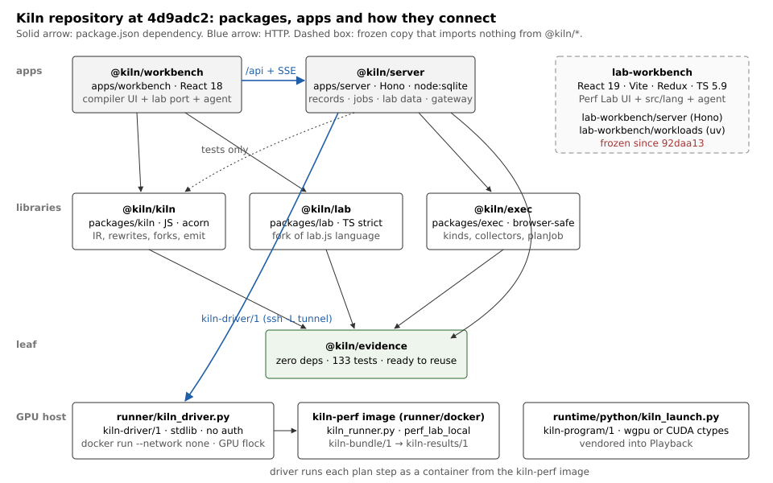
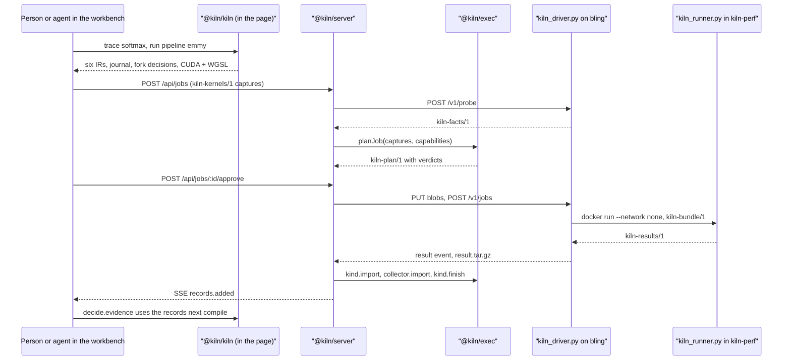
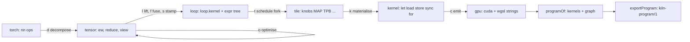
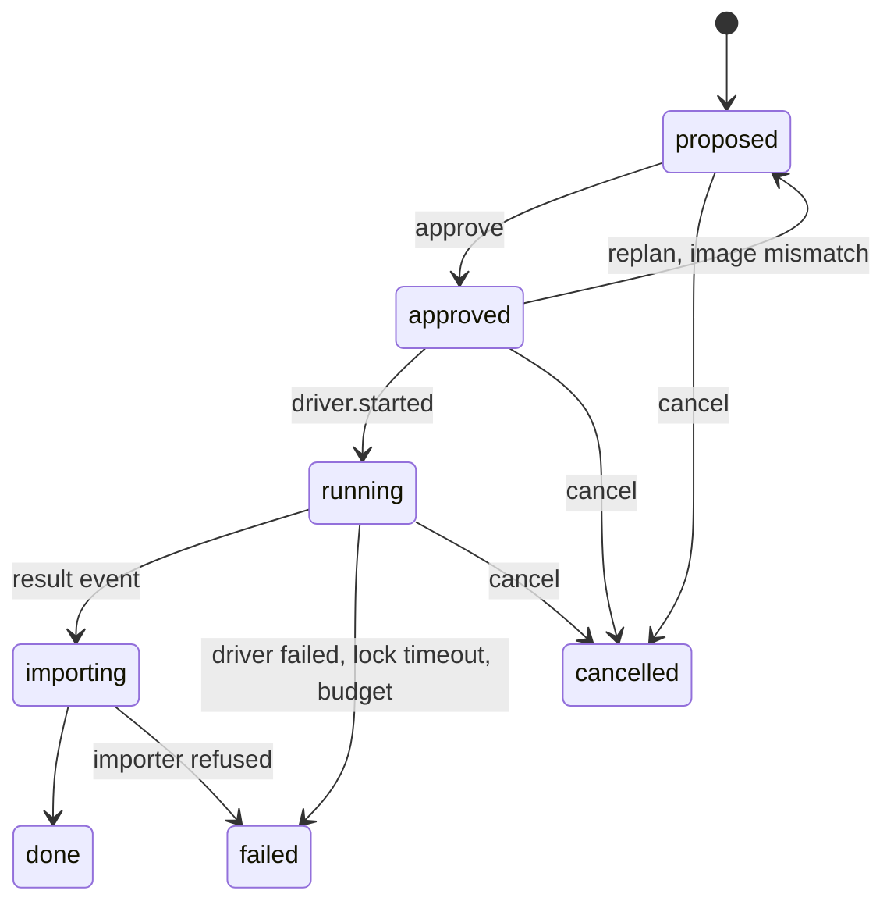
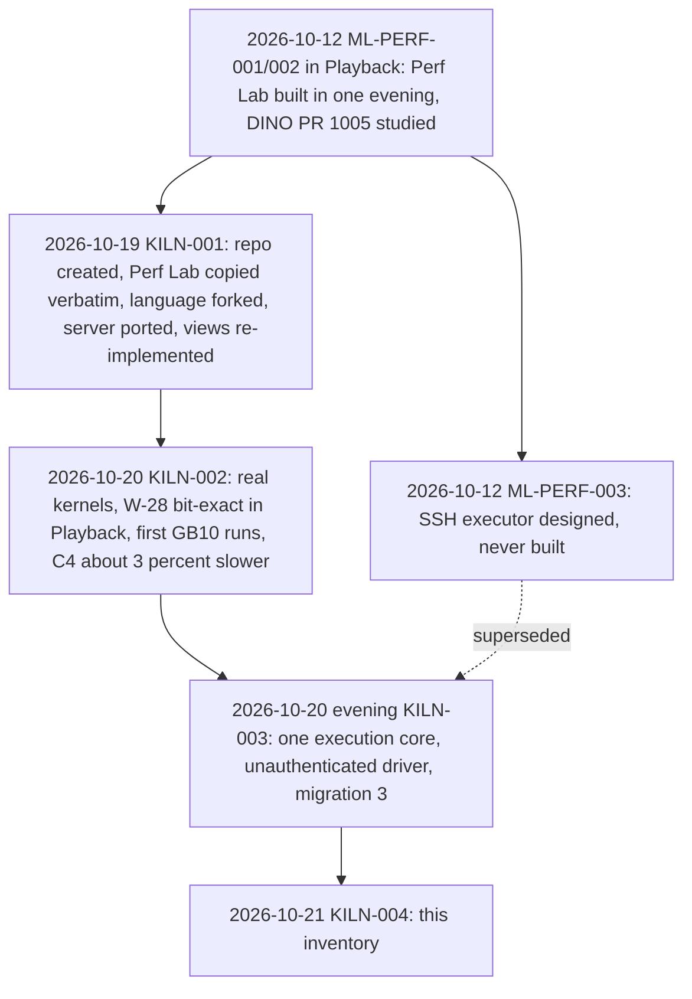
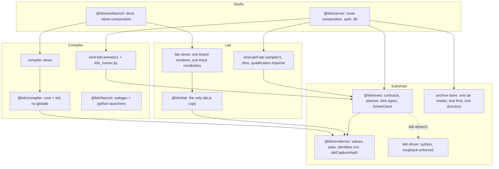

# Intern guide: the Kiln × Perf Lab system, its components and how to separate them again

## How to read this guide

This guide is for someone who has never seen the Kiln repository. It explains what the system is, walks through
each part with file references and APIs, and then turns into an analysis: what is duplicated, where the complexity
is, what can be packaged and reused, and how to pull the system apart into cleaner pieces again.

- **Sections 1–4** are orientation: the two products, a glossary, the repository map, and one end-to-end trace.
- **Sections 5–11** are subsystem walkthroughs. Read the one you are about to touch.
- **Sections 12–16** are the analysis: formats, history, duplication, complexity, reuse.
- **Sections 17–21** are the proposal: target architecture, decisions, a phased plan with done-conditions, tests and
  risks.
- **Section 22** explains the SQLite inventory that backs every table here, so you can query it instead of trusting
  prose.

Every claim comes from one of five inventory passes (areas A–E, see the ticket's `reference/` notes) or from the
orchestrator. All of it was written against **Kiln commit `4d9adc2`** (branch `main`, 66 commits) on 2026-10-21. Paths
are relative to the Kiln repository root, `/Volumes/SSD/code/kiln`, unless they start with `playback:`. Line numbers
drift; search for the symbol name if a line does not match.

---

## 1. What the system is

### 1.1 Two products, one repository

**Kiln** is a small GPU kernel compiler with a workbench page around it. You describe a tensor computation in
JavaScript (`N.softmax(x, -1)`), and Kiln lowers it through six intermediate representations to CUDA and WGSL source.
At each lowering step it records every rewrite and every scheduling decision, so a person can inspect why a kernel
looks the way it does. Kiln can run the kernel in a simulator, in the browser through WebGPU, or on an NVIDIA host
through a CUDA runner. Every timing becomes a **record** with its provenance attached.

**Perf Lab** is an experiment notebook for performance questions about real workloads, in practice Playback's
Grounding DINO detector and its CPU/GPU stages. A performance question ("does PR 1005 halve warm latency?") is written
as a **lab.js program**: experiments with baseline and candidate arms, captures (timing, trace, memory, cpu), derived
tables, hypotheses and boards of views. A six-pass build turns the program into a capture plan. A runner executes the
captures as Python processes, an importer turns their outputs into run bundles, and boards render the evidence.

The two were built separately:

- Perf Lab was built in Playback, ticket ML-PERF-001, on 2026-10-12. ML-PERF-002 extended it the same day.
- Kiln began as a separate "Kiln Workbench" zip.

On 2026-10-19 (KILN-001), both were put into one repository. Perf Lab was copied verbatim into `lab-workbench/`.
Its language was then *forked* into `packages/lab`, and its server ported into `apps/server`. Its views were
re-implemented inside the Kiln page. KILN-002 (2026-10-20) used both on real kernels from Playback and factory-videos.
KILN-003, the same evening, replaced every way of executing work with **one execution core**: a planner, one job API,
and a Python driver on every host.

The result works: 20 jobs ran to completion on two hosts and the tests pass. But it holds two copies of several
things, and the boundaries between "compiler", "lab" and "measurement substrate" are blurred. This ticket maps it so
the pieces can be separated deliberately.

### 1.2 What is running

On this machine, port **5380** is the Kiln server. The process is `node src/index.ts`, with cwd `apps/server`, env
`KILN_PORT=5380` and `KILN_DATA_DIR=/Volumes/SSD/kiln-data/kiln-003`; the default port is 5280. It serves the built
workbench page at `/` and the API under `/api`.

Two drivers are registered as hosts:

| Host    | Address          | Hardware | Reached by                                                           |
| ------- | ---------------- | -------- | -------------------------------------------------------------------- |
| `mac`   | `127.0.0.1:5381` | M1 Pro   | a local driver; runs `perf-lab-sampler/1` in a `perf-lab-cpu` container |
| `bling` | `127.0.0.1:5481` | GB10     | an `ssh -N -L` tunnel to the driver on the DGX Spark                 |

Read-only GETs on 2026-10-21 showed:

- 3 migrations and 2 hosts;
- 20 jobs, all `done` (16 on bling, 4 on mac);
- 21 archives;
- one device, `cuda:nvidia-gb10-e220ce35`, with 12 records.

### 1.3 The three concerns hidden inside

Reading the code, three concerns keep reappearing. Most of this guide's recommendations come down to giving each
one a clear home:

1. **The measurement substrate:** what any performance measurement needs, independent of what is measured. It covers
   provenance-carrying values, statistics, canonical identities, records, verdicts, host facts, the planner, the job
   lifecycle, the GPU-host driver and archive import. It lives today in `@kiln/evidence`, `@kiln/exec`,
   `apps/server/src/exec`, and `runner/kiln_driver.py`.
2. **The kernel compiler:** IR, rewrites, scheduling forks, the cost model, emitters, launchers, the CUDA runner and
   the compiler views. It lives today in `@kiln/kiln`, `runtime/`, `runner/kiln_runner.py`, and most of
   `apps/workbench`.
3. **The experiment lab:** the lab.js language, workloads (sampler, DINO), the qualification importer, datasets,
   boards and hypotheses. It lives today in **two copies**: `lab-workbench/` (frozen original), and `@kiln/lab` +
   `apps/server/src/lab` + `apps/workbench/src/ui/lab` + kind `perf-lab-sampler/1` (live fork).

---

## 2. Glossary

| Term | Meaning | Where it lives |
| --- | --- | --- |
| **IR** | One of Kiln's six stages: `torch`, `tensor`, `loop`, `tile`, `kernel`, `gpu`. Each is a `Graph` whose nodes may only use the dialects that IR declares. | `packages/kiln/src/std/emmy.js` |
| **Dialect** | A named set of op definitions (`nn`, `tensor`, `loop`, `tile`, `kernel`, `gpu`). | `core/kiln.js:76-100` |
| **Rule** | A rewrite `rule(name).from(pattern).to(replacement)` with guards. | `core/kiln.js:621-671` |
| **Pass** | A named set of rules run in `fixpoint`, `once` or `ordered-once` mode. | `core/kiln.js:674-689` |
| **Fork** | A rewrite with several legal outcomes (e.g. schedule knobs). A **decide** policy picks one and records why. | `core/kiln.js:513-618` |
| **Pipeline "emmy"** | The default pipeline: passes `d o l f s t k c` over the six IRs. | `std/emmy.js` |
| **Knobs** | Schedule parameters on a tile kernel: `MAP, TPB, COARSEN, STAGE, BM, BN, BK, TM, TN`. | `std/tile.js` |
| **Kernel identity** | A hash naming a kernel's computation, used as fork key and evidence key. Five copies, one wrong (§14.1). | `std/loop.js:277` and others |
| **`kiln-program/1`** | Exported kernel program: sources, launch geometry, buffers; input to the launchers. | `std/export.js` |
| **Record / `kiln-measure/1`** | One measurement with context and provenance; the unit stored in the `records` table. | `packages/evidence/src/record.ts:8` |
| **Provenance** | Every value is `observed`, `derived`, `heuristic`, `illustrative` or `missing`, and stays so through arithmetic. | `packages/evidence/src/values.ts` |
| **Verdict** | A hypothesis result: `supported`, `refuted`, `open` or `unqualified`. | `packages/evidence/src/verdict.ts` |
| **lab.js program** | A Perf Lab program: `lab(...).experiment(...).derive(...).board(...)`. | `lab-workbench/src/lang/library.ts` |
| **Capture** | One planned measurement: an experiment × arm × capture mode on a host. Its identity is a hash of its lowered spec. | `lang/build.ts:517-625` |
| **Arm** | One side of a comparison (`baseline`, `candidate`, or a matrix point), pinned to a revision and switches. | `lang/builders.ts` |
| **Board** | A layout of views (table, chart, timeline, stepper, …) over derives. | `lang/builders.ts` |
| **Run bundle** | The imported outputs of one repetition of one capture. | `apps/server/src/lab/store.ts` |
| **Kind** | A plug-in that knows how to plan, lower, import and finish one workload type: `kiln-kernels/1`, `perf-lab-sampler/1`. | `packages/exec/src/kinds/` |
| **Collector** | A plug-in that observes a step: `cuda-events`, `ncu`, `nsys`, `gpu-sampler`, `rusage`, … (11). | `packages/exec/src/collectors/` |
| **Mode** | A family of collectors: `timing`, `counters`, `timeline`, `cpu`, `trace`, `memory`. | `collectors/index.ts` |
| **Host / driver** | A machine that runs jobs; it runs `kiln_driver.py`, which speaks `kiln-driver/1`. | `runner/kiln_driver.py` |
| **Facts / capabilities** | What a host's probe found (`kiln-facts/1`) and what the server concludes it can run (`kiln-capabilities/1`). | `packages/exec/src/model.ts` |
| **Plan** | `kiln-plan/1`: the steps a driver will run, with blobs, environments and limits. | `packages/exec/src/plan.ts` |
| **Job** | One approved plan on one host, tracked through seven states. | `apps/server/src/exec/jobs.ts` |
| **cyrb53** | A 53-bit non-cryptographic string hash. Perf Lab's capture name; survives as `lab_hash`. | `packages/exec/src/lab-hash.ts` |

---

## 3. Repository map

### 3.1 The package graph



The internal dependency rule, read from each `package.json`, is simple and currently clean:

```text
@kiln/evidence      → (nothing)
@kiln/exec          → @kiln/evidence
@kiln/kiln          → @kiln/evidence            (+ acorn)
@kiln/lab           → @kiln/evidence
@kiln/server        → @kiln/evidence, @kiln/exec, @kiln/kiln (the last one only in test/decide.test.ts)
@kiln/workbench     → @kiln/kiln, @kiln/lab     (talks to @kiln/server over HTTP)
lab-workbench       → nothing from @kiln/*      (frozen copy, own toolchain)
```

The coupling problems are not at the package level. They are *inside* packages, where an app reaches into another
package's internals, or a core module imports a helper filed under a different concern (§15).

### 3.2 Top-level directories

| Directory | What it is | Size / tests |
| --- | --- | --- |
| `packages/kiln` | `@kiln/kiln`: compiler core (`src/core`, 1,508 lines) and standard library (`src/std`, 3,028 lines) | 13 test suites |
| `packages/evidence` | `@kiln/evidence`: values, stats, identity, records, verdicts (1,051 lines) | 133 tests |
| `packages/exec` | `@kiln/exec`: execution model, kinds, collectors, planner (≈1,960 lines) | 21 tests |
| `packages/lab` | `@kiln/lab`: Kiln's fork of the lab.js language, data layer and presets | 100 tests |
| `apps/server` | `@kiln/server`: Hono + `node:sqlite` API (≈3,000 lines) | 79 tests |
| `apps/workbench` | `@kiln/workbench`: the single-page React 18 workbench, built with esbuild | 5 suites (8 browser/GPU suites skipped by `pnpm test`) |
| `runtime/webgpu`, `runtime/python` | `kiln-program/1` launchers (TS WebGPU; Python wgpu or CUDA) | launcher tests |
| `runner/` | `kiln_driver.py` (host driver), `kiln_runner.py` (in-container CUDA runner), `docker/` (`kiln-perf` image, `kiln-probe.cu`) | exercised by `apps/server/test/jobs.test.ts` |
| `lab-workbench/` | Perf Lab as copied from Playback at `cdb84891c`: React 19 UI, `src/lang`, `server/`, `workloads/` | 104 tests in 11 files |
| `imports/kiln-workbench-src` | The original Kiln Workbench zip, frozen | — |
| `scripts/` | `kiln-export.mjs`, `specimen.mjs`, `shoot.mjs` (CDP screenshots), design checks | — |
| `ttmp/` | docmgr tickets KILN-001 … KILN-004 | — |

### 3.3 Toolchains

Two toolchains coexist, which matters for any merge:

| | Kiln workspace | `lab-workbench` |
| --- | --- | --- |
| React | 18.3 | 19 |
| Bundler | esbuild single-file (`apps/workbench/build.mjs`) | Vite |
| State | module singletons (`wb`, `labs`) | Redux Toolkit slices, react-router |
| TypeScript | 7 (strict, `.ts` imports) | 5.9 |
| Charts / math | hand-rolled SVG, KaTeX | d3, MathJax 4 |
| Agent | one `eval` tool in a sandboxed iframe + worker | pi-ai / pi-coding-agent, in-page `new AsyncFunction` |

`pnpm test` at the root ran green in 55 s on 2026-10-21. `lab-workbench`'s own `pnpm test` passes 104 tests in 11
files.

---

## 4. One trace through the whole system

The fastest way to understand the parts is to follow one kernel from source to a verdict. Each numbered step names
the module that does the work; later sections explain each one.



1. **Trace and compile** (`@kiln/kiln`, in the browser). `k.trace("softmax", ({x}) => ({y: N.softmax(x, -1)}), {x:
   k.tensor([4, 64])})` builds a `torch` graph. `pipeline({target}).run(g)` lowers it to one fused kernel
   `k_softmax_reduce`. The schedule fork had 21 options; the cost model chose `MAP=row, TPB=128`. The run keeps
   `steps[]` (every rewrite), `decisions[]` (every fork) and a checkpoint per IR.
2. **Measure locally (optional).** The `SimDevice` runs the SIMT simulator, and `WebGpuDevice` runs the WGSL with
   protocol `{reps 7, warmup 3, launches 20, seed 1}` (`std/devices.js`). Results become `kiln-measure/1` records
   (`std/records.js`).
3. **Propose a job.** The page posts the kernel captures, kind `kiln-kernels/1`, to `POST /api/jobs`
   (`apps/server/src/exec/routes.ts:58`). The server probes the host (`kiln-facts/1`, cached for 10 minutes) and
   calls `planJob` (`packages/exec/src/plan.ts`). Each capture gets a verdict, `execute`, `cached` or `blocked`.
4. **Approve.** A person approves (`POST /api/jobs/:id/approve`); an agent may propose but never approve. The server
   uploads missing blobs and submits the plan to the driver.
5. **Execute.** The driver takes the GPU lock and runs each step as a `docker run --network none` container from the
   `kiln-perf` image. Inside, `kiln_runner.py` compiles with NVRTC/nvcc, times with CUDA events, and writes
   `kiln-results/1`. Sidecars such as `nvidia-smi -lms 100` run alongside.
6. **Import.** The server long-polls events, fetches `result.tar.gz`, verifies its sha256, and runs the kind's and the
   collectors' importers (`apps/server/src/exec/import.ts`). This writes `captures`, `runs`, `run_bundles` and
   `records`, then emits `records.added` over SSE.
7. **Decide with evidence.** The next compile can use `decide.evidence(store)`, which picks fork options by measured
   time instead of the cost model (`std/emmy.js` `defaultDecide`). Records also feed hypothesis verdicts
   (`@kiln/evidence` `verdict`).

A Perf Lab capture follows the same steps from 3 onwards. The difference is that the captures come from a lab.js
build (§10) and the kind is `perf-lab-sampler/1`.

---

## 5. The compiler: `@kiln/kiln`

### 5.1 The core (`packages/kiln/src/core`)

`core/kiln.js` (1,152 lines) is the whole compiler framework. It knows nothing about tensors or GPUs. Its parts, in
file order:

| Lines | Part | What it gives you |
| --- | --- | --- |
| 9-17 | types | `tensor(shape, dtype)`, `scalar`, `KilnError`, `Skip` |
| 20-40 | **globals** | `SCOPES` (current build scope), `METHODS` (method → dialect fn) and the Proxy that gives values methods (`x.exp()`) |
| 43-100 | ops and dialects | `OpDef` (attrs schema, type inference, print, traits, eval), `Dialect`, **global** `DIALECTS` |
| 107-192 | graph | frozen `Node`, **global** `GID`, `Graph` (`clone, addNode, replaceUses, users, topo, dce, find, key, print, eval`) |
| 352-385 | building | `Builder`, `graph(name, fn)`, `trace(name, fn, inputs)` |
| 388-458 | patterns | `P = {op, oneOf, trait, any, const, var, chain}` |
| 461-511 | params | `param` builders, `ParamSet`, `knobs.canonical/parse` |
| 513-618 | forks and decisions | `fork(options)`, `expandFork` (cap 20,000), `decide.{first, pinned, random, cost, chain, exactly, evidence, strict}` |
| 621-671 | rules | **global** `RID`, `rule(name).from().to().when()` |
| 674-758 | passes and pipelines | `pass(name)`, `Pipeline` (`with, replace, insertAfter, without, insertRule, describe, run`) |
| 761-1094 | **`Run`** | the execution engine (the hotspot, §15) |
| 1134 | `unifiedDiff` | LCS diff for the step viewer |

A rewrite rule reads like this. The rule and pass shapes are real; the body is a sketch:

```js
import { k, rule, pass, P } from '@kiln/kiln/core/kiln.js';

// Pattern variables are bound by the *parameter names* of the lambdas.
const foldDoubleNeg = rule('fold_double_neg')
  .from(({ x }) => P.op('tensor.neg', P.op('tensor.neg', x)))
  .to(({ x }) => x);

const simplify = pass('simplify').mode('fixpoint').rules(foldDoubleNeg);
```

> **Gotcha.** `Rule.from()` and `to()` read the lambda's parameter names **from its source text** with a regex
> (`paramNames`, `kiln.js:665`). Minifying or transpiling rule sources would silently break variable binding. Never
> run `@kiln/kiln` through a minifier.

`Run` (`kiln.js:761-1094`) is one class that schedules passes, checks each IR boundary strictly, matches rules,
evaluates guards, expands forks, records decisions, and journals each step. The journal is a delta per step, plus a
snapshot every 48 rewrites. `Run` also emits UI events. A consumer sees `ok, error, graph, irOrder, at(irName),
steps[], decisions[], stepGraph(i), diff(i)`. Pseudocode for what it does:

```text
run(pipeline, graph):
  for each pass p in pipeline:
    if p is an IR boundary: checkIr(graph, allowed dialects) or fail
    repeat (fixpoint | once | ordered-once), at most 4000 steps:
      for node in topo(graph) from the last rewritten node:
        for rule in p.rules not declined for node:
          m = match(rule.pattern, node); if !m or !guards(m): continue
          r = rule.to(m)
          if r is a Fork: option = decide(policyChain, forkKey(node), options); record decision
          graph = apply(r); recordStep(rule, node)
  return {graph, steps, decisions, at}
```

`core/ix.js` (241 lines) holds index expressions, the affine maps behind views and addresses. `core/script.js` (39
lines) evaluates user scripts. It imports `std/index.js` at line 4, which is a **core → std leak**: the core cannot
be used without the standard library.

### 5.2 The standard library and the "emmy" pipeline (`packages/kiln/src/std`)

`pipeline().describe()` prints the whole compiler on one screen:

```text
pipeline emmy
  ir torch        [nn, tensor]
  d  frontend/decomposition   decompose:nn.ew, decompose:nn.linear, ... decompose:nn.softmax, ...
  ir tensor       [tensor] strict
  o  frontend/optimization    compose_views, fold_splat_view, drop_identity_view, fold_splat_ew, contract_fma
  l  loop/lowering            lift_elementwise, lift_reduce, lift_indexmap, lift_constant_output
  f  loop/fusion              merge_loop_ops
  s  loop/stamp               stamp_loop_names
  ir loop         [loop, tensor] strict
  t  tile/schedule            schedule
  ir tile         [tile, tensor] strict
  k  lowering/kernel          materialize, drop_redundant_syncs
  ir kernel       [kernel, tensor] strict
  c  lowering/emit            emit_sources
  ir gpu          [gpu, tensor] strict
```



| Module | Lines | Role |
| --- | ---: | --- |
| `tensor.js` | 306 | `nn` and `tensor` dialects, builders `N.*`, reference evaluators |
| `loop.js` | 359 | lifting into `loop.kernel`, fusion; module globals and caps |
| `tile.js` | 364 | the schedule fork and the cost model `timeModel` (152-194, nine knobs) |
| `kernel.js` | 318 | Kernel IR statements, materialisation, smem |
| `emit.js` | 254 | CUDA and WGSL emitters, and a SIMT simulator built with `new Function` |
| `devices.js` | 308 | `SimDevice`, `WebGpuDevice`, measurement protocol defaults |
| `records.js` | 208 | `kiln-measure/1` records, `kiln-codegen/2`, `flatKnobs` |
| `store.js` | 174 | evidence store, `kiln-evidence/2` |
| `export.js` | — | `kiln-program/1` |
| `tune.js` | 178 | search over forks: `spmcts`, `sweep` |
| `targets.js` | 19 | `SPECS` for rtx5090, rtx4090, h100, a100, gb10, orin; `gb10` measured with `kiln-probe` on 2026-10-20 |
| `emmy.js` | 37 | the pipeline and `defaultDecide = chain(pinned, evidence(store), costPrior, first)` |

The default decision chain is the link between compiler and measurement. A pinned choice wins; otherwise measured
evidence; otherwise the cost model; otherwise the first option. **Evidence is looked up by fork key**, which is why
the kernel identity bug (§14.1) matters.

### 5.3 What uses the compiler

- `apps/workbench` imports `@kiln/kiln` directly in the page, through `src/compile.js` and the views.
- `scripts/kiln-export.mjs` and `runtime/test/fixtures.mjs` import `apps/workbench/src/compile.js`. A script and a
  runtime test depend on an **app** file; that should be a package export.
- `apps/server/test/decide.test.ts` imports `core/kiln.js`, `std/tensor.js` and `std/emmy.js`. It is the only server
  use.

---

## 6. Launchers and runners

Once compiled, a kernel can run in four places. Each has its own executor:

| Where | Module | Input → output | Notes |
| --- | --- | --- | --- |
| Simulator | `std/emit.js` + `std/devices.js` `SimDevice` | kernel IR → values | `new Function` SIMT interpreter |
| Browser WebGPU | `std/devices.js` `WebGpuDevice.runOnce` | WGSL → timings | used by the workbench |
| WebGPU, standalone | `runtime/webgpu/launch.ts` (160) | `kiln-program/1` → outputs | only its own test uses it, so the browser path is duplicated (§14) |
| Python | `runtime/python/kiln_launch.py` (474) | `kiln-program/1` → outputs | wgpu, or CUDA through ctypes NVRTC; `CudaProgram(allocate=False)` for embedding; **vendored into Playback** with a hash test |
| CUDA in a container | `runner/kiln_runner.py` (281) | `kiln-bundle/1` → `kiln-results/1` | runs inside `kiln-perf`; driven by kind `kiln-kernels/1` |

The `kiln-perf` image (`runner/docker`) carries nvcc 13.0, ncu 2025.3.1.0 and nsys 2025.3.2.474 on bling. It also
holds `kiln-probe.cu` (194 lines), the microbenchmark that measured the GB10 at 259 GB/s read, 28.9 TFLOP/s FMA and
2.4 µs launch.

Stale descriptions to ignore:

- `README.md:40` still documents `kiln_runner.py serve`, which was removed in `49f5156`.
- Some docs mention an `--ncu` flag, which no longer exists.
- `kiln-program-set/1` has a writer (`scripts/kiln-export.mjs`) but no reader in this repository.

---

## 7. The server: `@kiln/server`

### 7.1 Boot, security, routes

`apps/server/src/index.ts` (38 lines) loads `config.ts`, which maps the environment to a config. It then opens the
database and mounts `app.ts`. `security.ts` (48 lines) does three things:

- it checks `Host` and `Origin` against an allow-list;
- it requires `X-Kiln-Token` on **every non-GET**;
- it enforces the content type.

The HTTP surface, condensed (the full table with handlers is in notes C §2.3 and the `endpoints` table):

| Group | Routes | Notes |
| --- | --- | --- |
| health | `GET /api/health` | version, migrations, hosts, features, SSE clients |
| records | `GET/POST/DELETE /api/records`, `GET /api/devices` | records validated with `validateRecord`, insert-or-ignore by id |
| hosts | `GET /api/hosts`, `GET /api/hosts/:id/capabilities`, `POST /api/hosts/:id/probe` | probe pushes a new driver first if its sha256 differs |
| jobs | `GET /api/jobs`, `GET /api/jobs/:id`, `GET /api/jobs/:id/plan`, `POST /api/jobs`, `POST …/approve`, `…/cancel`, `…/reimport` | `POST /api/jobs` supports `dryRun`; header `x-kiln-proposer: user|agent` |
| archives | `GET /api/archives`, `GET /api/archives/:sha`, `POST /api/archives` | two storage directories (§14) |
| events | `GET /api/events` | SSE: `hello`, bus events, `ping` every 15 s |
| agent | `POST /api/agent/sample`, `GET /api/agent/usage` | Anthropic Messages proxy, streamed as NDJSON; `llm_calls` accounting |
| lab | `GET/PUT/DELETE /api/lab/programs/:labId`, `GET /api/lab/catalog`, `GET /api/lab/bundles`, annotations, datasets, `GET /api/lab/media/:sha` | Perf Lab response shapes over Kiln tables; `POST /api/lab/datasets/:id/materialize` answers **501** |
| page | `GET /`, `GET /index.html` | the built workbench |

### 7.2 Database (`apps/server/src/db.ts`, schema "kiln")

The schema is built by three migrations:

1. **Migration 1** creates `records`, `devices`, `sources`, a first `jobs`/`job_events`, and `llm_calls`.
2. **Migration 2** adds Perf Lab's tables with a `lab_` prefix: programs, artifacts, runs, run bundles, jobs,
   annotations, evidence archives, datasets and media.
3. **Migration 3** is KILN-003's "one execution core". It drops `lab_job*` and the first `jobs`. It creates `jobs`,
   `job_events`, `job_captures`, `captures`, `runs`, `run_bundles` and `archives`. `captures` is seeded from
   `lab_artifacts where origin='measured'`.

```text
jobs(id, status, proposed_by, host, reason, spec_json, spec_sha256, plan_sha256, plan_steps,
     archive_sha256, result_json, created/approved/submitted/started/finished_at, executor_ms, driver_seq, error)
job_captures(job_id, seq, idx, capture, kind, pair_id, mode, collectors_json, label, verdict, reason)
captures(hash PK, kind, lab_id, lab_hash, experiment, arm, mode, host, reps, spec_json, origin, status, ..., job_id)
runs, run_bundles(gzip JSON)      archives(sha, ..., job_id)
```

Dead weight to remove in a future migration:

- `sources` is never read or written;
- `devices.spec_json` is never written;
- the comment at `db.ts:9-10` describes the dropped first `jobs` table.

### 7.3 The model gateway (`agent.ts`, 322 lines)

The server's "agent" is a **model gateway**, not an agent. It validates a sample request, estimates prompt tokens,
adds a `cache_control` breakpoint, and re-emits Anthropic's SSE stream as NDJSON. It writes one `llm_calls` row per
call. Tools run in the page, not on the server, and no transcripts are stored. Perf Lab's assistant
(`lab-workbench/server/assistant/service.ts`, pi-coding-agent, conversations/messages tables) is a different design
and was not ported.

---

## 8. The execution core: `@kiln/exec`, jobs and the driver

### 8.1 The two plug-in contracts

`packages/exec` is browser-safe (no `node:` imports) and depends only on `@kiln/evidence`. Its centre is two
interfaces in `registry.ts`. Abridged:

```ts
interface WorkloadKind {
  id: string;                         // 'kiln-kernels/1' | 'perf-lab-sampler/1'
  environments: Environment[];        // container images it can run in
  requires: Requirement[];            // checked against kiln-facts/1
  inProcess: string[];                // collectors it cooperates with in-process
  assets: Asset[];                    // staged sources (part of the content id)
  nvtxRange?: string;                 // declared, set by no kind
  accept(capture): Verdict;           // can this capture run here?
  lower(group, ctx): Step[];          // captures → plan steps
  import(step, ctx): Observation[];   // step outputs → observations
  finish?(job, ctx): Record[];        // observations → kiln-measure/1 records
  lab?: LabAdapter;                   // Perf Lab catalog shape
}

interface Collector {
  id: string;                         // 'ncu', 'nsys', 'gpu-sampler', ...
  shape: 'wrapper' | 'in-process' | 'sidecar';
  requires: Requirement[];
  disturbs: boolean;                  // perturbs timing → planner adds a timing companion
  exclusive: boolean;
  apply(step): Step;                  // wrap argv, add env, add sidecar
  import(step, ctx): Observation[];
}
```

The registered set is `KINDS = [kiln-kernels/1, perf-lab-sampler/1]`. There are eleven collectors:

- `cuda-events`, `ptxas`, `nvtx`, `stage-timers`, `wall-clock`, `rusage`;
- `torch-profiler`, `torch-memory`;
- `ncu`, `nsys`, `gpu-sampler`.

They fall into six modes: `timing`, `counters`, `timeline`, `cpu`, `trace` and `memory`. `nvtx` and `stage-timers`
are registered but never usable, because "no registered kind cooperates".

### 8.2 The planner

`planJob(input)` (`plan.ts`) works in five passes:

```text
planJob({captures, host, capabilities, catalog, protocol}):
  1. verdict each capture: execute | cached (runs exist) | blocked (reason)
  2. group executable captures by kind | collectors | pairId
  3. if a group asks for ncu: add a timing companion step (counters disturb timing)
  4. order repetitions with @kiln/evidence repetitionOrder(seed, rep), interleaving paired arms
  5. apply in-process collectors, then wrappers; emit kiln-plan/1 with limits
```

The limits in `PLAN_LIMITS` are:

- captures 256, group 64;
- reps 64, warmup 1000, launches 10,000;
- archive 1 GiB, minimum free disk 5 GiB, step output 64 MiB.

Capture identity (`identity.ts`) is `sha256(canonicalJSON({format: 'kiln-capture/1', kind, content, collectors,
protocol, device, environment}))`. Device keys look like `gpu:<uuid>` or `cpu:<arch>:<model>:<cores>`.

### 8.3 The job state machine (`apps/server/src/exec/jobs.ts`, 495 lines)



Rules that `Jobs.create` enforces:

- An agent may propose but not approve its own job (403 `agent_cannot_approve`).
- Agent jobs share a 24-hour executor budget (429 `agent_budget_exhausted`). A job cancelled because the budget ran
  out mid-run ends as `failed`, not `cancelled`.
- An unreachable host is 503 `host_unreachable`.
- A `dryRun` returns the plan and stops.

The private pipeline, in order:

1. `follow` → `drive`. Submission is serial per host.
2. `submit`:
   - re-check the plan's images against fresh facts; on a mismatch, go back to `proposed`;
   - `HEAD`/`PUT` the blobs the driver lacks;
   - `POST /v1/jobs`.
3. Long-poll `GET /v1/jobs/:id/events?after=driver_seq`. At most 400 `step.output` events are stored per job.
4. On the `result` event, `collect`:
   - fetch the archive and verify its sha256;
   - store it, and list it into `archives`;
   - `importArchive`;
   - `DELETE /v1/jobs/:id`.
5. `resume()` at start-up re-follows approved, running and importing jobs.

> **The replan edge.** It is missing from the file's own header diagram. Approval cannot be bypassed: `approve` only
> works from `proposed`. But the stored plan file is kept, so re-approving re-submits the same plan, which replans
> again. In practice it is a dead end; the event text tells the user to propose a new job.

### 8.4 The driver (`runner/kiln_driver.py`, 1,044 lines, `kiln-driver/1`)

The driver is one stdlib-only Python process per host:

```bash
python3 kiln_driver.py serve --root ~/kiln-exec --listen 127.0.0.1:5281
```

It is **plain HTTP without authentication, by decision (2026-10-20)**. Its header tells you to "bind it to the one
address the server reaches". bling's driver is reached through an SSH tunnel.

| Method | Path | Contract |
| --- | --- | --- |
| GET | `/v1/info` | api, driver sha256, hostname, root, running, queued |
| POST | `/v1/probe` | `kiln-probe-request/1` → `kiln-facts/1` |
| HEAD/GET/PUT | `/v1/blobs/:sha` | content-addressed blobs; PUT 400 if the bytes do not hash to the name |
| POST | `/v1/jobs` | `kiln-plan/1` → 202 `{position}`; 409 missing blobs |
| GET | `/v1/jobs`, `/v1/jobs/:id/plan` | listing (no server caller), stored plan |
| GET | `/v1/jobs/:id/events?after=N&wait=S` | long-poll, ≤ 60 s, ≤ 1000 events |
| POST | `/v1/jobs/:id/cancel` | kills the running container |
| GET | `/v1/jobs/:id/archive` | `result.tar.gz`; 409 before the end |
| DELETE | `/v1/jobs/:id` | removes an ended job |
| PUT | `/v1/self` | new driver source: compile check, then re-exec; 409 while busy |

For each job, the worker:

1. Checks free disk.
2. Takes `fcntl.flock` on `/run/lock/kiln-gpu-<uuid>.lock`.
3. Records GPU conditions before and after each step.
4. Runs each step as:

   ```text
   docker run --rm --init --network <profile, default none> --user uid:gid
     -v bundle:/job/in:ro -v out:/job/out [+ cache/tool mounts]
   ```

5. Runs sidecars.
6. Trims outputs above `maxOutputBytes`.
7. Appends `steps.ndjson` and writes `execution.json` (`kiln-execution/1`).
8. Packs `result.tar.gz` and emits exactly one final `result` event.

One quirk: `events.ndjson` inside the archive is packed *before* that final event, so the archive lacks it.

### 8.5 Importing an archive (`apps/server/src/exec/import.ts`)

```text
importArchive(db, job, archive):
  files = readTarGz(archive, limit = plan.limits.archiveBytes + 64 MiB)
  exec  = files['execution.json']                     # kiln-execution/1
  for step in exec.steps:
    obs  = kind.import(step) + Σ collector.import(step)   # nsys via node:sqlite tables (nsys-sqlite.ts)
    runs = stepRuns(obs)
    upsert captures, runs, run_bundles (gzip JSON)
  records = kind.finish(job) → insertRecords          # kiln-measure/1
  set devices.host
```

The execution core depends on helpers filed under the Perf Lab port:

- `exec/jobs.ts` imports `../lab/files.ts` and `../lab/tar.ts`;
- `exec/import.ts` uses `lab/store.ts` `pack`.

This is the clearest **filing** problem in the server (§15).

---

## 9. Evidence: `@kiln/evidence`

This is the most reusable code in the repository. It has zero runtime dependencies, no `node:` imports and 133 tests.
Four packages consume it.

| Module | Exports | What to know |
| --- | --- | --- |
| `values.ts` | `observed, derived, heuristic, illustrative, missing, combine, seal, raw, num` | Arithmetic propagates the weakest provenance; `ProvenanceError` on misuse |
| `stats.ts` | `median, quantile (type 7), rng (mulberry32), summarize (bootstrap CI), pairedRatio, separated` | `pairedRatio` bootstraps over processes, 2000 resamples |
| `protocol.ts` | `repetitionOrder(seed, rep), checkSamples` | Interleaves paired arms reproducibly |
| `sha256.ts` | `sha256Hex, isSha256Hex` | Pure JS, works in the browser |
| `canonical.ts` | `canonicalJSON` | The input to every SHA-256 identity |
| `identity.ts` | `contentId, deviceId, cudaDevice, slug` | |
| `record.ts` | `RECORD_FORMAT='kiln-measure/1', validateRecord, recordId, poolKey, isDecisive` | The server refuses invalid records |
| `verdict.ts` | `verdict → supported/refuted/open/unqualified, below, above` | Used by both the Kiln page and `@kiln/lab` |

A hypothesis check, end to end (the call shapes are a sketch; check the signatures in `stats.ts` and `verdict.ts`):

```ts
import { pairedRatio, verdict, below } from '@kiln/evidence';

const r = pairedRatio(baselineMs, candidateMs, { seed: 1 }); // {ratio, lo, hi} over processes
const v = verdict({ claim: below(r, 0.5), qualified: gatePassed }); // 'supported' | 'refuted' | 'open' | 'unqualified'
```

> **Reproducibility gap.** In Perf Lab, the seed passed to `pairedRatio` is ignored, so confidence intervals can move
> between renders of the same runs. Any result that decided something (§13) should be re-derived with a fixed seed.

---

## 10. Perf Lab: the lab.js language, its server and its fork

### 10.1 A lab.js program

```js
lab('Hello, Perf Lab')
  .experiment('dino-warm', (e) => e
    .question('Does PR 1005 lower warm backend latency on the same work?')
    .workload(dino({ fixtures: 'coco-128', precision: 'fp16', inputSize: 768 }))
    .boundary('backend_cpu_result')
    .baseline(rev('a6f14d94')).candidate(rev('d59d9ad0'))
    .capture(capture.timing()))
  .derive('latency', q.requests('dino-warm/*/timing'),
          (r) => r.groupBy('arm').agg({ latency: [count, p50, p95, max] }))
  .board('overview', (b) => b.title('Warm latency, baseline and candidate')
    .add(table('latency')).add(chart('latency')));
```

**Evaluation.** `evaluateProgram` compiles the source with `new Function(...libNames, '"use strict"; …')`
(`lang/build.ts:72-96`). There is no sandbox beyond strict mode. Every builder is wrapped by a **recorder Proxy**
(`builders.ts:17-34`):

- real methods run;
- any other method name is recorded as a property;
- when the builder declares its methods, an unrecorded name becomes an `unknown-method` lint.

View kinds absent from `VIEW_METHODS` (`detections`, `gallery`) accept any method silently.

**The six passes** (`lang/build.ts`):

| # | Pass | Output |
| --- | --- | --- |
| 1 | structure | lab/experiment/arm/board/view/derive/param nodes, `contains` edges |
| 2 | expand · resolve | arms × captures → capture instances; plan lambdas resolved; `NeedsEvidence` defers captures to plan stage 2 |
| 3 | trace | dry-run live lambdas and derives to learn which params they read; binding phase `plan > data > view` |
| 4 | validate | ~25 lint codes (`no-quality-gate`, `no-repetition`, `param-unused`, …) |
| 5 | lower | one perf_lab spec per capture instance |
| 6 | plan | stage 0 capabilities, stage 1 captures, stage 2 evidence-dependent; each `cached`, `import`, `execute` or `blocked` |

Built headlessly, the program above yields 12 nodes and 2 capture instances, plus three lints:

- `no-quality-gate`: results will be marked unqualified;
- `no-activation-rule`: a silent fallback would count as a candidate result;
- `no-repetition`: one process per arm cannot support a comparison.

**Capture identity.**

```text
spec = { schema_version: 1, experiment_id, arm, host, workload, comparison, state, warmup, expect,
         phases, offer, admission, deadline, repeat: {processes}, collection: {mode, ...},
         quality_gate_sha256, evidence? }
hash = cyrb53(stableStringify(spec))      # 13–14 hex digits
```

> **Naming hazard.** `quality_gate_sha256`, and `fixture_manifest_sha256` when there is no dataset, are **cyrb53**
> values, not SHA-256. Renaming the fields would change every spec's hash and orphan every stored capture. Fix it by
> introducing `schema_version: 2`, not by editing v1.

### 10.2 The Perf Lab server and workloads (`lab-workbench/server`, `lab-workbench/workloads`)

The server is Hono + `node:sqlite` with 24 `/api` routes, 9 assistant routes and 5 migrations:

- programs, catalog, seed, bundles, jobs, annotations, evidence, datasets, media, hosts;
- `/api/assistant/*` for transcripts.

The runner (`server/runner.ts`, 380 lines) executes one job and one process at a time. It shuffles arms per
repetition with `rng("${paired_order_seed}:${rep}")`. Each repetition spawns:

```text
uv run --project workloads python -m perf_lab_local.run --spec <data>/<hash>/spec.json --rep N --out <data>/<hash>/rep-N
stdout: one JSON event per line {start|warmup|request|done|error}
rep-N/: manifest.json activation.json quality.json timing.json cpu.json trace.json memory.json
```

`perf_lab_local/sampler.py` implements deformable-attention sampling three ways: `unfused`, `gather`, and `compiled`
through TorchInductor. `perf_lab_dino/run.py` runs both DINO arms in one process and writes the PR 1005
qualification layout. `server/qualification.ts` (394 lines) imports that layout as `detection-qualification/v1`.

### 10.3 The fork: `@kiln/lab`

`packages/lab` is Kiln's copy of `lab-workbench/src/lang`, plus its data layer and presets. Of the 16 language files:

- **9** differ only mechanically, from the strict tsconfig (`.ts` imports, `| undefined`, `!`).
- **3** have small semantic edits:
  - `build` emits a lowered normal form;
  - `runtime` seals its rows;
  - `library` adds `below`/`above`.
- **4** are rewritten on `@kiln/evidence`: rows, values, stats and util.

`packages/lab/scripts/check-pl.ts` (`check:pl`) proves the two builds are equivalent on the presets. It is the only
seam that keeps the copies honest, and it **needs `lab-workbench` on disk**.

The only consumer of `@kiln/lab` is `apps/workbench`. The Kiln server does not import it; it serves Perf Lab
*response shapes* over its own tables (`apps/server/src/lab/*`).

Perf Lab's execution now runs on Kiln's core: `perf_lab_local` is wrapped as kind `perf-lab-sampler/1`, in a
`perf-lab-cpu` container behind the Mac driver. Perf Lab's DINO path and its qualification importer were **not
ported**. Kiln therefore recognises only COCO datasets in evidence archives, not `detection-qualification/v1`
reports.

---

## 11. The workbench page: `@kiln/workbench`

### 11.1 Build and state

`apps/workbench/build.mjs` bundles one HTML file with esbuild. It also writes four generated modules:

- `presets.gen.js`;
- `labs.gen.js`;
- `docs.gen.js`;
- `frame.gen.js`, the agent sandbox frame.

The CSS order list is duplicated in `scripts/specimen.mjs`.

State lives in two **module singletons**:

- `wb` (`src/ui/wb.js`, 506 lines) holds the project, compile results, channels and the `useLab` hook; it persists
  to `localStorage`.
- `labs` (`src/ui/lab/state.js`, 210 lines) holds lab programs, builds and bundles.

`server-client.js` and `server-sync.js` talk to the server: REST plus SSE, with record sync. `server-client.js`
keeps its own `EVENT_TYPES` list, a copy of the server's event names.

### 11.2 Layout: the dock and its views

`dock.js` (layout engine) and `Dock.jsx` (309 lines, a state machine) place **views** from `views.jsx`:

- `notes, code, agent, reference`;
- `ir, graph, trace, kernels, perf, knobs, tune`;
- `evidence, hypotheses, devices, jobs, events`;
- `lab, inspect, board:<id>`.

A board view renders one of 21 panel kinds. The largest view files are:

| File | Lines | Contents |
| --- | ---: | --- |
| `Perf.jsx` | 528 | three views in one file, including a roofline chart |
| `ui/lab/charts.jsx` | 503 | lab charts |
| `Compiler.jsx` | 358 | layered DAG layout |

### 11.3 The page agent

The agent has exactly one tool, `eval`. It runs JavaScript in a sandboxed iframe plus worker (`agent/sandbox.js`,
`frame.js`), so agent code cannot touch the page. Sampling goes either through the server relay
(`/api/agent/sample`) or through the claude.ai host bridge.

- `agent.js` (551 lines) builds the agent's scope (`makeAgentScope`, lines 357-537).
- The model-tier setting is inert on the relay (`gateway.js:19`).
- The agent has **no lab namespace**: it cannot build or run a lab program.

Compare Perf Lab's agent (`lab-workbench/src/features/agent/runtime.ts`, 639 lines). It evaluates with an in-page
`new AsyncFunction` (`runtime.ts:443`), with full access to the page, its fetch and its state.

### 11.4 The lab port

`src/ui/lab/*` (2,468 lines of JS/JSX + 221 CSS) is a hand re-implementation of Perf Lab's views inside the dock:
`LabView`, `board.jsx`, `panels.jsx`, `charts.jsx`, `inspect.jsx`, `media.jsx`. It duplicates Perf Lab's trace
vocabulary: the `ROLE_FILL` regexes that colour kernels by Inductor prefix, the mirror lanes and the outcome shapes.
Inside the page:

- three separate VERDICT display maps;
- two hypothesis systems (`@kiln/kiln` `std.evidence` and `@kiln/lab` `lang/hypothesis`);
- two markdown renderers (`md.js`, `doc.js`);
- `plural` defined five times.

Dead exports in `common.jsx`: `useStateRef`, `useInterval`, `useFrame`, `stateLabel`, `isBad`.

---

## 12. Formats

Every file, wire message and record format, with its definition site. When you change one, find every row with the
same name in the `formats` table first.

| Format | Kind | Producer → consumer | Defined at |
| --- | --- | --- | --- |
| kiln IR checkpoints | ir | pipeline → workbench views | `packages/kiln/src/std/emmy.js` |
| `kiln-program/1` | file | `exportProgram` → launchers, Playback, factory-videos | `packages/kiln/src/std/export.js` |
| `kiln-program-set/1` | file | `scripts/kiln-export.mjs` → (no reader in repo) | `scripts/kiln-export.mjs` |
| `kiln-codegen/2` | manifest | records → evidence store | `packages/kiln/src/std/records.js` |
| `kiln-evidence/1`, `/2` | file | evidence export/store | `std/records.js`, `std/store.js` |
| `kiln-measure/1` | record | devices, kinds' `finish`, page → `records` table | `packages/evidence/src/record.ts:8` |
| `kiln-hosts/1` | file | operator → `loadHosts` | `packages/exec/src/hosts.ts:5` |
| `kiln-driver/1` | protocol | driver ↔ `DriverClient` | `runner/kiln_driver.py:53` |
| `kiln-probe-request/1`, `kiln-facts/1` | wire | server ↔ driver probe | `packages/exec/src/model.ts:92-103` |
| `kiln-capabilities/1` | wire | server → page | `model.ts:139-141` |
| `kiln-plan/1` | manifest | `planJob` → driver | `model.ts:257-262` |
| `kiln-capture/1` | manifest | capture identity input | `packages/exec/src/identity.ts:6` |
| `kiln-bundle/1`, `kiln-results/1` | wire | `kiln-kernels` kind ↔ `kiln_runner.py` | `kiln-kernels.ts:121,156`; `kiln_runner.py` |
| `kiln-execution/1`, `result.tar.gz` | record, archive | driver → importer | `kiln_driver.py:614,624` |
| `kiln-probe/1` | record | `kiln-probe.cu` → `gb10` spec | `runner/docker/kiln-probe.cu` |
| `kiln-paired/1` | archive | KILN-002 C4 scripts → Kiln | KILN-002 guide |
| lab.js program, lab IR/1 | file, ir | presets/people → build → views | `lab-workbench/src/lang/{library,ir}.ts` |
| perf-lab capture spec/1 | record | `makeInstance` → runner, workloads, catalog | `lab-workbench/src/lang/build.ts` |
| perf-lab workload event stream, rep record | protocol, file | `perf_lab_local.run` → runner | `lab-workbench/workloads/perf_lab_local/run.py` |
| perf-lab run bundle | record | importer → boards | `lab-workbench/server/importer.ts` |
| `detection-qualification/v1` | archive | PR 1005 scripts, `perf_lab_dino` → `qualification.ts` (Perf Lab only) | `lab-workbench/server/qualification.ts:16-115` |
| lab capture hash (cyrb53 `lab_hash`) | manifest | lab build → catalog lookup | `packages/exec/src/lab-hash.ts` |
| agent eval wire | protocol | page ↔ sandbox frame | `apps/workbench/src/agent/encode.js` |
| `kiln-wb` localStorage state | record | `wb` ↔ browser | `apps/workbench/src/ui/wb.js` |

---

## 13. How it got this way



The pace explains much of the duplication:

- Perf Lab was built in about 6 hours of commits.
- The unification took about 4.5 hours.
- The execution core was designed twice and half-built between 20:18 and 23:49 on one evening.

Copies were made to move fast, and the seams to retire them were deferred. Three decisions reversed within hours or
days:

1. **How a GPU host is reached.** The chain was SSH (ML-PERF-003), then a subprocess over SSH, "no network-exposed
   execution endpoint" (KILN-001 D10). KILN-003 v1 had `local` + `ssh` transports, and v2 an unauthenticated HTTP
   driver on every host. SSH survives as an unmanaged `ssh -N -L` tunnel.
2. **Capture identity.** KILN-001 D3 said SHA-256 everywhere, but cyrb53 was kept. KILN-003 §12.2 retired cyrb53
   again, yet it survives as `lab_hash` beside the SHA-256 `captureId`. Every capture has two identities.
3. **Synthetic hosts and CPU lab runs.** KILN-003 planned to remove both. CPU lab runs came back the same evening as
   `perf-lab-sampler/1`. Synthetic host reports remain the fallback (`packages/lab/src/data/capabilities.ts:11-24`).

Results that decided something, and which the substrate must keep reproducible:

| Claim | Result | Verdict |
| --- | --- | --- |
| PR 1005 `latency-halved` (dgx) | reduction 0.303 [0.301, 0.306] | refuted |
| PR 1005 outputs exact, fusion active | 512/512 exact; `fused_sampling` 18 launches | supported |
| W-28 exactness (redaction mask post) | 0 of 269 M kernel pixels differ | exact |
| W-28 stage speed (dgx) | 6.8× (3.34 vs 22.63 ms) | — |
| `gb10-unchanged-or-better` (C4 on bling) | throughput 0.974 / 0.971 / 0.968 | refuted |
| Kiln cost model on GB10 | W-28 over-predicted 6.6–115× | model defect |

Ticket status disagrees with the code in places:

- KILN-003 P1 is ticked, but its `kiln-probe/1` kind does not exist.
- The `ncu`/`nsys` collectors exist while P2 is still open.
- KILN-001 8d (entity graph) was never started, yet `corresponds_to` edges are emitted as data
  (`packages/exec/src/runs.ts:57`).

---

## 14. Duplication matrix

The inventory lists 59 duplication rows. They collapse into **nine pieces of knowledge**, each implemented more than
once. This counts duplicated *knowledge* (one invariant enforced in several places), not duplicated characters.

| # | Knowledge | Copies | Canonical side today | Drift seam today | Severity |
| --- | --- | --- | --- | --- | --- |
| 1 | Lab capture hash (cyrb53 + `stableStringify`) | `lab-workbench/src/lang/util.ts`, `packages/lab/src/lang/util.ts`, `packages/exec/src/lab-hash.ts` (+ Kiln's own `core/util.js` hash, different purpose) | `@kiln/exec` | `importer.ts:222` re-verifies on import | high |
| 2 | Kernel identity formula | `std/loop.js:277`, `tile.js:346`, `kernel.js:294`, `program.js:19,38` | none; `loop.js` is **wrong** (omits dtype) | none | high |
| 3 | lab.js language | `lab-workbench/src/lang` vs `packages/lab/src/lang` (+ data layer, presets, synthetic capabilities) | `@kiln/lab` | `check:pl` | high |
| 4 | Lab views and board frame | `lab-workbench/src/components/organisms/views` vs `apps/workbench/src/ui/lab` (+ trace vocabulary, verdict maps ×3, hypothesis cards) | the Kiln port (live) | none | high |
| 5 | Page agent runtime | `lab-workbench` `runtime.ts` (in-page) vs `apps/workbench/src/agent` (sandboxed) (+ chat UI) | Kiln's sandbox | none | high |
| 6 | Perf Lab server modules | tar 0.73, events 0.73, importer→kind 0.65, datasets 0.64, evidence 0.64, db helpers 0.39; archive registration ×2; schema 5 ×3 | Kiln (`lab-workbench` frozen since `92daa13`) | none | medium |
| 7 | Host-side execution plumbing | nvidia-smi query ×3, NVRTC ctypes ×2, WebGPU execution ×2, protocol defaults ×3, CUDA entry symbol ×6, mulberry32 ×2, fixture generator ×2, target specs | none | vendored launcher hash test (Playback) | medium |
| 8 | Wire types | `HostView` ×3 (one untyped), server event names ×2 | server | none | medium |
| 9 | Frozen whole copies | `imports/kiln-workbench-src`, `lab-workbench/` | the split homes | manual `diff -rq` | low (but they inflate every search) |

### 14.1 The ones that are bugs, not just smells

- **#2, the kernel identity bug.** The schedule fork is keyed while a node is still a `loop.kernel`, and
  `loop.js:277` builds that key without the input dtype. A probe with `floor((rgb + 1) * 0.5)` on `(8, 64)` showed:

  ```text
  f32 fork key 302w2uv760 kernel identity 302w2uv760  activation ["decided by model"]
  u8  fork key 302w2uv760 kernel identity 2dbf6f6auuk activation ["no schedule fork decided this kernel"]
  ```

  So f32 evidence can decide a u8 kernel's fork, and pins recorded against the u8 identity never match. KILN-002's
  real kernels are u8 image kernels, which makes this the most consequential duplication in the repository.
- **#1, the hash with two names.** It is safe only while three files stay bit-identical; nothing tests them against
  each other except the importer's re-verification.
- **#6, two archive registration paths.** They have three different size limits (64 MiB, a 2 GiB read limit, a
  1 GiB plan limit) and two directories. `GET /api/archives/:sha` searches both.

### 14.2 Where the copies are allowed to stay (for now)

- The `kiln_launch.py` copies in Playback (`services/redaction/src/kiln/`) and factory-videos are *vendored on
  purpose*, pinned by a hash test. That is the right pattern for crossing a repository boundary. Keep it, and
  publish the launcher properly later (§17).
- `lab-workbench/` must stay until `check:pl`'s golden outputs are frozen elsewhere, because `check:pl` runs against
  it (§19, phase 3).

---

## 15. Complexity map

Complexity concentrates in a few files. Ranked by how much a change there can break:

| File | Lines | Why it is hard | What would help |
| --- | ---: | --- | --- |
| `packages/kiln/src/core/kiln.js` | 1,152 | `Run` is a god class of ~330 lines and 20 methods; module globals `SCOPES/METHODS/DIALECTS/GID/RID`; rules bind by parsing source | Split `Run` into scheduler, matcher, fork/decision recorder and journal; move globals onto a `Kiln` instance |
| `runner/kiln_driver.py` | 1,044 | HTTP, queue, GPU flock, docker argv, sidecars, output limits, recovery and self-update in one file, unauthenticated | Split into protocol / worker / container modules; keep stdlib-only |
| `lab-workbench/src/lang/build.ts` (and its fork) | 1,030 | six passes, `NeedsEvidence` control-flow exception, binding inference by dry-run tracing, ~25 lints | One copy (§17); pass-per-module |
| `lab-workbench/src/data/generate.ts` (and fork) | 724 | synthetic run generator still on the default path | Move behind an explicit demo flag |
| `lab-workbench/src/features/agent/runtime.ts` | 639 | in-page `AsyncFunction` eval | Retire in favour of the sandbox |
| `apps/workbench/src/agent/agent.js` | 551 | `makeAgentScope` builds the whole agent surface in one function | Namespaces per concern (compiler, records, jobs, lab) |
| `apps/workbench/src/ui/Perf.jsx` | 528 | three views in one file | One file per view |
| `apps/workbench/src/ui/wb.js` | 506 | global singleton with high fan-in | Split project, compile, channels, persistence |
| `apps/server/src/exec/jobs.ts` | 495 | seven states over eight methods, two schedulers, resumable long-poll, a replan edge missing from its diagram | Transition table as data; one test per edge |
| `runtime/python/kiln_launch.py` | 474 | ctypes FFI surface for NVRTC and CUDA driver | Already isolated; keep the hash test |
| `apps/server/src/db.ts` | 415 | migration 3 rewrites migration 2; dead table and column | Migration 4 to drop dead weight |
| `packages/kiln/src/std/tile.js` | 364 | the cost model: nine knobs, over-predicts gathers on GB10 | Calibrate against `kiln-probe` evidence |

**Module-level state** is the other complexity source:

- the compiler's globals;
- `VIEW_FNS` in `tensor.js`;
- the page singletons `wb` and `labs`.

Each makes tests order-dependent and blocks two instances in one process, for example two pipelines with different
dialect sets.

---

## 16. Reusable component catalog

The `reusable_components` table holds 36 rows. This is the condensed catalog, grouped by readiness.

**Ready now** (clean dependencies, tested, useful outside Kiln):

| Component | Path | Use it for |
| --- | --- | --- |
| `@kiln/evidence` | `packages/evidence` | Any measurement with provenance, bootstrap CIs and verdicts. Playback's perf scripts could use it as is |
| `kiln_launch.py` | `runtime/python/kiln_launch.py` | Running a `kiln-program/1` kernel from Python (already in Playback) |
| `kiln-driver` | `runner/kiln_driver.py` | A minimal job runner for any containerised GPU step, given a loopback-only deployment |
| device specs | `packages/kiln/src/std/targets.js` | Roofline and cost-model inputs |
| lab.js language | `packages/lab/src/lang` | Headless lab builds (CI checks of lab programs) |
| detection pairing | `packages/lab/src/lang/detections.ts` | Ground-truth matching, pinned by a golden test against Playback's Python |
| paired-ratio bootstrap | `packages/lab/src/lang/stats.ts` | Paired A/B with offered-rate accounting |
| `LabData` seam | `packages/lab/src/data/lab-data.ts` | Swapping synthetic and server data |
| agent relay tool loop | `apps/workbench/src/agent/gateway.js` | Any page needing a model loop through the server |
| CDP page harness | `scripts/shoot.mjs` | Headless screenshots |
| EventBus + SSE | `apps/server/src/events.ts` | Trivial |

**Needs extraction** (good code, wrong home or one coupling to cut):

| Component | Path | The coupling to cut |
| --- | --- | --- |
| compiler core | `packages/kiln/src/core` | `core/script.js:4` imports `std/index.js`; module globals |
| kernel emitters | `packages/kiln/src/std/emit.js` | fold the six entry-symbol copies in first |
| `@kiln/exec` contracts | `packages/exec` | embeds two concrete kinds and a cyrb53 copy |
| `DriverClient` | `apps/server/src/exec/driver-client.ts` | belongs beside the driver protocol |
| safe tar.gz reader | `apps/server/src/lab/tar.ts` | filed under `lab/`, used by `exec/` |
| model gateway | `apps/server/src/agent.ts` | config and db only |
| agent eval sandbox | `apps/workbench/src/agent/sandbox.js` | generated frame module |
| dock layout engine | `apps/workbench/src/ui/dock.js` | |
| design tokens and primitives | `apps/workbench/src/ui/tokens.css` | duplicated dark-token block |
| notes markdown + KaTeX | `apps/workbench/src/ui/doc.js` | second renderer `md.js` |
| layered DAG layout, roofline | `Compiler.jsx`, `Perf.jsx` | inline in views |
| rows and query algebra | `packages/lab/src/lang/rows.ts` | |

**Entangled** (needs redesign before reuse):

- the job pipeline (`apps/server/src/exec/jobs.ts`);
- Perf Lab's process runner and qualification importer;
- Perf Lab's view set;
- the Kiln board renderer `ui/lab/board.jsx`;
- the provenance marks `ui/marks.jsx`.

---

## 17. Target architecture: three products on one substrate

### 17.1 The rule

The proposal makes the three concerns of §1.3 explicit and gives them one dependency rule:

> The **substrate** knows nothing about kernels or labs. The **compiler** and the **lab** depend on the substrate and
> never on each other. The **shells** (server, page) compose all three and own no domain logic.



### 17.2 What moves where

| Today | Target | Why |
| --- | --- | --- |
| `packages/exec/src/lab-hash.ts` + two lab copies | `@kiln/evidence` `labCaptureHash`, with golden vectors | one implementation of a hash that names stored data |
| five kernel identity sites | one `kernelIdentity({expr, shape, inShapes, inDtypes})` in `@kiln/kiln` | fixes the u8 bug for the whole class |
| `packages/exec/src/kinds/kiln-kernels.ts` | beside the compiler (e.g. `packages/kiln/src/exec`) | the substrate stops knowing about kernels |
| `packages/exec/src/kinds/perf-lab-sampler.ts` | beside the lab (`packages/lab/src/exec`) | the substrate stops knowing about labs |
| `apps/server/src/exec/driver-client.ts` | `@kiln/exec` | the protocol and its client live together |
| `apps/server/src/lab/{tar,files}.ts` | `apps/server/src/archives/` (or a small package) | the execution core stops importing `lab/` |
| two `registerArchive` paths | one archive store | one limit, one directory, one lookup |
| `HostView` ×3, `EVENT_TYPES` ×2 | exported types and constants from `@kiln/exec` | the page and lab stop re-declaring wire shapes |
| `apps/workbench/src/compile.js` used by scripts | a `@kiln/kiln` export | scripts and runtime tests stop importing an app |
| `apps/workbench/src/ui/lab/*` + `lab-workbench` views | one lab view module with one trace vocabulary and one verdict map | §14 #4 |
| two agent runtimes | the sandboxed `eval` with a `lab` namespace | §14 #5, and the security asymmetry |
| `lab-workbench/server/qualification.ts` | a lab-side archive importer for `detection-qualification/v1` | the last unported Perf Lab capability |
| `lab-workbench/`, `imports/kiln-workbench-src` | deleted, after their golden outputs are frozen | §14 #9 |

### 17.3 The enforcement seam

Without a check, the layering is only a convention, and conventions failed here within a day. Add one script,
`scripts/check-layers.mjs`, run in `pnpm test`. It reads every import in `packages/*/src` and `apps/*/src` and
refuses:

- `packages/evidence` importing any workspace package;
- `packages/exec` importing `@kiln/kiln` or `@kiln/lab`;
- `@kiln/kiln` and `@kiln/lab` importing each other;
- `apps/server/src/exec/**` importing `apps/server/src/lab/**`;
- any `packages/**` or `scripts/**` file importing from `apps/**`;
- `packages/kiln/src/core/**` importing `packages/kiln/src/std/**`.

That is six rules, each matching a coupling the inventory found.

---

## 18. Decisions to make

Each decision is written so that someone can accept or reject it. The recommendation comes first.

**KD1. Which Perf Lab is canonical?** Recommendation: **Kiln's fork** (`@kiln/lab`, `apps/server/src/lab`,
`perf-lab-sampler/1`). `lab-workbench/` has not changed since `92daa13`; every later fix landed in Kiln.

- *Alternative:* keep developing `lab-workbench` and re-port. It was rejected because the copies would drift again
  with no seam.
- *Consequence:* `lab-workbench` becomes a reference to retire (phase 3). `check:pl` must be re-pointed at frozen
  golden builds first.

**KD2. Which lab UI survives?** Recommendation: **the Kiln dock port** (`apps/workbench/src/ui/lab`). It is the live
one, it runs on the Kiln server, and it shares the dock, tokens and records. Its first task is to absorb the trace
vocabulary and the verdict maps into one module.

- *Alternative:* lift `lab-workbench`'s React 19 / Redux views into a package. Its views are richer, but the move
  needs a React and toolchain upgrade of the whole page first. Revisit it if the page moves to React 19 anyway.

**KD3. Capture identity.** Recommendation: the SHA-256 `captureId` is **the** key; `lab_hash` is a lookup alias with
one implementation and golden vectors. Freeze spec `schema_version: 1` as is, misnamed `*_sha256` fields included. Any
renaming happens in `schema_version: 2`, with real SHA-256 values.

- *Rejected:* renaming the fields in v1. It changes every cyrb53 and orphans every stored capture.

**KD4. One agent runtime.** Recommendation: the workbench's sandboxed `eval`, plus a `lab` namespace (build, plan,
propose a job) so the agent can drive Perf Lab. Retire the in-page `AsyncFunction` runtime.

- *Rejected:* keeping both. The unsandboxed one can reach the page's state and its authenticated fetch.

**KD5. Driver exposure.** The "no authentication" decision of 2026-10-20 stands. Recommendation: add the cheapest seam
that keeps it safe. The driver refuses to listen on a non-loopback address unless `--listen-public` is passed. Today
nothing stops an operator from typing `--listen 0.0.0.0:5281`.

- *Alternative:* a shared bearer token, issued by the server and pushed with `PUT /v1/self`. It is stronger and
  costs a protocol bump (`kiln-driver/2`).

**KD6. Kernel identity.** Recommendation: one `kernelIdentity()` export used at all five sites, plus a test that
compiles the same expression at f32 and u8 and asserts different fork keys.

- *Also decide:* whether existing evidence keyed by the wrong fork key is re-keyed or discarded. Evidence for u8
  kernels from KILN-002 is the affected set.

**KD7. Replan.** Recommendation: make the replan edge regenerate the plan from fresh facts and require re-approval. A
person approves a plan, not a job id. Alternatively, fail the job with a reason. Either is better than today's
dead end.

---

## 19. Phased plan with done-conditions

Each phase is sized to land in one branch. Each has a checkable done-condition: the instances to cover, the
enforcement seam, and the command that proves it.

### Phase 0: correctness (small, do first)

| Change | Done when |
| --- | --- |
| One `kernelIdentity()` (KD6) | all five sites (`loop.js:277`, `tile.js:346`, `kernel.js:294`, `program.js:19`, `program.js:38`) call it; new test "u8 and f32 fork keys differ" passes; `pnpm --filter @kiln/kiln test` green |
| `pairedRatio` honours its seed in the lab path | same runs → identical CI across two calls; test in `packages/lab` |
| Replan (KD7) | `jobs.test.ts` covers approved → proposed → approved → running with a regenerated plan sha256 |
| Driver bind guard (KD5) | `kiln_driver.py serve --listen 0.0.0.0:1` exits non-zero without `--listen-public`; covered in `jobs.test.ts` support |

### Phase 1: one source per piece of knowledge

| Change | Done when |
| --- | --- |
| `labCaptureHash` in `@kiln/evidence` | `packages/exec/src/lab-hash.ts` and `packages/lab/src/lang/util.ts` import it; golden vectors (≥ 5 specs from presets) pass in evidence tests; `importer.ts:222` still verifies |
| Wire types exported from `@kiln/exec` | `HostViewLike` deleted; `server-sync.js` reads typed views (JSDoc import); `EVENT_TYPES` imported, not copied |
| One CUDA entry-symbol function, one protocol-defaults constant, one mulberry32 (`@kiln/evidence` `rng`) | `rg` for the old definitions returns only the canonical site |
| One trace vocabulary and one verdict map in the page | `ROLE_FILL` defined once; the three VERDICT maps reduced to one |

### Phase 2: refile the substrate

| Change | Done when |
| --- | --- |
| `tar.ts`, `files.ts`, `pack` out of `apps/server/src/lab` | `apps/server/src/exec/**` imports nothing from `lab/`; `check-layers` rule passes |
| One archive store | one size limit, one directory; `GET /api/archives/:sha` reads one place; old directory migrated |
| `DriverClient` into `@kiln/exec` | server imports it from the package; `DriverClient.jobs()` either used by start-up reconciliation or deleted |
| Kinds move beside their domains | `packages/exec/src/kinds/` empty; `KINDS` assembled by the server from both domains |
| `scripts/check-layers.mjs` in `pnpm test` | the six rules of §17.3 enforced; a deliberate violation fails the run |

### Phase 3: retire the frozen copies

| Change | Done when |
| --- | --- |
| Port `qualification.ts` as a lab-side archive importer | a PR 1005 archive registered in Kiln yields `detection-qualification/v1` bundles; ML-PERF-002 boards render from Kiln data |
| Freeze `check:pl` golden builds | `check:pl` compares against committed JSON, not `lab-workbench/src/lang` |
| Delete `lab-workbench/` and `imports/kiln-workbench-src` | root `pnpm test` green; README updated; the `lab:import` CLI kept only if a Perf Lab store still needs importing |
| Remove synthetic hosts from the default path | `packages/lab/src/data/capabilities.ts` synthetic reports behind an explicit demo flag (KILN-003 P4) |

### Phase 4: one agent, one lab UI

| Change | Done when |
| --- | --- |
| `lab` namespace in the sandboxed agent | the agent can build a preset, dry-run a job, and propose it; agent-e2e covers it |
| Dock lab views absorb the remaining Perf Lab views (`detections`, `gallery`, …) | every `VIEW_METHODS` kind renders in the dock; unknown-method lint applies to all kinds |

### Phase 5: compiler hygiene

| Change | Done when |
| --- | --- |
| `Run` split; globals onto a `Kiln` instance | two pipelines with different dialects run in one test process |
| `core/script.js` stops importing std | `check-layers` core → std rule passes |
| Docs drift cleaned | `apps/server/README.md`, root `README.md:40`, KILN-003 task list match the code |

---

## 20. Testing strategy

- **Keep the suites green at every phase.** The baseline is root `pnpm test`: exit 0 in 55 s, covering evidence 133,
  exec 21, kiln 13 suites, lab 100, server 79 and workbench 5 suites. `lab-workbench` adds 104 until phase 3.
- **Golden vectors for everything that names stored data:** `labCaptureHash`, `captureId`, `kernelIdentity`,
  `recordId`. A change to any of them must fail loudly, not re-key the database silently.
- **The driver stays tested without a GPU.** `apps/server/test/jobs.test.ts` drives the real `kiln_driver.py` against
  fake `docker`, `nvidia-smi` and `nvcc` binaries (`apps/server/test/support/bin`). New driver behaviour (bind guard,
  token) gets a case there.
- **Browser and GPU suites.** The 8 suites `pnpm test` skips (WebGPU device, CUDA check, Playwright UI, CDP shots) are
  where launchers and views break. Run them at phase boundaries and record their result in the ticket diary.
- **Layering** is a test from phase 2 on (`scripts/check-layers.mjs`).
- **Reproducibility.** Re-derive the decided results of §13 (C4, PR 1005) from stored runs with a fixed seed after
  phase 0, and record the CIs.

---

## 21. Risks and open questions

| Risk or question | Why it matters | Status |
| --- | --- | --- |
| Area C (server, exec, evidence) had the thinnest inventory: one diary step, rows generated from its notes | the "fold Perf Lab's server into Kiln" verdict rests on difflib ratios, not on a behavioural comparison | Recommended: a short semantic diff of importer and evidence store before phase 3 |
| Mis-keyed u8 evidence (KD6) | f32 evidence may have decided u8 forks in KILN-002 | Open: list affected records before fixing |
| Perf Lab agent's in-page eval | it can reach page state and authenticated fetch | Open until phase 4; do not enable it against the Kiln server |
| Driver exposure | unauthenticated code execution if bound beyond loopback | Mitigated by deployment (bling via `ssh -N -L`); KD5 adds a seam |
| Unseeded bootstrap | decided results may not reproduce exactly | Phase 0 |
| Replan edge | approval is not bypassable, but the edge is a dead end | KD7 |
| Toolchain gap (React 18 vs 19, TS 7 vs 5.9) | blocks KD2's alternative | Accepted; revisit if the page upgrades |
| Browser/GPU suites skipped by default | launcher and view regressions are invisible to `pnpm test` | Run at phase boundaries |
| Open in notes C | should `DriverClient.jobs()` back a start-up reconciliation? where does `detection-qualification/v1` live? | Phase 2 and 3 decide |

---

## 22. The inventory database

Everything in this guide is backed by rows in `various/kiln-inventory.sqlite`. The database is **derived**: it is
rebuilt from the per-area JSON files in `various/inventory/` and from the six diaries, by
`scripts/load_inventory.py`. The contract is in `playbook/01-inventory-database-contract-json-rows-diaries-and-crosslinks.md`.

```bash
T=/Volumes/SSD/code/kiln/ttmp/2026/10/21/KILN-004--kiln-perf-lab-component-inventory-reusable-packages-duplication-and-complexity-map-intern-guide
python3 $T/scripts/load_inventory.py --check   # validate; exit 1 on any problem
python3 $T/scripts/load_inventory.py           # rebuild
sqlite3 -header -column $T/various/kiln-inventory.sqlite 'select * from v_area_counts'
```

Useful queries:

```sql
-- Every duplication with its locations, most severe first
select severity, title, locations from duplications
order by case severity when 'high' then 0 when 'medium' then 1 else 2 end;

-- What a module does and which functionalities use it
select * from v_functionality_map where module_path like 'apps/server/src/exec/%';

-- Which diary step found a row, and in which commit
select agent_area, step, step_title, commit_hash, target_table, target_key
from v_diary_crosslinks where target_key like '%kiln_driver%';

-- Formats and where they are defined
select name, kind, producers, consumers, definition_path from formats order by name;
```

At the time of writing it holds:

- 15 packages, 266 modules, 124 functionalities and 80 endpoints;
- 38 tables, 59 duplications, 29 hotspots, 36 reusable components;
- about 370 facts and 35 formats;
- 18 diary steps, crosslinked to their rows by ~1,600 links.

Area C's rows were generated by the orchestrator from notes C (`scripts/gen_server_exec_evidence.py`), because
agent C stopped at a usage limit.

---

## 23. References

**Ticket documents** (in this ticket directory):

- `reference/02-…-a-compiler-runtime-launchers-and-cuda-runner.md`: compiler, launchers, runner (area A).
- `reference/03-…-b-the-kiln-workbench-page.md`: the page (area B).
- `reference/04-…-c-server-execution-core-and-evidence.md`: server, exec, driver, evidence (area C).
- `reference/05-…-d-perf-lab-and-the-kiln-lab-package.md`: Perf Lab and `@kiln/lab` (area D).
- `reference/06-…-e-design-history-of-kiln-and-ml-perf-tickets.md`: ticket history, reversals, copy map (area E).
- `reference/01-investigation-diary.md` and `reference/07-…` to `11-…`: the diaries.

**Key source files:**

- Compiler: `packages/kiln/src/core/kiln.js`, `packages/kiln/src/std/{emmy,tensor,loop,tile,kernel,emit,devices,records,store,export,tune,targets}.js`
- Evidence: `packages/evidence/src/{values,stats,protocol,sha256,canonical,identity,record,verdict}.ts`
- Execution: `packages/exec/src/{model,registry,plan,identity,lab-hash,hosts,requirements,offers,runs}.ts`, `packages/exec/src/kinds/*`, `packages/exec/src/collectors/*`
- Server: `apps/server/src/{index,config,security,app,db,records,devices,events,agent}.ts`, `apps/server/src/exec/*`, `apps/server/src/lab/*`
- Host: `runner/kiln_driver.py`, `runner/kiln_runner.py`, `runner/docker/`, `runtime/python/kiln_launch.py`, `runtime/webgpu/launch.ts`
- Lab: `lab-workbench/src/lang/{build,builders,library,ir,runtime,rows,stats,detections}.ts`, `lab-workbench/server/{app,runner,importer,qualification,db}.ts`, `lab-workbench/workloads/perf_lab_local/*`, `packages/lab/src/lang/*`, `packages/lab/scripts/check-pl.ts`
- Page: `apps/workbench/build.mjs`, `apps/workbench/src/ui/{wb,dock,Dock,views,Perf,Compiler}.js*`, `apps/workbench/src/agent/{agent,sandbox,gateway}.js`, `apps/workbench/src/ui/lab/*`, `apps/workbench/src/server-{client,sync}.js`

**Earlier tickets:**

- In Playback: `ttmp/2026/10/12/ML-PERF-001…`, `ML-PERF-002…`, `ML-PERF-003…`.
- In Kiln: `ttmp/2026/10/19/KILN-001…`, `ttmp/2026/10/20/KILN-002…`, `ttmp/2026/10/20/KILN-003…`.
