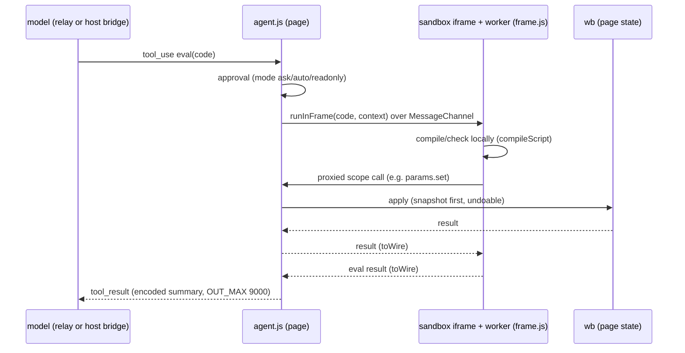

# Inventory notes B: the Kiln workbench page

Repo: `/Volumes/SSD/code/kiln` (branch `main`), read-only inspection on 2026-10-21.
Scope: `apps/workbench/` (`@kiln/workbench`) and the repo-level `scripts/` that serve it
(`shoot.mjs`, `shoot-views.mjs`, `specimen.mjs`, `contrast.mjs`, `css-usage.mjs`, plus
`run-node-tests.mjs` and `kiln-export.mjs` because the workbench's tests and presets use them).
Comparison target for duplication: `lab-workbench/src` (the Perf Lab React UI, a verbatim copy of
playback commit `cdb84891c` per the repo README).

This is an inventory, not a review. Line references are `path:line` relative to the repo root
unless the path is obviously relative to `apps/workbench/src/`.

Marking convention:

- **[obs]** observed directly in the file at the cited line.
- **[inf]** inferred from structure, naming, or the absence of a reference; not executed.
- Nothing was built, installed, or run. LOC figures are `wc -l`.

---

## 1. Package at a glance

### 1.1 Identity and dependencies

- `apps/workbench/package.json` [obs]: name `@kiln/workbench`.
  - deps: `@kiln/kiln`, `@kiln/lab`, `katex 0.16.9`, `react 18.3.1`, `react-dom 18.3.1`.
  - devDeps: `esbuild 0.24.2`.
  - No direct dependency on `@kiln/evidence` or `@kiln/exec`. Evidence reaches the workbench
    transitively through `@kiln/kiln`'s std library (`packages/kiln/src/std/{evidence-context,index,records,store,devices,program}.js`
    import `@kiln/evidence`) [obs].
- Scripts [obs]:
  - `build` → `node build.mjs`
  - `dev` → `node build.mjs --dev`
  - `gen` → `node build.mjs --gen-only`
  - `test` → gen-only, then `scripts/run-node-tests.mjs` over `test/*.mjs`, **skipping**
    `ui`, `export-cuda`, `param-sweep`, `webgpu`, `paired-webgpu`, `server-e2e`, `agent-e2e`, `lab-e2e`.
  - `test:ui`, `test:sweep`, `test:webgpu`, `test:paired`, `test:server`, `test:agent` run those individually.
- `dist/` is gitignored by the repo-root `.gitignore:5` (there is no `apps/workbench/.gitignore`) [obs]. A built `dist/kiln-workbench.html` (5009 lines) and
  `dist/specimen.html` (796 lines) were present on disk at inspection time [obs].

### 1.2 Repository README context

- The README frames the repo as the place to unify Kiln Workbench (`imports/kiln-workbench-src`)
  and Perf Lab (`lab-workbench/`) [obs].
- README instructs `python3 runner/kiln_runner.py serve …` [obs], but `runner/kiln_runner.py`
  (281 LOC, `RUNNER_VERSION = "kiln_runner/2"`) only defines the subcommands `device` and `run` [obs].
  The runner is now invoked by the Kiln driver inside the `kiln-perf` image, emitting
  `kiln-kernels/1` captures [obs/inf from the server-side job spec]. The README line is stale.

### 1.3 File map with sizes

Source under `apps/workbench/src/` (generated `*.gen.js` excluded; they are gitignored by the repo-root
`.gitignore:6`, `apps/workbench/src/*.gen.js`):

| File                         | LOC | Role                                                                  |
| ---------------------------- | --- | --------------------------------------------------------------------- |
| `main.jsx`                   | 38  | Entry: `createRoot`, `window.__kiln`, agent usage poll                |
| `ui/wb.js`                   | 506 | `Workbench` singleton: all app state + operations                     |
| `ui/dock.js`                 | 176 | Pure dock-tree operations, view lists, preset layouts                 |
| `ui/Dock.jsx`                | 309 | Dock rendering: splits, tiles, tabs, drag/drop, phone dock            |
| `ui/views.jsx`               | 53  | View registry `VIEWS` + `viewDef`                                     |
| `ui/App.jsx`                 | 134 | Top bar, keyboard shortcuts, menus                                    |
| `ui/common.jsx`              | 107 | `useLab` hook + primitive components                                  |
| `ui/marks.jsx`               | 195 | Provenance vocabulary: `Val`, `StatusStamp`, `METHOD`, SVG defs       |
| `ui/Ide.jsx`                 | 157 | Code editor pane (textarea over highlighted `<pre>`)                  |
| `ui/Notes.jsx`               | 58  | Notes view (markdown + KaTeX + hypothesis slots)                      |
| `ui/Compiler.jsx`            | 358 | IR, graph, trace views                                                |
| `ui/Kernels.jsx`             | 97  | Kernels table + source tabs                                           |
| `ui/Perf.jsx`                | 528 | Perf view (roofline, compare), **Tune view** (l.340) and **Devices view** (l.481) |
| `ui/Knobs.jsx`               | 179 | Knobs view (forks table, `ForkDetail`), shared `ParamControl` (l.9)   |
| `ui/Evidence.jsx`            | 225 | Evidence records browser                                              |
| `ui/Hypotheses.jsx`          | 145 | Kiln-project hypotheses                                               |
| `ui/Jobs.jsx`                | 256 | Server jobs, devices/hosts                                            |
| `ui/Events.jsx`              | 58  | Event log                                                             |
| `ui/Agent.jsx`               | 267 | Agent chat panel                                                      |
| `server-client.js`           | 165 | HTTP + SSE client for the Kiln server (in `src/`, not `src/ui/`)      |
| `server-sync.js`             | 168 | Record push/pull, `HostDevice`, job merge (in `src/`)                 |
| `ui/doc.js`                  | 114 | Notes markdown renderer                                               |
| `ui/md.js`                   | 45  | Agent-answer markdown renderer                                        |
| `ui/highlight.js`            | 69  | Syntax highlighter for the editor                                     |
| `ui/links.js`                | 56  | `lab:` link scheme                                                    |
| `compile.js`                 | 77  | `pipelineFor`, `compileScript`, `hasKernels`, `endToEnd` (in `src/`)  |
| `ui/lab/state.js`            | 210 | `Labs` singleton (Perf Lab programs inside Kiln)                      |
| `ui/lab/api.js`              | 86  | Lab client over `/api/lab/*`, re-exports from `@kiln/lab`             |
| `ui/lab/board.jsx`           | 156 | Board renderer, `ViewRenderer`, `Panel`, error boundary               |
| `ui/lab/panels.jsx`          | 349 | Non-chart board panels                                                |
| `ui/lab/charts.jsx`          | 503 | Chart, timeline, mirror panels (no d3)                                |
| `ui/lab/media.jsx`           | 232 | Gallery + detections panels                                           |
| `ui/lab/inspect.jsx`         | 258 | Kernel card, route, ledger, stepper, batch panels                     |
| `ui/lab/LabView.jsx`         | 221 | Lab view (program picker, boards, hypotheses, plan, runs)             |
| `ui/lab/InspectView.jsx`     | 81  | Inspect view (entity detail)                                          |
| `ui/lab/params.jsx`          | 103 | Board parameter bar                                                   |
| `ui/lab/format.js`           | 48  | Lab cell formatting                                                   |
| `agent/agent.js`             | 551 | Agent loop, settings, scope, conversations                            |
| `agent/sandbox.js`           | 62  | Sandboxed iframe + worker bootstrap                                   |
| `agent/frame.js`             | 108 | In-worker eval runtime                                                |
| `agent/encode.js`            | 95  | Result encoding, wire format                                          |
| `agent/gateway.js`           | 104 | Page-side tool loop over the server relay                             |
| `agent/inspect.js`           | 48  | `ir`/`trace` namespaces for the agent                                 |
| `agent/worker-main.js`       | 7   | Worker bundle entry                                                   |
| `ui/tokens.css`              | 44  | Design tokens (light + dark)                                          |
| `ui/base.css`                | 166 | Element defaults                                                      |
| `ui/chrome.css`              | 126 | Top bar, dock chrome                                                  |
| `ui/views.css`               | 388 | Per-view styling                                                      |
| `ui/evidence.css`            | 101 | Evidence/hypotheses                                                   |
| `ui/jobs.css`                | 29  | Jobs                                                                  |
| `ui/lab/lab.css`             | 221 | Lab boards                                                            |
| `ui/utilities.css`           | 6   | Utility classes                                                       |
| `../reference.txt`           | 198 | Reference text (`apps/workbench/reference.txt`; Reference view, agent) |
| `../agent-guidelines.txt`    | 22  | Agent guidelines (`apps/workbench/agent-guidelines.txt`)              |

Approximate totals [obs, summed]: UI JS/JSX ~7,000 LOC (of which the `lab/` subfolder is 2,468
including `lab.css`), agent ~975 LOC, CSS ~1,080 LOC.

---

## 2. Build pipeline (`apps/workbench/build.mjs`, 71 LOC)

All observed in `apps/workbench/build.mjs`:

1. **Preset header parsing** (l.16-20). Each `presets/*.js` starts with a doc comment of the form

   ```text
   /** W-NN Title * group Group * about one-line description * try Prompt A | Prompt B
   ```

   `parseHeader` splits it into id, title, group, about, and a `try` list of suggested prompts.
2. **Presets** (l.21-30). Every `presets/*.js` plus its optional sibling `.md` (notes) becomes an
   entry in `src/presets.gen.js` → `PRESETS`.
3. **Lab programs** (l.31-39). `packages/lab/presets/*.lab.js` are collected into
   `src/labs.gen.js` → `LAB_PROGRAMS`, each validated against `PRESET_INFO` imported from
   `../../packages/lab/src/presets.ts` **by relative path** (not through the package entry). An
   unlisted lab preset throws at build time.
4. **Docs** (l.40). `apps/workbench/reference.txt` and `apps/workbench/agent-guidelines.txt` → `src/docs.gen.js`
   (`REFERENCE`, `GUIDELINES`).
5. **Agent worker** (l.41-43). esbuild bundles `src/agent/worker-main.js` as an IIFE string into
   `src/frame.gen.js` → `WORKER_JS`; this is later turned into a Blob worker inside the sandbox
   iframe.
6. `--gen-only` exits here (used by `test` so node tests can import the generated modules).
7. **Main bundle** (l.47-51). esbuild IIFE of `src/main.jsx`, JSX transform, `NODE_ENV=production`.
8. **CSS** (l.55). Concatenated in a fixed order:
   `tokens, base, chrome, views, evidence, jobs, lab/lab, utilities`.
9. **Outputs** (l.67-69):
   - `dist/index.html` without a doctype (the artifact host wraps it).
   - `dist/kiln-workbench.html`, standalone, served by the Kiln server (which injects the
     `<meta name="kiln-token">` the client reads; see section 4).

Single-file output: CSS, JS, worker source, presets, lab programs and reference text all inline in
one HTML file [obs from build steps + dist size].

**Coupling notes**

- Relative import of `packages/lab/src/presets.ts` (a `.ts` file read by a `.mjs` build) ties the
  build to the lab package's internal layout [obs].
- The CSS order list at `build.mjs:55` is duplicated, incompletely, at `scripts/specimen.mjs:10`
  (specimen omits `jobs` and `lab/lab`) [obs]. See section 13.

### 2.1 Generated files

| Generated               | Export          | Source                                |
| ----------------------- | --------------- | ------------------------------------- |
| `src/presets.gen.js`    | `PRESETS`       | `presets/*.js` + `.md`                |
| `src/labs.gen.js`       | `LAB_PROGRAMS`  | `packages/lab/presets/*.lab.js`       |
| `src/docs.gen.js`       | `REFERENCE`, `GUIDELINES` | `reference.txt`, `agent-guidelines.txt` |
| `src/frame.gen.js`      | `WORKER_JS`     | esbuild of `src/agent/worker-main.js` |

---

## 3. (a) UI architecture

### 3.1 Entry and globals

- `main.jsx:31` `createRoot(...)` mounts `<App/>` [obs]. React 18, no router, no Redux.
- `main.jsx:15` exposes `window.__kiln = { wb, k, P, std, agent, labs }` [obs]. This global is the
  test/automation seam: `scripts/shoot-views.mjs` and the e2e tests drive the UI through
  `window.__kiln.wb` rather than through DOM events [obs].
- `main.jsx:24` asks `GET /api/agent/usage` once at start; only when it answers `ready` does it set
  `wb.sample = gatewaySample(...)` (the server relay). Otherwise `wb.sample` stays on the claude.ai host bridge
  [obs for the condition; inf that the bridge is the fallback].

### 3.2 State: the `Workbench` singleton and named channels

- `ui/wb.js:26-505` defines `class Workbench` and exports `wb = new Workbench()` [obs].
- The header comment (`wb.js:1-2`) names the pattern "Octavo Lab pattern": one mutable object,
  React subscribes to **named channels** [obs].
- Pub/sub primitives `on(ch, fn)`, `bump(ch)`, `version(ch)` at `wb.js:75-77` [obs].
- React binding: `useLab(...channels)` in `ui/common.jsx:7-12` built on `useSyncExternalStore`;
  it re-renders when any listed channel's version changes [obs].
- `common.jsx` and `Dock.jsx` import `wb as lab` [obs]. This alias is a naming collision with the
  separate Perf Lab store `labs` (section 3.3) and with the word "Lab" used for Perf Lab programs [inf].

What `wb` owns (grouped by responsibility, all [obs] in `wb.js`):

| Group           | Members (approximate)                                                                                                      |
| --------------- | -------------------------------------------------------------------------------------------------------------------------- |
| Script          | `load`, `setScript` (350 ms debounced compile), `holdScript` (agent scripts held pending approval), `runScript`            |
| Compile         | `compile` (l.154-188), `checkEndToEnd` cache, `run`, `prog`, `compileMs`, outputs/diagnostics                              |
| Params/forks    | `params`, `pins`, `kernelPins`                                                                                             |
| Devices         | `makeDevices` (sims + WebGPU from `@kiln/kiln/std/devices.js:306-308`), `HostDevice` per server host, `device`, `deviceId` |
| Evidence        | `store`, hypotheses via `std.evidence.evaluateHypotheses` (l.226-233)                                                      |
| Measure/compare | `measure` (via `measureProgram`; on a host device it becomes `proposeJob`), `compare` (via `measurePaired`)                |
| Tune            | `spmcts`, `sweep`, `sweep-all` via `std/tune.js`                                                                           |
| Server          | `startServer`, `serverReread`, `serverDevices`, `serverJobs`, `serverRecordsAdded`, `jobMeasured`, `jobSettled`, `proposeJob`, `openJob`, `probeHost`, `openPlan`, `dryRunJob`, `jobAction`, `forgetOnServer` (l.319-466) |
| Presets         | `savePreset`, `deletePreset`, `newPresetFromText` (user presets `U-NN` in localStorage)                                    |
| Layout          | `setLayout`, `showView`, `dropView`, `focusTile`, `toggleMax`, layout-migration flags (l.51-70)                           |
| Misc            | `toast`, `log`, `summary()` (used by the agent context), `sample` (agent model bridge)                                    |

`compile` (l.154-188) shares `pipelineFor`, `hasKernels` and `endToEnd` with `src/compile.js` (imported at
`wb.js:13`), but writes the core sequence of `compileScript` out a second time: `runScript` → declare params →
`project.graph` → `pipe.run` → diagnostics (`wb.js:157-181` vs `compile.js:22-36`) [obs]. The two copies differ on
purpose: the page mutates its live `ParamSet` (`params.params.set`) and applies first-time pins and device, while
`compileScript` declares params on a clone [obs]. `compileScript` itself has one caller, the agent frame
(`agent/frame.js:15,53`) [obs]. `compile.js:1-3` says "The page's compile and the agent's sandbox frame both call
these" and `frame.js:10` says "by the same compileScript the page uses"; the first is true of the helpers, the
second is not [obs].

### 3.3 Second singleton: `labs` (Perf Lab inside Kiln)

- `ui/lab/state.js:16-210` defines `class Labs`; `state.js:210` exports `labs = new Labs()` [obs].
- It **publishes on `wb`'s `"lab"` channel** rather than owning its own pub/sub [obs]; it imports
  `wb, lsGet, lsSet` from `../wb.js` and `* as Dock` from `../dock.js` (`state.js:9-10`) [obs].
- It builds lab programs from `LAB_PROGRAMS` (`labs.gen.js`) using `build`, `checkParam`,
  `dehydrate`, `syntheticEnv`, `serverEnv`, `labClient`, `labJobs` from `./api.js` (`state.js:11-12`) [obs].
- `ui/lab/api.js:5` imports `labEnv, createMemoryLabData, hostReport` from `@kiln/lab` [obs];
  `api.js:18` `labClient(server)` wraps `/api/lab/*`; `api.js:66` `labJobs(labId, captures, {reason, dryRun})`
  turns lab captures into Kiln server jobs; `api.js:86` `serverEnv` composes a catalog with the client data [obs].
- `runPlan` and `dryRun` live here (Lab view "Plan" section) [obs].

### 3.4 Persistence (localStorage)

Prefix `kiln-wb:` (`wb.js:21-23`, helpers `lsGet`/`lsSet`) [obs]. Keys seen:

| Key (after prefix)                          | Holds                                                     |
| ------------------------------------------- | --------------------------------------------------------- |
| `mine`                                      | user presets (`U-NN`)                                     |
| `protocol:<kind>`                           | per-device-kind measurement protocol                      |
| `device`                                    | selected device                                           |
| `evidence2` (and legacy `evidence`)         | local evidence store                                      |
| `layout`                                    | dock tree                                                 |
| `evidenceView`, `jobsView`, `hypothesesView`| one-shot migration flags that insert new views into old layouts (`wb.js:51-70`) |
| `theme`                                     | light/dark                                                |
| `last`, `draft`, `draftNotes`               | last preset, unsaved script and notes                     |
| `lab`                                       | `labs` state (selected program, params)                   |
| `agentSettings`, `convs`                    | agent settings and conversations (section 7)              |

All state is per-browser; the server is the only shared store (records, jobs) [obs/inf].

### 3.5 Dock layout system

`ui/dock.js` (176 LOC, pure functions over a tree) [obs]:

- Node types: `tile` (a tab strip holding view ids) and `split` (direction + ratios).
- Operations: `normalize`, `moveToTab`, `moveToSide`, `splitTile`, `closeView`, `closeTile`,
  `activate`, `resize`, `reveal`, `flatViews`.
- View lists (`dock.js:6-11`):
  - `IDE_VIEWS = [notes, code, agent, reference]`
  - `SYS_VIEWS = [ir, graph, trace, kernels, perf, knobs, tune, evidence, hypotheses, devices, jobs, events, lab, inspect]`
  - dynamic `board:<id>` views (one per lab board).
- Preset layouts (`dock.js:17-22`): `default`, `compiler`, `perf`, `one`.

`ui/Dock.jsx` (309 LOC) [obs]:

- `Split` + `Gutter`: drag to resize, double-click to equalise, arrow keys to nudge.
- `Tile`, `Strip`, `DTab`: tab strip, tab drag source, close.
- `Picker`: add-view menu (via `addableViews` from `views.jsx`).
- `FloatMenu`: portal menu.
- Drag and drop with `hitTest` (edge band `EDGE = 0.25`) deciding tab-insert vs split-side;
  `DragLayer` draws the drop preview.
- `PhoneDock` below 640 px width (`Dock.jsx:11-12`, `298-309`): a single-column tab switcher.

### 3.6 View registry

`ui/views.jsx:23-42` `VIEWS` maps view id → `{ title, about, col, el, badge }` [obs];
`viewDef(id)` (`views.jsx:45-50`) resolves `board:<id>` ids to a `BoardView` definition [obs].
Section 5 lists every entry.

### 3.7 Keyboard

- `App.jsx:12-17`: `⌘\` maximise tile (`toggleMax`), `⌘B` compile, `⌘↵` measure [obs].
- `Ide.jsx:77-85`: `⌘S` save preset, Tab indents in the editor [obs].
- Dock gutters accept arrow keys (Dock.jsx) [obs]. No command palette [inf: none found].

### 3.8 Design tokens and CSS

- `ui/tokens.css` (44 LOC): "Swiss" monochrome system — Arial, black/white/greys, a single red
  accent, provenance hatch patterns [obs]. Dark mode is defined **twice**: once under
  `@media (prefers-color-scheme: dark)` (l.24-31) and again under `[data-theme=dark]` (l.32-39) [obs].
- Provenance vocabulary is CSS + `marks.jsx`: classes like `.prov.heuristic`, `.prov.derived`,
  `.val`, the SVG `#half` pattern from `SvgDefs` [obs].
- Repo scripts test this layer: `contrast.mjs` (WCAG pairs), `css-usage.mjs` (dead selectors),
  `specimen.mjs` (visual specimen) — section 9.

---

## 4. Server endpoints and runners

### 4.1 Client

`src/server-client.js` `connectServer` (165 LOC) [obs]:

- Token: read from `<meta name="kiln-token">` (lookup in `packages/kiln/src/std/devices.js:297`) [obs].
- Every non-GET request sends `x-kiln-token` [obs].
- SSE `GET /api/events` with `EVENT_TYPES`: `hello`, `ping`, `job.updated`, `job.event`,
  `records.added`, `device.updated`, `host.updated`, `catalog.changed`, `evidence.registered`;
  reconnect backoff 1 s → 30 s [obs].

### 4.2 Endpoint inventory

| Method | Path                                   | Called from                                    |
| ------ | -------------------------------------- | ---------------------------------------------- |
| GET    | `/api/health`                          | server-client                                  |
| GET    | `/api/records`                         | server-client / server-sync pull               |
| POST   | `/api/records`                         | server-sync push (debounced 400 ms, chunks of 250) |
| DELETE | `/api/records`                         | `wb.forgetOnServer`                            |
| GET    | `/api/devices`                         | server-client                                  |
| GET    | `/api/hosts`                           | server-client                                  |
| GET    | `/api/hosts/:id/capabilities`          | Devices view (`HostBlock`)                     |
| POST   | `/api/hosts/:id/probe`                 | `wb.probeHost`                                 |
| GET    | `/api/jobs`, `/api/jobs/:id`           | Jobs view                                      |
| GET    | `/api/jobs/:id/plan`                   | `wb.openPlan`                                  |
| POST   | `/api/jobs` (header `x-kiln-proposer`) | `wb.proposeJob`, lab `labJobs`                 |
| POST   | `/api/jobs/:id/{approve,cancel,reimport}` | `wb.jobAction`                              |
| GET    | `/api/archives`                        | server-client                                  |
| GET    | `/api/archives/:sha` (link)            | `Jobs.jsx:197`                                 |
| GET    | `/api/lab/catalog`, `/api/lab/datasets`, `/api/lab/datasets/:id` | `lab/api.js`         |
| GET    | `/api/lab/bundles?hashes=…` (batched 64) | `lab/api.js`                                 |
| GET    | `/api/lab/media/:sha`                  | `lab/api.js:19` (gallery images)               |
| GET    | `/api/events` (SSE)                    | server-client                                  |
| GET    | `/api/agent/usage`                     | `main.jsx:24`                                  |
| POST   | `/api/agent/sample` (NDJSON stream)    | `agent/gateway.js:30`                          |

Job spec [obs]: `jobSpec` / `jobKernel` build `kiln-kernels/1` captures with defaults
`reps 7, warmup 3, launches 20, seed 1`.

Server side of the agent relay [obs]: `apps/server/src/agent.ts` (Anthropic Messages API, env
`KILN_MODEL`, `ANTHROPIC_API_KEY`, `KILN_MODEL_URL` default `api.anthropic.com`; config at
`apps/server/src/config.ts:35,59-61`; error codes `no_model` / `no_api_key` at `agent.ts:252-253`).

### 4.3 `server-sync.js` (168 LOC) [obs]

- `recordSync`: debounced push (400 ms), chunks of 250, a `refused` map for records the server
  rejected.
- `HostDevice`: device id `host:<id>`, `kind: "cuda"`; `runKernels` **throws** — Tune and Compare
  cannot run on server hosts; Measure becomes a job proposal instead.
- `hostDevices`, `upsertJob`, `addJobEvent`: merge server events into `wb` state.

### 4.4 Runners reachable from the page

| Runner              | Where                                         | Notes                                                    |
| ------------------- | --------------------------------------------- | -------------------------------------------------------- |
| Simulated SIMT GPUs | `@kiln/kiln` std devices                      | cost-model "sim" numbers                                 |
| WebGPU              | `WebGpuDevice` (`navigator.gpu`)              | in-browser measurement, paired compare, tune             |
| CUDA (remote)       | server hosts as jobs only                     | no direct page→runner path; results return as records    |

---

## 5. (b) View inventory and the data each consumes

All view ids come from `dock.js:6-11` and are registered in `views.jsx:23-42` [obs].

| View id      | Component (file)                         | Data consumed                                                                                          |
| ------------ | ---------------------------------------- | ------------------------------------------------------------------------------------------------------ |
| `notes`      | `NotesView` (`Notes.jsx`)                | preset `.md` / `draftNotes`; `doc.js` markdown + KaTeX; `lab:` links; ```` ```hypothesis ```` blocks portaled as `NoteHypothesis` (evaluated hypotheses) |
| `code`       | `CodePane` (`Ide.jsx`)                   | `wb.script`, diagnostics, `ParamControl` groups from params, `Checks` from `wb.e2e` / outputs          |
| `agent`      | `AgentPanel` (`Agent.jsx`)               | agent conversations, settings, pending approvals                                                       |
| `reference`  | `Reference` (`Ide.jsx:141`)              | `REFERENCE` + `GUIDELINES` from `docs.gen.js`                                                          |
| `ir`         | `IrView` (`Compiler.jsx`)                | `wb.run` pipeline: `PipeMap`, `StepBanner`, `IrText` (clickable nodes), `NodeSide`                     |
| `graph`      | `GraphView` (`Compiler.jsx`)             | IR graph; own layered layout in SVG; 500-node cap                                                      |
| `trace`      | `TraceView` (`Compiler.jsx`)             | pass trace steps, `Diff` via `unifiedDiff`, per-pass stats, declined rewrites                          |
| `kernels`    | `KernelsView` (`Kernels.jsx`)            | `wb.prog` kernels: model vs measured vs validity; `KernelIds` (content ids + activation); tabs CUDA / WGSL / Kernel IR / Tile / Loop / Launch |
| `perf`       | `PerfView` (`Perf.jsx`)                  | `BigNumber` total, history `Spark`, per-kernel model/sim/hw `Val` cells, metrics, `Roofline` (SVG + `placeLabels`), "Across devices", titleblock, `KernelMetrics`, `ComparePanel` (paired ratio via `std.evidence.evidenceContext().ev.ratio`) |
| `knobs`      | `KnobsView` (`Knobs.jsx`)                | forks table, `ForkDetail` options with evidence, param side panel; `paramGroups`, `STD_KNOBS`          |
| `tune`       | `TuneView` (`Perf.jsx:340`)              | tune runs; `TuneChart` SVG (`Perf.jsx:375`)                                                                             |
| `evidence`   | `EvidenceView` (`Evidence.jsx`)          | evidence store records grouped by identity / row / device; import/export/forget; `RecordDetail`; `Strip` SVG |
| `hypotheses` | `HypothesesView` (`Hypotheses.jsx`)      | `wb` hypotheses evaluated with `std.evidence.evaluateHypotheses`; `HypothesisCard`, `Predicate`, `Rows` |
| `devices`    | `ServerLine` (`Jobs.jsx:237`) + `DevicesView` (`Perf.jsx:481`) | devices list, server hosts (`HostBlock` `Perf.jsx:433`, capabilities, probe), `ProtocolBlock` (`Perf.jsx:406`)                         |
| `jobs`       | `JobsView` (`Jobs.jsx`)                  | server jobs: `JobStamp`, `Verdicts`, `PlanSteps`, `DryRun`, `JobDetail`, archive links                 |
| `events`     | `EventsView` (`Events.jsx`)              | workbench log and last compile events                                                                  |
| `lab`        | `LabView` (`lab/LabView.jsx`)            | `labs`: program picker by group, boards list, hypotheses table, `Plan` (runPlan / dryRun), `LabDryRun`, `HostReports`, `Runs` |
| `inspect`    | `InspectView` (`lab/InspectView.jsx`)    | selected lab entity: fields, relations, `MetricsTable`, manifest                                       |
| `board:<id>` | `BoardView` (`lab/board.jsx:107`)        | one built lab board: `Ctx` provider, `ParamBar`, `ViewRenderer`, error `Boundary`                      |

### 5.1 Lab board panel kinds

`lab/board.jsx:62-66` dispatches panel kinds [obs]:

- Data: `table`, `chart`, `timeline`, `stat`, `runList`, `ledger`, `batchView`
- Provenance: `manifest`, `manifestDiff`, `hypothesisCard`
- Text: `note`, `math`, `text`, `source`
- Interaction: `control`, `stepper`
- Comparison/trace: `mirror`, `route`, `kernelCard`
- Media: `gallery`, `detections`
- Layouts: `row`, `stack`, `grid`, `split`
- Escape hatches: `component`, `kind:*`

Component homes (`board.jsx:11-14`) [obs]:

| Panels                                                                                       | File                  |
| -------------------------------------------------------------------------------------------- | --------------------- |
| `TableView, StatView, RunListView, ManifestView, ManifestDiffView, TextView, NoteView, MathView, SourceView, HypothesisCardView, ControlView` | `lab/panels.jsx` |
| `ChartView, TimelineView, MirrorView`                                                        | `lab/charts.jsx`      |
| `GalleryView, DetectionsView`                                                                | `lab/media.jsx`       |
| `KernelCardView, RouteView, LedgerView, StepperView, BatchView`                              | `lab/inspect.jsx`     |

`board.jsx` also exports `useBoard`, `useResolved`, `Rich` (inline markdown via `doc.js` `inline`,
`dangerouslySetInnerHTML`), `PanelError`, `Panel`, `ViewRenderer` (l.19-90) [obs].

### 5.2 Shared provenance vocabulary (`ui/marks.jsx`, 195 LOC)

Exports used across Perf, Kernels, Knobs, Evidence, Hypotheses [obs]:
`METHOD`, `Val`, `StatusStamp`, `modelOf`, `modelVal`, `evidenceVal`, `optionEvidence`, `simRef`,
`hwRef`, `recordVal`, `valueVal`, `SvgDefs` (`#half` hatch). These read `wb.store` and `wb.run`
directly [obs], so the vocabulary is not a pure presentational layer.

### 5.3 Primitive components (`ui/common.jsx`)

Exports (l.7-107) [obs]: `useLab`, `cls`, `Btn`, `Seg`, `Tog`, `Pill`, `Tabs`, `Kv`, `Meter`,
`Code`, `Spark`, `Menu`, `Empty`, `stateLabel`, `isBad`, `useInterval`, `useFrame`, `useStateRef`.
Usage check in section 13.

---

## 6. Presets and docs

### 6.1 Kiln presets (`apps/workbench/presets/`)

27 presets, each `W-NN-*.js` + `W-NN-*.md` (27 `.md` files) [obs]. Numbering W-01..W-26 and W-28;
**W-27 is absent** [obs].

| Group                | Presets                                                                                     |
| -------------------- | ------------------------------------------------------------------------------------------- |
| Basics               | W-01 Hello, dialect · W-02 Patterns, declines and guards · W-03 Lowering to a register VM · W-04 Forks, knobs and sliders |
| ML compiler          | W-05 RMSNorm, fused · W-06 Softmax in one kernel · W-07 GELU, pointwise · W-08 Linear layer, tiled · W-09 MLP and the blowup guard · W-10 Attention |
| Write programs       | W-11 N-body forces · W-12 Box blur, a stencil · W-13 LayerNorm with a residual              |
| Extend the compiler  | W-14 Your own pass in the ML pipeline · W-15 Your own cost model · W-16 A new frontend op   |
| Other compilers      | W-17 Regex → NFA → DFA → JavaScript                                                         |
| GPU optimization     | W-18 Roofline: three regimes · W-19 Fusion · W-20 Batch size and arithmetic intensity · W-21 The matmul ladder · W-22 Variance three ways · W-23 Occupancy and latency hiding · W-24 One program, five GPUs · W-25 Cost model vs. measurements |
| Real work            | W-26 Window similarity (KILN-002 Example A) · W-28 Redaction mask post-processing (KILN-002 Example C) |

- Presets that declare hypotheses in code: `W-05-rmsnorm.js`, `W-19-fusion.js`,
  `W-25-model-vs-measurement.js` [obs, grep for `hypothesis`]. Others may declare them only in
  the `.md` notes as ```` ```hypothesis ```` blocks [inf].
- W-26 and W-28 are the two presets tied to Playback real work (KILN-002) [obs from headers].
  The "Example B" between them has no preset [inf from the W-27 gap plus A/C naming].

### 6.2 Lab programs

`LAB_PROGRAMS` come from `packages/lab/presets/*.lab.js`, shown in the Lab view grouped by
`PRESET_INFO` group [obs]. These are Perf Lab programs (e.g. the `dino-pr1005` dataset used by
`test/lab-e2e.mjs`) [obs].

### 6.3 Reference text

`apps/workbench/reference.txt` (198 LOC) and `apps/workbench/agent-guidelines.txt` (22 LOC) [obs]. Both feed the
Reference view and the agent's instructions [obs].

---

## 7. Agent subsystem (`apps/workbench/src/agent/`)

### 7.1 Shape

- **One tool, `eval`** [obs, `agent.js`]. The model writes JavaScript that runs against an agent
  scope (namespaces below); results come back as an encoded summary.
- Limits [obs]: `EVAL_CAP 8` (evals per turn), `HISTORY 16`, `OUT_MAX 9000` characters.
- Settings [obs]: tier `quick | default | complex` (labels `TIER_LABEL` Fast / Balanced / Deep),
  `effort`, mode `auto | ask | readonly`, scripts `hold | run`.
- Conversations persisted in localStorage `convs`, max 30, trimmed at 300 KB [obs].
- `contextSummary` (uses `wb.summary()`), `AGENT_SCOPE` doc (`agent.js:102-124`), instructions;
  `turnsFor` caps the transcript at ~230 KB [obs].
- `ERRORS` map of error codes, including host-bridge codes such as `not_granted` [obs].
- `SUGGESTIONS` list of starter prompts [obs].

### 7.2 Transport: two paths

1. **Host bridge**: `window.claude.use("sample")` when the page runs inside a claude.ai artifact
   host [obs, `wb.sample`].
2. **Server relay**: `agent/gateway.js` runs the tool loop page-side over
   `POST /api/agent/sample` (NDJSON), `MAX_CALLS 12` [obs]. The relay is `apps/server/src/agent.ts`.

`sendCore` picks between them via `wb.sample` [obs].

### 7.3 Sandboxed execution

- `agent/sandbox.js` (62 LOC): per-eval `<iframe sandbox="allow-scripts">` with `srcdoc` and CSP
  `default-src 'none'; script-src 'unsafe-inline' 'unsafe-eval'; worker-src blob:`; inside it a
  Blob worker built from `WORKER_JS`; a `MessageChannel` connects page (`servePort`) and frame
  (`runInFrame`) [obs].
- `agent/frame.js` (108 LOC): `startFrame`, `runEval` inside the worker; page calls are stubs that
  cross the channel; `editor.check` / `compile` run **locally in the worker** via `compileScript`
  (`src/compile.js`); `inspectScope` (`agent/inspect.js`: `ir`, `trace` namespaces); code runs via
  `new Function` [obs].
- `agent/encode.js` (95 LOC): `errs`, `warns`, `runSummary`, `e2eLine`, `rowOf`, `r3`, `plain`,
  `yaml`, `toWire`, `fromWire` [obs].
- `agent.js` `runEval` adds approval (`askApproval`), `snapshot` / `restore` / `revertFrom` for undo,
  `apiOf` / `pageCall` / `frameContext` / `CHANGES` bookkeeping [obs].

### 7.4 Agent scope (`makeAgentScope`, `agent.js:357-537`)

Namespaces [obs]: `wb`, `editor`, `notes`, `compile`, `forks`, `params`, `kernels`, `devices`,
`measure`, `tune`, `evidence`, `checks`, `presets`, `jobs`, `chat` (`table`, `propose`, `code`,
`show`, `place`), `ref`. Read-only mode wraps mutating members with `RO` and throws `ReadOnlyError`;
held scripts raise `HeldScriptError` [obs].

**No `lab` / `labs` namespace** [obs: absent from the list]. The agent cannot build, plan or
inspect Perf Lab programs or boards inside Kiln.

### 7.5 UI (`ui/Agent.jsx`, 267 LOC)

`Chat` (settings `Seg`s, composer), `UserMsg`, `AssistantMsg` (fold, retry menu, undo), `ToolCard`
(approve Run / Run all / Decline), `Part` (table / code / proposal), `History` [obs].

---

## 8. Tests (`apps/workbench/test/`)

Plain Node scripts, no test framework, run by `scripts/run-node-tests.mjs` (34 LOC) [obs].

| Test                   | LOC | In `pnpm test`? | What it covers                                                                                  |
| ---------------------- | --- | --------------- | ----------------------------------------------------------------------------------------------- |
| `gateway.mjs`          | 174 | yes             | `gateway.js` tool loop with a fake `fetch`                                                      |
| `notes.mjs`            | 41  | yes             | every `lab:` link in preset notes resolves                                                      |
| `presets.mjs`          | 26  | yes             | presets parse/compile                                                                           |
| `sandbox.mjs`          | 131 | yes             | sandbox bridge using Node `MessageChannel`                                                      |
| `server-sync.mjs`      | 187 | yes             | `server-sync.js` against a fake client                                                          |
| `ui.mjs`               | 268 | no              | Playwright UI smoke; hardcoded `/opt/npm-tools`, `/opt/pw-browsers/...` (`ui.mjs:4,36`)         |
| `export-cuda.mjs`      | 24  | no              | exports CUDA; pairs with `cuda_check.py` (63 LOC, NVRTC/ptxas)                                  |
| `param-sweep.mjs`      | 35  | no              | param sweep                                                                                     |
| `webgpu.mjs`           | 96  | no              | real WebGPU in Chrome via `scripts/shoot.mjs`                                                   |
| `paired-webgpu.mjs`    | 65  | no              | paired compare on WebGPU                                                                        |
| `server-e2e.mjs`       | 188 | no              | page against `apps/server/test/support/serve-dev.ts` with a dev-fake host                       |
| `agent-e2e.mjs`        | 166 | no              | agent through the relay against a fake model upstream, with leak checks                         |
| `lab-e2e.mjs`          | 165 | no              | imports Perf Lab data dir, `dino-pr1005`, byte-identical store check                            |

Observations:

- The CI-default suite covers only non-DOM modules; every browser test is manual [obs].
- Two browser harnesses coexist: Playwright with Linux container paths (`ui.mjs`) and the CDP
  harness `scripts/shoot.mjs` (macOS Chrome default path) used by `webgpu`, `paired-webgpu`,
  `server-e2e`, `agent-e2e`, `lab-e2e` [obs]. `ui.mjs` looks like a leftover from the imported
  workbench container [inf].
- No test exercises `dock.js` tree operations, `wb.js` compile, `marks.jsx`, or the lab board
  renderer in isolation [obs: no matching test file].

---

## 9. Repo-level scripts serving the workbench (`scripts/`)

| Script               | LOC | Purpose                                                                                      |
| -------------------- | --- | -------------------------------------------------------------------------------------------- |
| `shoot.mjs`          | 133 | Chrome over CDP WebSocket; throwaway profile; exports `withPage`; `Page.eval/until/shot`; CLI `--size --dark --until --do --settle --webgpu --print --timeout`; `CHROME` default `/Applications/Google Chrome.app` |
| `shoot-views.mjs`    | 51  | 15 named `SHOTS`, each driving `window.__kiln.wb` (layout, preset, view) then screenshotting |
| `specimen.mjs`       | 56  | Writes `dist/specimen.html`: tokens, provenance marks, `Val` cells, stamps, titleblock, series |
| `contrast.mjs`       | 47  | WCAG contrast pairs for light and dark from `tokens.css`                                      |
| `css-usage.mjs`      | 96  | Dead-selector finder over built CSS vs sources; `--write`                                     |
| `kiln-export.mjs`    | 87  | `kiln-program/1` export of a preset                                                           |
| `run-node-tests.mjs` | 34  | Runs `test/*.mjs` with a skip list                                                            |

Notes:

- `shoot.mjs`'s `withPage` is already the de facto shared browser-test harness [obs: imported by
  five tests and `shoot-views.mjs`].
- `contrast.mjs:12` reads only the `[data-theme=dark]` block of `tokens.css`, not the
  `prefers-color-scheme` block [obs]; because the two blocks are duplicated by hand, a drift between
  them would go unchecked [inf].
- `specimen.mjs:10` hardcodes a CSS file list that omits `jobs` and `lab/lab` [obs] (see section 13).

---

## 10. (c) Duplication

### 10.1 Against Perf Lab (`lab-workbench/src`)

Perf Lab stack [obs, `lab-workbench/package.json`]: React 19, Redux Toolkit, react-router,
d3-scale / d3-shape, MathJax, Archivo + IBM Plex fonts. Kiln stack: React 18, no store library,
no router, no d3, KaTeX, Arial.

Kiln's `ui/lab/*` files say outright that they are ports (header comments) [obs]:

- `lab/charts.jsx:1` "ported from Perf Lab's ChartView and TimelineView without d3"
- `lab/inspect.jsx:1` "ported from Perf Lab"
- `lab/media.jsx:1` "ported from Perf Lab's GalleryView…"
- `lab/format.js:1` "ported from Perf Lab's lib/format.ts"
- `lab/params.jsx:1` "ported from Perf Lab's ParamBar and lib/params.ts"
- `lab/panels.jsx:1` "ported from Perf Lab's views onto Kiln's vocabulary"
- `lab/InspectView.jsx:1` "Perf Lab's Inspector as a dock view"

Port map (Kiln file → Perf Lab counterparts, LOC) [obs paths and sizes]:

| Kiln (LOC)                     | Perf Lab counterpart(s) under `lab-workbench/src/` (LOC)                                                                                                    |
| ------------------------------ | ----------------------------------------------------------------------------------------------------------------------------------------------------------- |
| `ui/lab/charts.jsx` (503)      | `components/organisms/views/ChartView/ChartView.tsx` (374), `TimelineView/TimelineView.tsx` (308), `MirrorView/MirrorView.tsx` (151)                       |
| `ui/lab/panels.jsx` (349)      | `views/TableView` (118), `StatView` (19), `RunListView` (39), `ManifestView` (146), `HypothesisView` (129), `TextView` (60), `SourceView` (36), `ControlView` (19) |
| `ui/lab/media.jsx` (232)       | `views/GalleryView` (125), `views/DetectionsView/DetectionsView.tsx` (147) + `evidence.ts` (68)                                                            |
| `ui/lab/inspect.jsx` (258)     | `views/KernelCardView` (67), `RouteView` (98), `LedgerView` (72), `StepperView` (110), `BatchView` (45)                                                    |
| `ui/lab/params.jsx` (103)      | `components/organisms/ParamBar/ParamBar.tsx` (127), `lib/params.ts` (50)                                                                                   |
| `ui/lab/format.js` (48)        | `lib/format.ts` (93)                                                                                                                                        |
| `ui/lab/board.jsx` (156)       | `app/board-context.tsx` (77), `components/organisms/ViewRenderer/ViewRenderer.tsx` (120)                                                                    |
| `ui/lab/LabView.jsx` (221)     | `organisms/LabTab/LabTab.tsx` (208), `PlanTab/PlanTab.tsx` (161), `RunsTab/RunsTab.tsx` (75)                                                                |
| `ui/lab/InspectView.jsx` (81)  | `organisms/InspectTab/InspectTab.tsx` (103), `Inspector/Inspector.tsx` (61)                                                                                 |
| `ui/lab/state.js` (210)        | `app/store.ts` (94) + Redux slices (`features/params/paramsSlice.ts` 64, `thunks.ts` 102, signals, selection, ui, jobs, server …)                         |
| `ui/lab/lab.css` (221)         | the per-component `.css` files beside each view above, and `styles/tokens.css` (133)                                                                        |

Shared constants re-declared rather than imported [obs per summary]: `charts.jsx` re-declares the
Perf Lab `SHAPES`, `OUTCOME_SHAPE`, `TICK_CHAR_PX` tables.

Other cross-app duplication:

| Concern          | Kiln                                                                                             | Perf Lab                                                                                                                                         |
| ---------------- | ------------------------------------------------------------------------------------------------ | ------------------------------------------------------------------------------------------------------------------------------------------------ |
| Agent runtime    | `agent/agent.js` (551) + `sandbox.js` + `frame.js`: one `eval` tool, sandboxed iframe + worker, page-side tool loop | `features/agent/runtime.ts` (639): `runAgentCode` runs `new AsyncFunction` **in the page, no sandbox** (`runtime.ts:443`); server-driven `liveTurn` via `streamPost` to `/assistant/turns` and `/assistant/messages/:id/result`, up to 6 calls (`runtime.ts:531-574`); scripted replies `parseReplies` |
| Model access     | server relay `apps/server/src/agent.ts` (Anthropic Messages) or claude.ai host bridge            | `server/assistant/model.ts` via `@earendil-works/pi-ai` (`ModelRuntime`, `provider/id:thinking`)                                                 |
| Agent UI         | `ui/Agent.jsx` (267): `AgentPanel`, `History`                                                    | `organisms/AgentRail/AgentRail.tsx` (202), `TranscriptLibrary/TranscriptLibrary.tsx` (289)                                                       |
| State            | `wb` + `labs` singletons, named channels, `useSyncExternalStore`                                 | Redux Toolkit `app/store.ts` + slices                                                                                                            |
| Design tokens    | `ui/tokens.css` (44): Swiss monochrome, Arial, red accent only                                   | `styles/tokens.css` (133): "Lattice Deck" paper/sheet, `sig/warn/bad/ok`, `--d1..d4` data palette                                               |
| Charts           | hand-rolled SVG (`charts.jsx`, `Perf.jsx` Roofline and TuneChart, `common.jsx` Spark, `Evidence.jsx` Strip) | d3-scale / d3-shape in `ChartView.tsx`                                                                                   |
| Math rendering   | KaTeX (`doc.js`)                                                                                 | MathJax                                                                                                                                          |
| Lab language     | consumes `@kiln/lab` (`lab/api.js:5`)                                                            | its own `lab-workbench/src/lang/*.ts` (does not import `@kiln/lab`)                                                                              |

Lab language fork [obs, diff line counts between `lab-workbench/src/lang/<f>.ts` and
`packages/lab/src/lang/<f>.ts`]: all 16 shared files differ (e.g. `build.ts` 1030 vs 1036, 38 diff
lines; `values.ts` 89 vs 113, 156; `stats.ts` 122 vs 168, 126; `refs.ts` 2). `packages/lab` adds
`hypothesis.ts` (103 LOC). So the Kiln lab UI renders on a **diverged fork** of the language Perf
Lab renders on. (This sits in the packages area covered by another inventory; noted here because it
determines whether the two UIs can show the same board identically.)

### 10.2 Inside the Kiln workbench

| Duplication                         | Evidence                                                                                                       |
| ----------------------------------- | -------------------------------------------------------------------------------------------------------------- |
| Two hypothesis systems              | Kiln projects: `std.evidence.evaluateHypotheses` (`wb.js:226-233`); lab programs: `@kiln/lab` `evaluateHypothesis` (`packages/lab/src/lang/hypothesis.ts:58`) |
| Three hypothesis VERDICT maps       | `ui/Hypotheses.jsx:50` (`{cls,text}`), `ui/lab/LabView.jsx:12` (`[cls,text]` tuples), `ui/lab/panels.jsx:227` (`{cls,text,why}`); same four verdicts `supported/refuted/open/unqualified` in three shapes |
| Two hypothesis card components      | `HypothesisCard` (`Hypotheses.jsx`) and `HypothesisCardView` (`lab/panels.jsx`)                                |
| A fourth, unrelated `VERDICT`       | `ui/Jobs.jsx:108` maps planner verdicts `execute/cached/blocked`; same identifier, different domain           |
| Two markdown renderers              | `ui/md.js` (agent answers) and `ui/doc.js` (notes, boards via `inline`), each with its own `inline`/`esc`      |
| Two value-cell implementations      | `Val` (`marks.jsx`) and `LabVal` (`lab/panels.jsx`)                                                            |
| `plural` helper ×5                  | `Hypotheses.jsx:7`, `Jobs.jsx:6`, `Evidence.jsx:11`, `marks.jsx:12`, `lab/LabView.jsx:95` (identical one-liner) |
| `when` date formatter ×2            | `Jobs.jsx:7`, `Evidence.jsx:10` (near-identical; Jobs adds a null guard)                                       |
| `Empty` component ×3                | `common.jsx:92` (exported) vs local redefinitions `lab/panels.jsx:24`, `lab/inspect.jsx:12` (identical to each other, different markup from common) |
| Two `ParamControl` components       | `Knobs.jsx:9` (exported, used by the Code view via `Ide.jsx:6`) and a local one at `lab/params.jsx:67`; same name, different param models |
| Two `Judged` helpers                | `Hypotheses.jsx:139` (one check) and `lab/panels.jsx:265` (a list of checks), inside the two hypothesis cards |
| Two dry-run UIs                     | `Jobs.jsx` `DryRun` and `lab/LabView.jsx` `LabDryRun`, both composing `Verdicts` / `PlanSteps`                 |
| Download/save-text logic ×3         | `saveText` is exported from `Kernels.jsx:10-15` and imported by `Evidence.jsx:7`, `Agent.jsx:11`, `Notes.jsx:7`; `App.jsx:49-55` (script download) and `App.jsx:109` (notes download) inline the same downloads-or-clipboard logic instead |
| Compile sequence ×2                 | `wb.js:157-181` and `src/compile.js:22-36` (`compileScript`); helpers are shared, the sequence is not           |
| Dark tokens ×2                      | `tokens.css:24-31` and `tokens.css:32-39`                                                                      |
| CSS file list ×2                    | `build.mjs:55` and `scripts/specimen.mjs:10` (already drifted)                                                 |
| Hand-rolled SVG chart scaffolding ×5| `Perf.jsx:249` Roofline, `Perf.jsx:375` TuneChart, `common.jsx` Spark, `Evidence.jsx` Strip, `lab/charts.jsx` [inf: no shared axis/scale helper found] |

---

## 11. (d) Complexity hotspots

Ranked by how much unrelated responsibility one unit carries (LOC as a proxy) [inf from structure]:

1. **`ui/wb.js` (506 LOC)**, the god object. It owns script editing, compile, params, devices,
   evidence, hypotheses, measure, compare, tune, server connection, record sync, jobs, presets,
   layout and toasts. Every view and the agent scope reach into it. Server lifecycle alone is
   `l.319-466` (~150 lines). The layout-migration flags (`l.51-70`) are permanent code for a
   one-time transition.
2. **`agent/agent.js` (551 LOC)**, especially `makeAgentScope` (`l.357-537`, ~180 lines): every
   namespace is defined inline, mutations are wrapped for read-only mode one by one, and the scope
   doc (`l.102-124`) is a hand-maintained string describing the same surface (and has drifted;
   section 13).
3. **`ui/Perf.jsx` (528 LOC)**: totals, history, per-kernel model/sim/hw cells, metrics, the
   Roofline (SVG + `placeLabels` collision layout), cross-device table, titleblock and the
   `ComparePanel` in one file, and also the Tune view (`Perf.jsx:340-399`) and the Devices view with
   `ProtocolBlock` and `HostBlock` (`Perf.jsx:400-528`): three of the dock's views live in it. Long single-line JSX rows (e.g. `Perf.jsx:109`) combine formatting,
   provenance and layout.
4. **`ui/lab/charts.jsx` (503 LOC)**: three charts (chart, timeline, mirror) with their own scale
   and tick logic, written without d3.
5. **`ui/Dock.jsx` (309 LOC)**: drag state, `hitTest`, drop preview, gutters and the phone fallback.
   Logic is split well from `dock.js`, but drag handling is stateful and untested.
6. **`ui/Compiler.jsx` (358 LOC)**: IR, graph (own layered layout) and trace views together; the
   graph layout is a self-contained algorithm.
7. **`ui/App.jsx:109`**: one large inline handler in the top-bar menu (download/export) [obs].

---

## 12. (e) Extraction candidates and their couplings

| Candidate                                  | Files                                                         | Couplings to cut                                                                                                       |
| ------------------------------------------ | ------------------------------------------------------------- | ---------------------------------------------------------------------------------------------------------------------- |
| Dock layout engine                         | `ui/dock.js`, `ui/Dock.jsx`                                   | `wb.setLayout` / `dropView` / `focusTile`; `viewDef` / `addableViews` from `views.jsx`; hardcoded `IDE_VIEWS`/`SYS_VIEWS`; `labs` manipulates the tree via `import * as Dock` (`state.js:10`). `dock.js` is already pure. |
| Channel store + hook                       | `wb.js:75-77` (`on/bump/version`), `common.jsx:7-12` (`useLab`)| None material; a ~20-line module. `labs` already reuses it by borrowing `wb`'s channel.                                 |
| Agent sandbox                              | `agent/sandbox.js`, `agent/frame.js`, `agent/worker-main.js`, `agent/encode.js` (wire) | `frame.js` imports `compileScript` (`src/compile.js`) and `inspectScope` (`agent/inspect.js`) and `@kiln/kiln`; the build step that inlines `WORKER_JS`. The sandbox is the one piece Perf Lab lacks (it evals in-page). |
| Agent gateway loop                         | `agent/gateway.js`                                            | Generic: a tool loop over an NDJSON endpoint. Coupled only to the endpoint path and message shape.                     |
| Provenance cells (`Val`, stamps, METHOD)   | `ui/marks.jsx`, related CSS in `tokens.css`/`views.css`       | Reads `wb.store`, `wb.run` directly; would need values passed in. `LabVal` in `lab/panels.jsx` is the second consumer. |
| Design system package                      | `tokens.css`, `base.css`, `utilities.css`, `common.jsx` primitives, `scripts/{specimen,contrast,css-usage}.mjs` | CSS order list lives in `build.mjs:55`; specimen keeps its own list. Perf Lab has a competing token set.               |
| Browser test harness                       | `scripts/shoot.mjs` (`withPage`)                              | Already shared by 5 tests + `shoot-views.mjs`; `ui.mjs` (Playwright) is a second harness to retire or fold in.         |
| Lab board renderer                         | `ui/lab/board.jsx`, `panels.jsx`, `charts.jsx`, `media.jsx`, `inspect.jsx`, `format.js`, `params.jsx`, `lab.css` | `labs` singleton (`state.js`), `wb.toast` / `wb` channels, `doc.js` `inline`, `useLab`. This is the natural seam for a single board renderer shared by both apps. |
| Markdown/notes renderer                    | `ui/doc.js`, `ui/md.js`, `ui/links.js`                        | KaTeX; `lab:` link scheme resolves against `labs`/`wb`.                                                                |
| Server client                              | `src/server-client.js`, `src/server-sync.js`                  | `wb` merge calls (`upsertJob`, `addJobEvent`); token lookup lives in `@kiln/kiln` std (`devices.js:297`).               |

---

## 13. (f) Dead, vestigial or stale code

| Item                                                                                               | Evidence                                                                            | Status |
| -------------------------------------------------------------------------------------------------- | ----------------------------------------------------------------------------------- | ------ |
| `useStateRef` exported, never imported; also not a ref (returns `useState` pair)                   | `common.jsx:107`; grep finds no other use                                           | [obs] dead |
| `useInterval` exported, never imported                                                             | `common.jsx:97`; no other use                                                       | [obs] dead |
| `useFrame` exported, never imported                                                                | `common.jsx:102`; no other use                                                      | [obs] dead |
| `stateLabel`, `isBad` (worker `W.status` idle/busy/restarting/stopped) never imported             | `common.jsx:94-95`; no other use; statuses match a worker model not present in this app | [obs] dead; [inf] leftover from the source workbench |
| Comment says the workbench "does not run lab captures yet"                                         | `lab/params.jsx:4`; `labs.runPlan` in `state.js` does run them as jobs              | [obs] stale |
| "(Runs view)" in the Jobs note                                                                     | `Jobs.jsx:229`; there is no `runs` view id, only a `Runs` section inside the Lab view (`LabView.jsx:29,193`) | [obs] stale wording |
| Agent scope doc lists device ids `webgpu cuda`                                                     | `agent.js:114`; CUDA devices are `host:<id>` (`server-sync.js` `HostDevice`)        | [obs] stale |
| Agent scope doc's view list omits `hypotheses`, `jobs`, `lab`, `inspect` and `board:<id>`          | `agent.js:120` vs `dock.js:6-11`                                                    | [obs] stale |
| Model tier / thinking controls are inert on the server-relay path                                  | `gateway.js:19` accepts `modelTier` and echoes it back as `modelTierApplied` (l.90-97) but the request body (l.33) sends only conversation, messages, tools; `effort` is documented at l.5 and not even destructured | [obs] partially vestigial |
| Comment claims the page compiles with `compileScript`                                              | `agent/frame.js:10` vs `wb.js:154-188` (the page has its own sequence)              | [obs] stale narration |
| `saveText` / `copyText` live in the Kernels view module                                            | `Kernels.jsx:10`, imported by Evidence, Agent and Notes views                       | [obs] misplaced home, not dead |
| Host-bridge error codes (`not_granted`, …) in `ERRORS`                                             | `agent.js` `ERRORS`                                                                 | [inf] only meaningful inside the artifact host |
| Playwright test with container paths                                                               | `test/ui.mjs:4,36` (`/opt/npm-tools`, `/opt/pw-browsers/...`)                       | [obs] not runnable on the dev Mac as-is; [inf] imported leftover |
| Layout migration flags                                                                             | `wb.js:51-70` (`evidenceView`, `jobsView`, `hypothesesView`)                        | [inf] vestigial once all stored layouts are migrated |
| Legacy `evidence` storage key alongside `evidence2`                                                | `wb.js` key list                                                                    | [inf] migration residue |
| W-27 gap in preset numbering                                                                       | `presets/` listing                                                                  | [obs] gap; [inf] removed or never written (KILN-002 Example B) |
| README `kiln_runner.py serve`                                                                      | README vs `runner/kiln_runner.py` (`device`, `run` only)                            | [obs] stale |
| `specimen.mjs` CSS list missing `jobs`, `lab/lab`                                                  | `scripts/specimen.mjs:10` vs `build.mjs:55`                                         | [obs] drift |
| `contrast.mjs` checks one of two dark blocks                                                       | `scripts/contrast.mjs:12`                                                           | [obs] partial coverage |
| `lab:` link scheme name                                                                            | `ui/links.js`                                                                       | [inf] not dead, but collides with the Perf Lab "Lab" view and the `labs` store in naming |

Exports that **are** used (checked, to bound the dead list): `Pill` (`App.jsx:98-99`), `Meter`
(`Perf.jsx:92,109`) [obs].

---

## 14. Cross-cutting observations

- **Naming collisions** [inf]: "lab" means three things in this app — the `useLab` hook over the
  `wb` singleton (imported as `lab` in `common.jsx`/`Dock.jsx`), the `labs` store for Perf Lab
  programs, and the `lab:` link scheme in notes. Any merged UI will need one vocabulary.
- **Two persistence models** [obs/inf]: browser-local (localStorage, per user, per machine) for
  scripts, presets, layouts, conversations and the local evidence store; server-shared for records
  and jobs. `recordSync` reconciles records only.
- **Measurement authority** [obs]: the browser can measure (WebGPU) and simulate; only the server
  can measure CUDA. `HostDevice.runKernels` throws, so Tune and Compare are browser-only.
- **Agent blind spot** [obs]: the agent sees Kiln projects (compile, forks, measure, evidence) but
  not Perf Lab programs/boards, so the integrated half of the app is not agent-drivable.
- **Single-file deliverable** [obs]: everything (including the worker) is inlined into one HTML
  file, which keeps it embeddable as an artifact and servable by the Kiln server without static
  routes.

---

## 15. Not verified / open questions

- Whether every `views.css` / `evidence.css` / `lab.css` selector is live (run `scripts/css-usage.mjs`
  to answer; not run here).
- Whether `ui.mjs` still passes anywhere (container paths suggest it ran in the imported workbench's
  container).
- Exact behavioural difference between Kiln's `charts.jsx` and Perf Lab's `ChartView.tsx` beyond
  "no d3, monochrome" (not rendered side by side).
- Whether Example B of KILN-002 was intended to be W-27.
- How much of `packages/lab/src/lang` divergence from `lab-workbench/src/lang` is intentional
  (owned by the packages inventory).

---

## 16. Diagrams

Both diagrams are also rows in the inventory database (`diagrams`, area `workbench-ui`).

### 16.1 Page architecture

Two stores, one dock, one agent; arrows to the right leave the page.

```mermaid
flowchart LR
  subgraph page[@kiln/workbench page]
    main[main.jsx] --> App[ui/App.jsx]
    App --> Dock[ui/Dock.jsx + dock.js]
    Dock --> Views[views.jsx VIEWS]
    Views --> KilnViews[Notes Code IR Graph Trace Kernels Perf Knobs Tune Evidence Hypotheses Devices Jobs Events]
    Views --> LabViews[Lab Inspect board:id]
    KilnViews --> wb[(wb singleton\nui/wb.js)]
    LabViews --> labs[(labs singleton\nui/lab/state.js)]
    labs -- publishes on lab channel --> wb
    Views --> AgentPanel[ui/Agent.jsx]
    AgentPanel --> agent[agent/agent.js]
    agent --> sandbox[agent/sandbox.js iframe + worker]
  end
  wb --> kiln[@kiln/kiln compiler, std, devices]
  labs --> lab[@kiln/lab]
  wb -- http + sse --> server[@kiln/server]
  labs -- /api/lab/* --> server
  agent -- /api/agent/sample --> server
  agent -- host bridge --> host[claude.ai artifact host]
  kiln -- WebGPU --> gpu[browser GPU]
  server -- jobs --> runner[runner / kiln-perf]
```

### 16.2 One agent eval through the sandbox

The model never touches page state directly: code runs in a sandboxed worker, and every mutating call crosses back
to the page, where it is approved (by mode) and snapshotted for undo.


