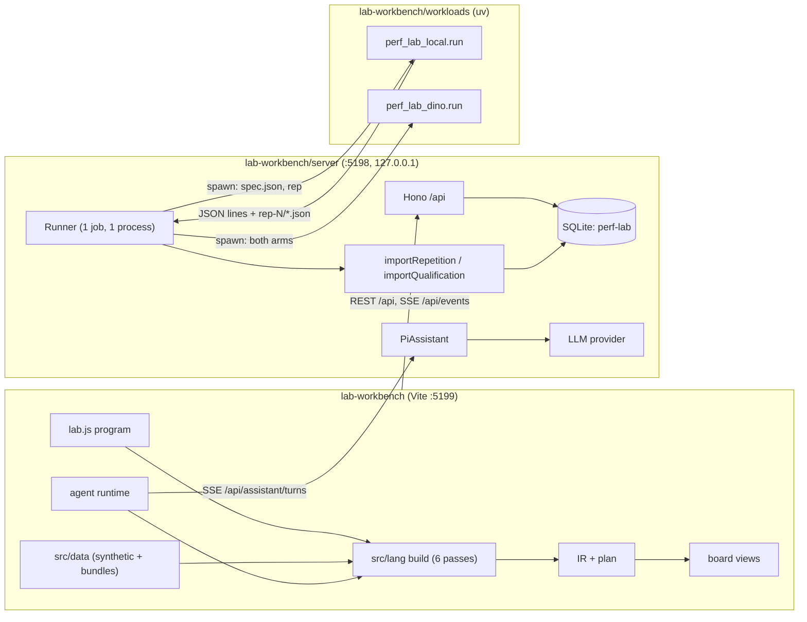
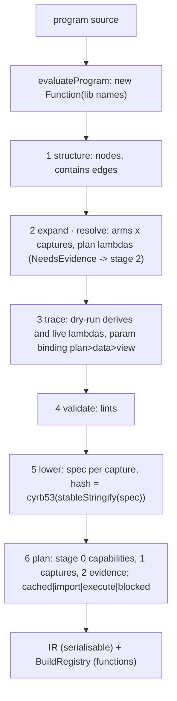
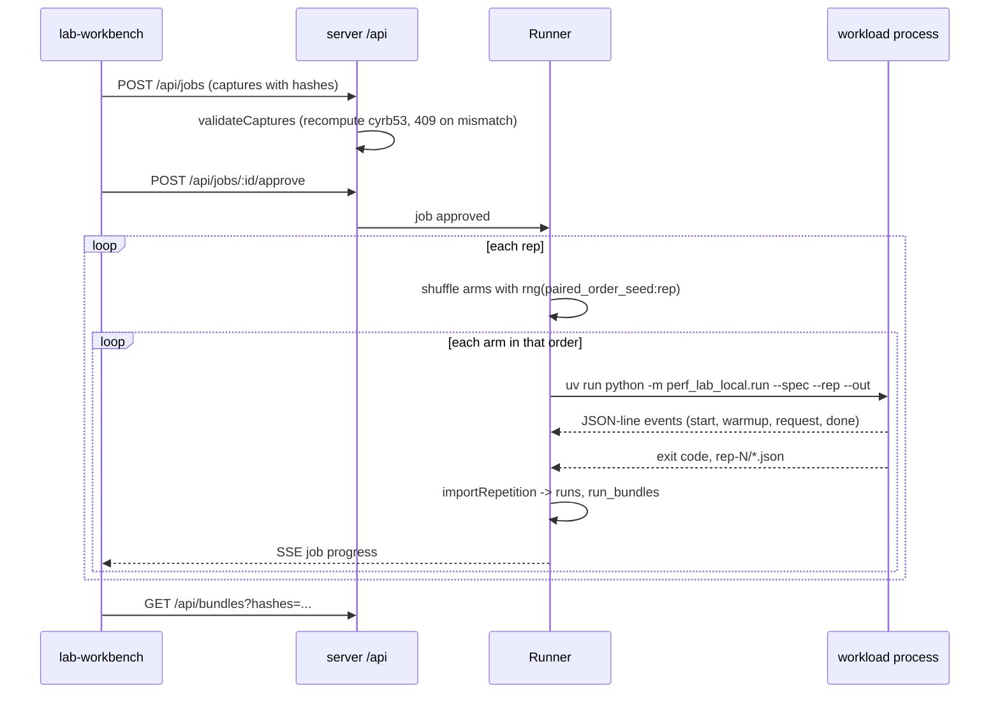
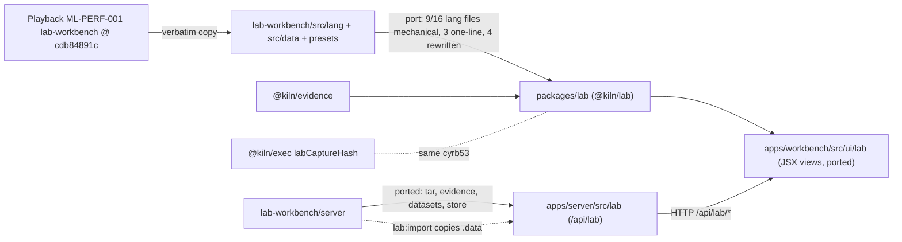

# Inventory notes D: Perf Lab and the kiln lab package

## Goal

An inventory, not a review: what each module of Perf Lab (`lab-workbench/`) and of `@kiln/lab` (`packages/lab/`) is
for, what it exposes, how big it is, how it is tested, and what is copied where. The last section collects the four
things the orchestrator asked for: (a) duplication, (b) complexity hotspots, (c) reusable components and the
couplings that would have to be cut, (d) dead or vestigial pieces.

## Context

- Repository: `/Volumes/SSD/code/kiln`, branch `main`. All paths below are relative to it unless absolute.
- `lab-workbench/` is a verbatim copy of Playback's ML-PERF-001 `experiments/lab-workbench` at Playback commit
  `cdb84891c`. It is its own pnpm root: `lab-workbench/pnpm-workspace.yaml` declares `packages: []`, and the root
  workspace does not include it.
- `packages/lab/` (`@kiln/lab`) is a headless, strictly-typed re-port of `lab-workbench/src/lang`, `src/data` and the
  presets, rebased onto `@kiln/evidence`.
- Evidence labels used throughout:
  - **[obs]** read in the code at the cited `file:line`;
  - **[ran]** executed during this inventory (command recorded in diary D);
  - **[inf]** inferred from code or comments, not executed or not traced end to end.
- Nothing in either tree was modified, installed or run except one read-only headless build of a preset with Node's
  native TypeScript stripping (§2.11, diary D Step 1).

## Quick Reference

| Area                      | Path                                                 | Non-test LOC | Tests (LOC)               | Notes                                                       |
| ------------------------- | ---------------------------------------------------- | ------------ | ------------------------- | ----------------------------------------------------------- |
| Language                  | `lab-workbench/src/lang`                             | 3945         | 337 + 5682-line fixture   | builders, 6 passes, queries, values, stats, detections      |
| Data layer                | `lab-workbench/src/data`                             | 1243         | (via lang tests)          | synthetic generator, sources, bundles, hosts, datasets      |
| Presets                   | `lab-workbench/src/presets`                          | 962          | `build.test.ts`           | 11 programs loaded with Vite `?raw`                         |
| Frontend (features, app)  | `src/features`, `src/app`, `src/services`, `src/lib` | 2721         | agent replies, tex, yaml  | Redux Toolkit store, thunks, agent runtime                  |
| Frontend (components)     | `src/components/**`                                  | 5910 TS/TSX  | RichText tokenize         | atomic design; 18 board views; 3366 lines CSS               |
| Server                    | `lab-workbench/server`                               | 3354         | 704                       | Hono `/api`, node:sqlite, runner, importers, assistant      |
| Workloads                 | `lab-workbench/workloads`                            | 680 Python   | none                      | `uv` project; sampler + DINO runners, probe                 |
| `@kiln/lab`               | `packages/lab/src`                                   | 6150         | 883 (+ fixtures)          | headless port; deps only `@kiln/evidence`                   |
| Kiln server port          | `apps/server/src/lab`                                | 1028         | (server suite)            | data routes at `/api/lab`, PL data-dir importer             |
| Kiln workbench port       | `apps/workbench/src/ui/lab`                          | 2468 JS/JSX  | `test/lab-e2e.mjs`        | dock views over `@kiln/lab`                                 |

Tracked `lab-workbench/` total: 330 files, about 33.2k lines (including the 5682-line golden JSON and the 965-line
`uv.lock`). No Storybook stories exist anywhere in it [obs].

## 1. Layout, dependencies and build

### 1.1 `lab-workbench/package.json` [obs]

- Runtime dependencies: `hono ^4.13.13`, `@hono/node-server`, `@reduxjs/toolkit ^2.13`, `react 19.3`, `react-dom`,
  `react-redux`, `react-router-dom 7`, `d3-scale`, `d3-shape`, `@mathjax/src 4.1.3`, fonts, and the coding-agent
  stack `@earendil-works/pi-ai` and `@earendil-works/pi-coding-agent` at `0.87.1`.
- Dev: `vite 8`, `vitest 4`, `tsx`, `typescript 5.9`.
- Scripts: `dev` (Vite on `:5199`, proxy `/api` → `:5198`), `build` (`tsc -b && vite build`), `test` (vitest),
  `lab-server` (`tsx server/index.ts`), `lab` (`tsx scripts/lab.ts`, the CLI).
- `vite.config.ts`: alias `@` → `src`; vitest runs in the `node` environment over `src/**/*.test.ts` and
  `server/**/*.test.ts`.
- `.gitignore` excludes `.data/` (the SQLite store and artifacts) and `workloads/.venv/` [obs].

### 1.2 `packages/lab/package.json` [obs]

- `"exports"`: `"."` → `src/index.ts`, `"./node"` → `src/node/index.ts`, `"./presets/*"` → `presets/*`.
- Dependencies: only `@kiln/evidence` (`workspace:*`). Dev: `@types/node ^26.6.5`, `typescript ^7.0.2`,
  `vitest ^5.0.5`.
- Scripts: `test`, `typecheck` (`tsc --noEmit`), `check:pl` (`node scripts/check-pl.ts`, compares against a Perf Lab
  store), `fixtures` (`node scripts/extract-fixtures.ts`).
- Strictness inherited from root `tsconfig.base.json`: `noUncheckedIndexedAccess`, `exactOptionalPropertyTypes`,
  `erasableSyntaxOnly`, `allowImportingTsExtensions`, `module: nodenext`. These four settings explain almost every
  mechanical difference between the two copies of the language (§9.2).

### 1.3 Largest files (non-test) [obs]

| File                                         | LOC  | Role                                              |
| -------------------------------------------- | ---- | ------------------------------------------------- |
| `packages/lab/src/lang/build.ts`             | 1036 | port of the compiler                              |
| `lab-workbench/src/lang/build.ts`            | 1030 | the compiler: six passes, lowering, lints, plan   |
| `packages/lab/src/data/generate.ts`          | 731  | port of the synthetic generator                   |
| `lab-workbench/src/data/generate.ts`         | 724  | deterministic synthetic runs                      |
| `lab-workbench/src/features/agent/runtime.ts`| 639  | in-browser agent loop and handles                 |
| `lab-workbench/src/lang/builders.ts`         | 451  | fluent builders and the method-recording Proxy    |
| `lab-workbench/server/qualification.ts`      | 394  | PR 1005 qualification-report importer             |
| `lab-workbench/server/runner.ts`             | 380  | job runner and executors                          |
| `lab-workbench/server/assistant/service.ts`  | 377  | LLM assistant service                             |
| `lab-workbench/src/components/.../ChartView` | 374  | chart board view                                  |
| `lab-workbench/server/db.ts`                 | 363  | migrations and helpers                            |
| `lab-workbench/src/lang/rows.ts`             | 350  | entity rows algebra                               |

## 2. The lab.js language (`lab-workbench/src/lang`)

A lab program is plain JavaScript evaluated with a library of free names. Builders record what the program declares;
the build turns the declarations into an IR (a graph plus a plan of captures) and a registry of live functions.

### 2.1 Module table [obs]

| Module          | Purpose                                                                 | Main exports                                                                    |
| --------------- | ----------------------------------------------------------------------- | ------------------------------------------------------------------------------- |
| `ir.ts`         | IR types only                                                           | `NodeKind`, `EdgeKind`, `IRNode`, `IR`, `LintItem`, `ParamSummary`, `PlanSummary` |
| `builders.ts`   | fluent builders, method recorder                                        | `recorder`, `VIEW_METHODS`, `CAPTURE_METHODS`, `LabB`, `ExperimentB`, `BoardB` … |
| `library.ts`    | the free names a program sees                                           | `createLibrary`, `capture`, `component`, `defineCollector`, `defineKind`        |
| `build.ts`      | evaluation, six passes, lowering, plan                                  | `build`, `evaluateProgram`, `BuildError`, `paramSpecOf`, `selectImages`         |
| `runtime.ts`    | derives, signals, `$`, registry                                         | `BuildRegistry`, `readDerive`, `makeDollar`, `dehydrate`/`rehydrate`            |
| `query.ts`      | lazy query values                                                       | `Query`, `q`, `isQuery`                                                         |
| `rows.ts`       | the row algebra over entities                                           | `Rows`, `Grouped`, `AggRows`, `makeEnt`, `FIELD_UNITS`, `DataSource`           |
| `values.ts`     | provenance-carrying values                                              | `val`, `derived`, `missing`, `illustrative`, `sealObserved`, `ProvenanceError` |
| `stats.ts`      | estimators                                                              | `stats.pairedRatio`, `stats.offered`, `stats.summary`                           |
| `compare.ts`    | structural kernel matching                                              | `compare`, `by`, `CompareB`, `MatcherB`                                         |
| `params.ts`     | parameter specs and URL codec                                           | `checkParam`, `encodeParam`, `decodeParam`, `formatParam`, `implicitDefault`    |
| `algo.ts`       | illustrative algorithm walkthroughs                                     | `algo`, `walkthrough`                                                           |
| `detections.ts` | detection/ground-truth comparison (port of PR 1005 Python)              | `pairDetections`, `compareDetections`, `evaluateDetections`, `verdicts`         |
| `env.ts`        | build-environment contract                                              | `BuildEnv`, `Capabilities`, `AdapterContract`, `CaptureInstance`                |
| `refs.ts`       | reference parsing                                                       | ref helpers                                                                     |
| `util.ts`       | hashing, RNG, stable JSON                                               | `hash` (cyrb53), `stableStringify`, `mulberry32`, `rng`, `quantile`, `globToRegExp` |

### 2.2 IR data model (`ir.ts`) [obs]

- `NodeKind`: `lab | experiment | arm | capture | import | derive | param | signal | lambda | board | view |
  hypothesis | compare`.
- `EdgeKind`: `contains | input | reads | produces | evidence | binds`.
- `IRNode`: `{ id, kind, label, parent, detail, props, hash, status, binding, phase }`; `status` is one of
  `cached | execute | import | blocked | skipped`.
- `ParamSummary`: `key, urlKey, scope (lab|experiment|board), control, options, optionsPhase
  (literal|plan|data|view|runs|none), constraints, binding, readers, confirm, affects, urlEnabled`.
- `CaptureSummary`: `hash, status (cached|execute|import|blocked), stage, blockedOn, estimateGpuMin, host, lowered`.
- `PlanSummary`: `stages, captures, execute, import, cached, blocked, estimateGpuMin`.
- `IR`: `{ buildId, version: 1, labId, title, nodes, edges, passes, lint, boards, params, plan, experiments,
  hypotheses, stats, durationMs }`; a failed build is a `BuildFailure`.

### 2.3 Builders and the recorder (`builders.ts`, `library.ts`) [obs]

- `recorder(self, log, known)` (`builders.ts:17-34`) wraps every builder in a `Proxy`. Real methods run; any other
  method name is recorded as `props[name] = args` and, when `known` is given and lacks the name, added to
  `log.unknown` (later the `unknown-method` lint). `then` and `toJSON` return `undefined` so a builder is never
  mistaken for a promise or serialised.
- `VIEW_METHODS` (`builders.ts:38-65`): per view kind, `COMMON_VIEW` (`focus, grow, height, title, eyebrow,
  missing, caption, width, span`) plus kind-specific methods, e.g. `chart` adds `mark, x, y, color, shape, sort,
  track, rule, filter, legend, roof`; `table` adds `cols, sort, limit, labels`; `stepper` adds `show, compare,
  casts, tree, caveat, implements, step`. The lookup is `VIEW_METHODS[kind]` (`builders.ts:83`), so a kind absent
  from the table (`detections`, `gallery`) gets `known === undefined` and **accepts any method without a lint** [obs].
- `CAPTURE_METHODS` (`builders.ts:153-164`): `timing{processes,pairs}`, `trace{apis,ranges,requests,buffer,processes}`,
  `kernels{launch,sections,cacheControl,replay}`, `memory{ledgers,around,states}`, `cpu{events,callGraph}`,
  `sanitizer{tool}`, plus `stages`, `predictions`, `tests`. `CaptureB.sections('+X')` is additive; `clone()` copies.
- `ExperimentB` recorded props: `question, workload, boundary, host, state, warmup, expect, gate, repeat, compare,
  offer, admission, deadline, drain, units, purpose, evidence`; explicit methods `baseline, candidate, arm,
  capture, param, phases, matrix` (cartesian product of arms), `when, limitation, skip, fork`.
- `ArmB`: `rev, switches, corunner, pin`. `PhasesB`: `stable, alternate, churn, only`.
- `BoardB`: `title, subtitle, layout, add, sig, derive, param, preset, effect`. `ViewB`: `as, on, add, left, right,
  p, pa`. `HypothesisB`: `claim, predicts(query, fn), supportedBy, alternatives, scope`.
- `LabB` (the value `lab(...)` returns): `data, param, experiment, derive, hypothesis, board, defaults, each, ref`.
- `createLibrary()` (`library.ts:85-167`) is the whole surface a program sees: `lab, rev, fixtures, src, archive,
  dataset`, the workloads `dino, embedding, sampler`, `load, activation, paired, quality.ref/exact, stats,
  schedule.poisson/constant, stress.*, none, capture.*, defineCollector, ms, q, compare, by, live, missing,
  illustrative`, the parameter kinds (`slider, range, number, checkbox, toggle, select, multiselect, radio, text,
  seed, pickRun`, and `textInput`), the views (`table, chart, timeline, stat, manifest, manifestDiff, mirror, metrics,
  kernelCard, ledger, source, route, stepper, hypothesisCard, note, math, text, row, stack, split, runList,
  detections, gallery, jobList, batchView, grid`), and `algo, component, defineKind, warmupPolicy`.

### 2.4 The build (`build.ts`) [obs]

Evaluation: `evaluateProgram` compiles the source with `new Function(...libNames, '"use strict"; …')` and maps error
line numbers back with `LINE_OFFSET = 3` (`build.ts:72-96`). There is no sandbox beyond strict mode and the absence
of other free names; the program runs with the page's (or Node's) globals [inf: no isolation code exists].

The six passes, each recorded as a `PassRecord` with a one-line detail:

1. **structure** (`build.ts:174`) — walk the lab builder: experiments, boards, derives, params; create
   `lab/experiment/arm/board/view/derive/param` nodes and `contains` edges.
2. **expand · resolve** (`build.ts:313-497`) — expand arms × captures into capture instances; resolve *plan
   lambdas* (functions in plan slots) with `resolveDeep(ctx)` where `ctx = { param, data, dataset, capabilities,
   adapter, host, evidence }`. A plan lambda that needs imported evidence throws `NeedsEvidence`, and its captures are
   deferred to plan stage 2.
3. **trace** (`build.ts:635-745`) — dry-run *live lambdas* and derives against the data source to discover which
   params and derives each reads; a param's binding is the strongest reader phase, `plan > data > view`. A hypothesis
   loop at `build.ts:732-734` is empty.
4. **validate** (`build.ts:748-827`) — lints. Codes observed: `unknown-method, no-quality-gate, no-activation-rule`
   (DINO only), `no-repetition, no-workload, counters-not-latency, capture-unsupported, host-unavailable, fork,
   layout-area, param-unused, param-default-invalid, param-affects-mismatch, param-plan-identity,
   param-options-empty, param-shadow, param-url-collision`; raised elsewhere: `live-in-plan-slot,
   lower-runner-slot, evidence-archive, dataset-images, collector-lower, resolve-error, derive-error`.
5. **lower** (`build.ts:830`) — one perf_lab specification per capture instance.
6. **plan** (`build.ts:838-872`) — stage 0 `capabilities` (one probe per host), stage 1 `captures`, stage 2
   evidence-dependent captures; each capture is `cached` (its hash is in the catalog), `import`, `execute` or
   `blocked` (host or capability missing).

### 2.5 A capture instance and its identity (`build.ts:517-625`) [obs]

`makeInstance` (`build.ts:517-591`) builds the lowered spec:

```text
spec = {
  schema_version: 1, experiment_id, arm, host,
  workload: lowerWorkload(exp),            // build.ts:597-625
  comparison: { baseline_revision, candidate_revision, arm_revision, switches, corunner, paired_order_seed },
  state, warmup, expect, phases, offer, admission, deadline,
  repeat: { processes },
  collection: { mode, ...captureOpts },
  quality_gate_sha256,                     // cyrb53 of the gate, build.ts:554
  evidence?                                // archive-backed captures only
}
hash = cyrb53(stableStringify(spec))
reps = timing: repeat.processes (default 3) | trace: opts.processes | memory: states.length
estimateGpuMin = reps × per-mode factor
```

- `lowerWorkload` for a DINO workload over a dataset selects `image_ids` with `selectImages` (`all`, `stratified`,
  `negatives`, `count`, `list`) and carries the dataset's real SHA-256 (`build.ts:617`). Without a dataset it sets
  `fixture_manifest_sha256: hash(String(fixtures))` (`build.ts:601`).
- **Naming hazard [obs]:** `quality_gate_sha256` and the non-dataset `fixture_manifest_sha256` are cyrb53 values
  (13-14 hex digits), not SHA-256; the importers then label the gate `sha256:<cyrb53>`
  (`server/importer.ts:258`, `server/qualification.ts:363`).
- The hash is the capture's identity everywhere: the catalog, the run store, job captures, and the server's
  `validateCaptures` check (§5.1).

### 2.6 Runtime (`runtime.ts`) [obs]

- `BuildRegistry` holds what cannot be serialised: derive functions, live lambdas, signal initial values, board
  effects. The IR holds only data.
- `paramValue` resolves applied → URL → default; `readDerive` memoises a derive by the param values it read and
  detects cycles; `markDerived` stamps rows with `__prov`.
- `queryEnv` turns a registry plus applied state into a `QueryEnv`; `makeDollar` builds `$` with `$.read`, `$.peek`,
  `$.set` for board signals; `dehydrate`/`rehydrate` move signal state through Redux.
- `patternExperiments` / `instancesForPattern` resolve `'exp/arm/mode'` glob patterns to capture instances.

### 2.7 Queries and rows (`query.ts`, `rows.ts`) [obs]

- A `Query` is lazy: a root (`entities | runs | read | of`) plus recorded operations replayed on `Rows` when
  materialised. Roots on `q`: `runs, requests, spans, kernels, tensors, allocs, instants, batches, graphs, images,
  annotations, detections, checks, read, of`.
- `EntityKind` includes the ML-PERF-002 kinds `image, annotation, detection, check`.
- `DataSource`: `{ runs, entities, entity, links }`. Entities get a prototype with `metric`, `follow`, `back`,
  `overlaps`.
- `Rows extends Array`: `where, name, kind, role, phase, arm, warm, sort, orderBy, top, distinct, pluck, first, one,
  follow, back, metric, sum, groupBy, stats`; `Grouped.agg/map`; `AggRows.keep`. `FIELD_UNITS` maps fields to units.

### 2.8 Values and provenance (`values.ts`) [obs]

- A `Value` is `{ __value, value, unit, prov, reason, source, scope, denominator, method, metric }` with
  `prov ∈ observed | derived | heuristic | illustrative | unknown`.
- `missing` is not zero: `valueOf()` returns `NaN`, so arithmetic on a missing value poisons rather than hides.
- `sealObserved` wraps observed rows in a `Proxy` that throws `ProvenanceError` on mutation, so a derive cannot
  overwrite a measured number.

### 2.9 Statistics (`stats.ts`, 122 LOC) [obs]

`stats.pairedRatio(opts)` (`stats.ts:23-92`):

```text
for each (arm, rep):                       # rep = one OS process
    m[arm][rep] = median(field over requests with outcome ok)   # field defaults to latency
    skip runs with runValid === false (counted as excluded)
pairs   = reps present in both arms
ratio_r = m[candidate][r] / m[baseline][r]
point   = median(ratio_r)
if pairs < 2: ci = [point, point] with a note
else: 2000 bootstrap resamples of the ratios, rng seeded with `pairedRatio:${ratios.join(',')}`
      ci = quantiles at (1-level)/2 and 1-(1-level)/2
method = "bootstrap over <n> processes"
```

- The unit of resampling is the process, not the request (comment at `stats.ts:21`): correlated requests within one
  process cannot masquerade as independent experiments.
- The `seed` option is accepted in the signature (`stats.ts:23`) but never read; the RNG is always seeded from the
  ratios (`stats.ts:69`) [obs]. `@kiln/lab` fixes this (§9.3).
- `stats.offered(input)` (`stats.ts:95-117`): open-loop offered-rate accounting per process window —
  `requestsOnTime, windowsOnTime, expired, rejected, outstandingAtEnd, offered` (a `derived` count).
- `stats.summary(input, field)` delegates to `Rows.stats`.

### 2.10 Compare, params, algo, detections [obs]

- `compare.ts`: `compare(a, b).match(by.op/layout/role/code/name…)`; `require` fields; reports matched pairs,
  `unmatched` and `excluded` — a structural, not statistical, kernel comparison.
- `params.ts`: `ParamSpec` kinds and constraints; `checkParam`, `encodeParam`/`decodeParam` for the URL,
  `formatParam`, `implicitDefault`.
- `algo.ts`: deterministic illustrative walkthroughs (`bilinear`, `weightedReduction`, `rmsnorm`, `matmulTiles`);
  every value is marked `illustrative`.
- `detections.ts` (port of PR 1005 `grounding_dino_quality.py`): `ordered`, `maximumMatching` (BFS augmenting paths),
  `pairDetections` (box tolerance 0.001, confidence 0.01, inclusive `math.isclose`-style), `compareDetections`,
  `overlap`/IoU (crowd regions use the detection's area), `evaluateDetections` (priority regular > ignored > crowd),
  `compareGroundTruth`, `cocoBox`, `verdicts` (`exact | within-tolerance | changed | added | dropped`). Guarded by a
  golden fixture (`quality-golden.json`, 5682 lines) generated from the Python.

### 2.11 Example program and what it compiles to [ran]

`presets/hello.lab.js` (abridged):

```js
lab('Hello, Perf Lab')
  .experiment('dino-warm', (e) => e
    .question('Does PR 1005 lower warm backend latency on the same work?')
    .workload(dino({ fixtures: 'coco-128', precision: 'fp16', inputSize: 768 }))
    .boundary('backend_cpu_result')
    .baseline(rev('a6f14d94')).candidate(rev('d59d9ad0'))
    .capture(capture.timing()))
  .derive('latency', q.requests('dino-warm/*/timing'),
          (r) => r.groupBy('arm').agg({ latency: [count, p50, p95, max] }))
  .board('overview', (b) => b.title('Warm latency, baseline and candidate')
    .add(table('latency')).add(chart('latency')));
```

Built headlessly with `@kiln/lab`'s `buildSynthetic` (the `lab-workbench` build is the same algorithm; the package
only normalises `lowered`), the IR is:

```text
passes
  1 structure: 1 experiments · 1 boards · 1 derives · 0 params
  2 expand · resolve: 1 experiments · 2 capture instances · 0 plan lambdas · 0 staged
  3 trace: 0 live lambdas · 1 derives traced · 0 dry-run notes
  4 validate: 3 findings
  5 lower: 2 perf_lab specifications
  6 plan: 2 cached · 0 execute · 0 blocked
lint (all warnings)
  no-quality-gate     dino-warm: no quality gate — results will be marked unqualified
  no-activation-rule  dino-warm: no activation rule — a silent fallback would count as a candidate result
  no-repetition       dino-warm: no repetition policy — one process per arm cannot support a comparison
nodes (12)
  lab · experiment:dino-warm (dino · playback@dgx)
  arm baseline (rev a6f14d94) · arm candidate (rev d59d9ad0)
  capture:dino-warm/baseline/timing  [cached] timing ×3 · 14fc4e27   → import (3 runs)
  capture:dino-warm/candidate/timing [cached] timing ×3 · 205b2767   → import (3 runs)
  derive:latency · board:overview · view table·6 · view chart·7
edges (13): contains ×6, produces ×2, input ×3 (2 imports → derive, derive → table), contains board→views ×2
plan: stage 0 capabilities [capabilities@playback@dgx]; stage 1 captures [both]; estimate 0.22 GPU-min each
derive output (synthetic): baseline count 120, p50 138.78 ms; candidate count 120, p50 68.01 ms; prov "derived"
```

The lowered spec of the baseline capture:

```json
{ "schema_version": 1, "experiment_id": "dino-warm", "arm": "baseline", "host": "playback@dgx",
  "workload": { "adapter": "dino", "boundary": "backend_cpu_result", "fixture_manifest_sha256": "146d72d6b2cd52",
                "fixtures": "coco-128", "inputSize": 768, "precision": "fp16" },
  "comparison": { "arm_revision": "a6f14d94", "baseline_revision": "a6f14d94", "candidate_revision": "d59d9ad0",
                  "corunner": null, "paired_order_seed": null, "switches": null },
  "collection": { "mode": "timing" }, "repeat": { "processes": 3 }, "phases": [],
  "admission": null, "deadline": null, "expect": null, "offer": null, "quality_gate_sha256": null,
  "state": null, "warmup": null }
```

Observations from the run: the chart view received no `input` edge (only the table did), the host defaulted to
`playback@dgx`, and the synthetic build reports both captures `cached` because the synthetic catalog holds every
hash it is asked for [ran]. The three lints match `build.test.ts` ("hello reports the missing contract as lints")
[obs].

A larger preset, `local-sampler.lab.js` [obs]: host `local`, workload `sampler`, arms
`rev(ctx.capabilities.tools.workloads)` with `switches({ impl: 'unfused' | 'compiled' })`, `expect` activation
`compile active`, a quality gate, `repeat` 4 processes with paired order seed `20261012`, a `pairedRatio` comparison,
captures `timing/trace/memory/cpu`, derives `latency/speedup/blocks`, hypothesis `compile-removes-intermediate`, and
boards `identity/latency/memory/cpu`.

## 3. Data layer (`lab-workbench/src/data`, 1243 LOC) [obs]

| File              | Purpose                                                                                           |
| ----------------- | ------------------------------------------------------------------------------------------------- |
| `generate.ts`     | deterministic synthetic runs seeded by capture hash + rep (`Gen`); `genCollector` (gpu-clocks), `genDino`, `kernelMetrics`, `dinoMemory`, `genEmbedding` |
| `source.ts`       | `createSource`/`createSyntheticSource`, `RunProvider`, `DatasetProvider`, a run cache              |
| `env.ts`          | `syntheticEnv()` and `appEnv(catalog)` — the second marks catalog captures as measured from bundles |
| `bundles.ts`      | module-level bundle cache; fetches `/api/bundles?hashes=` in batches of 16 and revives entities    |
| `capabilities.ts` | synthetic hosts `playback@dgx` (GB10) and `playback@rtx-dev`; module-global `localReport` set by `setLocalReport`; `ADAPTERS` for dino, embedding, sampler, unknown |
| `datasets.ts`     | module caches and fetches of `/api/datasets`, `loadEvidence`, `indexDataset`, `mediaUrl` → `/api/media/<sha>` |

- Synthetic kernel metrics are created with `val(...)`, i.e. labelled **observed** although generated
  (`generate.ts`); `@kiln/lab` relabels them `illustrative` (its P-7) [obs].
- The data layer is not pure: `bundles.ts`, `capabilities.ts` and `datasets.ts` hold module-level state and call
  `fetch` against the Perf Lab server's `/api` [obs]. This is the main reason the browser `src/data` could not be
  reused headlessly as is.

## 4. Presets (`lab-workbench/src/presets`, 962 LOC) [obs]

The programs live in `src/presets/programs/*.lab.js` (11 programs, 2 reply scripts); `src/presets/index.ts` loads
each with Vite's `?raw` and groups them: `hello`, `parameters`, `request-to-kernel`, `compare`, `learn`, `matrices`,
`scenario-a` (+ scripted agent replies), `scenario-b`, `scenario-c` (+ replies), `local-sampler`, `dino-pr1005`.
`build.test.ts` builds every preset. The `?raw` import ties the preset registry to Vite; `@kiln/lab` replaces it with
a filename registry plus a Node reader (§9.3).

## 5. Server (`lab-workbench/server`, 3354 LOC)

Hono on `@hono/node-server`, `node:sqlite`, port 5198, data in `PERF_LAB_DATA_DIR` (default `.data`). One process
holds the API, the runner and the assistant.

### 5.1 HTTP routes (`server/app.ts`, basePath `/api`) [obs]

| Method | Path                              | Line  | Notes                                                              |
| ------ | --------------------------------- | ----- | ------------------------------------------------------------------ |
| GET    | `/health`                         | 70    | includes `features: ['evidence-import','datasets','media']`         |
| GET    | `/hosts`                          | 85    | synthetic hosts + local                                             |
| GET    | `/hosts/:host/capabilities`       | 92    | `local` only; runs the Python probe (`probe.ts`, 180 s timeout)     |
| GET    | `/programs/:labId`                | 102   | saved program source                                                |
| PUT    | `/programs/:labId`                | 106   | debounced autosave from the client                                  |
| DELETE | `/programs/:labId`                | 112   |                                                                     |
| GET    | `/catalog`                        | 118   | artifacts with origin/status                                        |
| POST   | `/labs/:labId/seed`               | 126   | registers synthetic artifacts for non-executable hosts              |
| GET    | `/bundles?hashes=`                | 134   | up to 64 hashes                                                     |
| GET    | `/jobs`, `/jobs/:id`              | 142-3 |                                                                     |
| POST   | `/jobs`                           | 147   | `validateCaptures` (50-64) recomputes cyrb53 → `409 spec_hash_mismatch`; `approve: true` only for user-proposed jobs |
| POST   | `/jobs/:id/approve`               | 183   |                                                                     |
| POST   | `/jobs/:id/cancel`                | 191   |                                                                     |
| GET    | `/annotations`, POST same         | 205-6 |                                                                     |
| GET    | `/evidence`, `/evidence/:sha`     | 214-5 |                                                                     |
| POST   | `/evidence`                       | 219   | tar.gz archive, 64 MiB cap                                          |
| GET    | `/datasets`, `/datasets/:id`      | 233-4 |                                                                     |
| POST   | `/datasets/:id/materialize`       | 240   | `202`; downloads public COCO images, SHA-verified                   |
| GET    | `/media/:sha`                     | 255   | public media only                                                   |
| GET    | `/events`                         | 266   | SSE bus, 15 s ping                                                  |

Assistant routes, mounted by `server/assistant/service.ts`, all under `/api/assistant`: `GET /models` (249),
`GET /conversations` (255), `GET /library` (262), `GET /library/:id` (281), `POST /archive` (288),
`POST /library/:id/restore` (300), `DELETE /library/:id` (312), `POST /turns` (321, SSE),
`POST /messages/:id/result` (355).

No route has authentication: the server binds `127.0.0.1` (`config.ts:28`; port `PERF_LAB_PORT`, default 5198)
and trusts every local caller. The only role distinction is `proposed_by`, set by the route a job came through.

### 5.2 SQLite schema (`server/db.ts`) [obs]

`node:sqlite`, WAL, foreign keys on; five migrations in `MIGRATIONS` (`db.ts:11`), tracked in `schema_migrations`
(`db.ts:331-332`).

| Version | Line    | Change                                                                                                         |
| ------- | ------- | -------------------------------------------------------------------------------------------------------------- |
| 1       | 12-150  | `programs`, `artifacts` (origin `synthetic|measured`, status `running|available|failed`), `runs`, `run_bundles` (gzip JSON entities/links), `jobs` (`proposed|approved|running|importing|done|failed|cancelled`, `proposed_by user|assistant`), `job_captures`, `job_events`, `annotations`, `conversations`, `messages`, `llm_calls` |
| 2       | 153-154 | `llm_calls.prompt_chars`, `est_prompt_tokens`                                                                  |
| 3       | 161-191 | `runs`/`run_bundles` re-keyed to `(hash, rep)`; earlier ref-keyed runs overwrote each other across parameter values |
| 4       | 200-251 | `conversations.archived_at` + partial unique index on the active conversation; `messages`/`llm_calls` rebuilt |
| 5       | 260-311 | `artifacts.source`; `evidence_archives`, `datasets` (COCO, public flag), `dataset_images`, `dataset_annotations`, `media` |

### 5.3 Runner and job lifecycle (`server/runner.ts`, 380 LOC) [obs]

- `Executor` (`runner.ts:31`) has two implementations: `processExecutor` (`:46`) and a synthetic one that sleeps
  150 ms and stores no runs (the client generates synthetic data itself).
- `Runner` (`:104`): one job and one process at a time. Captures are grouped by `experiment / mode @ host`.
- **Paired order** (`:302-310`): for each repetition, the group's arms are shuffled with Fisher-Yates using
  `rng(`${paired_order_seed}:${rep}`)`, so baseline and candidate interleave per rep in a reproducible order.
- After each repetition `importRepetition` turns the output directory into a bundle (`:326`).
- Evidence-backed captures skip execution: `importEvidence` (`:165`) imports a qualification report from an archive
  (`reportsDir 'qualification/reports/'`).
- DINO on an executable host goes through `runDino` (`:217`) → `runDinoRepetition` (`dino.ts:60`), which runs both
  arms in one Python process.
- Interrupted jobs are failed at startup (`store.ts` `failInterruptedJobs`).

### 5.4 Workload process protocol (`workloads/`, `uv` project) [obs]

`workloads/pyproject.toml`: Python `>=3.12,<3.14`, `torch==2.14.1`, `transformers==5.2.0`, `numpy==2.5.4`,
`opencv-python-headless`, `pillow`, `huggingface-hub`, `pydantic-settings`; `uv` `package = false`.

```text
spawn: uv run --project workloads python -m perf_lab_local.run \
         --spec <data>/<hash>/spec.json --rep N --out <data>/<hash>/rep-N        (runner.ts:57)
env:   PYTHONUNBUFFERED=1, PERF_LAB_INDUCTOR_CACHE
stdout: one JSON object per line, {"event": "start|warmup|request|done|error", ...}
        → job event "script.<event>"
stderr: last 8000 characters kept for the failure message
exit:   non-zero → run invalid
outputs in rep-N/: manifest.json, activation.json, quality.json (maxAbsDiff vs eager unfused; tol 1e-5 / 1e-2),
                   timing.json (per-request start/end/cpu ns), cpu.json (getrusage delta),
                   trace.json (torch.profiler chrome trace), memory.json
```

- `perf_lab_local/sampler.py` (120 LOC) implements deformable-attention sampling three ways: `unfused`
  (`grid_sample` into a `[B·H, C, Q, P]` intermediate), `gather` (no intermediate, many small ops), `compiled`
  (`unfused` through TorchInductor; fusion recorded as activation, not assumed). `run.py` (219 LOC) reads
  `comparison.switches.impl`, `collection.mode`, `state.compilerCache`.
- `perf_lab_dino/run.py` (261 LOC): `--specs <baseline> <candidate> --mode --rep --images --repo --out`; writes
  `reports/paired.json` or `example-predictions.json`, `artifact-provenance.json`, `run-configuration.json` in the
  PR 1005 qualification layout, which `qualification.ts` then imports.
- `perf_lab_local/probe.py` (76 LOC) prints a capability JSON; `server/probe.ts` runs it.

### 5.5 Importers [obs]

- `importer.ts` `importRepetition` (`:63`) builds `run`, `request`, `span`, `kernel`, `alloc`, `tensor`, `instant`
  entities and `contains/launches/aliases` links from one rep directory. `roleOf(op)` (`:53`) classifies ops into
  roles. A run is **valid** iff the exit code is 0 and the declared activation expectation holds; its quality is
  **qualified** iff a gate was declared, `quality.pass`, and the run is valid (`:243-258`).
- `qualification.ts` is **not** statistics: it imports the `detection-qualification/v1` report format
  (`QUALIFICATION_FORMAT`, `:16`) produced by PR 1005. `reportsFor` (`:45`), `parseProfilerTable` (`:66`),
  `parseJunit` (`:86`), `kernelRole` (`:103`, Inductor prefix first), `variantOf` (`:113`), `importQualification`
  (`:115`) per mode: timing (paired results or changing-prompt rows), memory pools, stage spans, predictions with
  verdicts and ground-truth evaluation (`detections.ts`), kernels, tests. Quality is qualified iff a gate was declared,
  every digest is exact and the run is valid (`:337-363`).

### 5.6 Evidence, datasets, media, tar [obs]

- `evidence.ts`: `registerArchive` (`:59`) validates a tar.gz entry by entry (`tar.ts` `readTarGz`, `checkPath`), stores
  it by SHA-256, and registers any COCO selection inside it as a dataset. `MAX_ARCHIVE_BYTES = 64 MiB` (`:13`).
- `datasets.ts`: `registerCocoDataset` (`:83`), `listDatasets`/`getDataset`, `readMedia` (`:197`; 400/403/404 results),
  `materialize` (`:227`) downloads public COCO S3 images through `publicFetchUrl` (`:71`) and verifies each SHA-256.
- `tar.ts` (129 LOC): `readTarGz` (ustar, pax, GNU long names; regular files and directories only), `writeTar`.

### 5.7 Assistant (`server/assistant`) [obs]

- `model.ts`: model catalog via the `pi` agent's credentials under `~/.pi/agent`; default model
  `lunaroute/deepseek-4.1-flash:high` (`config.ts`).
- `prompt.ts`: `systemPrompt` (`:28`) states the rules, including "at most four code executions per question"
  (`:12`); `observationText` (`:39`), `splitReply` (`:52`). It imports `REFERENCE` from
  `src/components/organisms/IdePane/reference.ts` (`prompt.ts:1`) — a server module importing a UI component's file.
- `service.ts` `PiAssistant`: `MAX_STEPS = 4` (`:14`) enforces that limit (`:203`, `:213`; the last step's code is
  kept but marked `skipped`); `HISTORY = 24` messages (`:15`, `:182`); one answer per conversation at a time
  (`busy`, `409`); conversations, messages and `llm_calls` persisted with a prompt-token estimate of
  `ceil(promptChars / 4)` (`:127`, `:225`).
- The model's code never runs on the server. The SSE `reply` event carries `code` and `run`; the browser runs it in
  the agent runtime (§6.3) and posts `{status, value, error, logs, ms, continue}` to `POST /messages/:id/result`
  (`:355-372`), which stores an `observation` message and, with `continue: true`, asks the model again.

## 6. Frontend (`lab-workbench/src`)

### 6.1 Architecture [obs]

- Redux Toolkit store (`app/store.ts`) with slices `program, build, params, signals, selection, catalog, jobs, agent,
  annotations, ui, server` plus an RTK Query API `labApi` (`hosts`, `capabilities`). Layout and model choice persist
  to `localStorage`; the program is autosaved with a debounced `PUT /api/programs/:labId`.
- Builds are not serialisable, so they live outside Redux in `app/registry.ts` (keeps the last 24) together with
  agent patches; Redux stores only build ids and the IR.
- `features/build/thunks.ts` `buildLab`: a seed build that excludes host `'local'` (hard-coded), `POST /labs/:id/seed`,
  the real build with `appEnv(catalog)`, `loadMeasured` (bundles), then a rebuild.
- `features/server/thunks.ts`: `EventSource('/api/events')`, health, catalog, models, programs, jobs, and
  `setLocalReport` into the data layer's module global.

### 6.2 Views (`ViewRenderer.tsx:41-64`) and their inputs [obs]

| View kind        | Renderer                | Input (what `.on(...)`/args give it)                     |
| ---------------- | ----------------------- | -------------------------------------------------------- |
| `table`          | `TableView`             | rows of a derive or query; `cols, sort, limit, labels`  |
| `chart`          | `ChartView` (d3)        | rows; `mark, x, y, color, shape, track, rule, roof`     |
| `timeline`       | `TimelineView`          | spans/requests; `lanes, bucket, window, request`        |
| `stat`           | `StatView`              | one value or estimate; `unit, format, compare`          |
| `manifest`, `manifestDiff` | `ManifestView`| runs; `fields`                                           |
| `mirror`         | `MirrorView`            | a `compare` result; `align, unmatched, request`         |
| `kernelCard`, `metrics` | `KernelCardView` | one kernel and its counters (`metrics` is an alias)     |
| `ledger`         | `LedgerView`            | allocs; `groupBy, scope`                                 |
| `stepper`        | `StepperView`           | an `algo` walkthrough; `show, compare, casts, step`     |
| `route`          | `RouteView`             | a query walked hop by hop                                |
| `hypothesisCard` | `HypothesisView`        | a hypothesis; verdict computed in the view               |
| `note`, `math`, `text` | `TextView`        | markdown / TeX (MathJax) / styled text                   |
| `source`         | `SourceView`            | program source                                           |
| `runList`        | `RunListView`           | runs                                                     |
| `control`        | `ControlView`           | a parameter control                                      |
| `batchView`      | `BatchView`             | batches; `show`                                          |
| `detections`     | `DetectionsView`        | dataset + image id, `.runs(pattern)`                     |
| `gallery`        | `GalleryView`           | `q.images(dataset)`, `.runs(pattern)`                    |
| `row, stack, grid, split, component, kind:*` | `Layout` | children / slots                          |

`ViewRenderer.tsx:113-114`: an unregistered kind renders `no renderer for view kind "…"`.

- **Hypothesis verdicts live in a React view** [obs]: `HypothesisView.tsx:19-48` `evaluateHypothesis` — `unqualified`
  if any supporting run is invalid; `open` if there are no checks or a failing row has missing values; `supported`
  if all pass; otherwise `refuted`. `src/lang/evidence.test.ts:97` imports it from the component.

### 6.3 Agent runtime (`features/agent/runtime.ts`, 639 LOC) [obs]

- Two sources of replies: scripted (`parseReplies` over preset reply files: `=== board`, `> prompt`, a `js` fence) or
  live from `POST /api/assistant/turns` (SSE).
- Agent code runs with `AsyncFunction` over `createLibrary()` plus handles: `lab` (`experiment, fork, patch, plan,
  derive, query, runs, run, hypothesis, params, start, checkpoint, jobs`) and `self` (`params`/`state` proxies,
  `focus`, `find`). Each step snapshots state for rollback; 10-minute timeout.

### 6.4 Component tree [obs]

Atomic design: `atoms` (17), `molecules` (18), `organisms` (`AgentRail, BoardSheet, BoardStrip, GraphTab, IdePane,
Inspector, InspectTab, LabTab, ParamBar, PlanTab, PresetPicker, RunsTab, TopBar, TranscriptLibrary, ViewRenderer`, 18
views under `organisms/views/`), `templates/WorkbenchLayout`, `pages/{Workbench,NotFound}`. LOC: atoms 463 TS/469
CSS, molecules 1007/621, organisms 4202/2111, templates 111/157, pages 127/8.

## 7. Tests

### 7.1 `lab-workbench` [obs]

- `src/lang/build.test.ts`: every preset builds; hello lints; param bindings; scenario B and A; URL codec; error line
  numbers; the local host.
- `src/lang/detections.test.ts`: golden comparison against `quality-golden.json`.
- `src/lang/evidence.test.ts`: archive-backed builds, lowered DINO workload, hypothesis verdicts (via the component).
- `src/lib` (tex, yaml), `RichText` tokenizer, agent reply parser.
- `server/server.test.ts`: migrations, importer, API seed, paired job, parameter separation, failure.
  `server/qualification.test.ts`, `server/evidence.test.ts`, `server/assistant.test.ts`.

### 7.2 `packages/lab` [obs]

`test/` covers `build`, `data`, `detections`, `evidence`, `hypothesis`, `measured`, `stats`, and `browser-safety`
(asserts the main entry does not reach Node built-ins), with fixtures extracted by `scripts/extract-fixtures.ts`.
`scripts/check-pl.ts` replays builds against a real Perf Lab store read through `readPerfLabStore`.

Tests were not run in this area; the ticket's test baseline is in the main diary (KILN-004 diary Step 2).

## 8. Python and data directories, briefly [obs]

- `workloads/.venv/` exists on disk (gitignored); a line count over `workloads/` without excluding it reports
  hundreds of thousands of lines of site-packages. Tracked Python is 680 lines.
- `.data/` holds the SQLite store (`perf-lab.db` + WAL) and per-hash artifact directories; it is what Kiln's
  `lab:import` copies.

## 9. `@kiln/lab` compared with its source

### 9.1 File map [obs]

| `packages/lab/src/…`     | LOC  | Source in `lab-workbench/src/…` | Kind of difference                                  |
| ------------------------ | ---- | ------------------------------- | --------------------------------------------------- |
| `lang/ir.ts`             | 153  | `lang/ir.ts`                    | mechanical                                          |
| `lang/refs.ts`           | 57   | `lang/refs.ts`                  | mechanical                                          |
| `lang/env.ts`            | 70   | `lang/env.ts`                   | mechanical                                          |
| `lang/query.ts`          | 157  | `lang/query.ts`                 | mechanical                                          |
| `lang/params.ts`         | 266  | `lang/params.ts`                | mechanical                                          |
| `lang/algo.ts`           | 260  | `lang/algo.ts`                  | mechanical                                          |
| `lang/detections.ts`     | 288  | `lang/detections.ts`            | mechanical (`cocoBox` destructuring)                |
| `lang/builders.ts`       | 463  | `lang/builders.ts`              | mechanical                                          |
| `lang/compare.ts`        | 121  | `lang/compare.ts`               | mechanical                                          |
| `lang/build.ts`          | 1036 | `lang/build.ts`                 | mechanical + `lowered` normal form                  |
| `lang/library.ts`        | 178  | `lang/library.ts`               | adds `below`, `above`; `illustrative(opts)`         |
| `lang/runtime.ts`        | 255  | `lang/runtime.ts`               | `markDerived` skips sealed rows                     |
| `lang/rows.ts`           | 368  | `lang/rows.ts`                  | aggregate provenance via `combine`; deep seal       |
| `lang/values.ts`         | 113  | `lang/values.ts`                | re-exports `@kiln/evidence`; `val` removed          |
| `lang/stats.ts`          | 168  | `lang/stats.ts`                 | estimators on `@kiln/evidence`; seed honoured       |
| `lang/util.ts`           | 114  | `lang/util.ts`                  | `rng`/`quantile` from evidence; `hash` kept         |
| `lang/hypothesis.ts`     | 103  | `components/…/HypothesisView`   | **new**: headless verdicts                          |
| `data/generate.ts`       | 731  | `data/generate.ts`              | `val` → `illustrative`                              |
| `data/source.ts`         | 142  | `data/source.ts`                | mechanical                                          |
| `data/env.ts`            | 83   | `data/env.ts`                   | `syntheticEnv({hosts})`, `labEnv(LabData)`, `buildSynthetic` |
| `data/lab-data.ts`       | 132  | —                               | **new**: injected data interface                    |
| `data/bundles.ts`        | 24   | `data/bundles.ts`               | reduced to `reviveBundles`, no fetch/cache          |
| `data/capabilities.ts`   | 182  | `data/capabilities.ts`          | `hostReport`, `capabilitiesFor` replace the global  |
| `data/datasets.ts`       | 150  | `data/datasets.ts`              | no caches; `/api/lab/media/`; `evidenceBlockedBy`   |
| `presets.ts`             | 128  | `presets/index.ts`              | filename registry instead of `?raw`                 |
| `node/presets.ts`        | 19   | —                               | `readPresets`, `readPreset` (Node fs)               |
| `node/perf-lab-store.ts` | 194  | —                               | `readPerfLabStore`: read a PL store from a copy     |
| `index.ts`               | 192  | —                               | the public barrel                                   |

### 9.2 Mechanical differences (every file) [obs]

- `.ts` extensions on relative imports (`allowImportingTsExtensions`, `nodenext`).
- `| undefined` on optional properties (`exactOptionalPropertyTypes`).
- `!` and defaults on indexed reads (`noUncheckedIndexedAccess`).
- Constructor parameter properties rewritten as explicit fields (`erasableSyntaxOnly`), so Node can strip types.

### 9.3 Semantic differences [obs]

Labels P-n are the package's own change identifiers, cited in its comments.

- `values.ts`: re-exports `Value`, `missing`, `derived`, `illustrative` from `@kiln/evidence`; `val` is removed (only
  importers may create observed values); `sealObserved` becomes a deep seal; adds `valueFrom`, `computed`,
  `defined`, `fieldsOf`, `withValue`, `revive`, `LinkEvidence`.
- `stats.ts`: `pairedRatio` and `median` from `@kiln/evidence`; the `seed` option is honoured (its default is derived
  the same way Perf Lab's was, so default results agree); arm names are options; the result adds `caveat`, `seed`, `n`.
  `offered` treats a missing arrival or window as missing rather than zero (P-9, P-10, P-15).
- `util.ts`: `rng` and `quantile` from `@kiln/evidence` with an identical stream; `hash` kept bit for bit because
  stored capture hashes depend on it (P-5).
- `rows.ts`: aggregate provenance via `combine` — an aggregate of illustrative values stays illustrative instead of
  becoming `derived`; deep seal on observed rows. `runtime.ts` `markDerived` skips sealed rows.
- `build.ts`: `CaptureSummary.lowered` is `JSON.parse(stableStringify(spec))`, a key-sorted normal form.
- `library.ts`: adds `below`/`above` (evidence checks); `illustrative` accepts options.
- `generate.ts`: synthetic metrics are `illustrative`, not observed (P-7).
- New `lang/hypothesis.ts`: headless `evaluateHypothesis`/`evaluateHypotheses` on evidence `verdict`; a throwing
  predicate gives `open`, a `null` predicate `undecided`.
- New `data/lab-data.ts`: `LabData` (catalog, bundles, datasets, media URL…), `createMemoryLabData`,
  `bundlesNeeded`. `data/env.ts` `labEnv(LabData)` replaces `appEnv(catalog)` + module caches.
- `data/capabilities.ts`: `HostReport`, `HostViewLike`, `hostReport(view, workloads)` built from Kiln's
  `GET /api/hosts`; `capabilitiesFor(reports)` replaces the module-global `localReport`; `LAB_KIND =
  'perf-lab-sampler/1'` names the Kiln run kind.
- `data/datasets.ts`: no module caches; `indexDataset` exported; `defaultMediaUrl` → `/api/lab/media/`;
  `evidenceBlockedBy`; `EVIDENCE_IMPORT_FEATURE`.
- Presets: identical except `local-sampler.lab.js` (host param `mac`/`bling`, source path) and `dino-pr1005.lab.js`
  (host `mac`, limitation text); the package adds `sampler-hosts.lab.js`. The package's `presets.ts` comment says
  the presets are "copied unmodified", which is no longer true for those two [obs].

### 9.4 Consumers of `@kiln/lab` [obs]

- Only `apps/workbench`: `package.json:21`; `src/ui/lab/api.js:5` imports `labEnv`, `createMemoryLabData`,
  `hostReport` and re-exports the runtime (`:12`); `state.js` and `panels.jsx` use it; `build.mjs:31` bundles the
  presets; `test/lab-e2e.mjs` drives it.
- `apps/server` does **not** depend on `@kiln/lab` (its dependencies are `@kiln/evidence`, `@kiln/exec`, `hono`).
- `packages/lab/scripts/perf-lab.ts:6,40-41` and `check-pl.ts` use `readPerfLabStore`; nothing else does.

### 9.5 Diff counts behind the comparison [ran]

`raw` is `diff <PL> <pkg> | grep -c '^[<>]'`. `norm` is the same after removing the three mechanical edits that
`sed` can undo: the `.ts` import extension, `| undefined`, and a postfix `!` before `. ; , ) [`. What `norm` still
shows in a "mechanical" file was inspected by eye: constructor parameter properties rewritten as fields, tuple
destructuring with defaults, and the one-line semantic edits named in the last column.

| File (`src/…`)        | PL LOC | pkg LOC | raw | norm | Residual after normalising                                            |
| --------------------- | ------ | ------- | --- | ---- | --------------------------------------------------------------------- |
| `lang/ir.ts`          | 153    | 153     | 52  | 0    | none                                                                  |
| `lang/refs.ts`        | 57     | 57      | 2   | 0    | none                                                                  |
| `lang/env.ts`         | 70     | 70      | 10  | 0    | none                                                                  |
| `lang/query.ts`       | 155    | 157     | 14  | 10   | `Query` constructor fields                                            |
| `lang/params.ts`      | 264    | 266     | 16  | 12   | tuple type `[number, number]`, fields                                 |
| `lang/algo.ts`        | 260    | 260     | 14  | 8    | destructuring defaults                                                |
| `lang/detections.ts`  | 285    | 288     | 31  | 9    | `cocoBox` defaults, test path in a comment                            |
| `lang/builders.ts`    | 451    | 463     | 100 | 60   | constructor fields of the builder classes                             |
| `lang/compare.ts`     | 116    | 121     | 21  | 15   | constructor fields                                                    |
| `lang/build.ts`       | 1030   | 1036    | 38  | 12   | `BuildError`/`NeedsEvidence` fields; `lowered` normal form (`:866-868`) |
| `lang/runtime.ts`     | 253    | 255     | 70  | 6    | `markDerived` skips sealed rows (`isSealed`); `?? pattern`            |
| `lang/library.ts`     | 169    | 178     | 27  | 13   | `below`/`above`; `illustrative` takes a unit or options; `describeText` guard |
| `lang/rows.ts`        | 350    | 368     | 70  | 66   | semantic: provenance via `combine`, deep seal                         |
| `lang/values.ts`      | 89     | 113     | 156 | 156  | rewritten on `@kiln/evidence`                                         |
| `lang/stats.ts`       | 122    | 168     | 126 | 122  | rewritten on `@kiln/evidence`                                         |
| `lang/util.ts`        | 121    | 114     | 41  | 41   | `rng`/`quantile` from evidence; `hash` unchanged                      |
| `data/generate.ts`    | 724    | 731     | 57  | 47   | `val` → `illustrative`                                                |
| `data/source.ts`      | 138    | 142     | 16  | 14   | fields, typing                                                        |
| `data/env.ts`         | 52     | 83      | 89  | 89   | `labEnv`, `buildSynthetic`                                            |
| `data/bundles.ts`     | 52     | 24      | 68  | 68   | fetch and cache removed                                               |
| `data/capabilities.ts`| 123    | 182     | 137 | 135  | host reports instead of a module global                               |
| `data/datasets.ts`    | 154    | 150     | 130 | 128  | caches removed, Kiln media URL                                        |

Presets (`diff -rq lab-workbench/src/presets/programs packages/lab/presets`): nine programs and both reply scripts are
byte-identical; `local-sampler.lab.js` differs by 15 lines (a `host` parameter `mac|bling`, `.host(ctx =>
ctx.param('host'))`, the workload path `HEAD:lab-workbench/workloads/...` instead of the Playback ticket path) and
`dino-pr1005.lab.js` by 4 (`.host('mac')`, a limitation saying no Kiln kind runs the DINO workload yet);
`sampler-hosts.lab.js` exists only in the package. The package's `presets.ts:1` still says "copied unmodified".

So of the 16 language files, 9 differ only mechanically (`ir`, `refs`, `env`, `query`, `params`, `algo`,
`detections`, `builders`, `compare`), 3 carry one-line semantic edits (`build`, `runtime`, `library`) and 4 are
rewritten (`rows`, `values`, `stats`, `util`); of the 6 data files, 2 are near-copies (`generate`, `source`) and 4
are re-architected around `LabData` injection.

## 10. The Kiln-side ports, briefly

### 10.1 `apps/server/src/lab` (1028 LOC) [obs]

| File          | LOC | Ported from (`lab-workbench/server/…`) | Notes                                                                   |
| ------------- | --- | -------------------------------------- | ----------------------------------------------------------------------- |
| `routes.ts`   | 76  | `app.ts` (subset)                      | `/api/lab`: programs GET/PUT/DELETE (26-36), catalog (42), bundles (43), annotations (51-52), datasets (60-61), materialize (65, refused), media (68) |
| `store.ts`    | 133 | `store.ts`                             | read side only; `unpack` gzip JSON (19)                                 |
| `datasets.ts` | 206 | `datasets.ts`                          | no outbound materialisation                                             |
| `evidence.ts` | 118 | `evidence.ts`                          | archive registration                                                    |
| `tar.ts`      | 98  | `tar.ts`                               | header says "ported from PL/server/tar.ts"                              |
| `files.ts`    | 37  | —                                      | `sha256`, atomic writes, media paths                                    |
| `importer.ts` | 326 | —                                      | **different job**: copies a PL `.data` directory into Kiln's DB, verifying every identity (`labCaptureHash` from `@kiln/exec`, 21) |
| `import.ts`   | 34  | —                                      | CLI for the importer                                                    |

The routes header (`routes.ts:1-6`) says jobs, hosts and archives go through Kiln's own `/api/jobs`, `/api/hosts`,
`/api/archives`; dataset materialisation and the assistant are not ported.

Diff sizes against the Perf Lab originals (`diff | grep -c '^[<>]'`) [ran]: `tar` 61 changed lines (129 vs 98 LOC),
`evidence` 84 (100 vs 118), `datasets` 182 (266 vs 206), `store` 327 (276 vs 133). These are adapted ports, not copies.

### 10.2 `apps/workbench/src/ui/lab` (2468 JS/JSX + 221 CSS) [obs]

Each file's header says "ported from Perf Lab's …": `charts.jsx` (503; ChartView + TimelineView without d3, in
monochrome), `media.jsx` (232; GalleryView, DetectionsView, DetectionOverlay), `inspect.jsx` (258; kernel card,
route, ledger, stepper), `panels.jsx` (349; table, stat, manifest, hypothesis card…), `params.jsx` (103; ParamBar +
`lib/params.ts`), `board.jsx` (156; ViewRenderer + layouts), `LabView.jsx` (221), `InspectView.jsx` (81), `state.js`
(210), `api.js` (86), `format.js` (48). Its `VIEWS` (`board.jsx:62-66`) has 21 kinds: Perf Lab's set minus the
`metrics` alias; an unknown kind renders "This workbench has no panel for … yet". `params.jsx:1-4` states that a
plan-bound parameter change cannot run captures from this workbench yet.

## 11. Findings

### (a) Duplication

1. **Two copies of the language.** `lab-workbench/src/lang` (3945 LOC) and `packages/lab/src/lang` (about 4000 LOC)
   implement the same compiler: 9 of 16 language files differ only mechanically and 3 more by one-line edits (§9.5).
   Every fix must be made twice or the copies drift — and they already have (seed handling, provenance of
   aggregates, synthetic `observed` labels). [ran: per-file diffs]
2. **Three copies of the capture hash.** cyrb53 + `stableStringify` live in `lab-workbench/src/lang/util.ts:1-16`,
   `packages/lab/src/lang/util.ts:6-24` and `packages/exec/src/lab-hash.ts:7,43` (`labCaptureHash`). They must stay
   bit-identical or every stored artifact becomes unmatchable; only the package's comment (P-5) says so. [obs]
3. **Two Perf Lab store readers.** `packages/lab/src/node/perf-lab-store.ts:45-59` and
   `apps/server/src/lab/importer.ts:79-82` both copy the WAL-mode SQLite store to a temp directory before opening it.
   [obs]
4. **Server modules ported with edits:** `tar`, `evidence`, `datasets`, `store` exist in `lab-workbench/server` and
   `apps/server/src/lab` with 61-327 changed lines each (§10.1). [ran]
5. **Board views in two UI stacks:** 18 TSX views in `lab-workbench/src/components/organisms/views` and their JSX
   re-implementations in `apps/workbench/src/ui/lab` (about 1500 LOC across `charts`, `media`, `inspect`, `panels`).
   They share inputs (the IR's view nodes and `Rows`) but no code. [obs]
6. **Hypothesis verdicts twice:** `HypothesisView.tsx:19-48` and `packages/lab/src/lang/hypothesis.ts` (on
   `@kiln/evidence` `verdict`); semantics differ (`undecided`, throw → `open`). [obs]
7. **Presets twice:** `lab-workbench/src/presets` and `packages/lab/presets`, nine identical, two edited, one added.
   [obs]
8. **Detection matching three times** [inf]: Python in Playback PR 1005, `lab-workbench/src/lang/detections.ts`, and
   `packages/lab/src/lang/detections.ts`; the golden fixture is the only tie.

### (b) Complexity hotspots

1. `build.ts` (1030 LOC): six passes, plan-lambda resolution with a `NeedsEvidence` control-flow exception,
   parameter-binding inference by dry-run tracing, 25 lint codes, lowering and plan staging in one module.
2. The `recorder` Proxy (`builders.ts:17-34`): any misspelt method silently becomes a prop; correctness depends on
   `VIEW_METHODS`/`CAPTURE_METHODS` being complete, and views absent from the table (`detections`, `gallery`) are
   never checked.
3. Parameter binding phases (`literal|plan|data|view|runs|none`; `plan > data > view`): a plan-bound change rebuilds
   and changes capture hashes; the rest re-render. This is the hardest concept for a newcomer and the reason v3 of
   the schema re-keyed runs (`db.ts:161-191`).
4. `features/agent/runtime.ts` (639 LOC): `AsyncFunction` evaluation with live handles, snapshots and rollback,
   scripted and live sources.
5. `runner.ts` + `importer.ts` + `qualification.ts` + `dino.ts` (about 1170 LOC): three execution paths (process
   per rep, DINO both-arms-in-one-process, archive import), each with its own validity and quality rules.
6. `frontend build/thunks.ts` `buildLab`: build twice around a seed `POST` and a bundle load, with `'local'`
   hard-coded.

### (c) Reusable components and the couplings to cut

| Candidate                                        | Already packaged?                  | Coupling to cut                                                                                       |
| ------------------------------------------------ | ---------------------------------- | ----------------------------------------------------------------------------------------------------- |
| lab.js language (builders, build, IR, runtime)   | yes, `@kiln/lab`                   | retire `lab-workbench/src/lang` or make Perf Lab consume the package                                   |
| Rows/query algebra + values                      | inside `@kiln/lab`                 | could be its own package beside `@kiln/evidence`; it has no lab-specific dependency [inf]              |
| Estimators (`pairedRatio`, `offered`)            | `@kiln/evidence` + `@kiln/lab`     | PL server imports browser `src/lang/util` (`runner.ts:5`, `app.ts:3`)                                   |
| Detection comparison (`detections.ts`)           | inside both                        | standalone, pure; golden-tested; PL `qualification.ts:1` imports it from the browser tree              |
| Capture hash                                     | `@kiln/exec` `labCaptureHash`      | make `@kiln/lab` and PL import one implementation                                                      |
| tar.gz reader, SHA-verified media store          | duplicated in two servers          | pure Node modules; candidates for a small shared server package [inf]                                 |
| Qualification-report importer                    | PL only                            | imports `val`/`missing` from browser `src/lang/values` (`qualification.ts:3`); `@kiln/lab` removed `val` |
| Workload protocol (spec in, JSON lines out)      | PL only; Kiln has `@kiln/exec` kinds | the protocol is implicit in `run.py` and `runner.ts`; no schema file [obs]                            |
| Board views                                      | two UI stacks                      | inputs are the IR + `Rows`; a view contract document would let one stack go                            |

Couplings observed inside Perf Lab that would block a clean split [obs]:

- `server/assistant/prompt.ts:1` imports `REFERENCE` from `src/components/organisms/IdePane/reference.ts`.
- `server/app.ts:3`, `server/importer.ts:3-4`, `server/qualification.ts:1-3`, `server/runner.ts:5` import from
  `src/lang`.
- `src/lang/evidence.test.ts:97` imports `evaluateHypothesis` from a React component.
- `src/data/{bundles,capabilities,datasets}.ts` hold module-level state and call `fetch` — `@kiln/lab` replaced them
  with `LabData` injection, which is the pattern to copy.

### (d) Dead or vestigial pieces [obs unless marked]

- `jobList` view: in `VIEW_METHODS` (`builders.ts:62`) and the library (`library.ts:159`) but no renderer in either UI.
- Library names unused by any preset: `jobList`, `metrics`, `grid`, `defineKind`, `warmupPolicy`, `load`,
  `fixtures`, `q.runs`, `q.batches`, `q.annotations`, `q.detections`, `seed`, `stress.cpuCompute`,
  `schedule.constant`, `fork`; `stats.summary` likely [inf: grep over presets only, not agent replies].
- `pairedRatio`'s `seed` option is accepted and ignored in Perf Lab (`stats.ts:23,69`).
- Empty hypothesis loop in the trace pass (`build.ts:732-734`); `void resolved/lowered/cap` statements; `void ctx`
  in `Layout`.
- `CatalogEntry` origin `'job'` is declared but never produced.
- Synthetic executor (`runner.ts`) sleeps 150 ms and stores nothing; it exists so synthetic jobs walk the job state
  machine.
- Stale narration: `packages/lab/src/presets.ts` says presets are copied unmodified; two are edited.
- `*_sha256` field names hold cyrb53 values outside the dataset path (§2.5). The workload's own
  `manifest.json` adds a third identity, `spec_sha256`, a real SHA-256 of the `sort_keys` spec
  (`workloads/perf_lab_local/run.py:89`), which matches neither the capture hash nor the gate field.

## 12. Diagrams

The same four diagrams are rows of the `diagrams` table (`various/inventory/perf-lab.json`).

Processes and data flow [obs]:



The build pipeline [obs]:



A job run [obs]:



Lineage of the copies [obs, from §9.5 and §10]:



## Usage Examples

Reproduce the compiled example (read-only; Node ≥ 23 strips types natively):

```bash
node -e "
import('/Volumes/SSD/code/kiln/packages/lab/src/index.ts').then(async ({ buildSynthetic }) => {
  const fs = await import('node:fs');
  const src = fs.readFileSync('/Volumes/SSD/code/kiln/packages/lab/presets/hello.lab.js', 'utf8');
  const { ir } = buildSynthetic(src, { labId: 'hello' });
  console.log(ir.passes.map((p) => p.name + ': ' + p.detail).join('\n'), ir.lint);
});"
```

Find who still imports the browser language from the Perf Lab server:

```bash
grep -rn "from '../src" /Volumes/SSD/code/kiln/lab-workbench/server
```

## Related

- `../design-doc/01-intern-guide-the-kiln-perf-lab-system-its-components-and-how-to-separate-them-again.md` — the
  guide these notes feed.
- `10-diary-d-perf-lab-and-the-kiln-lab-package.md` — how these notes were gathered.
- `01-investigation-diary.md` — the ticket's main diary and the user's request.
- Areas A (compiler/runtime/runner), B (Kiln workbench), C (server/exec/evidence) — notes 02, 03, 04.
