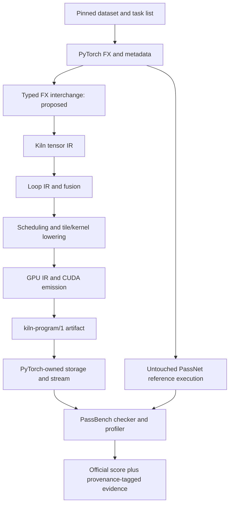

# PassNet reproduction and Kiln integration: intern implementation guide

## 1. Scope and evidence status

This project has two independent experimental tracks. The reference track runs the pinned PassNet implementation without Kiln changes. The integration track lowers the same workloads through Kiln and submits their results to PassBench. Keeping the reference evaluator unchanged makes the effects of compiler and runtime changes identifiable.

The checked-in paper is arXiv:2605.29357v1. Reference source revision is `61c64709f6d324216ae8252cec3cdc35b2dd5da5`; dataset revision is `4f7dd9211178327c2718f1b828d83ea126186f9e`. Source inventory, revision API responses, paper, and preliminary research are under `../sources/`. The guide is being developed against these sources; an API described as proposed below is not implemented yet. GPU benchmark results do not yet exist.

The requested end state includes baseline reproduction, an end-to-end Kiln round-trip, reusable pass experiments with held-out evaluation, documented compiler extensions, reMarkable delivery, and milestone reports in the Obsidian vault. A small FP32 example is an integration gate, not completion of corpus support.

## 2. What a task asks the compiler to do

A graph describes tensor operations and their data dependencies. A pass consists of a pattern matcher and a replacement. PassNet groups graph variants with related operation structure into one task; variants can differ in shape and dtype. A replacement that works for only one shape does not establish task-level correctness.

PassBench's pinned README describes each graph directory as containing `model.py`, `input_meta.py`, `weight_meta.py`, `input_tensor_constraints.py`, and `graph_net.json`. Metadata provides the shape/dtype/device contract; input constraints determine which values can be sampled legally. Read these before importing a graph. A JSON graph alone may omit behavior expressed by executable Python and constraints.

The evaluator loads Python pass modules from `pass_dir/` according to `sorted_output_pass_rule_names.json`. Each module exposes:

```python
def pattern(*args): ...
def replacement_args(*args): ...
def replacement_func(): ...
```

The first function expresses the computation to match. The second maps captured operands to replacement arguments. The third returns a stable module-level callable. The pinned README explicitly rejects nested definitions and lambdas for that callable. `PassMgrBackend` traces with `torch.compile`, applies `SubgraphMatcher`, substitutes the callable, and recompiles the FX graph. A pass that matches nothing causes an early exit and receives the documented minimum score rather than an eager fallback.

## 3. System boundaries



The bridge must preserve graph semantics across each boundary. Compilation success alone is insufficient: a program can compile while using the wrong reduction axis, scalar promotion, output dtype, or alias behavior. Separate serialization validation, import legality, compiler reference checking, and original evaluator correctness.

Kiln's current source map begins with `packages/kiln/src/std/tensor.js` for tensor operators, `std/loop.js` for loop transformations, `std/tile.js` and `std/kernel.js` for lower-level representations, `std/emit.js` for emission, `std/export.js` for artifacts, and `core/kiln.js` for rule/pass machinery. Inspect concrete definitions before adding an operation; matching frontend names does not prove equivalent semantics.

`scripts/kiln-export.mjs` calls `compileScript` and `endToEnd` from `apps/workbench/src/compile.js`. It records source SHA256, target, parameters and exported kernels, and rejects unknown CLI arguments. It defaults to WebGPU; CUDA target selection must be explicit. Its end-to-end result can be skipped: record a skip as unverified, not passed.

## 4. Acquire and materialize the corpus

Run `scripts/01-download-dataset.py` from this ticket. It resolves downloads using the stored dataset revision, checks file size and SHA256 against published LFS metadata, and writes a receipt after each verified shard. Large binary corpus files remain under `sources/dataset/` and are intentionally excluded from Git; the script and inventories are committed. A partial file is not valid evidence of a downloaded shard.

Materialization must be implemented after inspecting the Parquet schema. Do not assume that a row is one complete graph: the preliminary research describes file-content records. A safe materializer should reject absolute paths, parent traversal, duplicate conflicting paths, and symlink escape. Preserve record bytes and record the selected corpus revision and output manifest.

```text
for shard in verified_shards:
    inspect schema and required fields
    for record in shard:
        path, content = decode documented record format
        reject path escaping corpus root
        reject conflicting duplicate path
        write content and record SHA256
verify all paths in pinned evaluation list exist
record task count, graph count, dtypes, operations and missing files
```

Do not execute arbitrary downloaded graph code during materialization. Execution belongs in the designated isolated evaluation environment after source inspection.

## 5. Reference environment and numerical protocol

Paper Table 3 specifies A30 24 GB SM80, Ubuntu 24.04.1, CUDA 12.8/cuDNN 9.10.2, PyTorch 2.9.1+cu128 and Triton 3.5.1. It specifies 20 warmups, 100 trials, and rerunning if IQR exceeds 20% of median. The pinned README instead describes 25 warmups. Reconcile executable defaults and paper settings explicitly before comparisons.

The available host `bling.local` is ARM64 with NVIDIA GB10. Host inspection found driver 580.178.04, Docker 29.6.2, Python 3.12.3 and Node 26.8.1. NVIDIA-SMI reports driver CUDA capability 13.0; this is not a toolkit version. Local Node 24 does not satisfy Kiln's package.json Node >=26 requirement, so use the verified remote Node or install a supported local runtime. ARM64/Blackwell compatibility may require a distinct software environment. Report this as a hardware-port reproduction with a full environment manifest.

The pinned README gives baseline tolerances:

| dtype | rtol | atol |
|---|---:|---:|
| FP32 | 1.3e-6 | 1e-5 |
| FP16 | 1e-3 | 1e-5 |
| BF16 | 1.6e-2 | 1e-5 |

The checker also verifies output dtype; numerically close FP32 output is not an acceptable replacement for required BF16 output. It sweeps tolerance levels, so retain the complete per-level result instead of one Boolean.

Timing records both end-to-end and GPU-only latency. Preserve raw trial values, warmup count, synchronization policy, compile time, and stability decisions. Allocation and Python dispatch can dominate small computations; report these costs separately rather than attributing all changes to kernel code.

## 6. Proposed FX interchange and importer

The interchange must use explicit node identities, operator overload names, typed tensor specifications, scalar constants and output structure. Start with static shapes and make unsupported features explicit diagnostics. Every restriction is a coverage limitation to remove or measure, not a silent fallback.

```text
import_graph(graph):
    validate version, node references and acyclic ordering
    validate input metadata: dtype, shape, strides, device semantics
    for node in topological order:
        resolve exact ATen overload
        validate promotion, broadcasting, axes and alias behavior
        lower using a documented Kiln operator implementation
        verify inferred shape and dtype against source metadata
    reconstruct complete output structure
    return Kiln graph and mapping/provenance manifest
```

Resolve tensor-scalar addition separately from tensor-tensor broadcasting. Preserve reduction axis lists, keepdim and accumulation dtype. A reshape of noncontiguous storage may require a copy; transpose changes layout. Do not replace either with an indexing assumption without proving it against the source semantics. Track constants and weights distinctly from runtime inputs. Unsupported overload errors should name the source node, overload, dtype and missing capability.

## 7. CUDA/PyTorch ownership contract

`runtime/python/kiln_launch.py` exposes `open_program` and `CudaProgram.launch(stream=0, scratch=None, **pointers)`. Opening with `allocate=False` leaves input, output and intermediate storage to the caller; constant buffers remain launcher-owned. The launcher compiles CUDA with NVRTC for the detected device architecture, retains its CUDA context, and launches without copying or synchronizing.

The PyTorch bridge must allocate each declared output with the correct shape and dtype on the selected CUDA device, allocate scratch per invocation, and pass data pointers plus the current PyTorch stream. Validate dtype, device, shape, strides and supported layouts before launch. Keep tensor storage alive through asynchronous execution and use PyTorch stream ownership mechanisms where necessary. Never reuse mutable scratch concurrently across streams. Cache compiled programs by artifact content identity and device, not merely by filename.

The launcher uses a live non-primary CUDA context if one is already current. Therefore context consistency with PyTorch must be verified, not assumed. Add real tests for non-default streams, repeated program lifetimes, multi-kernel scratch, and error paths before relying on this runtime in benchmark measurements.

## 8. Reusable fusion experiment

`packages/kiln/src/std/loop.js` currently defines `mergeLoopOps`; its profitability guard is `now <= was * 1.02`. This confirms the preliminary proposal's threshold. A first policy experiment can vary this guard, but legality must remain enforced independently.

Split workloads by graph family before policy selection. Shape variants of the same pattern must not leak across training and held-out sets. Compare the unchanged compiler, manual policy, agent-selected parameters, agent-composed passes, and new agent-generated passes under the same measurement budget. Report compiler time and failures as well as latency.

An exploratory selection objective is mean log baseline/candidate latency minus a compile-cost penalty. This does not replace the official PassBench score. The pinned README describes squared slowdowns while the preliminary research says executable scoring defaults to p=0; inspect the scorer before implementing aggregation. Record its parameters with every result.

## 9. Provenance for compiler extensions

For each borrowed implementation, record repository URL, immutable revision, path, symbol, license and whether code was copied or independently implemented from behavior. Explain semantic differences and cite the tests that cover them. For research-derived transformations, cite the paper section and preconditions. Put this information in the design document and corresponding chronological diary entry; preserve applicable license notices with copied code.

User authorization includes implementing missing Kiln capabilities, consulting PyTorch/PassNet/research, and using bling.local. The corpus coverage audit determines which dtype/layout/operator and lowering extensions are necessary. Do not add compatibility layers merely to preserve an obsolete interface.

## 10. Validation and delivery gates

1. Verify pinned sources, corpus materialization and complete evaluation membership.
2. Run untouched eager and Inductor evaluation, recording all failures and software/hardware differences.
3. Lower one genuine task through Kiln; pass the original numerical and dtype checker.
4. Exercise original pass matching, integrity defenses and score aggregation. If a sanctioned integration requires evaluator changes, label the protocol modified and preserve the untouched reference.
5. Expand full operation/dtype/layout coverage and report unsupported cases in the declared denominator.
6. Evaluate reusable policies on fixed held-out families and preserve raw evidence and compiler identities.
7. Finish and visually validate intern documentation, upload to reMarkable, write milestone textbook-style vault reports, and commit/push the vault.

Current work has reached source acquisition and environment inspection. The remainder of these gates is pending.

## 11. First verified reference task and importer target

The first pinned evaluation task is hash `6291d774daf9c8b62c3f7d79f1fc55ec2d82adcd69425bfb0bb4e00b14724de8`. Its six variants completed with six success statuses and no failed statuses in the original evaluator. Archived raw output is in `sources/reference-smoke/000-inductor.log`, with exact command and process duration in `execution-receipt.json`. This establishes one task on DGX Spark, not full reproduction.

Its GraphModule.forward accepts running mean, running variance, bias, weight, and activation. It computes functional ReLU, functional batch_norm with training=False and eps=1e-5, followed by dropout with p=0 and training=False, returning a singleton tuple. The FP32 batch-eight source is under `sources/upstream/graphs/hf_subgraphs_v2/fusible_subgraphs/float32/8/samples/torchgeometric/LINKX/_decomposed/LINKX_start17_end20_5/model.py`.

Inference batch normalization requires channel-aware broadcasting: output = (relu(input)-running_mean)/sqrt(running_variance+eps)*weight+bias. Confirm channel axis, precision and intermediate rounding against PyTorch before lowering. Disabled dropout is an identity in this graph, but general training dropout requires random-number semantics and must not be silently removed. Preserve the tuple output and FP16/BF16 rounding behavior. These requirements motivate extending the importer beyond a synthetic add/ReLU demonstration.
