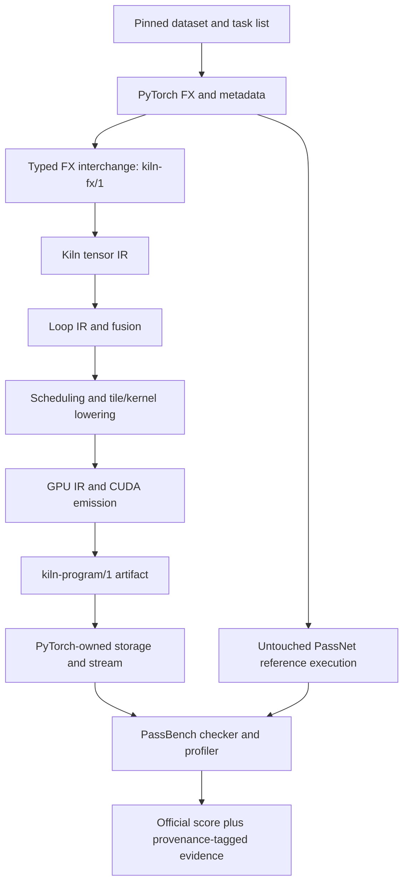

# PassNet reproduction and Kiln integration: intern implementation guide

## 1. Scope and evidence status

This project has two independent experimental tracks. The reference track runs the pinned PassNet implementation without Kiln changes. The integration track lowers the same workloads through Kiln and submits their results to PassBench. Keeping the reference evaluator unchanged makes the effects of compiler and runtime changes identifiable.

The checked-in paper is arXiv:2605.29357v1. Reference source revision is `61c64709f6d324216ae8252cec3cdc35b2dd5da5`; dataset revision is `4f7dd9211178327c2718f1b828d83ea126186f9e`. Source inventory, revision API responses, paper, and preliminary research are under `../sources/`. Current exact PassBench integration coverage is eight complete tasks containing 84 graph variants, with 149 individually passing graphs including partial tasks, under explicitly recorded modified protocols. The nominal numerical criterion is upstream t=-5. Earlier tolerance-one counts were relaxed diagnostics and must not be interpreted as nominal acceptance. The separate faithful import audit finds 984 translatable graphs and 43 fully translatable tasks. Three direct FP32 compiler-policy studies have completed training selection and held-out evaluation: the scalar pilot has a narrow positive result, while two conditional-policy studies select baseline. Their metrics are relative to unchanged Kiln, not official PassBench scores. Sections 11–24 preserve earlier historical checkpoints; this section and Sections 25–26 give the current state.

The requested end state includes baseline reproduction, an end-to-end Kiln round-trip, reusable pass experiments with held-out evaluation, documented compiler extensions, reMarkable delivery, and milestone reports in the Obsidian vault. A small FP32 example is an integration gate, not completion of corpus support.

## 2. What a task asks the compiler to do

A graph describes tensor operations and their data dependencies. A pass consists of a pattern matcher and a replacement. PassNet groups graph variants with related operation structure into one task; variants can differ in shape and dtype. A replacement that works for only one shape does not establish task-level correctness.

PassBench's pinned README describes each graph directory as containing `model.py`, `input_meta.py`, `weight_meta.py`, `input_tensor_constraints.py`, and `graph_net.json`. Metadata provides the shape/dtype/device contract; input constraints determine which values can be sampled legally. Read these before importing a graph. A JSON graph alone may omit behavior expressed by executable Python and constraints.

The evaluator loads Python pass modules from `pass_dir/` according to `sorted_output_pass_rule_names.json`. Each module exposes:

```python
def pattern(*args): ...
def replacement_args(*args): ...
def replacement_func(): ...
```

The first function expresses the computation to match. The second maps captured operands to replacement arguments. The third returns a stable module-level callable. The pinned README explicitly rejects nested definitions and lambdas for that callable. `PassMgrBackend` traces with `torch.compile`, applies `SubgraphMatcher`, substitutes the callable, and recompiles the FX graph. A pass that matches nothing causes an early exit and receives the documented minimum score rather than an eager fallback.

## 3. System boundaries



The bridge must preserve graph semantics across each boundary. Compilation success alone is insufficient: a program can compile while using the wrong reduction axis, scalar promotion, output dtype, or alias behavior. Separate serialization validation, import legality, compiler reference checking, and original evaluator correctness.

Kiln's current source map begins with `packages/kiln/src/std/tensor.js` for tensor operators, `std/loop.js` for loop transformations, `std/tile.js` and `std/kernel.js` for lower-level representations, `std/emit.js` for emission, `std/export.js` for artifacts, and `core/kiln.js` for rule/pass machinery. Inspect concrete definitions before adding an operation; matching frontend names does not prove equivalent semantics.

`scripts/kiln-export.mjs` calls `compileScript` and `endToEnd` from `apps/workbench/src/compile.js`. It records source SHA256, target, parameters and exported kernels, and rejects unknown CLI arguments. It defaults to WebGPU; CUDA target selection must be explicit. Its end-to-end result can be skipped: record a skip as unverified, not passed.

## 4. Acquire and materialize the corpus

Run `scripts/01-download-dataset.py` from this ticket. It resolves downloads using the stored dataset revision, checks file size and SHA256 against published LFS metadata, and writes a receipt after each verified shard. Large binary corpus files remain under `sources/dataset/` and are intentionally excluded from Git; the script and inventories are committed. A partial file is not valid evidence of a downloaded shard.

Materialization must be implemented after inspecting the Parquet schema. Do not assume that a row is one complete graph: the preliminary research describes file-content records. A safe materializer should reject absolute paths, parent traversal, duplicate conflicting paths, and symlink escape. Preserve record bytes and record the selected corpus revision and output manifest.

```text
for shard in verified_shards:
    inspect schema and required fields
    for record in shard:
        path, content = decode documented record format
        reject path escaping corpus root
        reject conflicting duplicate path
        write content and record SHA256
verify all paths in pinned evaluation list exist
record task count, graph count, dtypes, operations and missing files
```

Do not execute arbitrary downloaded graph code during materialization. Execution belongs in the designated isolated evaluation environment after source inspection.

## 5. Reference environment and numerical protocol

Paper Table 3 specifies A30 24 GB SM80, Ubuntu 24.04.1, CUDA 12.8/cuDNN 9.10.2, PyTorch 2.9.1+cu128 and Triton 3.5.1. It specifies 20 warmups, 100 trials, and rerunning if IQR exceeds 20% of median. The pinned README instead describes 25 warmups. Reconcile executable defaults and paper settings explicitly before comparisons.

The available host `bling.local` is ARM64 with NVIDIA GB10. Host inspection found driver 580.178.04, Docker 29.6.2, Python 3.12.3 and Node 26.8.1. NVIDIA-SMI reports driver CUDA capability 13.0; this is not a toolkit version. Local Node 24 does not satisfy Kiln's package.json Node >=26 requirement, so use the verified remote Node or install a supported local runtime. ARM64/Blackwell compatibility may require a distinct software environment. Report this as a hardware-port reproduction with a full environment manifest.

The pinned README gives baseline tolerances:

| dtype | rtol | atol |
|---|---:|---:|
| FP32 | 1.3e-6 | 1e-5 |
| FP16 | 1e-3 | 1e-5 |
| BF16 | 1.6e-2 | 1e-5 |

The checker also verifies output dtype; numerically close FP32 output is not an acceptable replacement for required BF16 output. It sweeps tolerance levels, so retain the complete per-level result instead of one Boolean.

Timing records both end-to-end and GPU-only latency. Preserve raw trial values, warmup count, synchronization policy, compile time, and stability decisions. Allocation and Python dispatch can dominate small computations; report these costs separately rather than attributing all changes to kernel code.

## 6. Typed FX interchange and importer contract

The implemented kiln-fx/1 interchange uses explicit node identities, operator targets, typed tensor specifications, scalar constants and complete output structure. fx_export.py owns serialization; fx_import.py and fx_indexing.py own supported semantic lowering. Current inputs are positive static contiguous FP32/FP16/BF16 tensors. The pseudocode below states the complete importer contract; individual operations still require expanded promotion/layout/alias coverage or explicit rejection. Consult the coverage and import-audit ledgers for measured capability rather than assuming every contract obligation is complete.

```text
import_graph(graph):
    validate version, node references and acyclic ordering
    validate input metadata: dtype, shape, strides, device semantics
    for node in topological order:
        resolve exact ATen overload
        validate promotion, broadcasting, axes and alias behavior
        lower using a documented Kiln operator implementation
        verify inferred shape and dtype against source metadata
    reconstruct complete output structure
    return Kiln graph and mapping/provenance manifest
```

Resolve tensor-scalar addition separately from tensor-tensor broadcasting. Preserve reduction axis lists, keepdim and accumulation dtype. A reshape of noncontiguous storage may require a copy; transpose changes layout. Do not replace either with an indexing assumption without proving it against the source semantics. Track constants and weights distinctly from runtime inputs. Unsupported overload errors should name the source node, overload, dtype and missing capability.

## 7. CUDA/PyTorch ownership contract

`runtime/python/kiln_launch.py` exposes `open_program` and `CudaProgram.launch(stream=0, scratch=None, **pointers)`. Opening with `allocate=False` leaves input, output and intermediate storage to the caller; constant buffers remain launcher-owned. The launcher compiles CUDA with NVRTC for the detected device architecture, retains its CUDA context, and launches without copying or synchronizing.

The PyTorch bridge must allocate each declared output with the correct shape and dtype on the selected CUDA device, allocate scratch per invocation, and pass data pointers plus the current PyTorch stream. Validate dtype, device, shape, strides and supported layouts before launch. Keep tensor storage alive through asynchronous execution and use PyTorch stream ownership mechanisms where necessary. Never reuse mutable scratch concurrently across streams. Cache compiled programs by artifact content identity and device, not merely by filename.

The launcher uses a live non-primary CUDA context if one is already current. Therefore context consistency with PyTorch must be verified, not assumed. Add real tests for non-default streams, repeated program lifetimes, multi-kernel scratch, and error paths before relying on this runtime in benchmark measurements.

## 8. Reusable fusion experiment

`packages/kiln/src/std/loop.js` defines createFusionRule({maxWorkGrowth=1.02, decide=null, onDecision=null}); mergeLoopOps is its unchanged default instance. pipeline.replaceRule installs a policy variant while preserving the existing matcher and inlining mutation. WorkOf uses weighted memory traffic and arithmetic, not elapsed time. A first study selected threshold 1.25 on training graphs and measured 1.0186x family-balanced held-out e2e speedup; see Section 22 and design document 06 for exact scope and limitations.

Split workloads by graph family before policy selection. Shape variants of the same pattern must not leak across training and held-out sets. Compare the unchanged compiler, manual policy, agent-selected parameters, agent-composed passes, and new agent-generated passes under the same measurement budget. Report compiler time and failures as well as latency.

An exploratory selection objective is mean log baseline/candidate latency minus a compile-cost penalty. This does not replace the official PassBench score. The pinned README describes squared slowdowns while executable scoring defaults to p=0. Original task scores record p=0 and fpdb=0.1. The direct policy study uses its own family-balanced latency objective and does not replace that official metric.

## 9. Provenance for compiler extensions

For each borrowed implementation, record repository URL, immutable revision, path, symbol, license and whether code was copied or independently implemented from behavior. Explain semantic differences and cite the tests that cover them. For research-derived transformations, cite the paper section and preconditions. Put this information in the design document and corresponding chronological diary entry; preserve applicable license notices with copied code.

User authorization includes implementing missing Kiln capabilities, consulting PyTorch/PassNet/research, and using bling.local. The corpus coverage audit determines which dtype/layout/operator and lowering extensions are necessary. Do not add compatibility layers merely to preserve an obsolete interface.

## 10. Validation and delivery gates

1. Verify pinned sources, corpus materialization and complete evaluation membership.
2. Run untouched eager and Inductor evaluation, recording all failures and software/hardware differences.
3. Lower one genuine task through Kiln; pass the original numerical and dtype checker.
4. Exercise original pass matching, integrity defenses and score aggregation. If a sanctioned integration requires evaluator changes, label the protocol modified and preserve the untouched reference.
5. Evaluate reusable policies on fixed held-out families and preserve raw evidence and compiler identities; this is the immediate critical path.
6. Expand full operation/dtype/layout coverage in parallel and retain every unsupported case in the declared denominator.
7. Finish and visually validate intern documentation, upload to reMarkable, write milestone textbook-style vault reports, and commit/push the vault.

Source acquisition and selected round-trips are verified. Complete benchmark coverage, exact reference reproduction, PassAgent runs and richer generated transformations remain unfinished. The first small FP32 scalar-policy study has passed its declared gates, with all source evidence retained.

## 11. Historical checkpoint: First verified reference task and importer target

The first pinned evaluation task is hash `6291d774daf9c8b62c3f7d79f1fc55ec2d82adcd69425bfb0bb4e00b14724de8`. Its six variants completed with six success statuses and no failed statuses in the original evaluator. Archived raw output is in `sources/reference-smoke/000-inductor.log`, with exact command and process duration in `execution-receipt.json`. This establishes one task on DGX Spark, not full reproduction.

Its GraphModule.forward accepts running mean, running variance, bias, weight, and activation. It computes functional ReLU, functional batch_norm with training=False and eps=1e-5, followed by dropout with p=0 and training=False, returning a singleton tuple. The FP32 batch-eight source is under `sources/upstream/graphs/hf_subgraphs_v2/fusible_subgraphs/float32/8/samples/torchgeometric/LINKX/_decomposed/LINKX_start17_end20_5/model.py`.

Inference batch normalization requires channel-aware broadcasting: output = (relu(input)-running_mean)/sqrt(running_variance+eps)*weight+bias. Confirm channel axis, precision and intermediate rounding against PyTorch before lowering. Disabled dropout is an identity in this graph, but general training dropout requires random-number semantics and must not be silently removed. Preserve the tuple output and FP16/BF16 rounding behavior. These requirements motivate extending the importer beyond a synthetic add/ReLU demonstration.

## 12. Historical checkpoint: Implemented serialization and first importer

`integrations/passnet/fx_export.py` uses FX ShapeProp to serialize trusted graph execution metadata into kiln-fx/1. It preserves argument/container structure and exact ATen overload strings. `fx_import.py` resolves references, validates static contiguous FP32 inputs, and emits a Kiln project script for a currently limited elementwise operation set. It returns an output-structure manifest so tuple/list/dictionary structure can be restored after flat program execution.

Run CPU boundary tests with `python3 -m unittest discover -s integrations/passnet -p 'test_*.py'`. These tests establish structure and explicit rejection behavior, not Kiln compilation or GPU equivalence. Next validation must compile the emitted script and compare its output against the source graph before integrating it into the original evaluator. Remaining operators and dtype/layout support must be implemented rather than omitted from the full benchmark denominator.

## 13. Historical checkpoint: Verified GPU milestone and integrity boundary

The integration now compiles an actual first-task FP32 graph into two CUDA kernels and executes it with PyTorch-owned inputs/outputs and per-invocation scratch. A CUDA test with nontrivial running mean, positive variance, weight and bias passed rtol 1.3e-6 and atol 1e-5, with maximum absolute error 9.5367431640625e-07. Reproduce its generation with scripts/04-export-first-task.py, compile the emitted project with the existing export CLI, and run integrations/passnet/smoke_batch_norm.py against the artifact. This verifies a genuine task's operation structure and shape under independent inputs; it does not establish PassBench acceptance or full task coverage.

The initial compiler check failed because imported source-domain constraints were not represented by generic project test data. Explicit running-statistics data made the reference check pass without disabling it. Preserve example inputs and domain constraints separately from graph semantics: a positive example variance must not become a compiler constant when variance remains a runtime operand.

The first pass module used the documented pattern/replacement_args/replacement_func interface. Original pass_mgr reported no match. scripts/08-inspect-fx-pattern.py explains why: symbolic_trace canonicalizes functional batch_norm arguments into keyword arguments and inserts dropout inplace=False, whereas Dynamo's graph retains eight positional batch_norm arguments and omits the dropout default keyword. Exact structural matching fails even though the operations agree mathematically.

Explicit Graph/GraphModule construction can express that structure, but the original AST validator rejects these calls. sources/kiln-match-v2.log preserves its exact diagnostics. Do not hide constructor calls in another module or alter validation to present this as original-protocol success. There are two legitimate research directions: find a pattern form accepted by the original interface, or add a separately labeled trusted integration protocol that admits compiler-produced pattern artifacts with a documented integrity contract. Either direction must retain numerical and dtype checks, reverse-order evaluation and replacement restrictions. The untouched reference environment remains authoritative for paper reproduction.

## 14. Historical checkpoint: Corpus completion and remaining work

All 14 Parquet shards were size/SHA256 verified and materialized into 2,067,810 file-content records, with zero duplicate records. sources/materialization-summary.json gives the compact receipt; the full manifest is under sources/materialized. The pinned repository independently contains all 200 evaluation tasks and 2,060 graph directories.

The full reference run is exploratory: synthetic GPU checks and integration tests overlapped it. Preserve its logs for correctness/failure diagnosis, but obtain isolated measurements before reporting comparative speedups. Capture exact GPU/software/image identity and active workload state with final measurements. Model-agent runs, reusable policy learning and held-out evaluation have not yet been executed.

This edition documents an ongoing implementation. It does not claim completion of FP16/BF16 support, full corpus operation/layout coverage, original pass matching/scoring, fine-tuning reproduction, compiler meta-optimization or final performance comparisons. Those remain explicit project requirements. The delivered progress edition is useful for an intern to inspect the current boundaries and continue from reproducible scripts; a later edition must replace this status with verified results.

## 15. Historical checkpoint: Measured static corpus requirements

scripts/09-inventory-operators.py parses all 2,060 source graphs without importing or executing them. It normalizes tensor method receiver names and counts Python arithmetic/subscript syntax as well as calls. Full per-graph records are in sources/operator-inventory.json. This is a static occurrence census; it does not measure dynamic invocation counts or prove compiler coverage.

Input/weight metadata mentions FP16 in 728 graphs, BF16 in 733 and FP32 in 569; 170 graphs mention int64 and three mention bool. Counts are nonexclusive because one graph can have several dtypes. A compiler supporting only floating arithmetic still needs integer indexing and Boolean masking semantics for complete coverage.

Static counts include 686 conv2d calls, 666 cat calls, 455 view calls, 346 mean calls, 340 batch_norm calls, 263 reshape calls, 243 transpose calls, 231 embedding calls and 200 dtype conversions. Python subscript and arithmetic syntax are counted separately; slice constructors and negative dimension literals are not GPU kernels. Prioritize capability work by complete task dependencies, not raw frequency alone: adding one operation does not unlock a task if its other operations remain unsupported.

A full implementation needs typed storage and arithmetic conversion rules, channel/spatial indexing, integer gather/embedding, layout views/copies, concatenation, convolution and reductions. Each extension must define reference evaluation, shape/type inference, lowering, emission/runtime representation and numerical tests. Preserve rejected tasks in the declared benchmark denominator while these capabilities are developed.

## 16. Historical checkpoint: Integration protocol: functional argument normalization

`integrations/passnet/fx_normalize.py` provides a narrowly scoped graph transformation for ReLU, batch_norm and dropout. It binds each public Python signature, fills defaults and emits ordered positional arguments. Both target and pattern graphs must undergo the same normalization before structural matching. This is explicitly a modified integration protocol; it is not a result under unchanged PassBench matching.

The transformation changes call syntax rather than tensor arithmetic. It neither evaluates function bodies nor relaxes dtype/shape predicates. It validates every call before mutation, rejects unsupported signatures, records changed node identities and is idempotent. Tests reproduce the actual positional/keyword mismatch, demonstrate one match after normalization, and check exact output preservation for the tested graph.

Original AST source validation remains applicable to generated pass modules. They should contain ordinary functional patterns, not explicit graph construction. Integration setup owns normalization outside generated code and must record module identity and changed-node receipts. Numerical, dtype, dispatch and reverse-order checks must remain active. A successful unit test of normalization does not establish that the rest of PassBench accepts the CUDA launcher; that still requires execution evidence.

## 17. Historical checkpoint: First complete task result

All six variants of task 6291d774daf9c8b62c3f7d79f1fc55ec2d82adcd69425bfb0bb4e00b14724de8 now pass numerical, dtype and stability checks under the declared normalized/record-stream integration protocol. The original scorer parsed six results and reported aggregate 0.8495327431059172. This is slower than eager in this run and is not a full-benchmark result. Earlier overlapping run failed BF16 stability; both attempts are retained.

Reproduce using scripts 16–20 and review sources/first-task-isolated.log plus first-task-score.json. Script 21 generates complete denominator accounting: one of 200 tasks, six of 2,060 graphs verified; the remaining 199 tasks are not yet verified. The task uses dtype-dispatched artifacts and runtime metadata validation. This is execution support for one fixed task family, not demonstrated generalization of a learned compiler policy.

## 18. Historical checkpoint: Convolution task acceptance and limitations

The first three tasks now have original checker acceptance under the declared modified protocol: 19 graphs across three of 200 tasks. Exact per-graph evidence is maintained in sources/kiln-coverage.json. The third task's FP16 convolution/in-place-ReLU/residual/identity-resize chain passes on original replay inputs after correcting low-precision bias addition order. Official aggregate is 0.043470409529710305, a severe slowdown versus eager.

A separate unit-scale random stress test still fails 67/73728 elements after the bias fix. Keep that limitation distinct from benchmark acceptance; the source's smaller replay distributions are not proof that larger values are invalid. The initial convolution uses safe clamped reads and explicit padding masks, nested indexed reductions and FP32 internal arithmetic. These are correctness foundations, not a high-performance convolution design. Profiling, precision robustness and reusable pass/schedule improvement remain required work.

## 19. Historical checkpoint: Static layout and cast import

The importer now accepts tensor methods reshape/view, flatten, permute, contiguous, and explicit floating conversions. Reshape uses the static output shape recorded by FX propagation after verifying literal shape operands. Permutation composes pairwise Kiln transposes. Contiguous materializes the logical tensor value through reshape. Casts use N.cast so FP16/BF16 rounding remains explicit through fusion.

This is value-semantic graph import. External noncontiguous inputs and mutation-dependent alias behavior remain unsupported. Device transfers and dynamic shape operands fail explicitly. Scripts 44/45 export and run a four-output chain; all outputs matched PyTorch CUDA exactly on GB10. These probes do not increase the verified PassBench task count.

## 20. Historical checkpoint: Shared corpus execution and explicit pattern support

Use `integrations/passnet/corpus.py` for task export and compilation, and `check_corpus_cuda.py` for source-model comparisons. The manifest records ordered inputs, graph identity and complete output structure. The recursive checker validates every output, including tuple/list/dict structure, shape and dtype. Design document 04 explains the ownership boundaries and commands. The original numbered scripts remain historical evidence rather than separate production implementations.

Two additional integration protocol components address patterns with explicit in-place operators and multiple outputs. `kiln-pattern-autowrap/1` preserves directly imported operator.iadd during pattern tracing. `kiln-pattern-multi-output/1` reuses the pinned upstream direct backend's tuple-destructuring helper with the standard backend's guarded callable. Neither changes graph arithmetic or removes source/dispatch/numerical checks. These changes must be reported alongside the existing argument-normalization and record_stream policies whenever presenting integration results.

## 21. Historical checkpoint: Corpus audit and basic indexing checkpoint

Verified benchmark coverage is 4/200 tasks and 49/2,060 graphs under explicitly recorded integration protocols. The 30-variant residual-plus-mean task scored 1.0032945157872568 with the original aggregate scorer, approximately eager parity on GB10. This is not evidence of a robust speedup or a reproduction on the paper's A30 environment.

The shared corpus runner now supports FakeTensorMode metadata propagation with fallback kernels disabled. It interprets trusted graph Python without materializing the large input tensors merely to derive metadata. Real and fake exports were identical for all 30 reduction-task variants. The complete audit verifies exact membership of all 200 tasks and 2,060 graph variants. After static indexing import, 381 graphs and 21 complete tasks translate successfully. Translation is not compilation or benchmark acceptance.

Basic indexing lives in `fx_indexing.py`: normalize ellipsis, None axes, negative integers and unit-step slices; lower selections to N.slice; then reshape away selected unit axes and insert requested dimensions. Computed result shape must agree with FX metadata. Strided and empty slices require additional compiler work and fail explicitly. Independent three-output probes passed CUDA comparisons for FP32, FP16 and BF16.

Concatenation is now the first blocker in 531 graphs. Other first blockers include integer inputs, linear/matmul, softmax and activation functions. Counts refer only to each graph's first encountered blocker; implementing one feature can reveal another. Local CUDA availability also prevents tracing some trusted source graphs and is recorded separately. Use sources/import-audit-summary.json for prioritization and sources/kiln-coverage.json for verified execution evidence.

## 22. Historical checkpoint: Current compiler-policy API and first measured transfer result

The first direct compiler-policy experiment is implemented by compile_policy.mjs, measure_policy.py, select_policy.py, summarize_policy.py and stress_policy.py under integrations/passnet. The frozen corpus and plan are in sources/policy-corpus-v2; compilation artifacts are in sources/policy-artifacts-v2; complete training, selection, held-out and stress evidence is in sources/policy-measurements-v1. Scripts 69–79 reproduce construction, qualification, GPU isolation, selection and verification.

Given a fixed target, create an explicit policy variant:

```javascript
const baseline = std.emmy.pipeline({ target });
const selected = baseline.replaceRule(
  "loop/fusion", "merge_loop_ops",
  std.loop.createFusionRule({ maxWorkGrowth: 1.25 })
);
```

The factory also accepts decide(features) and onDecision(event), using immutable weighted-work, consumer-count and producer-size features. Profitability is replaceable; the original matcher and transformation remain intact. The default mergeLoopOps still uses 1.02. A decision callback must return a Boolean or rejection reason.

Training used three FP32 graphs from two task families; held-out evaluation used seven graphs from four distinct families. The six candidate controls were compiled across all ten graphs. Actual default executable bodies matched unchanged Kiln. Source-model identities are disjoint between training and held-out membership. The corpus is a curated development set drawn from evaluation tasks, not an untouched paper benchmark. Version 2 was frozen after structural preflight and before any candidate timing.

Training selected 1.25 with family-balanced synchronized e2e score 1.1174679569686872 relative to unchanged Kiln. Selection commit 575effd precedes held-out timing. The selected policy qualified on all seven held-out graphs and scored 1.0186065904267643. Only one held-out RepViT graph changes: three kernels become two, e2e median 0.0362335 ms becomes 0.031265 ms, ratio 1.158915720454182. The other six executables are identical and share baseline measurement evidence.

The fixed plan uses 20 warmups, 100 trials and three repeats, seeded order, IQR <=20% and at most two retries. End-to-end includes allocation/launch/final synchronization; CUDA stream elapsed includes dispatch gaps. Neither is a pure device-kernel-only claim. Post-selection numerical stress passed 60/60 comparisons across both compilers, ten graphs and three seeds, max error 3.814697265625e-06. These tests use nontrivial random values and source-derived positive variance domains without retuning the policy.

This is a completed scalar-policy tuning pilot. Generated feature-dependent programs, new rewrite algorithms, independent broader confirmation and PassAgent comparisons remain future work. It does not add complete PassBench tasks: that ledger remains five tasks / 73 variants. Read reference report 07 and design document 06 before extending the study or changing the global default.

## 23. Historical checkpoint: bounded policies and fresh negative confirmation

The compiler now accepts validated feature-dependent profitability programs through `prepareFusionPolicy` in integrations/passnet/fusion_policy.mjs. Programs branch on originalWork, fusedWork, consumerCount and producerElements; thresholds and Boolean leaves compile to immutable callbacks for the existing createFusionRule factory. The matcher and mutation remain unchanged. Design 07 explains the bounded language, source selection and protocol.

A fresh official-training-source corpus contains 12 training and eight held-out FP32 programs from distinct exact models. Eight declared candidates compiled on all 20 graphs. All training executables equal baseline for every candidate, so training-only selection chose baseline under the registered tie rule. All 20 source replay comparisons and stable timing runs passed. The selected-policy ratio is exactly 1.0; this experiment produced no compiler improvement. The previous pilot's 1.0186x aggregate result remains a separate, narrower historical study.

The original Inductor reference completed 200 tasks / 2,060 attempted variants. Exact-membership audit with the upstream tolerance-one checker accepts 2,039 graphs and 191 complete tasks. Execution-success labels alone count 2,041 and are insufficient numerical evidence. Historical timings overlapped development and are exploratory; hardware/software still differ from the paper. Script 85 and reference-full-audit.json preserve the audit, raw phase messages and log hashes.

Current coverage remains 24 complete tasks / 804 graphs imported and five complete tasks / 73 graphs accepted under the declared modified PassBench protocols. The fresh direct compiler study does not add accepted complete benchmark tasks. Next synthesis work should use training transformation traces to ensure proposed policies actually alter executables before claiming optimization or transfer.

## 24. Current checkpoint: training-sensitive synthesis and activation coverage

The adaptive v4 study generated 12 bounded policy programs from training-only feature quantiles, compiled all 240 candidate/graph pairs, measured actual training interventions, and selected baseline. Stricter fusion restrictions did not improve its objective; all eight fresh exact-model confirmation graphs passed with unchanged selection. Design 07 and policy-measurements-v3 own the complete protocol and evidence. This is deterministic template synthesis, not external LLM or original PassAgent evaluation.

The importer now supports SiLU and sigmoid using FP32 operation arithmetic and narrowing at source operation boundaries. Conservative freshness/use-count checks also functionalize supported in-place activations on exclusively consumed fresh results; inputs, shared values and views remain rejected. Design 02 explains the numerical and aliasing contracts, with primary PyTorch references archived under sources/pytorch/activations. All 47 Python integration tests and 18 CUDA dtype/seed fixture comparisons passed.

Full-denominator import audit now succeeds for 912 of 2,060 graphs across 36 complete tasks. This extends the earlier 804/24 and intermediate 853/32 checkpoints; the audit is not execution acceptance. Real evaluation task 143 (SiLU -> multiply -> disabled dropout) additionally compiled, matched once per variant and passed numerical evaluation for FP32, FP16 and BF16. Original scorer p=0, fpdb=0.1 gives score 0.8399177755920565 under the declared modified protocol. It is slower than eager in aggregate for this task; no speed improvement is claimed.

The accepted coverage ledger now checks upstream tolerance-one numerical decisions in addition to exact membership, execution status and matching. Current verified Kiln coverage is six complete tasks / 76 variants. The original Inductor reference remains a separate 191-task / 2,039-variant numerical audit with exploratory timing. Next work should broaden compiler/runtime support and test interventions beyond the unsuccessful strict-fusion grammar.


## 25. Matrix lowering, canonical bindings and corrected numerical acceptance

The shared matrix implementation is `packages/kiln/src/std/matmul.js`. It defines positive static shape validation, vector promotion, right-aligned batch broadcasting, vector-axis removal, independent CPU references and tensor-IR decompositions. `fx_linalg.py` binds PyTorch linear, matmul, mm and bmm, widens FP16/BF16 operands to FP32 arithmetic, applies bias before the final storage cast and validates output metadata. Unsupported mutation and output-buffer arguments fail explicitly.

The independent fixture gate passed 126/126 CUDA comparisons across 14 forms, three dtypes and three seeds. All 26 Node test files passed at the matrix boundary; after canonical binding and specialization fixes, the full Python integration suite passed 62 tests. These fixtures establish the declared forms, not full task acceptance or optimized matrix scheduling.

`fx_trace.py` preserves Python in-place operator identities that ordinary FX Proxy can erase. This retracts 22 optimistic import successes from the intermediate matrix audit, yielding 984 translatable graphs and 43 complete task families. The retracted families were not among the six already verified tasks. General placeholder mutation and alias/writeback semantics remain open.

`generate_pass.py` extracts trusted source AST patterns and canonicalizes placeholder roles by first use in normalized FX. The same argument permutation is applied before compiler import. The manifest stores `source_input_order`; replay and random-input checking use this binding explicitly. Equivalent residual patterns with different original argument positions therefore execute the same arithmetic association. Concrete patterns with fewer tensor placeholders precede generic patterns, preventing a literal zero from being captured as a tensor. The completed canonical residual rerun verifies all 30 task variants at t=-5.

The coverage ledger now requires the original checker at t=-5, successful execution and exactly one replacement. The previous t=1 criterion is relaxed and was incorrectly used for the nominal coverage audit. The correction is recorded in diary Steps 88–90 and design 08, with earlier logs and reports preserved. Six complete tasks contain 76 passing graphs; an incomplete four-variant linear task contributes two more passing graphs. The current individually passing graph count is 78/2060 and complete-task count remains 6/200.

The linear task's other two variants pass only at relaxed points of the original curve. A separate BF16 diagnostic shows default native PyTorch reduced-precision reduction accounts for substantial disagreement in that case: Kiln agrees within the diagnostic tolerance with FP32/FP64 accumulation and with the native option disabled. Original evaluation retains the original flags, and these variants remain nominal failures. Greater agreement with a mathematical oracle does not imply benchmark agreement.

The same correction applies to interpretation of the completed Inductor baseline logs. Their t=-5 audit accepts 1748 graphs and 140 complete tasks; t=-4 accepts 1855/157; t=-3 accepts 1962/172; t=1 accepts 2039/191. These are numerical audits of the same exploratory run on different hardware/software from the paper. Timing overlap and other recorded limitations still prevent a controlled reproduction claim.

`evaluate_tasks.py` consolidates export, generation, compilation, original evaluator and original scoring into one sequential host runner. It checks frozen graph-list hashes and hashes compiler/runtime/integration sources before and after each phase. `summarize_task_run.py` independently audits membership, execution, replacements and the tolerance curve. All newly complete families relative to the activation audit form `matrix-cohort-plan.json`: 14 tasks / 151 graphs, selected without timing or correctness filtering. This cohort is running; no acceptance result is implied by plan membership.

To reproduce the next audit after that run completes:

```bash
python integrations/passnet/summarize_task_run.py \
  --directory /path/to/matrix-cohort-v1 \
  --upstream /path/to/PassNet \
  --output /path/to/matrix-cohort-v1-audit.json
```

The next optimization experiment should broaden the transformation intervention after numerical qualification. The three fusion-policy studies have already demonstrated training/confirmation execution and narrow positive or negative results. Repeating threshold searches without evidence of new reachable implementations offers limited value. Matrix lowering creates additional opportunities, but scheduling, precision contracts and common compiler infrastructure must be measured before claiming compiler improvement.


## 26. Complete first matrix cohort and diagnose compiler input domains

The fixed 14-task / 151-graph cohort is terminal. Ten task families reached original evaluation; four stopped during compilation. Original scoring was recovered from exact log copies named validation.log, with p=0 and fpdb=0.1 unchanged. The independent audit reports two complete nominally accepted tasks and 68 individually accepted variants within the cohort; 20 evaluated variants do not qualify and 63 are unexecuted due to task-level compilation stops. Task 121 overlaps earlier evidence. The cumulative ledger is therefore eight complete tasks containing 84 graphs and 144 individually passing graphs, not 78+68 without overlap correction.

All observed membership remains visible in matrix-cohort-v1-audit.json. Compilation failures occur in tasks 51,60,82,182. They share batch-normalization computations and failed synthetic end-to-end checks. The existing Project.inputsFor default samples uniform values, which can make running variance negative. A new shared reference-domain helper follows direct source variance inputs through sign-preserving views/casts, maps them through canonical argument roles, and configures existing Project.data with abs(value)+0.1 for compiler checks. It changes no runtime constants or benchmark inputs. Unknown domains retain a diagnostic and the normal enabled compiler check. This reuses the same inference helper as policy reference-domain export.

The Python integration boundary passes 65 tests. The four compile-blocked families, comprising all 63 unexecuted variants, form a separate frozen rerun plan. Its results are pending; the original failed run and source snapshot remain intact. A successful rerun is needed before attributing those failures to invalid synthetic domains or increasing verified coverage.


## 27. Separate remaining numerical checks from reference allocation

The four-family reference-domain rerun is complete. Task 82 reaches original evaluation and scoring, with five of six variants passing nominally; the complete task remains unaccepted. The other 57 declared variants remain unexecuted after compiler stops. Cumulative coverage is eight complete tasks containing 84 graphs and 149 individually passing graphs.

Focused diagnostics show finite, sparse BF16 differences in the remaining checks: task 51 differs beyond the compiler check at 1/65536 values, maximum absolute difference 0.0001220703125; task 60 differs at 3/228096 values on its large output, maximum 0.000244140625, while its reduced output agrees exactly. The compiler's fixed comparison policy and fused arithmetic/storage boundaries need investigation. No tolerance is changed to make these pass.

Task 182 aborts on its sixth variant while constructing reference data for shape [512,256,56,56]. The initial source-domain setup called Project.inputsFor for every input before the ordinary endToEnd work estimate could skip expensive validation. This eagerly allocates over 400 million elements. Project.inputsFor now accepts an optional {names:[...]} selection and validates distinct known input names. Source-domain setup selects only established variance inputs, preserving their deterministic dtype-rounded samples. Remaining inputs are generated by the ordinary check only when it runs. This fixes the allocation order without increasing memory limits or disabling correctness gates.

A focused test requests only a 256-element variance from a graph with the same huge unrelated input. The full Node boundary and exact previously aborting compiler program validate the change; the full nine-variant original task is retained in a new frozen rerun plan, whose GPU acceptance result remains pending.
