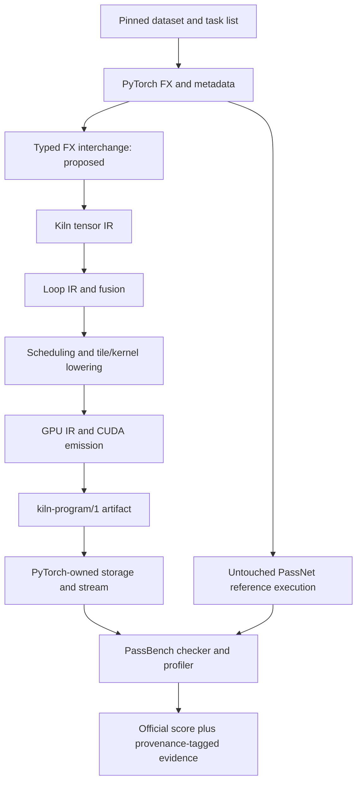

# PassNet reproduction and Kiln integration: intern implementation guide

## 1. Scope and evidence status

This project has two independent experimental tracks. The reference track runs the pinned PassNet implementation without Kiln changes. The integration track lowers the same workloads through Kiln and submits their results to PassBench. Keeping the reference evaluator unchanged makes the effects of compiler and runtime changes identifiable.

The checked-in paper is arXiv:2605.29357v1. Reference source revision is `61c64709f6d324216ae8252cec3cdc35b2dd5da5`; dataset revision is `4f7dd9211178327c2718f1b828d83ea126186f9e`. Source inventory, revision API responses, paper, and preliminary research are under `../sources/`. The guide is being developed against these sources; an API described as proposed below is not implemented yet. GPU benchmark results do not yet exist.

The requested end state includes baseline reproduction, an end-to-end Kiln round-trip, reusable pass experiments with held-out evaluation, documented compiler extensions, reMarkable delivery, and milestone reports in the Obsidian vault. A small FP32 example is an integration gate, not completion of corpus support.

## 2. What a task asks the compiler to do

A graph describes tensor operations and their data dependencies. A pass consists of a pattern matcher and a replacement. PassNet groups graph variants with related operation structure into one task; variants can differ in shape and dtype. A replacement that works for only one shape does not establish task-level correctness.

PassBench's pinned README describes each graph directory as containing `model.py`, `input_meta.py`, `weight_meta.py`, `input_tensor_constraints.py`, and `graph_net.json`. Metadata provides the shape/dtype/device contract; input constraints determine which values can be sampled legally. Read these before importing a graph. A JSON graph alone may omit behavior expressed by executable Python and constraints.

The evaluator loads Python pass modules from `pass_dir/` according to `sorted_output_pass_rule_names.json`. Each module exposes:

```python
def pattern(*args): ...
def replacement_args(*args): ...
def replacement_func(): ...
```

The first function expresses the computation to match. The second maps captured operands to replacement arguments. The third returns a stable module-level callable. The pinned README explicitly rejects nested definitions and lambdas for that callable. `PassMgrBackend` traces with `torch.compile`, applies `SubgraphMatcher`, substitutes the callable, and recompiles the FX graph. A pass that matches nothing causes an early exit and receives the documented minimum score rather than an eager fallback.

## 3. System boundaries



The bridge must preserve graph semantics across each boundary. Compilation success alone is insufficient: a program can compile while using the wrong reduction axis, scalar promotion, output dtype, or alias behavior. Separate serialization validation, import legality, compiler reference checking, and original evaluator correctness.

Kiln's current source map begins with `packages/kiln/src/std/tensor.js` for tensor operators, `std/loop.js` for loop transformations, `std/tile.js` and `std/kernel.js` for lower-level representations, `std/emit.js` for emission, `std/export.js` for artifacts, and `core/kiln.js` for rule/pass machinery. Inspect concrete definitions before adding an operation; matching frontend names does not prove equivalent semantics.

`scripts/kiln-export.mjs` calls `compileScript` and `endToEnd` from `apps/workbench/src/compile.js`. It records source SHA256, target, parameters and exported kernels, and rejects unknown CLI arguments. It defaults to WebGPU; CUDA target selection must be explicit. Its end-to-end result can be skipped: record a skip as unverified, not passed.

## 4. Acquire and materialize the corpus

Run `scripts/01-download-dataset.py` from this ticket. It resolves downloads using the stored dataset revision, checks file size and SHA256 against published LFS metadata, and writes a receipt after each verified shard. Large binary corpus files remain under `sources/dataset/` and are intentionally excluded from Git; the script and inventories are committed. A partial file is not valid evidence of a downloaded shard.

Materialization must be implemented after inspecting the Parquet schema. Do not assume that a row is one complete graph: the preliminary research describes file-content records. A safe materializer should reject absolute paths, parent traversal, duplicate conflicting paths, and symlink escape. Preserve record bytes and record the selected corpus revision and output manifest.

```text
for shard in verified_shards:
    inspect schema and required fields
    for record in shard:
        path, content = decode documented record format
        reject path escaping corpus root
        reject conflicting duplicate path
        write content and record SHA256
verify all paths in pinned evaluation list exist
record task count, graph count, dtypes, operations and missing files
```

Do not execute arbitrary downloaded graph code during materialization. Execution belongs in the designated isolated evaluation environment after source inspection.

## 5. Reference environment and numerical protocol

Paper Table 3 specifies A30 24 GB SM80, Ubuntu 24.04.1, CUDA 12.8/cuDNN 9.10.2, PyTorch 2.9.1+cu128 and Triton 3.5.1. It specifies 20 warmups, 100 trials, and rerunning if IQR exceeds 20% of median. The pinned README instead describes 25 warmups. Reconcile executable defaults and paper settings explicitly before comparisons.

The available host `bling.local` is ARM64 with NVIDIA GB10. Host inspection found driver 580.178.04, Docker 29.6.2, Python 3.12.3 and Node 26.8.1. NVIDIA-SMI reports driver CUDA capability 13.0; this is not a toolkit version. Local Node 24 does not satisfy Kiln's package.json Node >=26 requirement, so use the verified remote Node or install a supported local runtime. ARM64/Blackwell compatibility may require a distinct software environment. Report this as a hardware-port reproduction with a full environment manifest.

The pinned README gives baseline tolerances:

| dtype | rtol | atol |
|---|---:|---:|
| FP32 | 1.3e-6 | 1e-5 |
| FP16 | 1e-3 | 1e-5 |
| BF16 | 1.6e-2 | 1e-5 |

The checker also verifies output dtype; numerically close FP32 output is not an acceptable replacement for required BF16 output. It sweeps tolerance levels, so retain the complete per-level result instead of one Boolean.

Timing records both end-to-end and GPU-only latency. Preserve raw trial values, warmup count, synchronization policy, compile time, and stability decisions. Allocation and Python dispatch can dominate small computations; report these costs separately rather than attributing all changes to kernel code.

## 6. Proposed FX interchange and importer

The interchange must use explicit node identities, operator overload names, typed tensor specifications, scalar constants and output structure. Start with static shapes and make unsupported features explicit diagnostics. Every restriction is a coverage limitation to remove or measure, not a silent fallback.

```text
import_graph(graph):
    validate version, node references and acyclic ordering
    validate input metadata: dtype, shape, strides, device semantics
    for node in topological order:
        resolve exact ATen overload
        validate promotion, broadcasting, axes and alias behavior
        lower using a documented Kiln operator implementation
        verify inferred shape and dtype against source metadata
    reconstruct complete output structure
    return Kiln graph and mapping/provenance manifest
```

Resolve tensor-scalar addition separately from tensor-tensor broadcasting. Preserve reduction axis lists, keepdim and accumulation dtype. A reshape of noncontiguous storage may require a copy; transpose changes layout. Do not replace either with an indexing assumption without proving it against the source semantics. Track constants and weights distinctly from runtime inputs. Unsupported overload errors should name the source node, overload, dtype and missing capability.

## 7. CUDA/PyTorch ownership contract

`runtime/python/kiln_launch.py` exposes `open_program` and `CudaProgram.launch(stream=0, scratch=None, **pointers)`. Opening with `allocate=False` leaves input, output and intermediate storage to the caller; constant buffers remain launcher-owned. The launcher compiles CUDA with NVRTC for the detected device architecture, retains its CUDA context, and launches without copying or synchronizing.

The PyTorch bridge must allocate each declared output with the correct shape and dtype on the selected CUDA device, allocate scratch per invocation, and pass data pointers plus the current PyTorch stream. Validate dtype, device, shape, strides and supported layouts before launch. Keep tensor storage alive through asynchronous execution and use PyTorch stream ownership mechanisms where necessary. Never reuse mutable scratch concurrently across streams. Cache compiled programs by artifact content identity and device, not merely by filename.

The launcher uses a live non-primary CUDA context if one is already current. Therefore context consistency with PyTorch must be verified, not assumed. Add real tests for non-default streams, repeated program lifetimes, multi-kernel scratch, and error paths before relying on this runtime in benchmark measurements.

## 8. Reusable fusion experiment

`packages/kiln/src/std/loop.js` currently defines `mergeLoopOps`; its profitability guard is `now <= was * 1.02`. This confirms the preliminary proposal's threshold. A first policy experiment can vary this guard, but legality must remain enforced independently.

Split workloads by graph family before policy selection. Shape variants of the same pattern must not leak across training and held-out sets. Compare the unchanged compiler, manual policy, agent-selected parameters, agent-composed passes, and new agent-generated passes under the same measurement budget. Report compiler time and failures as well as latency.

An exploratory selection objective is mean log baseline/candidate latency minus a compile-cost penalty. This does not replace the official PassBench score. The pinned README describes squared slowdowns while the preliminary research says executable scoring defaults to p=0; inspect the scorer before implementing aggregation. Record its parameters with every result.

## 9. Provenance for compiler extensions

For each borrowed implementation, record repository URL, immutable revision, path, symbol, license and whether code was copied or independently implemented from behavior. Explain semantic differences and cite the tests that cover them. For research-derived transformations, cite the paper section and preconditions. Put this information in the design document and corresponding chronological diary entry; preserve applicable license notices with copied code.

User authorization includes implementing missing Kiln capabilities, consulting PyTorch/PassNet/research, and using bling.local. The corpus coverage audit determines which dtype/layout/operator and lowering extensions are necessary. Do not add compatibility layers merely to preserve an obsolete interface.

## 10. Validation and delivery gates

1. Verify pinned sources, corpus materialization and complete evaluation membership.
2. Run untouched eager and Inductor evaluation, recording all failures and software/hardware differences.
3. Lower one genuine task through Kiln; pass the original numerical and dtype checker.
4. Exercise original pass matching, integrity defenses and score aggregation. If a sanctioned integration requires evaluator changes, label the protocol modified and preserve the untouched reference.
5. Expand full operation/dtype/layout coverage and report unsupported cases in the declared denominator.
6. Evaluate reusable policies on fixed held-out families and preserve raw evidence and compiler identities.
7. Finish and visually validate intern documentation, upload to reMarkable, write milestone textbook-style vault reports, and commit/push the vault.

Current work has reached source acquisition and environment inspection. The remainder of these gates is pending.

## 11. First verified reference task and importer target

The first pinned evaluation task is hash `6291d774daf9c8b62c3f7d79f1fc55ec2d82adcd69425bfb0bb4e00b14724de8`. Its six variants completed with six success statuses and no failed statuses in the original evaluator. Archived raw output is in `sources/reference-smoke/000-inductor.log`, with exact command and process duration in `execution-receipt.json`. This establishes one task on DGX Spark, not full reproduction.

Its GraphModule.forward accepts running mean, running variance, bias, weight, and activation. It computes functional ReLU, functional batch_norm with training=False and eps=1e-5, followed by dropout with p=0 and training=False, returning a singleton tuple. The FP32 batch-eight source is under `sources/upstream/graphs/hf_subgraphs_v2/fusible_subgraphs/float32/8/samples/torchgeometric/LINKX/_decomposed/LINKX_start17_end20_5/model.py`.

Inference batch normalization requires channel-aware broadcasting: output = (relu(input)-running_mean)/sqrt(running_variance+eps)*weight+bias. Confirm channel axis, precision and intermediate rounding against PyTorch before lowering. Disabled dropout is an identity in this graph, but general training dropout requires random-number semantics and must not be silently removed. Preserve the tuple output and FP16/BF16 rounding behavior. These requirements motivate extending the importer beyond a synthetic add/ReLU demonstration.

## 12. Implemented serialization and first importer

`integrations/passnet/fx_export.py` uses FX ShapeProp to serialize trusted graph execution metadata into kiln-fx/1. It preserves argument/container structure and exact ATen overload strings. `fx_import.py` resolves references, validates static contiguous FP32 inputs, and emits a Kiln project script for a currently limited elementwise operation set. It returns an output-structure manifest so tuple/list/dictionary structure can be restored after flat program execution.

Run CPU boundary tests with `python3 -m unittest discover -s integrations/passnet -p 'test_*.py'`. These tests establish structure and explicit rejection behavior, not Kiln compilation or GPU equivalence. Next validation must compile the emitted script and compare its output against the source graph before integrating it into the original evaluator. Remaining operators and dtype/layout support must be implemented rather than omitted from the full benchmark denominator.

## 13. Verified GPU milestone and integrity boundary

The integration now compiles an actual first-task FP32 graph into two CUDA kernels and executes it with PyTorch-owned inputs/outputs and per-invocation scratch. A CUDA test with nontrivial running mean, positive variance, weight and bias passed rtol 1.3e-6 and atol 1e-5, with maximum absolute error 9.5367431640625e-07. Reproduce its generation with scripts/04-export-first-task.py, compile the emitted project with the existing export CLI, and run integrations/passnet/smoke_batch_norm.py against the artifact. This verifies a genuine task's operation structure and shape under independent inputs; it does not establish PassBench acceptance or full task coverage.

The initial compiler check failed because imported source-domain constraints were not represented by generic project test data. Explicit running-statistics data made the reference check pass without disabling it. Preserve example inputs and domain constraints separately from graph semantics: a positive example variance must not become a compiler constant when variance remains a runtime operand.

The first pass module used the documented pattern/replacement_args/replacement_func interface. Original pass_mgr reported no match. scripts/08-inspect-fx-pattern.py explains why: symbolic_trace canonicalizes functional batch_norm arguments into keyword arguments and inserts dropout inplace=False, whereas Dynamo's graph retains eight positional batch_norm arguments and omits the dropout default keyword. Exact structural matching fails even though the operations agree mathematically.

Explicit Graph/GraphModule construction can express that structure, but the original AST validator rejects these calls. sources/kiln-match-v2.log preserves its exact diagnostics. Do not hide constructor calls in another module or alter validation to present this as original-protocol success. There are two legitimate research directions: find a pattern form accepted by the original interface, or add a separately labeled trusted integration protocol that admits compiler-produced pattern artifacts with a documented integrity contract. Either direction must retain numerical and dtype checks, reverse-order evaluation and replacement restrictions. The untouched reference environment remains authoritative for paper reproduction.

## 14. Corpus completion and remaining work

All 14 Parquet shards were size/SHA256 verified and materialized into 2,067,810 file-content records, with zero duplicate records. sources/materialization-summary.json gives the compact receipt; the full manifest is under sources/materialized. The pinned repository independently contains all 200 evaluation tasks and 2,060 graph directories.

The full reference run is exploratory: synthetic GPU checks and integration tests overlapped it. Preserve its logs for correctness/failure diagnosis, but obtain isolated measurements before reporting comparative speedups. Capture exact GPU/software/image identity and active workload state with final measurements. Model-agent runs, reusable policy learning and held-out evaluation have not yet been executed.

This edition documents an ongoing implementation. It does not claim completion of FP16/BF16 support, full corpus operation/layout coverage, original pass matching/scoring, fine-tuning reproduction, compiler meta-optimization or final performance comparisons. Those remain explicit project requirements. The delivered progress edition is useful for an intern to inspect the current boundaries and continue from reproducible scripts; a later edition must replace this status with verified results.

## 15. Measured static corpus requirements

scripts/09-inventory-operators.py parses all 2,060 source graphs without importing or executing them. It normalizes tensor method receiver names and counts Python arithmetic/subscript syntax as well as calls. Full per-graph records are in sources/operator-inventory.json. This is a static occurrence census; it does not measure dynamic invocation counts or prove compiler coverage.

Input/weight metadata mentions FP16 in 728 graphs, BF16 in 733 and FP32 in 569; 170 graphs mention int64 and three mention bool. Counts are nonexclusive because one graph can have several dtypes. A compiler supporting only floating arithmetic still needs integer indexing and Boolean masking semantics for complete coverage.

Static counts include 686 conv2d calls, 666 cat calls, 455 view calls, 346 mean calls, 340 batch_norm calls, 263 reshape calls, 243 transpose calls, 231 embedding calls and 200 dtype conversions. Python subscript and arithmetic syntax are counted separately; slice constructors and negative dimension literals are not GPU kernels. Prioritize capability work by complete task dependencies, not raw frequency alone: adding one operation does not unlock a task if its other operations remain unsupported.

A full implementation needs typed storage and arithmetic conversion rules, channel/spatial indexing, integer gather/embedding, layout views/copies, concatenation, convolution and reductions. Each extension must define reference evaluation, shape/type inference, lowering, emission/runtime representation and numerical tests. Preserve rejected tasks in the declared benchmark denominator while these capabilities are developed.

## 16. Integration protocol: functional argument normalization

`integrations/passnet/fx_normalize.py` provides a narrowly scoped graph transformation for ReLU, batch_norm and dropout. It binds each public Python signature, fills defaults and emits ordered positional arguments. Both target and pattern graphs must undergo the same normalization before structural matching. This is explicitly a modified integration protocol; it is not a result under unchanged PassBench matching.

The transformation changes call syntax rather than tensor arithmetic. It neither evaluates function bodies nor relaxes dtype/shape predicates. It validates every call before mutation, rejects unsupported signatures, records changed node identities and is idempotent. Tests reproduce the actual positional/keyword mismatch, demonstrate one match after normalization, and check exact output preservation for the tested graph.

Original AST source validation remains applicable to generated pass modules. They should contain ordinary functional patterns, not explicit graph construction. Integration setup owns normalization outside generated code and must record module identity and changed-node receipts. Numerical, dtype, dispatch and reverse-order checks must remain active. A successful unit test of normalization does not establish that the rest of PassBench accepts the CUDA launcher; that still requires execution evidence.

## 17. First complete task result

All six variants of task 6291d774daf9c8b62c3f7d79f1fc55ec2d82adcd69425bfb0bb4e00b14724de8 now pass numerical, dtype and stability checks under the declared normalized/record-stream integration protocol. The original scorer parsed six results and reported aggregate 0.8495327431059172. This is slower than eager in this run and is not a full-benchmark result. Earlier overlapping run failed BF16 stability; both attempts are retained.

Reproduce using scripts 16–20 and review sources/first-task-isolated.log plus first-task-score.json. Script 21 generates complete denominator accounting: one of 200 tasks, six of 2,060 graphs verified; the remaining 199 tasks are not yet verified. The task uses dtype-dispatched artifacts and runtime metadata validation. This is execution support for one fixed task family, not demonstrated generalization of a learned compiler policy.

## 18. Convolution task acceptance and limitations

The first three tasks now have original checker acceptance under the declared modified protocol: 19 graphs across three of 200 tasks. Exact per-graph evidence is maintained in sources/kiln-coverage.json. The third task's FP16 convolution/in-place-ReLU/residual/identity-resize chain passes on original replay inputs after correcting low-precision bias addition order. Official aggregate is 0.043470409529710305, a severe slowdown versus eager.

A separate unit-scale random stress test still fails 67/73728 elements after the bias fix. Keep that limitation distinct from benchmark acceptance; the source's smaller replay distributions are not proof that larger values are invalid. The initial convolution uses safe clamped reads and explicit padding masks, nested indexed reductions and FP32 internal arithmetic. These are correctness foundations, not a high-performance convolution design. Profiling, precision robustness and reusable pass/schedule improvement remain required work.

## 19. Static layout and cast import

The importer now accepts tensor methods reshape/view, flatten, permute, contiguous, and explicit floating conversions. Reshape uses the static output shape recorded by FX propagation after verifying literal shape operands. Permutation composes pairwise Kiln transposes. Contiguous materializes the logical tensor value through reshape. Casts use N.cast so FP16/BF16 rounding remains explicit through fusion.

This is value-semantic graph import. External noncontiguous inputs and mutation-dependent alias behavior remain unsupported. Device transfers and dynamic shape operands fail explicitly. Scripts 44/45 export and run a four-output chain; all outputs matched PyTorch CUDA exactly on GB10. These probes do not increase the verified PassBench task count.
