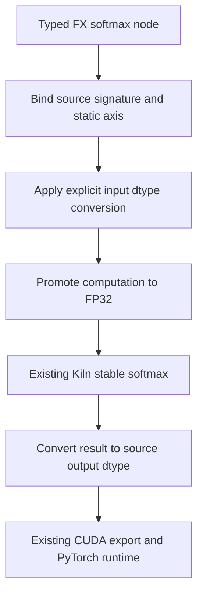

# Softmax source contracts and complete-family qualification

Softmax is a reduction over one tensor dimension. For each fixed coordinate outside that dimension, the result is the exponential of each element divided by the sum of exponentials. Kiln already implements a numerically stable decomposition: subtract the maximum, exponentiate, sum, then divide. This integration connects source operators to that existing implementation while preserving axis and dtype semantics.

## Representation and compilation

The source boundary accepts `torch.nn.functional.softmax`, `torch.softmax`, Tensor `softmax`, `aten.softmax.int` and `aten._softmax.default`. The argument binder lives beside LayerNorm in `integrations/passnet/fx_norm_ops.py`. `fx_import.py` resolves operand metadata and dispatches to it. No additional compiler pass, evaluator or runtime is introduced.



A requested dtype applies to the input before computing softmax. This order is observable when converting FP32 input to FP16: rounding changes the logits before normalization. Computing from the original FP32 values and narrowing the probabilities afterwards would not preserve source semantics. FP16 and BF16 computations then use FP32 operation arithmetic and narrow once at the source output boundary.

```text
storage_dtype = requested_dtype or input_dtype
converted = cast(input, storage_dtype)
wide = cast(converted, FP32)
shifted = wide - maximum(wide, axis)
exponentials = exp(shifted)
probabilities = exponentials / sum(exponentials, axis)
result = cast(probabilities, storage_dtype)
```

The internal ATen overload has a Boolean `half_to_float`, rather than a public dtype parameter. When true, this binding requires FP16 input and returns FP32. The direct unit test verifies its metadata and expression contract. The CUDA fixture population currently covers this internal overload with false; it does not claim direct execution coverage of the true branch.

## Axis and scalar semantics

Static dimensions must be integers, excluding Booleans, and must be in range before negative-axis normalization. A scalar accepts dimension -1 or 0. It is reshaped to one element for the existing reduction implementation, then reshaped back. This preserves the computation on nonfinite values; replacing scalar softmax by a constant one would not.

Only the functional interface permits an omitted or None dimension. Its deprecated choice is zero for ranks zero, one and three, and one otherwise. The binder resolves this statically from source metadata. Torch and ATen entry points require an explicit dimension. The warning stacklevel affects diagnostics only and must be a static integer if present.

Metadata must describe the unchanged tensor shape and the output dtype implied by the source signature. Duplicate or unknown arguments, invalid axes, unsupported dtypes and inconsistent output metadata fail explicitly. The importer still requires positive static dimensions and supported contiguous floating input storage.

## Ownership

Softmax produces fresh storage. Marking its result as owned allows a following single-use in-place activation to become a functional operation. Ownership does not transfer to the original input, and multiple uses still prevent mutation functionalization. This follows the importer's existing fresh-producer contract.

## Evidence and experimental scope

The 45 FX tests cover equivalent public bindings, scalar/vector/tensor axes, implicit dimension choice, explicit dtype conversion, invalid arguments and internal promotion metadata. Thirty-three independent fixture programs compile. Three input regimes per program produce 99 CUDA comparisons: normal random values, wider logits and a large common offset. All pass on GB10 using the existing fixture tolerances. Fixtures also compare input snapshots after execution to check unintended mutation.

The full 200-task import audit increases eligibility from 1,029 to 1,122 individual graphs and from 51 to 61 complete families. Script 249 freezes all ten newly complete families, containing 93 graphs, without shape or dtype filtering. Their original benchmark evaluation is a separate gate. Eligibility and fixture success do not establish official matching, nominal t=-5 correctness or score acceptance.

The frozen cohort uses the existing `evaluate_tasks.py` runner, separate FP32 contraction, original evaluator inputs, 20 warmups and 100 trials. The shared `summarize_task_run.py` must verify ordered graph membership, exactly one replacement, successful execution and the original numerical curve. Any failures remain in the 93-graph denominator. This is modified-protocol GB10 development qualification, not an A30 paper reproduction or held-out compiler improvement.

## Provenance

The semantic references are the official [functional softmax documentation](https://docs.pytorch.org/docs/stable/generated/torch.nn.functional.softmax.html), the archived [PyTorch v2.9.1 functional source](https://github.com/pytorch/pytorch/blob/v2.9.1/torch/nn/functional.py), and the installed PyTorch 2.11 function/schema reference. Their local files and hashes are in `sources/softmax-reference-provenance.json`. The documentation server rejected the direct archival request with HTTP 403; the version-pinned GitHub source was saved successfully. No PyTorch implementation is ported: the normalization algorithm remains Kiln's pre-existing `N.softmax` decomposition.
