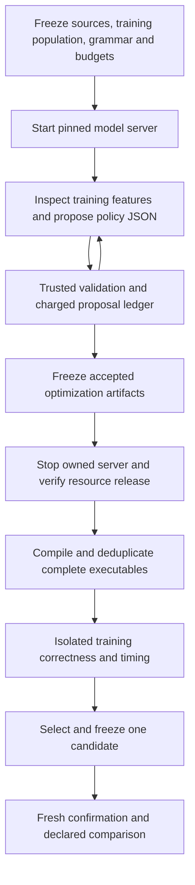

# Meta-compiler study assessment and optimization artifact implementation priorities

## Decision and scope

The supplied kiln_meta_compiler_study.md is archived byte-for-byte as sources/kiln-meta-compiler-study.md, SHA256650d2750bd958c1dc1404b07d1d5941b9c5c31588b71404bda4bdc7eaee4395c. It is a research/design input, not reproduced evidence for its81 external reference records. The current project reassessment reads its recommendations against all148 diary entry introductions/lessons, focused full investigation sections, design documents and actual code/receipts. Critical literature claims require primary-source inspection before implementation or attribution; no external source algorithm is ported here.

The recommended priority is one complete agent-generated reusable-policy experiment on an already-correct corpus, followed by a small replayable transformation language. Full200-task support, unchanged reference reproduction and native numerical compatibility remain active integration requirements. They should not gate every research iteration. Existing numerical findings remain failures where the declared benchmark rejects them.

## Existing capabilities and actual gaps

| Study recommendation | Current implementation/evidence | Remaining work |
|---|---|---|
| Pure deployable policy | fusion_policy.mjs validates bounded threshold, tree, selective and region JSON; optimization_artifact.mjs binds canonical identity and versioned contracts | Extend the bounded policy artifact to replayable transformation programs |
| Checked selective fusion | createFusionRule and chooseFusionSubset share inlining, retained-producer accounting and rollback | Expose through a small replayable action/query interface |
| Fixed evaluation and held-out confirmation | Completed four-slot LLM/threshold/random comparison with independent committed selections and eight fresh confirmation graphs | Replicated search batches, stronger structural holdouts and uncertainty |
| Transformation traces | Run records graph deltas/checkpoints/events | A portable lossless codec and explicit stale-handle/failure contracts |
| Independent evidence | Existing evidence identity library plus integration receipts | Compose complete experiment identity without introducing a parallel evidence store |
| LLM pass generation | Native task/driver work; initial smoke aliases baseline; controlled batch rejects four simultaneous actions and selects fallback | Improve action reliability in a new declared protocol and demonstrate an accepted beneficial transformation |

The existing deterministic proposal generator explicitly says it is not an external LLM invocation. Prior manual/template policy studies cannot be relabeled as such. The singleton reshape improvement is a manually derived reusable compiler algorithm, with positive but mixed fresh-model measurements. It is not autonomous synthesis.

## Optimization artifact and trusted boundary

A proposed optimization artifact binds its executable policy or strategy to an input IR, semantic profile, feature/action versions, resource budget and applicability scope. It has a deterministic content hash. A separate evaluation identity binds that artifact to workload membership, compiler/runtime/toolchain, device and protocol. Timing replicas belong to the evaluation, not to the reusable artifact's identity.

Keep these as modules near the existing compiler and evidence package initially. The study's suggested package tree is not a request to create several packages immediately. Move compiler-general policy/transform ownership out of the PassNet integration when an independent caller consumes it; keep dataset selection, FX, matching and official scoring within the integration.

The search process may propose policy/strategy data. It cannot edit references, numerical tolerances, measurement code, final membership or promotion rules. Structural validity, differential testing, sanitizer checks and formal proof are separate evidence categories. An empirical tolerance is not a license to reassociate every floating expression.

## Agent framework decision

Reuse the pinned R2E-Gym Action parser and TrajectoryStep records inside the bounded native driver. Repository-oriented Agent.run does not fit the native policy task; the implemented driver owns that lifecycle explicitly. Keep the original PassAgent reference configuration separate. The native task uses structured result fields and candidate identities, with no placeholder reward.

Implemented tools inspect approved training features, submit validated policy JSON and finish a batch. Existing corpus/compiler/runtime/measurement commands perform compilation and evaluation outside the model's control after serving stops. Model-requested compilation and adaptive timing feedback remain future work. Use one agent; extra agents require an explicit independent experiment.

Model choice is a recorded experimental variable. A higher model in the current coding conversation does not retroactively change the completed generic-Qwen reference run or establish a new benchmark result. Use a provider or the existing local endpoint with an explicit model identity. If serving shares the GB10, separate proposal and hardware timing phases and release serving resources before isolated measurements.

## Implementation order

1. Audit and freeze an already-correct training population with real policy-sensitive opportunities. Reuse the compiler, selector, qualification and measurement harness; do not wait for task10's convolution repair. Previously inspected confirmation sets are development evidence, not fresh tests.
2. Add the small optimization-artifact envelope and native task tools. Verify canonical identity, malformed proposals, immutable evaluator inputs, real executable deduplication and budget accounting. Every invalid/failed proposal consumes its declared proposal budget.
3. Compare baseline, threshold sweep, seeded random proposals and one recorded LLM under the same grammar and hardware evaluation budget. Record tokens, compile time, GPU time and actual distinct executables separately. Freeze the selected artifact before new-model confirmation.
4. Introduce only the transformation constructs needed by an observed experiment: structural selection/query, checked action and bounded sequencing. Reuse Rule/Pass/Run graph mutation. Serialization/replay must preserve actions/selection and reject stale handles; failed actions leave original IR unchanged. Retain rejection traces as learning data.
5. Expand to new transformation synthesis, semantic analyses and compiler-issue corpora after the first comparison can distinguish proposal quality, search-space headroom and measurement effects.

MLIR, equality saturation, whole-repository TypeScript conversion, large-scale training and broader autonomous source patching remain later evaluated branches. None is required to produce the next credible reusable compiler artifact. The full goal remains active.

## Numerical consequence of this review

The full-shape convolution probe in design19 contradicts selecting an oracle from its smaller batch1 probe. Compensated summation can reproduce the frontend while still disagreeing with the full native reference. This is a concrete example of why semantic profiles and external acceptance must remain independent of an agent's objective. No production numerical fix is approved by these diagnostic substitutions alone.

## Implementation checkpoint: native proposal boundary

The following checkpoints preserve the order of implementation and evidence. Later checkpoints supersede earlier statements about pending work; the capability table above summarizes the current architecture.

`integrations/passnet/native_policy_task.py` now implements the proposal phase as a trusted task object. The caller supplies the corpus manifest, a training-only compilation receipt, a proposal budget, an evaluator-owned output directory and the Node executable. Its three operations are `inspect_training`, `submit_policy` and `finish`. It exposes no shell, file editor, evaluator path, timing switch or numerical-tolerance operation. This boundary is callable by either an agent driver or a deterministic search baseline. It is not yet the R2E-Gym driver or a complete optimization experiment.

The training view projects only `originalWork`, `fusedWork`, `consumerCount` and `producerElements` from the approved training records. These are the existing fusion rule's estimated work and structural counts, not measured GPU costs. Work is derived by `kernelWork` from `workOf(schedule(...))`. `originalWork` includes the producer and original consumers; `fusedWork` includes rewritten consumers and a retained producer when required. The public view uses ordinal example identifiers and excludes source paths, model names, arbitrary diagnostics, held-out records and their measurements. The full manifest membership hash remains host-side in the task receipt. The task checks numerical-policy agreement between the manifest and compiler receipt.

`optimization_artifact.mjs` calls the existing `prepareFusionPolicy` validator, then packages the program with a numerical-policy contract, applicability declaration, feature/action versions and the existing hard program limits. Identity uses the existing evidence package's `canonicalJSON` and `sha256Hex`. The initial `kiln-loop/1`, `kiln-loop-fusion/1` and `kiln-loop-fusion-features/1` identifiers name this integration's declared contract; they are not a claim that the core compiler already has a versioned IR serialization protocol. Compiler source and runtime identities remain evaluation metadata.

The artifact fixes the diagnostic policy ID to `artifact-policy` and excludes author provenance from executable identity. Renaming a policy or changing its author metadata therefore produces the same artifact hash. Changing its decision program or fixed numerical policy produces a different hash. The numerical field currently records only the existing contraction setting; it is not a complete floating-point semantic profile or a claim that the convolution discrepancies are solved. The host must preserve the actual compiler, workload, precision and timing contracts when evaluating an artifact.

Every submission reserves a numbered request before validation. Malformed JSON, duplicate JSON keys, nonfinite numbers, forbidden fields, excess program budgets, malformed submission arguments, validator failures and repeated valid programs consume a slot. Identical artifacts receive `duplicate` and the first attempt number, without a second artifact file. Accepted means valid policy data; every accepted result explicitly reports `evaluation_status: not_run`. Invalid tool names consume no proposal slot; the future agent driver must charge every model turn against its independent step and inference budgets.

The ledger deliberately has a single owner and refuses an existing output directory. It does not promise concurrent writers, crash-safe resumption or power-loss durability. An interrupted reserved attempt remains visible. A future restart protocol must reconcile such reservations rather than refunding attempts. Filesystem access remains a host responsibility; the in-process API does not sandbox a model with an independently granted shell.

Script426 exercises the boundary on the previously observed v8-r2 training population. The final-source check is in `sources/native-policy-task-check-v2`: all twelve training graphs compile under the explicit default, the replayed default artifact and the disabled-fusion artifact. Default replay preserves all twelve executable fingerprints; disabling fusion changes all twelve. All thirty-six compilations pass the existing compiler reference checks. The script compiles with `--phase train`; it does not compile the historical held-out members. This is operational evidence, not a fresh holdout, native CUDA validation, performance measurement or external-LLM result. Script427 retains the focused validation commands and their output.

## Framework inspection and next connection

Inspection of pinned R2E-Gym `0d94c4eb9431cd195c55a7ea3abd54006c9a1735` shows that `Agent.run` expects a `RepoEnv`, repository commit/test-patch metadata and repository command installation. `Agent.model_query` chooses hard-coded tool sets for the supported scaffolds. `Trajectory` also contains required Docker and patch fields. Consequently the native integration cannot honestly be implemented as a prompt change on the original runner or by inventing a fake repository repair task. The separate driver should reuse applicable query/action/trajectory-step components and implement the small native lifecycle explicitly. Any changed provider, parsing or retry behavior must be recorded. The unchanged original PassAgent configuration remains separate.

The next step is to connect model actions to this task, retain raw requests/responses and usage, and feed accepted artifacts into the existing compilation and qualification harness. Artifact identity deduplication is already implemented; deduplication of distinct policies that lower to identical complete executables still belongs to the compiler/evaluation phase. The initial local-model experiment should batch proposals, stop serving, verify resource release, and then perform isolated correctness/timing evaluation. Training feedback can inform a later proposal batch after measurement; no concurrent serving/timing result should be promoted as an isolated compiler speedup.

## Native agent driver and experiment lifecycle

`run_native_policy_agent.py` now provides the separate proposal loop. It reuses pinned R2E-Gym `Action` parsing and `TrajectoryStep` records; it does not invoke the repository-editing `Agent.run`, assign a placeholder reward or fabricate Docker/patch fields for a repository trajectory. Model requests use the local OpenAI-compatible HTTP endpoint with an explicit model name. There are no automatic retries, inherited proxy settings or provider redirects. This initial provider implementation accepts loopback HTTP endpoints only and uses a dummy local key; external-provider credential handling is not implemented.

The prompt defines the complete bounded policy grammar and the meaning of its features. The host declares a proposal count, model-step count, per-response token limit and cumulative completion-token budget. Every model request consumes a step; all returned prompt/completion usage is retained separately. The cumulative hard token limit applies to completion tokens, not the sum of repeated input-context tokens. The server's context limit remains a separate bound. A response without consistent usage information cannot execute a tool. A response stopped by a length limit is retained but its partial action is not executed. Invalid or multiple action blocks consume a model step; a recognized submission with duplicate parameters reaches the task as an invalid proposal and consumes a proposal slot.

For each step the driver writes the exact JSON request, raw provider response and R2E trajectory-step record. Its final result reports the stopping condition, token usage, proposal ledger summary and `evaluation_status: not_run`. Finishing a batch does not select or promote a compiler policy. The first batch can use structural evidence and validation feedback; an adaptive experiment can alternate separately recorded proposal and training-measurement batches. That later feedback protocol must be fixed before comparison and must expose no confirmation data.

Scripts428/429 implement an operational smoke-run lifecycle on the DGX. The staging script refuses uncommitted input bytes and creates a separate source directory; it does not mutate the shared compiler checkout. The owning process verifies every bundle file, hashes the installed R2E Action/Trajectory modules against the archived pinned source, rehashes the full model artifact, and checks for existing GPU activity. It starts one named local model container, runs a two-proposal batch on previously observed training data, then stops only its verified container and records process/resource state. This operational run does not establish a new benchmark population or a policy speedup. Its results must be recorded separately from the later equal-budget experiment.

The implementation has seven controlled-provider loop tests covering token/step stopping, missing usage, response retention, partial/malformed actions, no hidden query retry and explicit local provider selection. These tests use doubles for framework objects; the DGX smoke is required to verify the installed R2E components and real model response together. At this source checkpoint that smoke has not yet run.

## First actual model batch: operational success, no executable change

The subsequently completed smoke used committed source `05efc4c494a1dd0b8c2a9786be1fec2e0e3e7c21` and the pinned generic Qwen3-30B-A3B BF16 model. It took five model steps and224.366 seconds of agent-loop time. Reported usage was60391 prompt tokens plus5743 completion tokens,66134 total. These prompt tokens include repeated context across requests; they are not a single context window. The full model file was rehashed before launch. The installed R2E Action and Trajectory module hashes matched the archived pin.

| Step | Observed action | Outcome |
|---|---|---|
|0|Inspect training features|Approved numeric feature view returned|
|1|Two submit actions in one response|Entire response rejected as an invalid action; no policy validation|
|2|Inspect training features again|Same approved view returned|
|3|Submit threshold1.05 with ID `threshold-1.05`|Charged proposal rejected: `Invalid fusion policy identity`; a dot violates the ID grammar|
|4|Submit threshold1.05 with ID `threshold-1-05`|Second charged proposal accepted; proposal budget exhausted|

The accepted optimization artifact is `47de696f439bec397cfd65268d9183a49e82a5948c123898290d70cec063f6d8`. It has kind `threshold` and `max_work_growth: 1.05`. This is also the numeric value in the prompt's illustrative example; the smoke does not establish independent discovery or novel policy synthesis. The model did produce a second textual decision-tree proposal in the multi-action response, but the host did not validate, compile or accept it.

Script430 collected29 files and verified their hashes against the terminal DGX files. Script432 reconstructed every model-visible message, replayed parsed actions with the pinned R2E Action implementation, and matched observations, token totals and task accounting. The final container was absent; both the owner's post-shutdown check and the later collector found no active GPU compute process.

Script431 compiled the actual accepted program and unchanged Kiln on all twelve historical training graphs. All24 compilations passed the compiler reference checks. Script433 independently compared complete emitted program objects after excluding only `name`, `source` and `compiler_policy` metadata. All twelve were equal, including executable code, launch configuration, inputs/outputs and scratch allocation. The result is an executable alias of the baseline on this corpus. No CUDA correctness result or timing contrast is inferred from compilation, and no duplicate GPU timing was performed.

This closes the operational model-to-policy-to-compiler connection. It does not close task f5d9: there is no equal-budget search comparison, selected improvement or fresh confirmation yet.

### Budget ambiguity to resolve before the scientific comparison

The implemented smoke protocol counts dispatched `submit_policy` calls as proposal attempts and counts malformed action responses against the model-step budget. Consequently its five responses contain four textual candidate blocks, but only two charged proposal attempts. That distinction is explicit in the raw evidence and must not be reported as only two generated candidates. The current run is an operational check under its recorded protocol, not evidence of equal candidate-generation budgets.

Before the comparison, tighten the driver so identifiable submission attempts in rejected multi-action responses also consume the declared proposal budget, or use a predeclared model-response budget as the primary search unit and report all textual candidates separately. The preferred next implementation is to charge each identifiable submission without executing the malformed multi-action response. Preserve this smoke unchanged and run the comparison under the new declared protocol. Also avoid using an illustrative candidate value as evidence that the model learned that value, and record repeated inspection costs rather than treating them as free input.

The shared study harness needs one further explicit behavior before arbitrary generated policies are compared: its current qualification function requires all candidates to compile successfully. It should retain failed candidates as ineligible search outcomes charged to the fixed budget, while a failed baseline or invalid evaluation declaration aborts the study. Implement this in the existing qualification/selection path rather than introducing a second evaluator. Fresh confirmation membership and training-only selection remain mandatory.

## Implemented protocol revision: rejected submissions and failed compilations

The native driver now emits `kiln-native-agent-batch/2` configuration and `kiln-native-agent-batch-result/2` outcomes. `dispatch_response` counts recognizable `submit_policy` opening headers in final response content, including unfinished headers. If the response contains multiple actions, unmatched delimiters, duplicate parameters or an incomplete completion, no action body executes. Each identifiable submission instead reserves a rejected proposal through the existing task. The task's hard budget remains authoritative: excess submissions are recorded as unadmitted, and no extra slot is created. The trajectory step and aggregate result separately record `identified_submissions`, `charged_submissions` and `unadmitted_submissions`.

This accounting applies to reserved XML delimiters in final response content. Arbitrary prose and provider-separated reasoning are not parsed as tool submissions; they still incur model-step and token costs. A valid action followed by a second unfinished action is invalid as a whole. The prompt states these rules and no longer includes the illustrative1.05 threshold candidate that appeared in the first smoke. It explicitly states that policy identifiers cannot contain dots or underscores.

Script434 applies the new dispatch rule to the first two responses from the preserved smoke. With the original two-slot budget, its multi-submission response now consumes both slots as rejections and yields no accepted artifact. This is a counterfactual replay of fixed response text, not a new inference run or a prediction of what the model will do under changed prompts and feedback. The original five-step run and its accepted artifact remain unchanged historical evidence. Historical audit scripts should be run from their recorded source revision; the current prompt and dispatch protocol intentionally differ.

`qualify_policies.py` now emits `kiln-policy-qualification/2`. Every declared candidate must still have a complete, correctly ordered record for every declared graph, matching its graph identity, split, numerical contract, target and policy. A candidate record may have status `compiled` or `failed`. A failed record requires an explicit diagnostic; its artifact and semantic-hash positions are null, and its graph/split/error remain in `compile_failures`. Missing records, unknown statuses, changed declarations or failed unchanged/default controls remain fatal. There is no outcome-dependent graph filtering.

`measurement_groups` builds shared executable bindings and explicit `compile_failed` groups. `measure_policy.py` reuses the complete qualifier to verify the saved qualification before measurement, replacing its separate partial validation loop. It skips GPU construction for failed groups while retaining their positions in the measurement record. Its output format is now `kiln-policy-measurement/2`. The existing `rank_training` already makes any candidate with a failed training measurement ineligible; no separate scoring system was needed. Successful aliases continue to share measurements.

Failures remain per graph and split. A candidate that compiles on training graphs and fails only on held-out graphs stays eligible for training selection; its later confirmation failure remains visible. Qualification does not compute a global candidate eligibility flag that could leak held-out outcomes into training selection. Failed controls still invalidate the study's reference. `compile_study.py` reports `qualified_with_candidate_failures` when appropriate, including the count of retained failed graph outcomes.

Validation comprises39 focused tests and syntax compilation of the affected compiler-study/measurement entry points. Tests cover budget overflow, truncated and hidden extra actions, explicit failed-candidate selection, missing outcomes, failed controls and held-out-only failures. Script435 also requalifies the real archived v8-r2 outputs: twelve policies across twenty graphs,240 successful artifacts. Their raw artifact hashes, semantic hashes, executable changes, control equivalence and cross-split alias analysis all agree with the historical qualification. New output is saved separately; the old qualification is preserved.

No new model inference or GPU timing ran under this protocol revision yet. The next experiment work is to freeze the method-specific proposal budgets and training population, generate threshold and seeded-random baselines through the same task boundary, and connect accepted model artifacts to a shared declaration. The comparison must preserve each method's independently selected training winner before fresh confirmation, rather than reporting only the globally best candidate across all methods. These orchestration steps remain part of open task f5d9.

## Controlled search orchestration and declared pilot

`policy_search.py` now owns the search declaration, deterministic proposal generation, ledger collection and per-method membership. It delegates proposal validation to `NativePolicyTask`, candidate freezing to `freeze_study.freeze_candidates`, training ranking to `select_policy.rank_training`, and confirmation metrics to `summarize_policy.confirmation_metrics`. The existing measurement entry point accepts a complete search selection and evaluates the union of unchanged Kiln and all selected winners. Exact executable aliases continue to share measurements. There is one correctness/timing implementation and one ranking objective.

The first declared comparison uses four proposal slots per method. Threshold search submits work-growth limits0.95,1.0,1.1,1.25. Seeded random search uses seed20261031 and the bounded threshold, decision-tree, selective and region grammar implemented in `baseline_programs`; duplicate proposals are retained without resampling. The external Qwen3-30B-A3B batch has at most12 model steps,4096 completion tokens per response and24576 total completion tokens. Proposal allowances are equal; inference, compilation and GPU costs are separate quantities. This is a single batch based on structural training features and validity feedback, without timing feedback.

The corpus in `sources/native-policy-search-v2` contains twelve previously studied training graphs and eight new exact-model confirmation graphs, four each in the matrix and reduction categories. The selector excluded models represented by541 graph records in tracked prior corpora, plus the official evaluation models. Its salted metadata scan selected the eight graphs after3036 tasks; there was no compilation or timing-based replacement. Exact-model separation does not imply architecture-family separation. The first preparation attempt failed before selection on an older list-valued manifest; its evidence is preserved in `native-policy-search-v1` and the corrected attempt uses the same declared salt and bounds.

Each method's candidate set includes unchanged Kiln as its first fallback. Independent training selection preserves that fallback on exact ties. A failed candidate is ineligible for the affected method; a failed baseline invalidates selection. Confirmation must retain every declared graph, and any failed graph makes that method's aggregate confirmation speedup unavailable. The summary recomputes all selections from the exact training measurement and rejects altered method membership or a different confirmation grid.

The collector revalidates accepted and duplicate submissions against their raw request bytes and the current artifact validator, checks every charged slot and retained artifact, and verifies baseline proposals against the declared deterministic generator. Cross-method copies of the same optimization artifact receive one compiler policy ID, while retaining their separate proposal costs. Raw model requests, responses and task ledgers are included in the common candidate freeze. Scripts428–430 now take explicit study/run inputs and retain the same isolated DGX ownership and shutdown checks; historical smoke runs remain reproducible from their pinned source revision.

At this checkpoint53 focused tests pass, both twelve-graph training controls compile, and each deterministic method has four valid proposals. The eight confirmation graphs are neither compiled nor timed. The new model batch and all candidate GPU measurements remain pending; no comparative speedup is claimed.

### Actual four-slot model batch and frozen candidates

The declared model batch subsequently ran from commit7776662f3b9e73336302015032529fa5e09bd07a. It completed two responses in142.0059 seconds: one training inspection followed by a response containing four submission actions. The driver rejected that response with `Expected exactly one complete tool action`, charged all four recognizable submissions, and accepted no artifact. Reported usage was10678 prompt tokens and3944 completion tokens. This is a protocol-following failure under the declared model/interface combination, not evidence that the four textual policy ideas would fail compilation or timing. They are not rescued into the comparison after the fact.

Script432 now replays version2 accounting against the pinned actual R2E Action implementation, reconstructs every model-visible message and verifies raw task requests/results. The replay passed. Script430 collected23 files with matching remote hashes and verified that the model container was absent and no GPU compute process remained. Evidence is in native-policy-search-model-terminal-v1 and native-policy-search-model-audit-v1.

The common candidate declaration is now frozen: unchanged/default controls, four threshold proposals and four random proposals. The LLM method contains only its predeclared unchanged-Kiln fallback. Its failure and inference cost remain part of the comparison; there is no rerun or replacement allowance. Scripts438/439 prepare isolated, hashed measurement bundles around the existing evaluator for both phases. Their runtime execution remains pending at this checkpoint. The next gate is complete candidate compilation, followed by isolated training selection and fresh confirmation.

### Completed comparison: unchanged winners and baseline-only confirmation

All ten policies compiled across all twenty graphs, with no compilation failures. Isolated training measured38 distinct graph/executable pairs on twelve graphs; every record passed correctness and stability. Threshold1.1 and1.25, random3 and random4 exactly alias baseline on training. The remaining threshold candidates scored0.9602354466 and0.8137166910; the remaining random candidates scored0.8102983902 and0.6512382639 in family-balanced end-to-end speedup. Each method selected baseline, with the complete selections and training evidence committed at e2b85df5d24ee176a43fcd9461048013a03a83d8 before confirmation.

Baseline then passed all eight fresh confirmation graphs. The three method summaries report1.0 because the selected executable and measurement are identical; there is no independent optimization contrast. Script440 reconstructed22800 training and4800 confirmation timing samples and checked frozen sources, compiled artifacts, aliases, stability and aggregate medians. The completed bounded comparison demonstrates no aggregate improvement. It completes the pilot execution, not the wider compiler-improvement goal. Reference23 explains the architecture, evidence, negative result and next protocol/representation questions in textbook form.

## Pi integration checkpoint and six-lane execution direction

The production Pi owner now completes a local scripted-provider round trip through native tools, the owned Python process and the real Kiln artifact validator. Evidence: sources/pi-local-full-run-v1/verification.json. One request produced one accepted artifact and clean process shutdown in 1376.677119 ms. This is integration evidence, not model performance or optimization evidence.

The user clarified that LunaRoute token cost does not constrain experiments and requested six concurrent lanes. The next owner should run up to six independent proposal sessions with separate output directories, task ledgers and recorded hypotheses. Token allowances should not be justified as cost controls. Explicit proposal counts and operational deadlines remain useful for experimental comparability and detecting runaway processes; actual usage must be reported separately from any reserved allowance.

Lane orchestration should reuse run_pi_policy_agent.mjs, not introduce another agent framework. Each lane must have a fresh immutable configuration and terminal receipt. One failed lane must not reset another lane's ledger or consume its proposal allowance. Compiler qualification can follow candidate collection; GPU measurement must remain serialized and isolated. Six simultaneous proposal sessions do not imply six competing GPU benchmarks.

Before external execution, resolve the payload-specific automatic-review rejection recorded in diary Step 165. The user's token-cost and concurrency preferences are recorded separately from that pending authorization. No rejected action has been retried.

## 2026-10-31 checkpoint: confirmed staged fusion and agent composition

The manually derived staged transformation measured 1.404537× family-balanced end-to-end speedup on twelve development graphs. A fixed transfer to thirteen previously unused exact models measured 1.146076×, with two changed executables (4.405327× and 1.335970×) and eleven baseline aliases. All passed the experiment's correctness checks. This is the separately declared exhaustive available thirteen-model population, after metadata scans failed a twenty-model quota. Architecture relatives may remain; the numerical protocol remains separate FP32 contraction with highest-precision matrix references. These are not official PassBench scores.

The next experiment exposes a bounded transformation composition rather than new arbitrary compiler code. `transformation_program.mjs` is the shared preparation path for both agent validation and corpus compilation. A `kiln-transformation-program/1` program of kind `fusion-sequence` contains `expose` and `cleanup`, each an existing fusion policy. Exposure replaces the existing fusion rule. Cleanup runs afterward in reverse order, retaining contraction producers whose cheapest estimated schedule is tiled. Both policies reuse existing legality checks, feature grammar and hard work-growth bounds; the combined node limit is 31. The fixed `scheduling-fusion` experiment remains an explicit program of its own, with its measured semantics unchanged.

This is deliberately narrower than arbitrary pass insertion: it tests whether agents can improve two cooperating decisions around an observed scheduling interaction. No new compiler IR or parallel pass registry is introduced. The existing sequence reproduces the measured fixed program's executable exactly on all six development graphs that changed under the original GLM discovery (script 465). Agent artifacts normalize stage names and provenance before identity calculation, and distinguish the staged action contract from single-rule fusion.

Script 466 runs six actual Pi/LunaRoute lanes, two each requesting low, medium and high thinking. All receive identical development feedback and three proposal slots. Requested versus effective thinking must be checked in receipts; two replicates are exploratory, not evidence of a reliable thinking-level ranking. The fresh confirmation outcomes are not provided to these agents. Candidate compilation and GPU measurement remain separate stages; acceptance only establishes grammar validity.

Evidence: sources/staged-confirmation-results-v1, sources/agent-fusion-sequence-validation-v1.json. Confirmation commit: e89b705. Full200 coverage, native precision and arbitrary new-pass synthesis remain unfinished.

### Composition experiment outcome

All six lanes completed in 8.8–56.8 seconds; fifteen of eighteen proposals passed the grammar. All 360 graph compilations passed, and all eighteen declared programs passed the twelve-graph GPU development evaluation. The nominal best sequence scored 1.405801× versus fixed staged 1.405437× (about 0.026% relative), with no established material advantage. Five sequence programs exactly reproduced fixed staged executables. Preserve the ranking as evidence, but retain the fixed transformation as the confirmed result. The next expansion should target additional workload families or a different measured transformation limitation; repeated tuning of these same two fusion decisions currently has low demonstrated value. Evidence: sources/pi-transformation-results-v1 and diary Steps 184–185. No thinking-level superiority is established.
