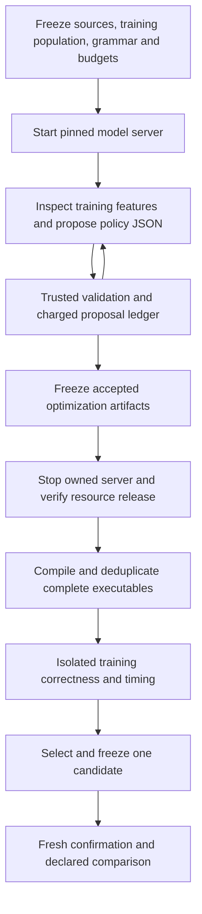

# Meta-compiler study assessment and optimization artifact implementation priorities

## Decision and scope

The supplied kiln_meta_compiler_study.md is archived byte-for-byte as sources/kiln-meta-compiler-study.md, SHA256650d2750bd958c1dc1404b07d1d5941b9c5c31588b71404bda4bdc7eaee4395c. It is a research/design input, not reproduced evidence for its81 external reference records. The current project reassessment reads its recommendations against all148 diary entry introductions/lessons, focused full investigation sections, design documents and actual code/receipts. Critical literature claims require primary-source inspection before implementation or attribution; no external source algorithm is ported here.

The recommended priority is one complete agent-generated reusable-policy experiment on an already-correct corpus, followed by a small replayable transformation language. Full200-task support, unchanged reference reproduction and native numerical compatibility remain active integration requirements. They should not gate every research iteration. Existing numerical findings remain failures where the declared benchmark rejects them.

## Existing capabilities and actual gaps

| Study recommendation | Current implementation/evidence | Remaining work |
|---|---|---|
| Pure deployable policy | fusion_policy.mjs validates bounded threshold, tree, selective and region JSON | Version feature semantics/units and unify artifact identity |
| Checked selective fusion | createFusionRule and chooseFusionSubset share inlining, retained-producer accounting and rollback | Expose through a small replayable action/query interface |
| Fixed evaluation and held-out confirmation | Frozen corpora, source snapshots, exact aliases, independent selection/measurement verifiers | Equal-budget external LLM versus simple search; stronger structural holdouts and uncertainty |
| Transformation traces | Run records graph deltas/checkpoints/events | A portable lossless codec and explicit stale-handle/failure contracts |
| Independent evidence | Existing evidence identity library plus integration receipts | Compose complete experiment identity without introducing a parallel evidence store |
| LLM pass generation | Original PassAgent50-step smoke is terminal, no accepted replacement | Kiln-native proposal task with typed outputs and authoritative structured evaluation |

The existing deterministic proposal generator explicitly says it is not an external LLM invocation. Prior manual/template policy studies cannot be relabeled as such. The singleton reshape improvement is a manually derived reusable compiler algorithm, with positive but mixed fresh-model measurements. It is not autonomous synthesis.

## Optimization artifact and trusted boundary

A proposed optimization artifact binds its executable policy or strategy to an input IR, semantic profile, feature/action versions, resource budget and applicability scope. It has a deterministic content hash. A separate evaluation identity binds that artifact to workload membership, compiler/runtime/toolchain, device and protocol. Timing replicas belong to the evaluation, not to the reusable artifact's identity.

Keep these as modules near the existing compiler and evidence package initially. The study's suggested package tree is not a request to create several packages immediately. Move compiler-general policy/transform ownership out of the PassNet integration when an independent caller consumes it; keep dataset selection, FX, matching and official scoring within the integration.

The search process may propose policy/strategy data. It cannot edit references, numerical tolerances, measurement code, final membership or promotion rules. Structural validity, differential testing, sanitizer checks and formal proof are separate evidence categories. An empirical tolerance is not a license to reassociate every floating expression.

## Agent framework decision

Initially reuse the pinned R2E-Gym lifecycle/tool/trajectory infrastructure already exercised by original PassAgent. Keep the reference configuration untouched. A distinct Kiln-native task must use structured result fields and candidate identities rather than inheriting PassAgent's regex score extraction, pass-file snapshot assumptions or placeholder reward.

Proposed tools inspect approved training IR/features, submit validated policy JSON, request compilation and request training evaluation. Existing corpus/compiler/runtime/measurement commands perform the work outside the candidate-editable workspace. The proposal API and task/tool configuration are new work, not implemented by this design. Start with one agent; extra agents require an explicit independent experiment.

Model choice is a recorded experimental variable. A higher model in the current coding conversation does not retroactively change the completed generic-Qwen reference run or establish a new benchmark result. Use a provider or the existing local endpoint with an explicit model identity. If serving shares the GB10, separate proposal and hardware timing phases and release serving resources before isolated measurements.

## Implementation order

1. Audit and freeze an already-correct training population with real policy-sensitive opportunities. Reuse the compiler, selector, qualification and measurement harness; do not wait for task10's convolution repair. Previously inspected confirmation sets are development evidence, not fresh tests.
2. Add the small optimization-artifact envelope and native task tools. Verify canonical identity, malformed proposals, immutable evaluator inputs, real executable deduplication and budget accounting. Every invalid/failed proposal consumes its declared proposal budget.
3. Compare baseline, threshold sweep, seeded random proposals and one recorded LLM under the same grammar and hardware evaluation budget. Record tokens, compile time, GPU time and actual distinct executables separately. Freeze the selected artifact before new-model confirmation.
4. Introduce only the transformation constructs needed by an observed experiment: structural selection/query, checked action and bounded sequencing. Reuse Rule/Pass/Run graph mutation. Serialization/replay must preserve actions/selection and reject stale handles; failed actions leave original IR unchanged. Retain rejection traces as learning data.
5. Expand to new transformation synthesis, semantic analyses and compiler-issue corpora after the first comparison can distinguish proposal quality, search-space headroom and measurement effects.

MLIR, equality saturation, whole-repository TypeScript conversion, large-scale training and broader autonomous source patching remain later evaluated branches. None is required to produce the next credible reusable compiler artifact. The full goal remains active.

## Numerical consequence of this review

The full-shape convolution probe in design19 contradicts selecting an oracle from its smaller batch1 probe. Compensated summation can reproduce the frontend while still disagreeing with the full native reference. This is a concrete example of why semantic profiles and external acceptance must remain independent of an agent's objective. No production numerical fix is approved by these diagnostic substitutions alone.

## Implementation checkpoint: native proposal boundary

`integrations/passnet/native_policy_task.py` now implements the proposal phase as a trusted task object. The caller supplies the corpus manifest, a training-only compilation receipt, a proposal budget, an evaluator-owned output directory and the Node executable. Its three operations are `inspect_training`, `submit_policy` and `finish`. It exposes no shell, file editor, evaluator path, timing switch or numerical-tolerance operation. This boundary is callable by either an agent driver or a deterministic search baseline. It is not yet the R2E-Gym driver or a complete optimization experiment.

The training view projects only `originalWork`, `fusedWork`, `consumerCount` and `producerElements` from the approved training records. These are the existing fusion rule's estimated work and structural counts, not measured GPU costs. Work is derived by `kernelWork` from `workOf(schedule(...))`. `originalWork` includes the producer and original consumers; `fusedWork` includes rewritten consumers and a retained producer when required. The public view uses ordinal example identifiers and excludes source paths, model names, arbitrary diagnostics, held-out records and their measurements. The full manifest membership hash remains host-side in the task receipt. The task checks numerical-policy agreement between the manifest and compiler receipt.

`optimization_artifact.mjs` calls the existing `prepareFusionPolicy` validator, then packages the program with a numerical-policy contract, applicability declaration, feature/action versions and the existing hard program limits. Identity uses the existing evidence package's `canonicalJSON` and `sha256Hex`. The initial `kiln-loop/1`, `kiln-loop-fusion/1` and `kiln-loop-fusion-features/1` identifiers name this integration's declared contract; they are not a claim that the core compiler already has a versioned IR serialization protocol. Compiler source and runtime identities remain evaluation metadata.

The artifact fixes the diagnostic policy ID to `artifact-policy` and excludes author provenance from executable identity. Renaming a policy or changing its author metadata therefore produces the same artifact hash. Changing its decision program or fixed numerical policy produces a different hash. The numerical field currently records only the existing contraction setting; it is not a complete floating-point semantic profile or a claim that the convolution discrepancies are solved. The host must preserve the actual compiler, workload, precision and timing contracts when evaluating an artifact.

Every submission reserves a numbered request before validation. Malformed JSON, duplicate JSON keys, nonfinite numbers, forbidden fields, excess program budgets, malformed submission arguments, validator failures and repeated valid programs consume a slot. Identical artifacts receive `duplicate` and the first attempt number, without a second artifact file. Accepted means valid policy data; every accepted result explicitly reports `evaluation_status: not_run`. Invalid tool names consume no proposal slot; the future agent driver must charge every model turn against its independent step and inference budgets.

The ledger deliberately has a single owner and refuses an existing output directory. It does not promise concurrent writers, crash-safe resumption or power-loss durability. An interrupted reserved attempt remains visible. A future restart protocol must reconcile such reservations rather than refunding attempts. Filesystem access remains a host responsibility; the in-process API does not sandbox a model with an independently granted shell.

Script426 exercises the boundary on the previously observed v8-r2 training population. The final-source check is in `sources/native-policy-task-check-v2`: all twelve training graphs compile under the explicit default, the replayed default artifact and the disabled-fusion artifact. Default replay preserves all twelve executable fingerprints; disabling fusion changes all twelve. All thirty-six compilations pass the existing compiler reference checks. The script compiles with `--phase train`; it does not compile the historical held-out members. This is operational evidence, not a fresh holdout, native CUDA validation, performance measurement or external-LLM result. Script427 retains the focused validation commands and their output.

## Framework inspection and next connection

Inspection of pinned R2E-Gym `0d94c4eb9431cd195c55a7ea3abd54006c9a1735` shows that `Agent.run` expects a `RepoEnv`, repository commit/test-patch metadata and repository command installation. `Agent.model_query` chooses hard-coded tool sets for the supported scaffolds. `Trajectory` also contains required Docker and patch fields. Consequently the native integration cannot honestly be implemented as a prompt change on the original runner or by inventing a fake repository repair task. The separate driver should reuse applicable query/action/trajectory-step components and implement the small native lifecycle explicitly. Any changed provider, parsing or retry behavior must be recorded. The unchanged original PassAgent configuration remains separate.

The next step is to connect model actions to this task, retain raw requests/responses and usage, and feed accepted artifacts into the existing compilation and qualification harness. Artifact identity deduplication is already implemented; deduplication of distinct policies that lower to identical complete executables still belongs to the compiler/evaluation phase. The initial local-model experiment should batch proposals, stop serving, verify resource release, and then perform isolated correctness/timing evaluation. Training feedback can inform a later proposal batch after measurement; no concurrent serving/timing result should be promoted as an isolated compiler speedup.

## Native agent driver and experiment lifecycle

`run_native_policy_agent.py` now provides the separate proposal loop. It reuses pinned R2E-Gym `Action` parsing and `TrajectoryStep` records; it does not invoke the repository-editing `Agent.run`, assign a placeholder reward or fabricate Docker/patch fields for a repository trajectory. Model requests use the local OpenAI-compatible HTTP endpoint with an explicit model name. There are no automatic retries, inherited proxy settings or provider redirects. This initial provider implementation accepts loopback HTTP endpoints only and uses a dummy local key; external-provider credential handling is not implemented.

The prompt defines the complete bounded policy grammar and the meaning of its features. The host declares a proposal count, model-step count, per-response token limit and cumulative completion-token budget. Every model request consumes a step; all returned prompt/completion usage is retained separately. The cumulative hard token limit applies to completion tokens, not the sum of repeated input-context tokens. The server's context limit remains a separate bound. A response without consistent usage information cannot execute a tool. A response stopped by a length limit is retained but its partial action is not executed. Invalid or multiple action blocks consume a model step; a recognized submission with duplicate parameters reaches the task as an invalid proposal and consumes a proposal slot.

For each step the driver writes the exact JSON request, raw provider response and R2E trajectory-step record. Its final result reports the stopping condition, token usage, proposal ledger summary and `evaluation_status: not_run`. Finishing a batch does not select or promote a compiler policy. The first batch can use structural evidence and validation feedback; an adaptive experiment can alternate separately recorded proposal and training-measurement batches. That later feedback protocol must be fixed before comparison and must expose no confirmation data.

Scripts428/429 implement an operational smoke-run lifecycle on the DGX. The staging script refuses uncommitted input bytes and creates a separate source directory; it does not mutate the shared compiler checkout. The owning process verifies every bundle file, hashes the installed R2E Action/Trajectory modules against the archived pinned source, rehashes the full model artifact, and checks for existing GPU activity. It starts one named local model container, runs a two-proposal batch on previously observed training data, then stops only its verified container and records process/resource state. This operational run does not establish a new benchmark population or a policy speedup. Its results must be recorded separately from the later equal-budget experiment.

The implementation has seven controlled-provider loop tests covering token/step stopping, missing usage, response retention, partial/malformed actions, no hidden query retry and explicit local provider selection. These tests use doubles for framework objects; the DGX smoke is required to verify the installed R2E components and real model response together. At this source checkpoint that smoke has not yet run.

## First actual model batch: operational success, no executable change

The subsequently completed smoke used committed source `05efc4c494a1dd0b8c2a9786be1fec2e0e3e7c21` and the pinned generic Qwen3-30B-A3B BF16 model. It took five model steps and224.366 seconds of agent-loop time. Reported usage was60391 prompt tokens plus5743 completion tokens,66134 total. These prompt tokens include repeated context across requests; they are not a single context window. The full model file was rehashed before launch. The installed R2E Action and Trajectory module hashes matched the archived pin.

| Step | Observed action | Outcome |
|---|---|---|
|0|Inspect training features|Approved numeric feature view returned|
|1|Two submit actions in one response|Entire response rejected as an invalid action; no policy validation|
|2|Inspect training features again|Same approved view returned|
|3|Submit threshold1.05 with ID `threshold-1.05`|Charged proposal rejected: `Invalid fusion policy identity`; a dot violates the ID grammar|
|4|Submit threshold1.05 with ID `threshold-1-05`|Second charged proposal accepted; proposal budget exhausted|

The accepted optimization artifact is `47de696f439bec397cfd65268d9183a49e82a5948c123898290d70cec063f6d8`. It has kind `threshold` and `max_work_growth: 1.05`. This is also the numeric value in the prompt's illustrative example; the smoke does not establish independent discovery or novel policy synthesis. The model did produce a second textual decision-tree proposal in the multi-action response, but the host did not validate, compile or accept it.

Script430 collected29 files and verified their hashes against the terminal DGX files. Script432 reconstructed every model-visible message, replayed parsed actions with the pinned R2E Action implementation, and matched observations, token totals and task accounting. The final container was absent; both the owner's post-shutdown check and the later collector found no active GPU compute process.

Script431 compiled the actual accepted program and unchanged Kiln on all twelve historical training graphs. All24 compilations passed the compiler reference checks. Script433 independently compared complete emitted program objects after excluding only `name`, `source` and `compiler_policy` metadata. All twelve were equal, including executable code, launch configuration, inputs/outputs and scratch allocation. The result is an executable alias of the baseline on this corpus. No CUDA correctness result or timing contrast is inferred from compilation, and no duplicate GPU timing was performed.

This closes the operational model-to-policy-to-compiler connection. It does not close task f5d9: there is no equal-budget search comparison, selected improvement or fresh confirmation yet.

### Budget ambiguity to resolve before the scientific comparison

The implemented smoke protocol counts dispatched `submit_policy` calls as proposal attempts and counts malformed action responses against the model-step budget. Consequently its five responses contain four textual candidate blocks, but only two charged proposal attempts. That distinction is explicit in the raw evidence and must not be reported as only two generated candidates. The current run is an operational check under its recorded protocol, not evidence of equal candidate-generation budgets.

Before the comparison, tighten the driver so identifiable submission attempts in rejected multi-action responses also consume the declared proposal budget, or use a predeclared model-response budget as the primary search unit and report all textual candidates separately. The preferred next implementation is to charge each identifiable submission without executing the malformed multi-action response. Preserve this smoke unchanged and run the comparison under the new declared protocol. Also avoid using an illustrative candidate value as evidence that the model learned that value, and record repeated inspection costs rather than treating them as free input.

The shared study harness needs one further explicit behavior before arbitrary generated policies are compared: its current qualification function requires all candidates to compile successfully. It should retain failed candidates as ineligible search outcomes charged to the fixed budget, while a failed baseline or invalid evaluation declaration aborts the study. Implement this in the existing qualification/selection path rather than introducing a second evaluator. Fresh confirmation membership and training-only selection remain mandatory.
