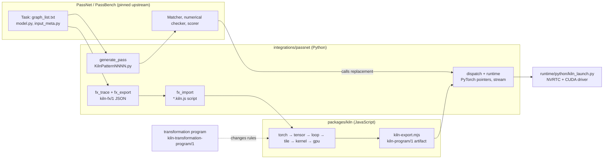

# Kiln PassNet system guide for new interns

## 1. What this system is, in one page

This repository connects two independent systems, Kiln and PassNet, to answer one research question:

> Can a model improve GPU performance on many unseen benchmark tasks by proposing **reusable changes to a compiler**, rather than by writing one hand-specialized kernel per task?

**PassNet** is a published benchmark and agent framework. Its benchmark, **PassBench**, contains 200 **tasks**. A task is a family of PyTorch computation graphs that share one operator pattern but differ in shapes and dtypes; across all tasks there are 2,060 graphs. For each graph, PassBench asks for a **pass**: a *pattern* that finds a subgraph in the PyTorch FX graph and a *replacement* that computes the same outputs faster. PassBench applies the pass, runs the graph, checks numerical agreement with eager PyTorch and computes a speed score.

**Kiln** is a GPU kernel compiler written in JavaScript. It takes a PyTorch-like program and lowers it through six **intermediate representations** (IRs): `torch`, `tensor`, `loop`, `tile`, `kernel` and `gpu`. At the end it emits CUDA source. Every lowering step is a named rewrite rule, and every scheduling decision (for example, how many threads per block) is an explicit, recorded choice.

The integration makes Kiln the replacement for PassBench passes. For every graph we:

1. trace the source PyTorch model to an FX graph and export it as JSON (`kiln-fx/1`);
2. translate that JSON into a Kiln program script (`*.kiln.js`);
3. compile the script with Kiln into an artifact (`kiln-program/1`) that holds CUDA kernels and a buffer table;
4. generate a PassBench pattern module whose replacement function calls a Python dispatcher;
5. let the **original, unmodified** PassBench evaluator match the pattern, call the replacement (which launches Kiln's CUDA through PyTorch's stream), check numerics and score the result.

Once that path works for a set of tasks, the research layer can change *how Kiln compiles*, for example which loop kernels it fuses. It then measures whether that change raises scores on tasks that were not used to design it. The change is expressed as a validated JSON **transformation program**, not as new CUDA. That separation is the whole point. A per-graph kernel is a single result, while a compiler policy is a hypothesis about many graphs.



Keep these terms straight from the start:

| Term | Meaning in this project |
|---|---|
| Task / sample | One PassBench family, for example `samples/.../task_006`, listing graph directories in `graph_list.txt`. |
| Graph / variant | One directory with `model.py` (an FX `GraphModule` source), `input_meta.py` and `weight_meta.py`. |
| Complete task | Every variant matched exactly once, executed and passed the original numerical check at the nominal tolerance point `t=-5`. |
| Import eligible | The FX importer translates every variant. This is an earlier level of evidence than acceptance. |
| Artifact | `kiln-program/1` JSON: kernels in launch order, buffers, input and output specs, source hash. |
| Specialization | The key that tells the dispatcher which compiled artifact to run for a call. |
| Transformation program | `kiln-transformation-program/1` JSON that swaps or parameterizes Kiln rules (for example fusion policy). |
| Modified protocol | Results that use our FX argument normalization in matching. They are always labeled that way, never as a pure paper reproduction. |

## 2. Repository map

All paths are relative to the worktree root `/home/manuel/code/wesen/kiln/worktrees/passnet`.

```text
packages/kiln/src/core/        framework: graphs, dialects, rules, passes, decisions (kiln.js), index exprs (ix.js),
                               Tensor reference storage (util.js), dtype rounding (dtypes.js)
packages/kiln/src/std/         the standard compiler: tensor.js (nn/tensor dialects, N API), loop.js, fusion.js,
                               tile.js, kernel.js, emit.js, program.js, export.js, emmy.js (pipeline), targets.js
packages/kiln/test/            41 script-style tests (node scripts/run-node-tests.mjs packages/kiln/test)
apps/workbench/src/compile.js  compileScript/endToEnd used by the export CLI
scripts/kiln-export.mjs        CLI: *.kiln.js → kiln-program/1
runtime/python/kiln_launch.py  NVRTC compile + driver-API launch, caller-owned pointers
integrations/passnet/          the bridge (FX, import, pass generation, dispatch, task running, policy agents)
ttmp/2026/10/30/KILN-005--…/   the research ticket: diaries, milestone reports, sources/, scripts/
```

The ticket directory is large. Read these first: `reference/43` (architecture map), `reference/45` (expert review), `reference/42` (capability plan) and the latest steps of `reference/24` (diary volume 2).

## 3. A worked example from source graph to CUDA

The rest of the guide follows one small graph through every stage. All output below was produced by the current code at commit `73bc1fc`.

### 3.1 Source model

PassBench graphs are stored as Python source of an FX `GraphModule`:

```python
class GraphModule(torch.nn.Module):
    def forward(self, in_0, in_1):
        tmp_0 = in_0 + in_1
        tmp_1 = torch.nn.functional.relu(tmp_0)
        tmp_2 = tmp_1.sum(dim=-1, keepdim=True)
        return (tmp_1, tmp_2)
```

The input shapes come from `input_meta.py` classes with `name`, `shape` and `dtype`. Here both inputs are `float32[4, 8]`.

### 3.2 Trace and export: `kiln-fx/1`

`corpus.translate_graph` loads the module, sorts metadata by the numeric suffix of `name`, traces with `fx_trace.trace_module` and propagates shapes with `fx_export.export_graph`. The default `fake` mode uses PyTorch `FakeTensorMode`, so no real kernels run. Each FX node becomes one JSON record:

```json
{"id": "add", "kind": "call_function", "target": "_operator.add",
 "args": {"tuple": [{"ref": "in_0"}, {"ref": "in_1"}]}, "kwargs": {"dict": {}},
 "tensor_meta": {"shape": [4, 8], "dtype": "torch.float32", "strides": [8, 1], "requires_grad": false}}
{"id": "sum_1", "kind": "call_method", "target": "sum",
 "args": {"tuple": [{"ref": "relu"}]}, "kwargs": {"dict": {"dim": -1, "keepdim": true}},
 "tensor_meta": {"shape": [4, 1], "dtype": "torch.float32", "strides": [1, 1], "requires_grad": false}}
```

Two details matter. First, `fx_trace.MutationTracer` makes `x += y` appear as `_operator.iadd` instead of being silently traced as a non-mutating add; the importer can then decide whether the mutation is legal. Second, `fx_export.encode` refuses anything it cannot represent losslessly (non-finite floats, non-string dict keys, `get_attr` constants, `call_module`). An unsupported value is an explicit error, never a guess.

### 3.3 Import: the Kiln script

`fx_import.import_graph` walks the nodes in order and produces JavaScript source:

```javascript
project("passnet").program(({v0, v1}) => {
const v2 = N.add(v0, v1);
const v3 = N.relu(v2);
const v4 = N.cast(N.sum(N.cast(v3, "f32"), 1, true), "f32");
return {out0: v3, out1: v4};
}, {v0: k.tensor([4, 8], "f32"), v1: k.tensor([4, 8], "f32")});
```

Alongside the script it returns metadata that the runtime needs later:

```json
{"inputs": {"v0": [4, 8], "v1": [4, 8]}, "input_dtypes": {"v0": "f32", "v1": "f32"},
 "output_structure": {"tuple": [{"output": "out0"}, {"output": "out1"}]}, "input_mutations": []}
```

`output_structure` records the nesting of the original return value (tuple, list or dict), so the dispatcher can rebuild exactly the Python object that the source graph returned. The reduction is wrapped in casts to FP32 and back because PyTorch accumulates low-precision reductions in FP32. The importer encodes PyTorch's numerical behavior explicitly in the program, at the operation where it happens.

### 3.4 Compile: the `kiln-program/1` artifact

```bash
node scripts/kiln-export.mjs --script 000.kiln.js --target a100 --contraction separate --out 000.json
# stderr: end-to-end check ok at loop
#         k_out0__zjrr8twhj8 TPB=1024; k_out1__2btaj460v72 TPB=1024
```

The artifact summary:

```json
{"format": "kiln-program/1", "codegen": "kiln-codegen/3", "target": {"id": "a100"},
 "inputs":  [{"name": "v0", "buffer": 0, "shape": [4, 8], "dtype": "f32"}, {"name": "v1", "buffer": 1, ...}],
 "outputs": [{"name": "out0", "buffer": 2, ...}, {"name": "out1", "buffer": 3, "shape": [4, 1], ...}],
 "buffers": [{"id": 0, "bytes": 128}, {"id": 1, "bytes": 128}, {"id": 2, "bytes": 128}, {"id": 3, "bytes": 16}],
 "kernels": [{"name": "k_out0__zjrr8twhj8", "reads": [0, 1], "writes": 2, "grid": 1, "block": 1024, "cuda": "..."},
             {"name": "k_out1__2btaj460v72", "reads": [2], "writes": 3, "grid": 1, "block": 1024, "cuda": "..."}]}
```

The first kernel computes `relu(v0 + v1)`:

```cuda
extern "C" __global__ void __launch_bounds__(1024) k_out0__zjrr8twhj8(
    const float* __restrict__ src0, const float* __restrict__ src1, float* __restrict__ dst) {
    const int tid = threadIdx.x;  const int bid = blockIdx.x;
    float in0 = 0.0f, in1 = 0.0f, v0 = 0.0f, v1 = 0.0f;  int e = 0;
    e = ((1024 * bid) + tid);
    if ((e < 32)) {
        in0 = src0[((e % 8) + (8 * (e / 8)))];
        in1 = src1[((e % 8) + (8 * (e / 8)))];
        v0 = __fadd_rn(in0, in1);       // separate rounding: no FMA contraction
        v1 = fmaxf(v0, 0.0f);
        dst[((e % 8) + (8 * (e / 8)))] = v1;
    }
}
```

The add and relu were **fused**: they share one kernel, and the intermediate `v2` never reaches memory. The sum was *not* fused into that kernel, because `relu` is itself a program output (`out0`) and must be materialized. The second kernel therefore reads buffer 2. Section 5.4 explains the rule that made this decision.

### 3.5 Run inside PassBench

`generate_pass.py` turns the source `forward` into a PassBench rule module:

```python
# KilnPattern0000.py (shape of the generated file)
def pattern(in_0, in_1):
    tmp_0 = in_0 + in_1
    tmp_1 = torch.nn.functional.relu(tmp_0)
    tmp_2 = tmp_1.sum(dim=-1, keepdim=True)
    return (tmp_1, tmp_2)
from _kiln_generated_runtime import kiln_generated
def replacement_args(in_0, in_1):
    return (in_0, in_1, 0)          # last element = pattern identity
def replacement_func():
    return kiln_generated
```

At evaluation time the original matcher finds the subgraph, calls `kiln_generated(in_0, in_1, 0)`, and that function calls `CorpusDispatch(in_0, in_1, specialization=(0,))`. The dispatcher picks the artifact compiled for these shapes and dtypes, launches it on the current PyTorch stream and returns `(out0, out1)` as a tuple.

## 4. The bridge, stage by stage (`integrations/passnet`)

### 4.1 Corpus export and compile — `corpus.py`

| Function | Contract |
|---|---|
| `translate_graph(upstream, graph, metadata_mode, *, input_order=None)` | Load `model.py`, metadata, trace, export, import. Returns the import result plus `reference_constraints` (input domains for the synthetic check) and per-node tensor metadata. `input_order` permutes placeholders into the pattern's canonical argument order. |
| `export_task(upstream, sample, directory, metadata_mode='fake')` | Writes `NNN.kiln.js` per graph and `manifest.json` with format `kiln-passnet-corpus/1`. |
| `read_manifest(directory)` | Validates the manifest: unique graphs, local script names, exact input-order permutations. Everything downstream reads through this function. |
| `compile_task(directory, kiln, target, contraction=None, optimization_program=None, skip_internal_reference_check=False)` | Runs `node scripts/kiln-export.mjs` once per variant and writes `compile-receipt.json`. It stops on the first failure. |
| `inspect_corpus(upstream, sample_list, output)` | The **import census**: the first blocker for every graph, written as `kiln-passnet-import-audit/1`. This is how coverage is measured before any GPU work. |

A manifest variant record looks like this (abbreviated):

```json
{"graph": "samples/.../graph_003", "script": "003.kiln.js",
 "inputs": {"v0": [4, 8], "v1": [4, 8]}, "input_dtypes": {"v0": "f32", "v1": "f32"},
 "output_structure": {...}, "input_mutations": [], "reference_constraints": [],
 "source_input_order": [0, 1], "source_sha256": "…", "specialization": [0]}
```

### 4.2 Tracing and export — `fx_trace.py`, `fx_export.py`

`MutationTracer` subclasses `torch.fx.Tracer` so that proxies implement `__iadd__` and similar methods as explicit `operator.iadd` calls. `export_graph(module, example_inputs, fake_mode=None)` runs `ShapeProp`, then emits `{"format": "kiln-fx/1", "torch_version": ..., "nodes": [...]}`. Targets are normalized to strings: `aten.add.Tensor`, `torch.nn.functional.relu`, `_operator.add`, or the method name for `call_method`.

### 4.3 Import — `fx_import.py` and helpers

`import_graph(graph) -> {script, inputs, input_dtypes, output_structure, input_mutations}` is the semantic center of the bridge. Its loop has this structure:

```python
for node in graph['nodes']:
    if placeholder:  require float32/16/bf16, positive static shape, contiguous strides → input vN
    args, kwargs = decode(node)        # refs → generated variable names; literals → JSON text
    if output:       remember the structure; continue
    expr = route(node.kind, node.target)(args, kwargs, meta, …)   # ~30 branches + fx_* helpers
    if expr is a list:                 # split/chunk/unbind → vN_0, vN_1, …
        emit one const per element
    else:
        emit "const vN = <expr>;"
    record mutation if the op is in-place on an input; mark fresh storage if the op allocates
flatten outputs → output_structure, with {"input_alias": i} for returned mutated inputs
```

The helper modules each own one family of operations and share the call shape `lower_x(target, args, kwargs, meta, resolve, literal)`:

| Module | Operations |
|---|---|
| `fx_indexing.py` | basic `getitem` indexing, transpose, reshape/view, squeeze/unsqueeze, flatten |
| `fx_layout.py` | pad, roll, split/chunk (partition), stack, unbind |
| `fx_linalg.py` | linear, matmul, mm, bmm |
| `fx_norm_ops.py` | layer norm, softmax |
| `fx_pooling.py`, `fx_max_pooling.py` | avg, adaptive avg and max pooling 2-D |
| `fx_scalar_ops.py` | hardtanh, clamp, pow, sin/cos, square, leaky relu, hardsigmoid, hardswish |

Each lowering does three things: it **binds** arguments against the PyTorch signature (positional and keyword, rejecting unknown or duplicate names), it **validates** static values and output metadata, and it **writes** a Kiln `N.*` expression. The importer is deliberately strict. Anything it cannot prove equivalent raises `ValueError` with the FX node name, and the census records that error as the graph's first blocker.

**In-place operations and mutation.** `require_mutation_source` accepts an in-place op only if its target has exactly one use and is either a fresh value (produced by an allocating op) or a graph input. A mutation of an input is lowered functionally. The new value becomes a hidden program output `__mutK`, and `input_mutations` records `{input_index, output}`. The dispatcher later copies it into the caller's tensor. The source graph's returned value then becomes `{"input_alias": K}`, so Python identity is preserved. Details are in reference 40.

**Precision.** For low-precision inputs, activations and reductions are computed as `N.cast(op(N.cast(x, "f32")), dtype)` to match PyTorch's FP32 "opmath". Plain elementwise ops rely on Kiln's own rule. Each `tensor.ew` on f16 or bf16 rounds its result (`liftEw` appends `round_f16`/`round_bf16`).

### 4.4 Pattern generation — `generate_pass.py`, `fx_normalize.py`

`extract_pattern(source, arity)` parses `model.py` with `ast`, copies `forward` as `pattern(...)` and rewrites `x += y` into `kiln_iadd(x, y)`. It then traces the pattern and normalizes functional-call arguments (`fx_normalize.normalize_arguments`, an integration modification). The placeholder order is reordered to *first-use order*, and the function builds a structural key. `generate(directory, upstream, output, runtime_directory)` deduplicates patterns by key, re-imports each graph with the canonical input order, writes one `KilnPatternNNNN.py` per distinct key, writes `sorted_output_pass_rule_names.json` (sorted by argument count) and records `pattern-provenance.json`.

> **Known defect (review A1).** The key includes the return order. PassBench's matcher ignores output order (`match_output=False`) and maps replacement outputs to the *applied* pattern's return order. Two patterns that differ only in return order can therefore collide, and dispatch then fails. The fix is to merge such patterns into one class and store a per-variant output permutation. See reference 45, §3.

### 4.5 Dispatch and runtime — `dispatch.py`, `runtime.py`, `runtime/python/kiln_launch.py`

```python
class CorpusDispatch:
    def __init__(self, directory, *, device=0, include_paths=(), program_factory=None):
        # key = ((shape, dtype) per input, frozen specialization constants) → TorchProgram
    def __call__(self, *inputs, specialization=()):
        program, structure, mutations = self.programs[key]       # ValueError if missing
        outputs = program(*inputs)                                # dict name → tensor
        for m in mutations: inputs[m['input_index']].copy_(outputs[m['output']])
        return restore_outputs(structure, outputs, inputs)

class TorchProgram:              # runtime.py
    def __call__(self, *inputs):
        # verify device, dtype, contiguity, shape; take data_ptr() of inputs
        # allocate outputs and scratch with torch.empty on the same device
        # launch every kernel on torch.cuda.current_stream() via kiln_launch
```

`kiln_launch.open_program(artifact, backend='cuda', allocate=False)` compiles each kernel's CUDA with NVRTC for the device architecture: cubin if NVRTC knows the architecture, PTX otherwise. It launches kernels with the CUDA driver API through `ctypes`. With `allocate=False` it never owns tensor memory; PyTorch does. The program must not copy data or change streams. It runs on the stream PyTorch is already using, so PassBench's own timing and synchronization stay valid.

### 4.6 Running and auditing tasks

| File | Role |
|---|---|
| `stage_corpus.py` | rsync exact manifest source directories to the GPU host |
| `run_task.py` | one isolated original-evaluator process per graph (`--compiler pass_mgr`, warmup 20, trials 100); records process results only |
| `evaluate_normalized.py` | the evaluator entry point with our FX normalization installed |
| `evaluate_tasks.py` | sequential orchestration of frozen task lists; refuses to continue if the compiler source changes mid-run |
| `score_task.py` | calls the unchanged PassBench scorer |
| `summarize_task_run.py` | the **auditor**: exact membership against `graph_list.txt`, one replacement per graph, numerical curve at `t=-5`; this is what decides "complete" |

Process exit status never means acceptance. Only `summarize_task_run.py` can call a task complete.

## 5. The Kiln compiler (`packages/kiln`)

### 5.1 Framework concepts — `core/kiln.js`

Kiln is a framework for building compilers out of small declared pieces:

| API | Purpose |
|---|---|
| `k.dialect(name).op(short, {args, attrs, infer, eval, print, traits})` | Declares IR operations. `infer` computes the result type `k.tensor(shape, dtype)`; `eval` is the reference semantics. |
| `k.rule(name).match(P.op("x").as("n").where(pred)).rewrite(fn)` or `.mutate(fn).guard(fn)` | A rewrite rule over the graph. `guard` can reject a rewrite with a reason string. |
| `k.pass(name).rules(...).order(...)` | An ordered group of rules applied to fixpoint. |
| `k.param.enum(name, values, …)` and `k.decide.chain(pinned, evidence, cost, first)` | Scheduling knobs and how a choice among them is made: pins, then measured evidence, then the cost model, then the first option. |
| `k.pipeline(name).ir(...).pass(...).target(t).decide(d).build()` | A pipeline: IR checkpoints with allowed dialects (`strict: true` means only those dialects may remain). |
| `pipeline.replaceRule(passName, ruleName, newRule)` | How transformation programs modify the standard pipeline without forking it. |

### 5.2 The standard pipeline — `std/emmy.js`

```text
torch (nn, tensor)  ─ decomposition ─▶ tensor
                    ─ [separate-rounding] ─ optimization ─ lift ─ fuse ─ stamp ─▶ loop
                    ─ tile/schedule ─▶ tile ─ lowering/kernel ─▶ kernel ─ emit ─▶ gpu
```

- **nn** (`tensor.js`, `nn` dialect) holds source-level operations with reference semantics, such as `nn.conv2d`, `nn.softmax`, `nn.reduce` and `nn.cast`. The `N` object is the builder API used by generated scripts (`N.add`, `N.sum(x, axis, keepdim)`, `N.cast(x, dtype)`, `N.select(c, a, b)` and so on).
- **tensor** has three primitives: `tensor.ew` (elementwise with function name and dtype), `tensor.reduce` (one axis) and `tensor.view` (an index map from output to input coordinates), plus `tensor.const`. **Decomposition** rewrites every `nn` op into these primitives.
- **optimization** composes views, folds constants, and (unless `contraction=separate`) contracts `a*b+c` into `fma`.
- **loop** has one operation, `loop.kernel`, whose attribute `expr` is an expression tree over output coordinates (5.3). **lift** turns each tensor primitive into a one-op loop kernel; **fuse** inlines producers into consumers (5.4).
- **tile** attaches a mapping to the GPU: `MAP` ∈ {thread, row, tiled}, `TPB`, `COARSEN`, `STAGE`, `BM/BN/BK/TM/TN`. `tile.js:analyze` describes the kernel shape, `legalMaps` filters choices, and `estimate`/`timeModel` give an analytic cost for a target spec (`targets.js`: rtx5090, rtx4090, h100, a100, orin, webgpu).
- **kernel** (`kernel.js:materialize`) spells out threads, shared memory, syncs and flat addresses for the chosen map.
- **gpu** (`emit.js:toCuda`, `toWgsl`) produces source text; `program.js` collects kernels and `export.js:exportProgram` writes the artifact.

### 5.3 Loop IR expressions — `std/loop.js`

The Loop IR is the level where most optimization happens. A `loop.kernel` computes `out[a0, a1, …] = expr` where `expr` is built from four node kinds:

```javascript
E.num(v)                    // constant
E.load(i, [ix0, ix1, …])    // read input i at affine index expressions of a0…, r…
E.op(fn, ...args)           // scalar function from fns.js (add, mul, exp, round_f16, select, …)
E.red(fn, r, n, body)       // reduction over fresh variable r in [0, n)
```

Expressions are **hash-consed**: structurally equal subtrees are the same object, keyed with reduction variables renamed, which de-duplicates shared work. `schedule(expr, shape)` places every subexpression at the outermost loop where all its variables are bound (loop-invariant hoisting) and returns a statement list (`for`, `let`, `init`, `acc`, `write`). `compileSerial` turns that list into a JavaScript function. That function is the **reference evaluator** every GPU schedule is checked against when `kiln-export.mjs` runs without `--no-check`.

For the worked example, after fusion the first kernel's expression is `max(add(in0[a0,a1], in1[a0,a1]), 0)` and the second is `add_{r<8} in0[a0, r]`.

### 5.4 Fusion — `createFusionRule` in `loop.js`, `fusion.js`

Fusion inlines a producer kernel `p` into its consumers. `inlineInto(c, p)` replaces every `load` of `p` inside `c` with `p`'s expression at the load's index, with fresh reduction variables. The rule matches a `loop.kernel` that is **not a program output** and whose users are all loop kernels. That is why `relu` (an output) in the example was not inlined into the sum.

The **guard** decides profitability. `workOf(schedule)` estimates work as trip-count-weighted operations, with loads and writes weighted `W_MEM = 12`. The default accepts a rewrite when `fusedWork ≤ originalWork × 1.02`, which avoids duplicating an expensive producer into many consumers. Two hooks make the decision programmable:

- `decide(features)` receives `{originalWork, fusedWork, consumerCount, producerElements}` and returns `true` or a rejection reason;
- `selectConsumers(region)` chooses a subset of consumers to fuse into (selective fusion), and the producer stays materialized for the others. `chooseFusionSubset` in `fusion.js` is an additive planner over launch, materialization and work weights.

### 5.5 Numerical contracts you must know

| Contract | Where | Why |
|---|---|---|
| f16/bf16 elementwise results are rounded after each op | `liftEw` (`loop.js`) | matches eager PyTorch kernel boundaries |
| reductions and activations computed in FP32 for low precision | importer casts | PyTorch opmath |
| `--contraction separate` emits `__fadd_rn`/`__fmul_rn` | `separateRoundingPass` | stops NVRTC from forming FMAs PyTorch eager would not |
| the internal check (`endToEnd`) compares the GPU schedule against the Kiln reference | `kiln-export.mjs` | catches lowering bugs, but not frontend semantic drift |
| the external check (PassBench, `t=-5`) is the acceptance gate | upstream evaluator | the benchmark's definition of correct |

Qualification runs use `--contraction separate`. Some exploratory runs pass `--skip-internal-reference-check` for both arms; the external check always stays on.

## 6. The research layer: transformation programs and agents

A transformation program is JSON validated by `transformation_program.mjs:prepareOptimizationProgram` and applied by `applyOptimizationProgram(pipeline, target, prepared)`. The supported kinds:

| Kind | Effect |
|---|---|
| `kiln-fusion-policy/1` with `kind` `unchanged`, `threshold`, `decision-tree`, `selective`, `region` | replaces `merge_loop_ops` with a bounded decision tree (at most 31 nodes, depth 6) over the fusion features |
| `scheduling-fusion` | staged fusion that preserves producers whose cheapest schedule is tiled (`scheduling_fusion.mjs`) |
| `fusion-sequence`, `pointwise-fusion-sequence` | an *expose* stage and a *cleanup* stage; the pointwise variant first rewrites 1×1 convolutions into matmuls (`pointwise_convolution.mjs`) |

Example:

```json
{"format": "kiln-transformation-program/1", "id": "artifact-policy", "kind": "pointwise-fusion-sequence",
 "expose":  {"format": "kiln-fusion-policy/1", "id": "expose", "kind": "selective",
             "tree": {"threshold": 1.02}, "consumer_tree": {"threshold": 2}},
 "cleanup": {"format": "kiln-fusion-policy/1", "id": "cleanup", "kind": "threshold", "max_work_growth": 1.02}}
```

Agents propose such programs. `run_pi_policy_agent.mjs` and `pi_policy_tools.mjs` drive the Pi coding agent with metered tool calls. `run_native_policy_agent.py` runs an R2E-Gym-style action loop against a local OpenAI-compatible endpoint. `policy_search.py` compares proposal methods under one evaluator and budget. The agent never writes CUDA. It writes policy data, and the host validates, compiles and measures it.

The most important measured result so far (reference 35): a fixed pointwise-fusion program was correct on all 92 graphs of 12 tasks, but the mean task score across 11 transfer tasks fell from 0.849 to 0.823. Task 101 improved 32.8× while task 25 regressed to 0.33×. The lesson is that a policy must condition on features that actually distinguish those workloads. Reference 45 §B5 explains why the current four work-model features cannot.

## 7. Current state (2026-10-31)

| Measure | Value | Source |
|---|---|---|
| Corpus | 200 tasks, 2,060 graphs | `sources/evaluation-inventory.json` |
| Import eligible (latest census) | 131 complete tasks, 1,668 graphs | `sources/current-capability-wave-frontier-v1.json` |
| Uniform qualification, ordinary band (56 tasks, 561 graphs) | 32 complete tasks, 479 accepted graphs | reference 44 |
| Ordinary-band failures | 16 dispatch (pattern collision), 23 matcher, 43 nominal numerical | reference 44 |
| Large and regression bands | still running on bling when this guide was written | `sources/uniform-importable-qualification-v1/` |
| Historical ledger (mixed snapshots) | 53 tasks, 505 graphs; **never add this to the counts above** | `sources/kiln-coverage.json` |

## 8. How to work on the system

### 8.1 Setup and tests

```bash
cd /home/manuel/code/wesen/kiln/worktrees/passnet
source ~/.nvm/nvm.sh && nvm use v26
node scripts/run-node-tests.mjs packages/kiln/test             # 41 tests, all pass
python3 -m unittest discover -s integrations/passnet -p 'test_*.py'   # 155 tests; one stale (review A2)
```

### 8.2 Recipe: add support for a new operator

1. Run the census (`corpus.py inspect`) and find the graphs whose first blocker names the operator. Group them by *shared semantic cause*, not by spelling.
2. Read the PyTorch semantics: signature, defaults, dtype promotion, aliasing and numerical behavior. Write them down in the ticket first.
3. If Kiln can already express the operation, add a lowering in the matching `fx_*` module that binds, validates and emits `N.*`. If it cannot, add an `nn` op with `infer`, `eval` and a decomposition in `tensor.js`. Do not emit CUDA from the importer.
4. Add a unit test in `integrations/passnet/test_fx_*.py` that compares eager PyTorch with the Kiln reference, and a dtype case if precision is involved.
5. Re-run the census, compile the newly eligible families locally, and only then queue complete families on the GPU.

### 8.3 Recipe: try a compiler policy

1. Write a `kiln-transformation-program/1` file.
2. `node scripts/kiln-export.mjs --script X.kiln.js --target a100 --contraction separate --optimization-program policy.json --out X.json` on a few graphs, and diff the kernel lists against the baseline.
3. For a real result, freeze membership and the program bytes before compiling, and use the frozen-run workflow (references 33 and 35).

### 8.4 Rules that protect the evidence

- Do not start a timed GPU job while `kiln-uniform-importable-v1`, `kiln-breadth-replays-v1` or `kiln-input-mutation-wave-v1` owns the GPU on `manuel@bling` (`HostKeyAlias=bling.local`).
- Do not modify a frozen corpus. `generate_pass.py` refuses on purpose.
- Label every result as original or modified protocol, and give its source snapshot hash.
- Raw evidence tarballs and receipts are never deleted, even when the scripts that made them are retired.

## 9. API and file quick reference

| Area | Symbol | File |
|---|---|---|
| Import census | `inspect_corpus` | `integrations/passnet/corpus.py` |
| Per-graph translation | `translate_graph` | `integrations/passnet/corpus.py` |
| FX JSON | `export_graph`, `encode` | `integrations/passnet/fx_export.py` |
| Mutation-preserving trace | `MutationTracer`, `trace_module` | `integrations/passnet/fx_trace.py` |
| FX → Kiln | `import_graph` | `integrations/passnet/fx_import.py` |
| Pattern modules | `extract_pattern`, `generate` | `integrations/passnet/generate_pass.py` |
| Argument normalization | `normalize_arguments`, `trace_pattern` | `integrations/passnet/fx_normalize.py` |
| Dispatch | `CorpusDispatch`, `restore_outputs` | `integrations/passnet/dispatch.py` |
| PyTorch bridge | `TorchProgram` | `integrations/passnet/runtime.py` |
| CUDA launch | `open_program`, `_Cuda.compile` | `runtime/python/kiln_launch.py` |
| Export CLI | `compileOne` | `scripts/kiln-export.mjs` |
| Artifact | `exportProgram`, `PROGRAM_FORMAT` | `packages/kiln/src/std/export.js` |
| Pipeline | `pipeline`, `defaultDecide` | `packages/kiln/src/std/emmy.js` |
| Frontend API | `N`, `nn`, `tensor`, `decompositions`, `contractFma` | `packages/kiln/src/std/tensor.js` |
| Loop IR | `E`, `schedule`, `compileSerial`, `workOf`, `inlineInto`, `createFusionRule` | `packages/kiln/src/std/loop.js` |
| Fusion planner | `chooseFusionSubset` | `packages/kiln/src/std/fusion.js` |
| Scheduling | `KNOBS`, `analyze`, `legalMaps`, `estimate`, `tilePass` | `packages/kiln/src/std/tile.js` |
| Kernel IR | `KB`, `materialize` | `packages/kiln/src/std/kernel.js` |
| Emission | `toCuda`, `toWgsl`, `toSim` | `packages/kiln/src/std/emit.js` |
| Policies | `prepareOptimizationProgram`, `applyOptimizationProgram`, `prepareFusionPolicy` | `integrations/passnet/transformation_program.mjs`, `fusion_policy.mjs` |
| Task audit | (script) | `integrations/passnet/summarize_task_run.py` |

## 10. Where to go next

Read reference 45 (the expert review) for the list of known defects and the phased plan. The first tasks suited to an intern are self-contained and testable: the stale mutation test (A2), the FP32-only guard on `contractFma` (A3), recording the internal-check status in artifacts (A6), and the index-overflow guard (A7). Each of them touches one file and needs one test, and none changes any frozen experiment.
