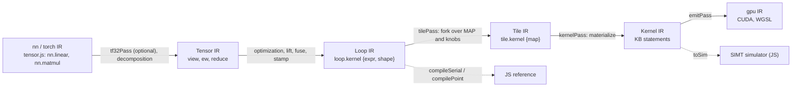
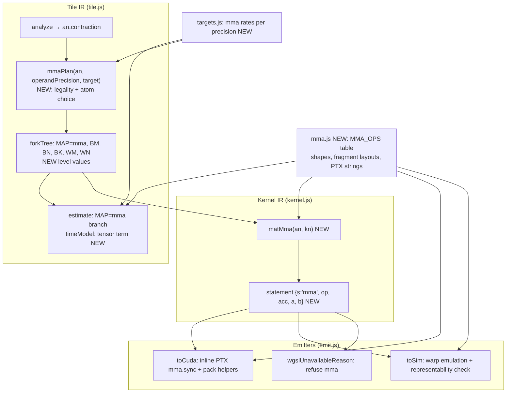
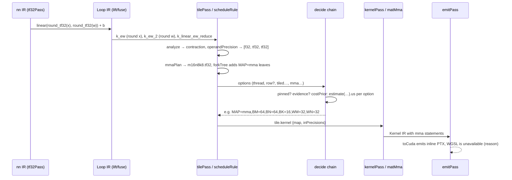

# Tensor-core matrix products: analysis, design and implementation guide

## 1. Executive summary

Kiln compiles every matrix product (`linear`, `matmul`, `bmm`, and pointwise convolutions decomposed as matrix products) to a CUDA kernel. In that kernel, each multiply-add is an ordinary FP32 instruction executed by one thread. NVIDIA GPUs since Volta also have *tensor cores*: units that compute a small matrix product for a whole warp in one instruction, at a much higher throughput than the FP32 pipeline. The reference backends that PassBench compares Kiln against (cuBLAS and cuDNN, called from PyTorch) use tensor cores whenever the operand types allow it. Kiln does not use them at all, and its matrix-heavy graphs are correspondingly slow.

This guide explains the parts of Kiln a new contributor must understand to add a tensor-core path. It then proposes a design. The core of the design is one new GPU mapping, `MAP=mma`, beside the existing `MAP=thread`, `MAP=row` and `MAP=tiled`. It reuses the contraction analysis that `MAP=tiled` already performs and adds one new Kernel IR statement, a warp-collective `mma`. The CUDA emitter renders that statement as PTX `mma.sync`, and the JavaScript SIMT simulator emulates it. The new mapping is legal only when the products' operands already have tensor-core precision: f16 or bf16 storage, or FP32 operands that the frontend has rounded to TF32 under `--matmul-precision tf32`. In those cases a tensor-core kernel computes what Kiln's own reference computes, apart from the order and rounding of the FP32 accumulation. An FP32 product at `"highest"` precision keeps its CUDA-core kernel.

The user asked whether this can be built on a machine without a GPU. The answer is yes for design, code generation and correctness, and no for performance. The Loop IR reference evaluator and the SIMT simulator are JavaScript and run on any CPU. With an emulation of `mma.sync` added to the simulator, every tensor-core kernel can be executed and checked against the reference on a laptop. Two things need the GPU host: compiling the emitted CUDA with NVRTC for `sm_121` (NVRTC itself needs no GPU, but no CUDA toolchain is installed on the development machine today), and measuring speed with PassBench replays on the DGX Spark (GB10).

The first implementation slice covers TF32 (`m16n8k8`), f16 and bf16 (`m16n8k16`) MMA with FP32 accumulation, with operands staged in shared memory as FP32 values and fragments loaded with ordinary shared loads. Faster staging (`ldmatrix`, half-precision shared arrays, `cp.async` pipelines and swizzled layouts), FP32 emulation by 3xTF32, and implicit-GEMM convolutions are designed here but deferred.

The guide separates three kinds of statement throughout. *Existing behavior* is cited to file and line at revision `67678fd`. The *first implementation slice* is the proposal of Sections 6 to 9. *Deferred design* is collected in Section 11.2.

## 2. Problem statement and scope

### 2.1 The problem

PassBench scores a compiled graph by its speed relative to the PyTorch reference on the same GPU. A score below 1.0 means Kiln is slower. The KILN-005 study reports several accepted families that are matrix-heavy and score far below 1.0. In the TF32 re-qualification replay of 2026-11-01 (KILN-005 `sources/tf32-rne-requal-gpu-v1/results-audit.json`, per-family `score.score`), task 32 scores 0.010, task 52 0.026, task 72 0.059 and task 5 0.167, with every graph of 32, 72 and the f32 graphs of 5 accepted. Reference 49 (line 76) reports task 32 at 0.034 under the cost-gated program in the earlier held-out study. The guide does not depend on the exact numbers. They establish the order of magnitude: the reference is often ten to a hundred times faster on these graphs.

Part of that gap is arithmetic throughput. The GB10's FP32 peak, as Kiln measured it, is 28.9 TFLOP/s (`packages/kiln/src/std/targets.js:12-16`). Tensor-core throughput for TF32 and f16 on the same chip is several times higher; the exact GB10 figures are not in the repository and must be measured (Section 9, Phase 0). A kernel restricted to FP32 instructions cannot approach a tensor-core reference on a large product, however well it is tiled.

### 2.2 Scope

In scope:

- Contractions that `analyze` in `tile.js` recognizes. These are matrix products with any batch dimensions, any fused epilogue (bias, activation, cast), and fused prologue views (transposes, reshapes).
- TF32 operands (FP32 storage rounded by `round_tf32`), and f16 or bf16 operands from f16/bf16 storage, accumulating in FP32.
- CUDA targets with compute capability 8.0 or higher. All CUDA specs in `targets.js` qualify (`a100` is `sm 80`, `gb10` is `sm 121`).
- CPU-side emulation, tests and cost-model changes; GPU validation and measurement as a later phase.

Out of scope for the first slice (designed, deferred): FP32 `"highest"` products on tensor cores (3xTF32 split), general 3x3 convolutions (implicit GEMM), FP8/FP4 types, Hopper `wgmma` and Blackwell `tcgen05` instructions, and WGSL cooperative-matrix extensions.

## 3. System orientation

This section introduces the terms the rest of the guide depends on, in the order they depend on each other: first the hardware facts, then Kiln's pipeline, then the specific places where a matrix product lives. One running example, `relu(linear(x, w, b))` with `x: [512, 256]`, `w: [384, 256]`, `b: [384]`, is followed through the IRs.

### 3.1 SIMT execution, warps and CUDA cores

A CUDA kernel runs as a *grid* of *blocks*, and each block is a set of *threads* (Kiln calls the counts `grid` and `block`). The hardware executes threads in groups of 32 called *warps*. All threads of a warp execute the same instruction at the same time, each on its own registers; this is SIMT (single instruction, multiple threads). An FP32 fused multiply-add (`fmaf`) executed by a warp performs 32 multiply-adds, one per thread, on the FP32 units that NVIDIA calls CUDA cores.

Threads of one block can exchange data through *shared memory*, a small on-chip array addressed by all threads of the block. They synchronize with a *barrier* (`__syncthreads()`), which every thread of the block must reach before any proceeds.

### 3.2 Tensor cores and `mma.sync`

A tensor core computes `D = A·B + C` for small fixed-size matrices in one warp-wide instruction. The PTX instruction that exposes it on sm_80 and later is `mma.sync.aligned`. The parts of its definition this guide relies on, all from NVIDIA's *PTX ISA* reference (section "Warp-level matrix multiply-accumulate instructions"), are these:

- The *shape* `mMnNkK` gives the matrix sizes: A is M×K, B is K×N, C and D are M×N. Kiln will use `m16n8k8` for TF32 operands and `m16n8k16` for f16 and bf16 operands, both with FP32 C and D.
- The instruction is *warp-collective*. The 32 threads of a warp jointly hold A, B, C and D. Each thread holds a few elements in its registers, called its *fragment*, and the PTX ISA specifies which element each lane holds. A thread cannot compute its part alone, and all 32 lanes must execute the instruction together (`.aligned`).
- Operands are passed in 32-bit registers. A TF32 element occupies one register (an FP32 bit pattern of which the hardware uses the sign, the 8 exponent bits and the top 10 mantissa bits). Two f16 or two bf16 elements are packed into one register.
- Per thread, `m16n8k8.tf32` takes 4 A registers, 2 B registers and 4 C/D registers. `m16n8k16.f16` and `.bf16` take 4 A registers (8 halves), 2 B registers (4 halves) and 4 C/D registers.
- `.row.col` means A's fragment is described in row-major terms and B's in column-major terms. It is the layout qualifier these shapes require. It concerns the fragment mapping, not how the data is stored in memory.

Two alternatives to raw `mma.sync` exist. *WMMA* (`nvcuda::wmma` in `<mma.h>`) is a C++ API with opaque fragment types and `load_matrix_sync`/`mma_sync`/`store_matrix_sync` calls. *CUTLASS* is NVIDIA's C++ template library that builds full GEMMs from these instructions. Section 7 records why Kiln emits `mma.sync` directly.

### 3.3 TF32, f16, bf16 and what "FP32 accumulate" means

TF32 is not a storage type. It is FP32's 8-bit exponent with a 10-bit mantissa, used as a tensor-core operand format. Under PyTorch's `allow_tf32` (or `float32_matmul_precision("high")`), cuBLAS rounds FP32 operands to TF32, multiplies them exactly, and accumulates the products in FP32. The f16 type has a 5-bit exponent and a 10-bit mantissa; bf16 has an 8-bit exponent and a 7-bit mantissa. The product of two TF32, f16 or bf16 values has at most 22 significant bits and is therefore exact in FP32. The accumulation is where tensor-core results can differ from a sequential FP32 loop: the PTX ISA does not promise IEEE round-to-nearest after each addition, nor a summation order. A tensor-core kernel therefore agrees with a scalar FP32 reference to within accumulation error, not bit for bit.

### 3.4 Kiln's six intermediate representations

Kiln compiles a program through six IRs. The pipeline is assembled in `packages/kiln/src/std/emmy.js:18-38`:

```text
torch (nn) ─d→ tensor ─o,l,f,s→ loop ─t→ tile ─k→ kernel ─c→ gpu (CUDA + WGSL)
```



- **nn IR** (frontend, dialect `nn` in `packages/kiln/src/std/tensor.js`) holds PyTorch-like ops: `nn.linear` (`tensor.js:331-334`), `nn.matmul` with a `precision` attribute (`tensor.js:337-340`), `nn.conv2d`. These ops accept only FP32 operands. The PassNet FX importer therefore widens f16/bf16 operands, multiplies in FP32 and rounds the result once (`integrations/passnet/fx_linalg.py:42-49`).
- **Tensor IR** (dialect `tensor`, same file) has three primitive kinds: `tensor.view` (an index map over another tensor), `tensor.ew` (an elementwise function) and `tensor.reduce`. A matrix product is decomposed into these primitives (Section 3.5).
- **Loop IR** (`packages/kiln/src/std/loop.js`) has one op, `loop.kernel`, whose attribute `expr` is an expression over output coordinates `a0, a1, …`. Expressions are built with `E` (`loop.js:50-64`): `num` (a constant), `in` (a load from input `i` at an index), `op` (a scalar function from `fns.js`) and `red` (a reduction with its own variable `r`, extent `n` and body). `schedule(expr, shape)` (`loop.js:96-159`) turns an expression into a loop nest of `for`, `let`, `init`, `acc` and `write` statements. `compileSerial` (`loop.js:213-239`) compiles that nest to a JS function: **the reference every GPU schedule is checked against**.
- **Tile IR** (`packages/kiln/src/std/tile.js`) is a Loop IR kernel plus a *map*: the knob values that say how it runs on a GPU (Section 3.6).
- **Kernel IR** (`packages/kiln/src/std/kernel.js`) makes every scheduling decision concrete: thread and block indices `tid`/`bid`, shared arrays, barriers and flat addresses. Its statements are listed in the header comment (`kernel.js:5-8`): `let`, `iset`, `load`, `store`, `sload`, `sstore`, `sync`, `for`, `if`, `note`. The builder class `KB` (`kernel.js:20-38`) appends them.
- **gpu IR** (`packages/kiln/src/std/program.js:12-25`) carries each kernel's rendered sources: `toCuda(K)` and `toWgsl(K)` in `packages/kiln/src/std/emit.js`.

Index expressions throughout are values of the `Ix` algebra in `packages/kiln/src/core/ix.js`: `C(v)` constants, `V(name)` variables, `LD(i, idx)` data-dependent loads, with `subst`, `vars`, `affine` (coefficients of an affine index) and `emit` (to JS, CUDA or WGSL).

### 3.5 How a matrix product looks inside Kiln

There is no matrix-product op below the nn IR. `lowerLinear` (`packages/kiln/src/std/matmul.js:56-62`) rewrites `linear(x, w)` into a view of `x` and a view of `w` over a common work shape `[..., K, N]`, an elementwise multiply, and a sum over the `K` axis:

```js
const left  = T.view(x, work, c => [...c.slice(0, rank), c[rank]]);   // x[..., k]
const right = T.view(w, work, c => [c[rank + 1], c[rank]]);            // w[n, k]
const reduced = T.sum(T.mul(left, right), -2);                          // Σ_k
```

`lowerMatmul` (`matmul.js:49-55`) does the same with batch broadcasting. After lifting and fusion, the running example becomes one Loop IR kernel. Compiled for target `gb10`, the ticket script `scripts/01-print-linear-contraction.mjs` prints:

```text
k_linear_ew_reduce row=MAP=tiled,BM=128,BN=32,BK=8,TM=2,TN=2 inDtypes=f32,f32,f32
expr: relu(add(in0[a1], add_{r5<256} mul(in1[a1, r5], in2[a0, r5])))
contraction: { M: 512, N: 384, K: 256, A: 1, B: 1, body: 'in,in,mul' }
```

Here `in0` is the bias, `in1` the weight and `in2` the input. The reduction `add_{r5<256}` is the sum over `K`. Its schedule, as `printNest(schedule(expr, shape))` prints it (buffer names are the kernel's argument numbers), is:

```text
for a0 in 0..512:  # free
    for a1 in 0..384:  # free
        in0 = load in0[a1]
        acc0 = 0
        for r0 in 0..256:  # reduce
            in1 = load in1[a1, r0]
            in2 = load in2[a0, r0]
            v0 = mul(in1, in2)
            acc0 <- add(acc0, v0)
        v1 = add(in0, acc0)
        v2 = relu(v1)
        out[a0, a1] = v2
```

In `analyze`'s terms (Section 3.6), `in2` (varies with `a0`, the row variable) is the A operand, `in1` (varies with `a1`) is the B operand, and the reduction `acc0` is `C`. Everything outside the `r0` loop is the epilogue.

Precision enters this picture in two different ways, and the difference matters for the design.

- **TF32.** Under `--matmul-precision tf32`, `tf32Pass` (`tensor.js:595-612`) wraps each operand of `nn.linear`/`nn.matmul` (unless `precision: "highest"`) and of ungrouped 1x1 `nn.conv2d` in `nn.ew round_tf32`. `roundTf32` (`packages/kiln/src/std/fns.js:11-16`) rounds to nearest, ties to even, and clears the low 13 mantissa bits; the CUDA emitter defines the same operation as `kiln_round_tf32` (`emit.js:61`). The rounding is **not** fused into the product. Inlining it would repeat the rounding `N` times per input element, and the fusion work guard (`loop.js:391-407`, `maxWorkGrowth = 1.02`) rejects that. The same script shows two extra kernels, `k_ew` and `k_ew_2`, each `round_tf32(in0[a0, a1])`. The contraction kernel is identical to the FP32 one. Its operand buffers hold TF32 values, but the contraction body does not say so.
- **f16 and bf16.** The FX importer's widening cast (`fx_linalg.py:42-49`) survives fusion as `copy`, and the loads read half-precision storage directly. The script prints `inDtypes=f16,f16,f16` and the body `mul(copy(in1[a1, r19]), copy(in2[a0, r19]))`, and the result is rounded once by `round_f16` in the epilogue. This is the "round once" semantics. cuBLAS with PyTorch's default `allow_fp16_reduced_precision_reduction` does not follow it exactly: probe 675 measured 29.0% (f16) and 28.8% (bf16) of `linear` output elements differing from round-once (KILN-005 `sources/gpu-probes-v2/result.json`, `low_precision_products.*.linear_True`). That is a property of the reference, independent of tensor cores.

### 3.6 Tile IR: knobs, the fork tree and the cost model

`tilePass` (`tile.js:377-378`) runs `scheduleRule` (`tile.js:354-358`) on every `loop.kernel`. The rule does not choose one schedule. It builds a *fork tree*, `forkTree(an, target)` (`tile.js:107-130`), whose levels are the *knobs* declared at `tile.js:15-24`:

| Knob | Values | Meaning |
|---|---|---|
| `MAP` | `thread`, `row`, `tiled` | how the kernel maps onto the GPU |
| `TPB` | 32…1024 | threads per block (thread and row maps) |
| `COARSEN` | 1, 2, 4 | outputs per thread (thread map) |
| `STAGE` | none, reused, all | shared-memory staging of row inputs (row map) |
| `BM`, `BN` | 16…128 | output tile rows and columns (tiled map) |
| `BK` | 8, 16, 32 | reduction slab depth (tiled map) |
| `TM`, `TN` | 1…8 | register tile per thread (tiled map) |

Each level lists the legal values given the knobs above it; legality (thread limits, shared-memory size) is the only filter. A *decide* policy then ranks the leaves. The default chain (`emmy.js:12-17`) is: pinned knobs first (`decide.pinned`, `packages/kiln/src/core/kiln.js:566-572`), then measured evidence from a record store, then the analytic cost model `costPrior` (`tile.js:361-365`), then emission order. `costPrior` calls `estimate(an, knobs, target)` (`tile.js:205-285`). That function counts flops, memory traffic, shared-memory wavefronts and warp instructions for the option, then converts the counts to microseconds with `timeModel` (`tile.js:154-197`). `timeModel` computes occupancy, a time per resource (DRAM, L2, compute, shared memory, issue) and waves, and takes the slowest resource per wave. Its compute term is `c.flops / (t.peakTflops * 1e6)` (`tile.js:175`): one rate per target.

`analyze(expr, shape, inShapes)` (`tile.js:31-99`) is what makes `MAP=tiled` possible. When the innermost output scope holds exactly one reduction `C`, it classifies the loads in `C`'s body (`tile.js:76-95`). A load whose index varies with the row output variable `mVar` but not the column variable `nVar` goes into `A`; one that varies with `nVar` goes into `B`; a load varying with both disqualifies the kernel, and so does a reduction nested inside `C` (`tile.js:83`). The result is `an.contraction = { C, A, B, mVar, nVar, M, N, K, batch, inC, loopScope }`. `legalMaps` (`tile.js:101-106`) offers `tiled` only when `an.contraction` exists.

### 3.7 Kernel IR materialization of a contraction today

`matTiled(an, kn)` (`kernel.js:177-248`) writes the CUDA-core GEMM:

1. It decodes `bid` into a batch index `bz` and tile indices `bm`, `bn`, and `tid` into `ty`, `tx` (`kernel.js:183-185`).
2. It declares `TM×TN` accumulators per thread and shared arrays `sA_q` of `BM×BK` and `sB_q` of `BK×BN` floats (`kernel.js:194-196`).
3. For each `k0` slab, all threads cooperatively load the A and B tiles from global memory into shared memory with bounds guards and zero fill (`tileLoad`, `kernel.js:198-216`), then `sync`.
4. For each `kk` in the slab, each thread reads `TM` A values and `TN` B values from shared memory and re-emits the reduction body for each `(i, j)` of its register tile (`kernel.js:218-229`). The body is emitted from Loop IR by `emitNest`, so any body works.
5. After the slab loop, each thread runs the *epilogue*, every Loop IR statement outside the reduction, once per output element of its register tile (`kernel.js:233-246`).

`materialize` (`kernel.js:305-327`) dispatches on `MAP`, infers value types (`valueTypes`, `kernel.js:258-303`) and returns `K = { name, grid, block, smem, body, floats, ints, params, map, row }`. Every floating load produces an f32 temporary (`kernel.js:254-257`; the CUDA emitter converts with `__half2float`/`__bfloat162float`, `emit.js:62`).

### 3.8 The SIMT simulator and correctness checks

`toSim(K)` (`emit.js:174-283`) compiles Kernel IR into a JS function that runs one block at a time in lockstep. Every statement executes for all active threads of the block before the next statement, with masks for divergent `if` and per-thread `for` loops (`emit.js:171-173`). Per-thread values live in arrays `F_name[t]` and `I_name[t]`; shared arrays are `Float32Array`s (`emit.js:266-270`). `simulateKernel(kern, target)` (`program.js:83-111`) runs a sample of blocks on seeded inputs and compares what they wrote with `referenceAt`, which evaluates the Loop IR reference at those output indices (`program.js:58-61`). The comparison is `checkSamples` (`packages/evidence/src/protocol.ts:37`), with default tolerances `rtol = 2e-3` and `atol = 2e-4`. It also reports out-of-bounds accesses and barriers in divergent code. With `instrument: true`, the simulator counts sectors, bank conflicts, warp instructions and flops (`SimMetrics`, `emit.js:285-333`), and `metricsOf` feeds those counts into the same `timeModel` (`program.js:113-128`).

### 3.9 Export and the cost gate

`scripts/kiln-export.mjs` compiles a script and writes `kiln-program/1`, the format the runtime launchers load. With an optimization program whose kind is cost-gated, `compileOne` (`kiln-export.mjs:77-111`) compiles both the baseline and the transformed pipeline. It keeps the transformed one only if `predictedCost(tileGraph, target)` (`tile.js:368-375`), the sum of `estimate(...).us` over all Tile IR kernels, is lower. The cost model therefore decides twice: per kernel inside `tilePass`, and per program in the gate. On the GPU host, `runtime/python/kiln_launch.py:284-294` compiles each kernel's CUDA with NVRTC, using `--gpu-architecture=sm_XY` for the device it finds.

## 4. Current-state analysis

This section summarizes what exists today, with the evidence for each claim.

| Area | Current behavior | Evidence |
|---|---|---|
| Matrix-product ops | `nn.linear`, `nn.matmul` accept FP32 operands only and decompose to `sum(mul(view, view))` | `tensor.js:331-340`, `matmul.js:49-62` |
| Low-precision products | Widened to FP32 by the FX importer, product in FP32, result rounded once | `fx_linalg.py:42-49`; probe script output (Section 3.5) |
| TF32 | Optional `tf32Pass` inserts RNE `round_tf32` on operands as separate kernels | `emmy.js:24`, `tensor.js:595-612`, `fns.js:11-16` |
| Contraction recognition | `analyze` → `an.contraction` (one reduction at the innermost output scope, A/B load split) | `tile.js:76-95` |
| GPU mappings | `MAP ∈ {thread, row, tiled}`; `tiled` is a CUDA-core register-tiled GEMM | `tile.js:15`, `kernel.js:177-248` |
| Kernel IR | Scalar per-thread statements only; no warp-level or matrix statement | `kernel.js:5-8` |
| Value types in kernels | Every floating load produces an f32 temporary; shared arrays default to f32 | `kernel.js:251-257`, `emit.js:62`, `emit.js:270` |
| Simulator | Block-lockstep, statement at a time; per-thread arrays; checks against Loop IR reference with `rtol 2e-3, atol 2e-4` | `emit.js:171-283`, `program.js:83-111`, `protocol.ts:37` |
| Cost model | Compute time is `flops / peakTflops`; `peakTflops` is the FP32 non-tensor peak | `tile.js:175`, `targets.js:1-2` |
| WGSL | Refuses kernels using functions without a WGSL spelling or non-f32/u8 storage | `emit.js:94-116` |
| Cost gate | Program-level choice by `predictedCost` | `kiln-export.mjs:77-92`, `tile.js:368-375` |
| GPU compile | NVRTC on the GPU host, per device architecture | `kiln_launch.py:284-294` |
| Convolutions | General conv: three nested reductions, not a contraction for `analyze`; pointwise conv can lower to `lowerMatmul` | `conv2d.js:55-75`, `tile.js:83` |

Numerical evidence from the GB10 (KILN-005 sources):

- `gpu-probes-v1/result.json` (`rounding`): FP32 `linear` under `allow_tf32` is closest to RNE operand rounding (mean abs error 6.1e-5, against 1.1e-4 for RNA and 7.5e-3 for plain FP32). 1x1 convolutions are also closest to RNE (8.0e-6). 3x3 convolutions are closest to RNA.
- `gpu-probes-v2/result.json` (`low_precision_products`): f16 `linear` with the default reduced-precision-reduction flag differs from round-once in 29.0% of elements (max 0.0039); with the flag off, in 0.08%. bf16: 28.8% (max 0.031) against 0.009%.
- `gpu-probes-v2/result.json` (`conv1x1_f32_task119`): task 119's 1x1 convolution under TF32 is closest to RNE (max 9.0e-6).

Three observations follow. First, the semantics a tensor-core kernel must reproduce are already in the IR: operands rounded to TF32 (RNE) or stored in half precision, exact products, FP32 accumulation, one final rounding. Second, nothing below Tile IR can express a warp-collective operation. Third, the cost model cannot tell a tensor-core kernel from a CUDA-core kernel, because it has one compute rate.

## 5. Gap analysis

| Gap | Consequence | Where it is closed |
|---|---|---|
| No warp-collective statement in Kernel IR | No emitter can produce `mma.sync` | New `mma` statement (Section 6.3) |
| No mapping that assigns contraction tiles to warps | `matTiled` assigns output elements to threads | New `MAP=mma` and `matMma` (Sections 6.2, 6.4) |
| TF32 provenance is invisible in the contraction body | A body-only legality check would reject every TF32 product | Operand-precision attribute computed from producers (Section 6.1) |
| Simulator cannot execute a warp-collective statement | No CPU correctness check for tensor-core kernels | Warp emulation in `toSim` (Section 6.5) |
| One compute rate per target | Model cannot rank `mma` against `tiled` | Per-precision tensor rates in `targets.js` and a `tensor` term in `timeModel` (Section 6.6) |
| No fragment-layout source of truth | Layout bugs would be silent | One table in a new `mma.js`, used by the materializer, emitter and simulator (Section 6.3) |
| WGSL has no matrix instruction | A WGSL program cannot use the new mapping | `MAP=mma` offered only for CUDA targets with `sm >= 80`; `wgslUnavailableReason` refuses `mma` statements |

## 6. Proposed architecture and APIs

The design adds a fourth GPU mapping and the minimum machinery to emit, simulate and cost it. Figure 1 shows where each change sits.



### 6.1 Operand precision and the legality rule

A tensor-core product is legal when every operand value it consumes is exactly representable in the MMA operand format, and when the contraction body is exactly a product of one A operand and one B operand accumulated by addition from zero. Then the MMA computes, for each output, the sum of the same exact products the reference computes. Only the FP32 accumulation order and rounding can differ.

The operand precision of each kernel input is computed in `scheduleRule`, where the graph is visible, and stored on the `tile.kernel` as a new attribute so that `materialize` and `predictedCost` can read it without the graph:

```js
// tile.js (new). n is a loop.kernel; returns one precision per input.
export function operandPrecision(n) {
  return n.args.map((a) => {
    const d = a.type.dtype || "f32";
    if (d === "f16" || d === "bf16") return d;
    // a producer kernel (loop.kernel or an already scheduled tile.kernel) whose root is round_tf32
    const e = a.attrs?.expr;
    if (d === "f32" && e && e.k === "op" && e.fn === "round_tf32") return "tf32";
    return d;            // "f32", integer types: not MMA operands
  });
}
```

The legality check reads the contraction from `analyze` and those precisions:

```js
// tile.js (new). → { op, a, b } or { reason }
export function mmaPlan(an, prec, t) {
  const ct = an.contraction;
  if (!ct) return { reason: "not a contraction" };
  if (!(t.sm >= 80)) return { reason: `target ${t.id} has no mma.sync (sm ${t.sm})` };
  if (ct.A.length !== 1 || ct.B.length !== 1) return { reason: "contraction body must read one A and one B operand" };
  const acc = accumulatorFn(an, ct);                 // the acc statement's fn
  if (acc !== "add") return { reason: `reduction ${acc} is not a sum` };
  if (!isProductOf(ct, ct.A[0], ct.B[0])) return { reason: "body is not mul(A, B) up to copy" };
  const pa = prec[ct.A[0].i], pb = prec[ct.B[0].i];
  if (pa !== pb) return { reason: `mixed operand precisions ${pa}, ${pb}` };
  const op = { tf32: "m16n8k8.tf32", f16: "m16n8k16.f16", bf16: "m16n8k16.bf16" }[pa];
  return op ? { op, a: ct.A[0], b: ct.B[0] } : { reason: `operand precision ${pa} has no tensor-core format` };
}
```

`isProductOf` accepts exactly these bodies: `mul(x, y)` where each of `x` and `y` is either the operand's load or `copy(load)`, in either order (commutative ordering, `loop.js:60`, may swap them). Anything else, such as `mul(sub(A, c), B)`, `max` reductions, or a second multiply, keeps the kernel on `MAP=tiled`. The returned `reason` strings serve diagnostics and tests; they mirror `wgslUnavailableReason`'s style.

The rule deliberately treats an FP32 graph input as FP32 even if its values happen to be TF32-representable. The probe of Section 3.5 shows that under `--matmul-precision tf32` every operand has a `round_tf32` producer, so this costs nothing in the target workflow.

### 6.2 Tile IR: the `mma` mapping and its knobs

`MAP` gains a fourth value, and two knobs describe the warp tile:

```js
export const MAP = k.param.enum("MAP", ["thread", "row", "tiled", "mma"], { off: "thread" })...;
export const WM = k.param.enum("WM", [16, 32, 64], { off: 0 }).group("tile").help("warp tile rows (mma map)");
export const WN = k.param.enum("WN", [8, 16, 32, 64], { off: 0 }).group("tile").help("warp tile columns (mma map)");
export const KNOBS = [MAP, TPB, COARSEN, STAGE, BM, BN, BK, TM, TN, WM, WN];
```

A block computes a `BM × BN` output tile. It is split into `(BM/WM) × (BN/WN)` warp tiles, and each warp computes its `WM × WN` tile as `MI × NI` MMA atoms, where `MI = WM/16` and `NI = WN/8`. The block has `(BM/WM)·(BN/WN)·32` threads. The reduction runs in slabs of `BK`, a multiple of the atom's `k` (8 for TF32, 16 for f16/bf16). `TM` and `TN` stay at their `off` value of 1, so `canonRow` prints rows such as `MAP=mma,BM=64,BN=64,BK=16,WM=32,WN=32`.

The fork-tree levels become (only the changed lines shown):

```js
.level(MAP, () => legalMaps(an, plan))            // adds "mma" when plan.op is set
.level(BM, (kn) => kn.MAP === "tiled" || kn.MAP === "mma" ? [16, 32, 64, 128].filter(v => v <= Math.max(16, pow2(ct.M))) : [0])
.level(BN, (kn) => kn.MAP === "tiled" || kn.MAP === "mma" ? [16, 32, 64, 128].filter(v => v <= Math.max(16, pow2(ct.N))) : [0])
.level(BK, (kn) => kn.MAP === "mma"
  ? [8, 16, 32].filter(v => v % ATOM[plan.op].k === 0 && smemMma(kn.BM, kn.BN, v) <= smemMax)
  : /* existing tiled rule */)
.level(WM, (kn) => kn.MAP === "mma" ? [16, 32, 64].filter(v => kn.BM % v === 0) : [0])
.level(WN, (kn) => kn.MAP === "mma" ? [8, 16, 32, 64].filter(v => kn.BN % v === 0 &&
  warps(kn.BM, kn.BN, kn.WM, v) * 32 <= maxT && warps(...) >= 1) : [0])
```

`launch(an, kn)` gains a branch returning `{ grid: batches·⌈M/BM⌉·⌈N/BN⌉, block: (BM/WM)(BN/WN)·32, smem: smemMma(BM, BN, BK), batches }`. `printTile` gains a branch that prints the warp grid and atom counts. `scheduleRule` stores `operandPrecision(n)` as a new attribute `inPrecisions` on `tile.kernel`. Because the attribute does not change what is computed, it joins `keyIgnore` and does not alter kernel identity (`tile.js:350-351`).

### 6.3 Kernel IR: the `mma` statement and the `MMA_OPS` table

A new file `packages/kiln/src/std/mma.js` is the single source of truth for atom shapes and fragment layouts. The materializer, the CUDA emitter, the simulator and the cost model all read it; none of them repeats a layout formula.

```js
// mma.js (new). Fragment layouts from the PTX ISA, "Matrix Fragments for mma.m16n8k8" and
// "... for mma.m16n8k16 with floating point type". g = lane >> 2, t = lane & 3.
export const MMA_OPS = {
  "m16n8k8.tf32": {
    m: 16, n: 8, k: 8, operand: "tf32", aRegs: 4, bRegs: 2, perReg: 1,
    ptx: "mma.sync.aligned.m16n8k8.row.col.f32.tf32.tf32.f32",
    a: (lane, i) => { const g = lane >> 2, t = lane & 3; return [g + 8 * (i & 1), t + 4 * (i >> 1)]; },  // [row, k]
    b: (lane, i) => { const g = lane >> 2, t = lane & 3; return [t + 4 * i, g]; },                      // [k, col]
  },
  "m16n8k16.f16": {
    m: 16, n: 8, k: 16, operand: "f16", aRegs: 4, bRegs: 2, perReg: 2,
    ptx: "mma.sync.aligned.m16n8k16.row.col.f32.f16.f16.f32",
    // element e of the 8 A halves (register e >> 1, half e & 1)
    a: (lane, e) => { const g = lane >> 2, t = lane & 3, r = e >> 1; return [g + 8 * (r & 1), 2 * t + (e & 1) + 8 * (r >> 1)]; },
    b: (lane, e) => { const g = lane >> 2, t = lane & 3, r = e >> 1; return [2 * t + (e & 1) + 8 * r, g]; },
  },
  "m16n8k16.bf16": { /* as f16, operand "bf16", ptx "...f32.bf16.bf16.f32" */ },
};
// C and D, all three ops: 4 f32 per lane
export const accLayout = (lane, i) => { const g = lane >> 2, t = lane & 3; return [g + 8 * (i >> 1), 2 * t + (i & 1)]; };
```

**These layouts are transcribed from NVIDIA's PTX ISA documentation and must be checked against the version of that document matching the CUDA toolkit in use before coding.** A CPU test can prove the table is a bijection (every element owned by exactly one lane and slot). Only a GPU probe can prove it matches the hardware (Phase 0).

The new Kernel IR statement is

```text
mma {op, acc:[4 names], a:[aRegs·perReg names], b:[bRegs·perReg names]}     acc ← A·B + acc, warp-collective
```

Every name is an ordinary f32 temporary. The statement keeps A and B as one f32 value per *element*, not per register. The CUDA emitter packs pairs into 32-bit registers, which keeps Kernel IR and the simulator free of packed types. `KB` gains one method:

```js
mma(op, acc, a, b) { this.push({ s: "mma", op, acc, a, b }); }
```

`valueTypes` (`kernel.js:258-303`) treats `acc` names as f32 assignments and requires `a`/`b` names to be f32. `printKernelBody` prints the statement as `mma.m16n8k8.tf32 {acc…} += {a…}·{b…}`.

### 6.4 Materializing `MAP=mma`: `matMma`

`matMma(an, kn)` follows `matTiled`'s structure (`kernel.js:177-248`), with three changes: shared-memory rows are padded, the inner loop issues MMA atoms per warp instead of scalar multiply-adds per thread, and the epilogue iterates over the accumulator fragment. Section 8.1 gives its pseudocode.

The shared tiles hold f32 values in the first slice. For TF32 these are the rounded FP32 bits. For f16/bf16 they are the widened values, which are exact. Row strides are padded to `BK + padA` and `BN + padB`. The materializer chooses the padding from `{0, 4, 8}` that minimizes the bank-conflict degree of the fragment reads. It computes that degree with the same `conflict` function `estimate` uses (`tile.js:260`), applied to addresses generated from `MMA_OPS`. The choice is deterministic and is recomputed identically by the cost model.

### 6.5 Emission: CUDA, the simulator and WGSL

**CUDA.** `toCuda` renders an `mma` statement as inline PTX. For TF32:

```cuda
asm volatile("mma.sync.aligned.m16n8k8.row.col.f32.tf32.tf32.f32 "
             "{%0,%1,%2,%3}, {%4,%5,%6,%7}, {%8,%9}, {%0,%1,%2,%3};\n"
  : "+f"(c0), "+f"(c1), "+f"(c2), "+f"(c3)
  : "r"(__float_as_uint(a0)), "r"(__float_as_uint(a1)), "r"(__float_as_uint(a2)), "r"(__float_as_uint(a3)),
    "r"(__float_as_uint(b0)), "r"(__float_as_uint(b1)));
```

For f16 and bf16, the emitter packs element pairs `(e, e+1)` with a helper it defines once per kernel, the way it defines `kiln_round_tf32` today (`emit.js:61`):

```cuda
__device__ __forceinline__ unsigned kiln_pack_f16(float lo, float hi) {
  __half2 h = __floats2half2_rn(lo, hi); return *reinterpret_cast<unsigned*>(&h); }   // .x (lo) in bits 0-15
__device__ __forceinline__ unsigned kiln_pack_bf16(float lo, float hi) {
  __nv_bfloat162 h = __floats2bfloat162_rn(lo, hi); return *reinterpret_cast<unsigned*>(&h); }
```

The `_rn` conversion is exact here because the legality rule guarantees the values are representable. The emitter adds `#include <cuda_fp16.h>` / `<cuda_bf16.h>` under the same conditions it uses now (`emit.js:59-60`).

**Simulator.** `toSim` gains an `mma` case. Because the simulator already executes one statement for all threads of the block before the next (`emit.js:171-173`), the statement can read all 32 lanes' fragments of each warp at once:

```js
case "mma": call(`for (let w = 0; w < T; w += 32) {
  if (!fullWarp(${m}, w)) { M?.badMma(${sid}); continue; }      // warp-collective: all 32 lanes or an error
  MMA.run("${s.op}", w, [${s.acc.map(n => "F_" + n)}], [${s.a.map(n => "F_" + n)}], [${s.b.map(n => "F_" + n)}], M);
}`);
```

`MMA.run` (in `mma.js`) gathers A (`m×k`), B (`k×n`) and C from the lanes using the layout table. It checks that every operand is representable in the operand format: `roundTf32(x) === x` for TF32, `roundToDtype(x, "f16") === x` for f16, likewise bf16. A violation is recorded as an error, because hardware would silently drop the low bits. It then computes each `D[i][j] = C[i][j] + Σ_k A[i][k]·B[k][j]`, with exact products and `Math.fround` after each addition in ascending `k`, and scatters D back. Under `instrument`, it counts one warp instruction per atom and `2·m·n·k` tensor flops in a new `tensorFlops` counter of `SimMetrics`. An optional `order: "reverse" | "pairwise"` setting lets tests check that results stay inside tolerance under a different accumulation order.

**WGSL.** `wgslUnavailableReason` (`emit.js:94-116`) returns `"tensor-core mma has no WGSL lowering"` for any body containing an `mma` statement. WebGPU targets never see `MAP=mma`, because `WEBGPU_DEFAULT` has `sm: 0` (`targets.js:20`) and `mmaPlan` requires `sm >= 80`. A program compiled for a CUDA target and containing `mma` kernels has `wgsl: null` for those kernels, which is the existing behavior for kernels using `add_rn` (`test/contraction.mjs`).

### 6.6 The cost model

Targets gain per-precision dense tensor throughput with FP32 accumulation:

```js
// targets.js: TFLOP/s, dense, FP32 accumulate; null = not measured
gb10: { ..., mma: { tf32: null, f16: null, bf16: null } },
a100: { ..., mma: { tf32: 156, f16: 312, bf16: 312 } },   // NVIDIA A100 datasheet, dense figures; verify
```

The A100 figures are NVIDIA's published dense numbers. GeForce parts publish lower f16 rates with FP32 accumulation than with f16 accumulation, so a figure must be taken for the FP32-accumulate case specifically. GB10's figures must be measured (Phase 0), as `peakTflops` was (`targets.js:12-15`). Until a rate is known, the model uses `peakTflops` as a pessimistic prior. Then `MAP=mma` is never predicted faster than a comparable CUDA-core kernel, the default compile is unchanged, and pins can still select it for testing.

`estimate` gains a `MAP=mma` branch that counts:

- `tensorFlops = 2 · batches · Mp · Np · Kp` with `M`, `N`, `K` padded to the block tile;
- global traffic for the tile loads, using the existing `tileLoads` logic (`tile.js:262-275`);
- shared-memory wavefronts for tile stores and fragment reads, with conflict degrees from `MMA_OPS` addresses and the chosen padding;
- warp instructions: one per atom, plus fragment shared loads, plus packing conversions (f16/bf16), plus the epilogue;
- `flops` for the epilogue's scalar work only.

`timeModel` gains one resource, `tensor: c.tensorFlops / (c.tensorTflops · 1e6)`, with `compEff` latency hiding. `estimate` passes `tensorTflops = t.mma?.[operand] ?? t.peakTflops`. `regsEstimate` gains `24 + MI·NI·4 + MI·aRegs·perReg + NI·bRegs·perReg` for the mma map.

`predictedCost` (`tile.js:368-375`) needs no change: it sums `estimate` over `tile.kernel`s and reads `map` and `inPrecisions` from the attributes. The cost gate in `compileOne` (`kiln-export.mjs:77-92`) therefore compares programs with tensor-core kernels correctly as soon as `estimate` covers them. Recorded evidence is keyed by the canonical row (`canonRow`), so measured `MAP=mma` rows enter the evidence policy without changes.

## 7. Decision records

### Decision: Raw `mma.sync` PTX instead of WMMA or CUTLASS

- **Context:** Kiln emits each kernel as standalone CUDA C++ compiled by NVRTC on the GPU host (`kiln_launch.py:284-294`). It must also execute the same kernel in a JS simulator from Kernel IR.
- **Options considered:** (1) WMMA (`nvcuda::wmma`), which has opaque fragment types and `load/store_matrix_sync` from memory with a leading dimension. (2) CUTLASS templates. (3) Inline PTX `mma.sync` with explicit fragment layouts.
- **Decision:** Inline PTX `mma.sync`.
- **Rationale:** WMMA's fragment-to-element mapping is unspecified ("opaque"), so the simulator could not emulate it faithfully, and a fused epilogue would need a round trip through memory via `store_matrix_sync`. CUTLASS is a large header-only dependency that would have to ship to NVRTC with its include paths, and its kernels are not expressible in Kernel IR. `mma.sync` has documented per-lane layouts, so materializer, simulator and epilogue can all reason about which lane owns which element.
- **Consequences:** Kiln owns the layout table and must verify it on hardware once per operand type. Later instructions (Hopper `wgmma`, Blackwell `tcgen05`) would be new ops in the same table, not drop-in replacements.
- **Status:** proposed

### Decision: A new `MAP=mma` mapping rather than a variant of `MAP=tiled`

- **Context:** The decision chain ranks options per kernel; knobs are flat enums (`tile.js:15-24`).
- **Options considered:** (1) A Boolean knob `TC` under `MAP=tiled`. (2) A new `MAP` value with its own knob levels.
- **Decision:** A new `MAP=mma` value with `WM`/`WN` knobs, reusing `BM`/`BN`/`BK`.
- **Rationale:** The thread-to-output assignment differs fundamentally: `tiled` assigns a `TM×TN` register tile to each thread, while `mma` assigns warp tiles and fixes the per-lane mapping. `TM`/`TN` are meaningless under `mma`, and `WM`/`WN` are meaningless under `tiled`. A separate value keeps `canonRow` readable and lets evidence records distinguish them.
- **Consequences:** `forkTree`, `launch`, `estimate`, `printTile`, `materialize` and `regsEstimate` each gain a branch.
- **Status:** proposed

### Decision: Feed Kiln's RNE-rounded bits to the TF32 MMA; do not use `cvt.rna.tf32.f32`

- **Context:** The reference behavior is RNE rounding of operands (probe 671; `fns.js:6-9`). PTX's long-standing conversion `cvt.rna.tf32.f32` rounds to nearest, ties *away* from zero. The PTX ISA leaves undefined how an MMA uses TF32 operand registers whose low 13 bits are not zero.
- **Options considered:** (1) Pass raw FP32 and let the hardware use what it uses. (2) Convert with `cvt.rna`. (3) Keep Kiln's `round_tf32` (RNE, low bits cleared) and pass the bits unchanged.
- **Decision:** Option 3. The legality rule requires TF32 provenance, and the simulator checks representability.
- **Rationale:** Option 1 depends on unspecified behavior. Option 2 reproduces the RNA rounding that the probes showed matches cuBLAS worse (mean abs 1.1e-4 against 6.1e-5 for `linear`). Option 3 computes exactly the operands the reference computes, and since the low bits are zero, the hardware's treatment of them does not matter.
- **Consequences:** The extra rounding kernels of Section 3.5 remain in the first slice. Moving the rounding into shared-memory staging (deferred) must keep RNE.
- **Status:** proposed

### Decision: Legality by operand precision, not by a precision flag on the pipeline

- **Context:** `matmulPrecision: "tf32"` is a pipeline option (`emmy.js:18-24`). Low-precision products arrive without any option, through storage dtypes.
- **Options considered:** (1) Enable `MAP=mma` when `matmulPrecision === "tf32"`. (2) Derive legality per kernel from operand provenance.
- **Decision:** Option 2.
- **Rationale:** Option 1 would miss f16/bf16 graphs. It would also apply to `nn.matmul(..., { precision: "highest" })`, which `tf32Pass` deliberately leaves FP32 (`tensor.js:603`), and so would change results the program asked to keep exact. Option 2 follows the values, which is what correctness depends on.
- **Consequences:** `scheduleRule` must see producers (it does: `n.args`), and `tile.kernel` carries `inPrecisions`.
- **Status:** proposed

### Decision: FP32 shared staging and scalar fragment loads in the first slice

- **Context:** High-performance kernels stage half-precision operands as halves, load fragments with `ldmatrix`, and overlap global loads with compute (`cp.async`).
- **Options considered:** (1) Implement all of these at once. (2) Start with f32 shared tiles, ordinary `sload`s into fragment registers, and synchronous staging; add the rest later as knobs.
- **Decision:** Option 2.
- **Rationale:** Option 2 reuses `matTiled`'s staging code and `valueTypes` unchanged, and keeps every new statement simulable. `ldmatrix` is itself a warp-collective with its own lane-address layout and would be a second new statement. It is worth adding only once measurements show staging is the bottleneck.
- **Consequences:** The first slice uses twice the shared memory per element for f16/bf16 and issues more shared loads than necessary. Peak performance will be below cuBLAS; the target is a large improvement over `MAP=tiled`.
- **Status:** proposed

### Decision: Pessimistic tensor-throughput prior until measured

- **Context:** GB10's tensor-core throughputs are not in the repository. `peakTflops` was measured (`targets.js:12-15`).
- **Options considered:** (1) Use marketing figures. (2) Use `peakTflops` (no speedup) until measured. (3) Refuse `MAP=mma` until measured.
- **Decision:** Option 2.
- **Rationale:** Option 1 would change default compiles on the strength of an unverified number. Option 3 would block pinned tests on CPU-only machines. Option 2 changes nothing by default and allows pins.
- **Consequences:** Phase 0 measurement is required before any default-compile speedup.
- **Status:** proposed

## 8. Pseudocode and key flows

### 8.1 `matMma`

```text
matMma(an, kn):                                    # kn = {BM, BN, BK, WM, WN}; plan = mmaPlan(...)
  op  = MMA_OPS[plan.op];  MI = WM/16;  NI = WN/8;  KS = BK/op.k
  T   = (BM/WM)·(BN/WN)·32
  bz, bm, bn = decode(bid)                          # as matTiled, kernel.js:183
  warp = tid / 32;  lane = tid % 32
  wm = warp / (BN/WN);  wn = warp % (BN/WN)         # this warp's tile inside the block
  acc[mi][ni][0..3] = 0                             # MI·NI·4 f32 temporaries
  sA = shared(BM · (BK+padA));  sB = shared(BK · (BN+padB))
  for k0 in 0..K step BK:
      cooperative tile load of A → sA[r·(BK+padA) + kk], of B → sB[kk·(BN+padB) + c]
          (guarded, zero-filled outside M, N, K: same as tileLoad, kernel.js:198-213)
      sync
      for ks in 0..KS:                              # unrolled
          for mi: for e in 0..aRegs·perReg:  [r, kq] = op.a(lane, e)
                  aF[mi][e] = sload sA[(wm·WM + mi·16 + r)·(BK+padA) + ks·op.k + kq]
          for ni: for e in 0..bRegs·perReg:  [kq, c] = op.b(lane, e)
                  bF[ni][e] = sload sB[(ks·op.k + kq)·(BN+padB) + wn·WN + ni·8 + c]
          for mi, ni:  mma(plan.op, acc[mi][ni], aF[mi], bF[ni])
      sync
  # epilogue: every Loop IR statement outside the contraction, per held accumulator element
  for mi, ni, i in 0..3:
      [r, c] = accLayout(lane, i)
      m = bm·BM + wm·WM + mi·16 + r;   n = bn·BN + wn·WN + ni·8 + c
      if m < M and n < N:
          emitNest(s.stmts, env = {batch…, mVar: m, nVar: n}, C ↦ acc[mi][ni][i])   # as kernel.js:234-246
```

Two properties of this pseudocode need emphasis. The fragment loads and the epilogue use only `Ix` index arithmetic on `lane`. These are ordinary `iset`/`sload` statements, so no emitter needs layout knowledge except for the `mma` statement itself. And the `mma` statements run unconditionally for every warp: the bounds guards appear only in tile loads (zero fill) and in epilogue stores. A guard around an `mma` would make it divergent, which the hardware forbids; the simulator reports it.

### 8.2 Compile flow for one TF32 linear layer



### 8.3 CPU-side check of one kernel

```text
kern = programOf(run.graph).kernels.find(k => k.row.startsWith("MAP=mma"))
{ check, metrics } = simulateKernel(kern, target(SPECS.gb10))   # program.js:83
  ├─ toSim(K): mma → MMA.run per warp (layout table, representability check, f32 accumulation)
  ├─ referenceAt: Loop IR compilePoint on the same seeded inputs
  └─ checkSamples(got, want, rtol 2e-3, atol 2e-4) + OOB + divergent-mma errors
assert(check.ok)
```

## 9. Implementation phases

Each phase ends at a validation boundary. Phases 1 to 4 run entirely on a CPU-only machine.

**Phase 0 — Hardware facts (GPU host, small, can run in parallel with Phase 1).**
1. Write a probe in the style of KILN-005 script 671 that compiles three handwritten kernels with NVRTC, one per op in `MMA_OPS`. Each fills A, B and C with values that encode their coordinates (for example `A[i][k] = 1 + i/64` with B a one-hot column) so D reveals the layout. It also measures sustained tensor throughput for TF32, f16 and bf16 with FP32 accumulation on GB10.
2. Record the result as `sources/mma-probe-v1/result.json`; set `targets.js` `gb10.mma`.

**Phase 1 — Layout table and emulator (CPU).**
1. Add `packages/kiln/src/std/mma.js` with `MMA_OPS`, `accLayout` and `MMA.run`.
2. Test: each layout is a bijection onto the atom's elements; `MMA.run` over a warp equals `matmulReference` on random representable inputs; representability violations are reported.

**Phase 2 — Kernel IR statement and emitters (CPU).**
1. `KB.mma`, `valueTypes`, `printKernelBody`.
2. `toCuda`: inline PTX and packing helpers. `toSim`: the `mma` case, full-warp check, `tensorFlops` counter. `wgslUnavailableReason`: refusal.
3. Tests: a handwritten Kernel IR body with one atom simulates correctly; the CUDA text contains the expected `mma.sync` string and constraint list; WGSL refuses it; a masked `mma` is reported.

**Phase 3 — Tile IR mapping and materializer (CPU).**
1. `operandPrecision`, `mmaPlan`, `MAP=mma`, `WM`, `WN`, `forkTree`, `launch`, `printTile`, `inPrecisions` attribute; `matMma`; `materialize` dispatch.
2. Tests (Section 10.1) with `MAP=mma` pinned.

**Phase 4 — Cost model (CPU).**
1. `targets.js` `mma` rates; `estimate` branch; `timeModel` `tensor` term; `regsEstimate`.
2. Tests: with `mma` rates null the default schedule is unchanged for every existing test program; with a test spec carrying A100-like rates, the model chooses `MAP=mma` for a 1024³ TF32 product and not for a 16×16×16 one; `predictedCost` includes `mma` kernels.

**Phase 5 — GPU validation and measurement (GPU host).**
1. Compile every `MAP=mma` kernel from the test programs with NVRTC for `sm_121`; run them through the launcher against the reference (`integrations/passnet/check_linalg_cuda.py` is the model for this script).
2. Replay matrix-heavy PassBench families (tasks 5, 32, 52, 72 and the TF32 P0 families) under an unchanged protocol, baseline against candidate; recalibrate the `mma` estimate from measured kernels as KILN-005 reference 47 did for the existing maps.

**Phase 6 — Deferred design.** Listed in Section 11.2.

## 10. Test strategy

### 10.1 CPU-only tests (the answer to "can we build them with CPU only")

All of the following run with `node packages/kiln/test/<file>.mjs` or `pnpm --filter @kiln/kiln test` and need no GPU, CUDA toolkit or driver.

| Test | What it proves |
|---|---|
| `mma-layout.mjs`: bijection of every `MMA_OPS` layout and `accLayout` | No element is owned twice or missed |
| `mma-layout.mjs`: `MMA.run` vs `matmulReference` on random TF32/f16/bf16-representable inputs | The emulator computes `A·B + C` |
| `mma-kernel.mjs`: pinned `MAP=mma` for TF32 `linear` (M=512, K=256, N=384), `simulateKernel(...).check.ok` | Materializer, fragment loads, epilogue and the simulator agree with the Loop IR reference |
| Same for f16 and bf16 linear with `round_f16`/`round_bf16` epilogues | Packed-operand path and low-precision epilogue |
| Same for batched `matmul` (`[4, 96, 80] @ [4, 80, 72]`) and sizes not divisible by the tile (`M=33, K=19, N=17`) | Batch decoding, zero-fill and guards |
| Fused epilogue: bias + ReLU, bias + GELU | Epilogue statements see the right `m`, `n` |
| `mmaPlan` refusals: FP32 `"highest"`, mixed f16/bf16, `max` reduction, body `mul(sub(a,c), b)`, WebGPU target | Legality is exact; reasons are reported |
| `simulateKernel` with `order: "reverse"` | Accumulation order stays within tolerance |
| Representability: a deliberately wrong materializer feeding unrounded FP32 into a TF32 atom | The simulator's operand check fires |
| `toCuda` text: contains `mma.sync.aligned.m16n8k8.row.col.f32.tf32.tf32.f32`, packing helpers for f16/bf16, includes | Emission shape |
| `toWgsl` refuses; `wgslUnavailableReason` names `mma` | WGSL fallback is explicit |
| Cost model tests of Phase 4 | Default behavior unchanged; ranking works when rates are set |
| Whole suite: `pnpm --filter @kiln/kiln test` | No existing kernel identity or schedule changes |

What CPU-only testing cannot establish:

1. That `MMA_OPS` matches the hardware. The CPU tests check the emulator against the table, and both come from the same transcription of the PTX ISA. Phase 0's layout probe is the only check against silicon.
2. That NVRTC accepts the emitted inline assembly for `sm_121`. NVRTC needs no GPU, so a development machine with a CUDA toolkit or a `nvidia-cuda-nvrtc` wheel installed could run compile-only checks. No such library is installed on the current development machine: `which nvcc ptxas` finds nothing.
3. Speed. The analytic model predicts it, and only PassBench on the GB10 host measures it.

### 10.2 GPU tests

- Phase 0 layout and throughput probe.
- Phase 5 NVRTC compile of every generated `mma` kernel, launcher correctness against PyTorch with `allow_tf32` for TF32 and with `allow_fp16_reduced_precision_reduction=False` for f16/bf16 (the round-once reference that Kiln's semantics match, per probe 675).
- PassBench replays under the frozen-study protocol of KILN-005.

## 11. Risks, alternatives and open questions

### 11.1 Risks

- **Layout transcription error.** A wrong row in `MMA_OPS` produces a consistent emulator and a wrong GPU kernel. Mitigation: Phase 0 before Phase 5, and one table shared by all consumers.
- **Accumulation precision of FP32-accumulate MMA.** The PTX ISA does not guarantee per-addition IEEE rounding. Long reductions (large K) may drift farther from the sequential reference than the sampled-check tolerance allows. Mitigation: the reverse-order simulator test bounds order effects. GPU checks at K up to the largest PassBench K reveal hardware effects. If needed, the materializer can split K into slabs accumulated in separate registers and combine them with FP32 adds, which adds a knob, not a design change.
- **Reference mismatch for f16/bf16 under PyTorch defaults.** Probe 675 shows the default cuBLAS reduced-precision reduction differs from round-once in about 29% of elements. Tensor cores do not cause this and do not fix it; the acceptance protocol's reference flags decide it.
- **Register pressure.** `WM=WN=64` holds 128 accumulators per lane in FP32 plus fragments. The `regsEstimate` branch must keep occupancy predictions honest; Phase 5 calibration checks it.
- **Extra TF32 rounding kernels.** They remain in the first slice and cost two launches plus a read and write of each operand.

### 11.2 Deferred design

- **Half-precision shared tiles and `ldmatrix`.** Store f16/bf16 tiles as `__half` (a `valueTypes` extension for shared arrays). Load fragments with `ldmatrix.sync.aligned.m8n8.x4.shared.b16`, a second warp-collective statement with its own lane-address table in `mma.js`.
- **Asynchronous staging.** `cp.async` double buffering, a `STAGES` knob.
- **Rounding during staging.** Let a `round_tf32` producer fuse into an `mma`-legal consumer by rounding once per staged element. This needs a fusion-rule exception keyed on `mmaPlan`.
- **3xTF32 for `"highest"` FP32.** Split each FP32 operand into a TF32 high part and a TF32 residual and issue three MMAs per atom. Its accuracy relative to the FP32 reference must be measured before use.
- **Implicit-GEMM convolution.** General convolutions have three nested reductions (`conv2d.js:56`). They would need `analyze` to treat the flattened `(c, kh, kw)` space as one reduction, or a dedicated lowering.
- **Newer instructions.** Hopper `wgmma` and Blackwell `tcgen05` (with tensor memory) as further `MMA_OPS` entries with asynchronous semantics; out of scope until sm_121 support for them is established.
- **WGSL.** Browser cooperative-matrix extensions, if standardized, as a separate emitter path.

### 11.3 Open questions

1. What are GB10's dense TF32, f16 and bf16 tensor throughputs with FP32 accumulation? (Phase 0.)
2. Does the PTX ISA version bundled with the GB10 host's CUDA 13 toolkit document the same `m16n8k8`/`m16n8k16` fragment layouts transcribed here? (Check before Phase 2.)
3. Can a CPU-only development machine install NVRTC (for example the `nvidia-cuda-nvrtc` wheel) and run compile-only checks for `sm_121`? That would move one GPU-host check onto the CPU.
4. Which absolute PassBench scores apply to tasks 5, 32, 52 and 72 at the current revision? (The guide uses them only for scale.)
5. Should operands that are graph inputs whose values are already TF32 (for example pre-rounded weights) be recognized? This needs a value annotation the IR does not have today.

## 12. References

Kiln source (line numbers at revision `67678fd`):

- `packages/kiln/src/std/emmy.js:18-38`: `pipeline`; `:12-17` `defaultDecide`.
- `packages/kiln/src/std/matmul.js:5-62`: `matmulSpec`, `linearSpec`, references, `lowerMatmul`, `lowerLinear`.
- `packages/kiln/src/std/tensor.js:331-340` (`nn.linear`, `nn.matmul`), `:595-612` (`tf32Pass`).
- `packages/kiln/src/std/fns.js:6-24`: `roundTf32`, `round_tf32`.
- `packages/kiln/src/std/loop.js:50-64` (`E`), `:96-159` (`schedule`), `:213-239` (`compileSerial`), `:357-411` (fusion rule and guard).
- `packages/kiln/src/std/tile.js:15-24` (knobs), `:31-99` (`analyze`), `:101-130` (`legalMaps`, `forkTree`), `:133-148` (`launch`), `:154-197` (`timeModel`), `:205-285` (`estimate`), `:354-378` (`scheduleRule`, `costPrior`, `predictedCost`, `tilePass`).
- `packages/kiln/src/std/kernel.js:5-38` (statements, `KB`), `:177-248` (`matTiled`), `:258-327` (`valueTypes`, `materialize`).
- `packages/kiln/src/std/emit.js:28-90` (`toCuda`), `:94-116` (`wgslUnavailableReason`), `:171-283` (`toSim`), `:285-333` (`SimMetrics`).
- `packages/kiln/src/std/program.js:58-61` (`referenceAt`), `:83-128` (`simulateKernel`, `metricsOf`).
- `packages/kiln/src/std/targets.js:7-21`: `SPECS`, `WEBGPU_DEFAULT`, `target`.
- `packages/kiln/src/std/conv2d.js:55-75`: convolution lowerings.
- `packages/kiln/src/core/ix.js`: `C`, `V`, `LD`, `subst`, `affine`, `emit`.
- `packages/evidence/src/protocol.ts:37`: `checkSamples` tolerances.
- `scripts/kiln-export.mjs:77-111`: `compileOne` and the cost gate.
- `integrations/passnet/fx_linalg.py:28-49`: FX lowering of `linear`/`mm`/`bmm`.
- `runtime/python/kiln_launch.py:284-294`: NVRTC compilation.

Evidence:

- This ticket: `scripts/01-print-linear-contraction.mjs` (Loop IR of linear under FP32, TF32, f16).
- KILN-005: `sources/gpu-probes-v1/result.json` (script 671), `sources/gpu-probes-v2/result.json` (script 675), `reference/47-cost-model-calibration-and-a-cost-gated-transformation-counterfactual.md`, `reference/48-p0-replay-result-and-the-tf32-convolution-boundary.md`, `reference/49-held-out-cost-gate-study-result.md`, diary `reference/24-implementation-diary-volume-2-pi-agents-and-compiler-optimization.md` (Steps 248-260).

External documentation this guide relies on (verify against the installed toolkit's version):

- NVIDIA, *Parallel Thread Execution ISA*, "Warp-level matrix multiply-accumulate instructions": `mma.sync` shapes, types, `.row.col`, fragment layouts for `m16n8k8` and `m16n8k16`; `cvt` rounding modes for `.tf32`; `ldmatrix`.
- NVIDIA, *CUDA C++ Programming Guide*, "Warp Matrix Functions" (WMMA) and the `cuda_fp16.h`/`cuda_bf16.h` conversion intrinsics.
- NVIDIA A100 Tensor Core GPU datasheet (dense TF32 and FP16 throughput figures cited in Section 6.6).
