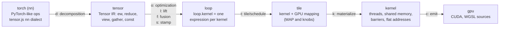
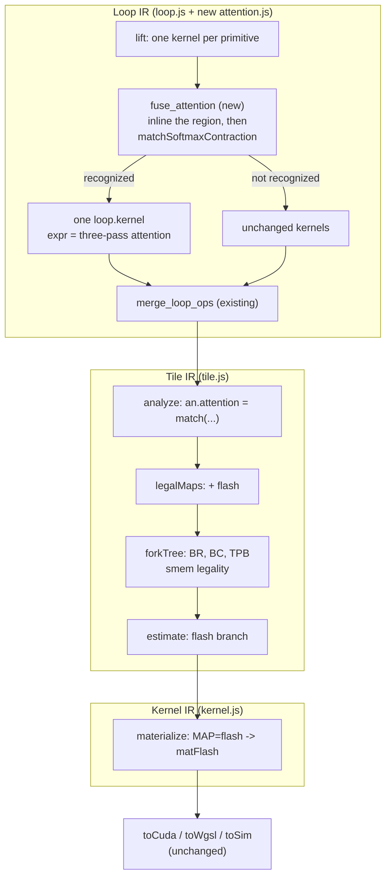

# Fused attention: analysis, design and implementation guide

## 1. Executive summary

Kiln compiles PyTorch's `scaled_dot_product_attention` (SDPA) today, but only as a composition of
ordinary operations: a matrix product for the scores, a softmax, and a second matrix product with the
values. The compiler turns that composition into three GPU kernels, and the middle one reads and
writes the full score matrix, of size L×S per head, through global memory. For long sequences that
matrix dominates the run time. A fused, "flash-style" kernel computes the same result in one pass
over the keys, keeping each block of scores in shared memory and folding it into a running softmax.

This guide explains every part of Kiln an intern needs in order to build that kernel, and proposes a
concrete design. Its central finding comes from a CPU experiment (`scripts/03-forced-fusion-single-kernel.mjs`):
the fully fused attention is *already expressible* as a single Loop IR expression, and evaluates to
the same values as the three-kernel version. The compiler refuses to form it because, with the GPU
mappings that exist today, the fused kernel would recompute the scores several times and run about
35 times slower (1543 µs against 44 µs on the modelled GB10 at a BERT shape). The work, therefore, is
not a new reduction primitive in the IR. It is four pieces that make the fused expression profitable:

1. a **recognizer** that identifies the softmax-contraction expression and extracts its parts;
2. a **fusion rule** that forms the single kernel when the recognizer accepts it;
3. a new **Tile mapping**, `MAP=flash`, with its own knobs, legality and cost estimate;
4. a **Kernel IR materializer**, `matFlash`, that spells the online softmax out as threads, shared
   memory and barriers, from which the existing emitters produce CUDA, WGSL and the CPU simulator.

All four can be built and verified on a CPU-only machine: the reference evaluator, the Loop IR
evaluator and the SIMT simulator are JavaScript, and NVRTC (CUDA C++ to PTX) is available from a
Python wheel without a GPU. What needs the GB10 host is register and spill reports from `ptxas`,
timing, the PassBench replay, and one numerics probe for f16/bf16 inputs (Section 10).

## 2. Problem statement and scope

### 2.1 The problem

The attention computation for one head is

```
scores[i, j] = (q[i, :] · k[j, :]) * scale + mask[i, j]       i < L queries, j < S keys
P[i, j]      = exp(scores[i, j] - max_j scores[i, :]) / sum_j exp(...)
out[i, d]    = sum_j P[i, j] * v[j, d]                        d < D head dimension
```

`scores` and `P` are L×S; `q`, `out` are L×D; `k`, `v` are S×D. With D = 64 and L = S = 1024, each
head's score matrix is 16 times larger than each of its L×D inputs, and about five times larger than
q, k and v combined. Kiln currently writes
`scores` to global memory, reads it back for the softmax, writes `P` (or the unnormalized
exponentials), and reads that again for the second product.

On the PassBench corpus this matters for family 5 (BERT attention subgraphs, 23 graphs). After the
FP32 fix described in Section 4.4, 15 of 23 graphs are accepted, and the family's speed score is
0.167.

### 2.2 In scope

- Fused SDPA for the shapes and options the importer already accepts: rank-4 `[B, H, L, D]` queries,
  `[B, H, S, D]` keys and values, no dropout, not causal, no grouped-query attention, with an
  optional additive (floating) or boolean mask that broadcasts to `[B, H, L, S]`.
- f32 inputs with PyTorch's measured FP32 numerics, as the first slice.
- f16/bf16 inputs, after a GPU probe pins down PyTorch's rounding points.
- CPU-only construction and validation of everything up to CUDA source and PTX.

### 2.3 Out of scope, with the ticket that owns each

- **Tensor-core matrix products** (`mma`/`wmma` instructions) inside the fused kernel: ticket
  KILN-006. The first slice uses FP32 FMA, which is also what PyTorch's f32 kernel does.
- **Causal masking** (`is_causal=True`) through the composed path needs index values in expressions:
  ticket KILN-010. Section 7, Decision 5, explains how the fused kernel could support it earlier.
- **Grouped-query attention** maps query head `h` to key head `h / (Hq / Hkv)`, an integer division
  in an index map; ticket KILN-011 covers integer floor division.
- **Dropout** with `p > 0` in training mode. It needs a random-number contract with PyTorch and is
  not planned.

## 3. System orientation

This section defines the terms the rest of the guide depends on, in the order the compiler uses them.

### 3.1 The six IR levels

Kiln is a compiler written in JavaScript. A program passes through six intermediate representations
(IRs). Each level is a graph of operations from one or more *dialects* (named sets of operations), and
a *pass* is a set of rewrite rules that turns one level into the next. The standard pipeline is
assembled in `packages/kiln/src/std/emmy.js:18-39`:



- **nn (frontend).** PyTorch-like operations with reference semantics, such as `nn.matmul`,
  `nn.softmax`, `nn.ew` (elementwise) and `nn.cast`. Programs use the helper object `N`
  (`packages/kiln/src/std/tensor.js:409-471`), e.g. `N.matmul(a, b, "highest")` (line 459) and
  `N.softmax(x, -1)` (line 461).
- **Tensor IR.** Five primitives (`tensor.js:365-375`): `const`, `ew` (elementwise function),
  `reduce` (along one axis), `view` (an index map, used for transposes, broadcasts and reshapes) and
  `gather`. The *decomposition* pass rewrites each nn operation into these
  (`tensor.js:504-559`). Softmax becomes `exp(x - max(x)) / sum(exp(x - max(x)))`
  (`tensor.js:547-551`), and a matrix product becomes a sum over a broadcast product
  (`packages/kiln/src/std/matmul.js:49-55`).
- **Loop IR.** Each `loop.kernel` node (`packages/kiln/src/std/loop.js:276-286`) holds one kernel as
  a single *expression* over its output coordinates `a0, a1, ...`. Section 3.2 describes expressions.
- **Tile IR.** A `tile.kernel` (`packages/kiln/src/std/tile.js:343-352`) is a Loop IR kernel plus a
  *mapping*: how its loops map onto GPU blocks and threads. Section 3.3 describes mappings.
- **Kernel IR.** A `kernel.kernel` (`packages/kiln/src/std/kernel.js:357-366`) holds a statement list
  built with the `KB` builder (`kernel.js:20-38`): integer and float lets, global loads and stores,
  shared-memory arrays, barriers (`sync`), `for` and `if`. It is target-neutral.
- **gpu.** `gpu.kernel` (`packages/kiln/src/std/program.js:12-21`) adds rendered sources:
  `toCuda` and `toWgsl` in `packages/kiln/src/std/emit.js:28` and `:117` are one-to-one tree walks
  over Kernel IR. `toSim` (`emit.js:174`) compiles the same Kernel IR into a JavaScript SIMT
  simulator that runs a block in lockstep on the CPU.

### 3.2 Loop IR expressions

A Loop IR expression is built from four constructors (`loop.js:50-64`):

| constructor | meaning |
|---|---|
| `E.num(v)` | a constant |
| `E.load(i, idx)` | element `idx` (a list of index expressions) of input `i` |
| `E.op(fn, ...args)` | a scalar function from `FNS` (`packages/kiln/src/std/fns.js:17`) |
| `E.red(fn, r, n, body)` | a reduction with monoid `fn` from `REDUCERS` (`fns.js:93-104`) over a fresh variable `r < n` |

The reducers are scalar monoids only: `add`, `max`, `min`, `mul` and typed integer variants.
Expressions are hash-consed up to renaming of reduction variables (`loop.js:18-38`), so two
structurally equal reductions are one value.

`schedule(expr, shape)` (`loop.js:96-159`) turns an expression into a *loop nest*: free loops for the
output coordinates, reduction loops, and `let`/`init`/`acc`/`write` statements. It places every value
at the outermost loop where all its variables are bound. This loop-invariant hoisting is what turns a
fused softmax into three sweeps over a row. `compileSerial` (`loop.js:213-239`) compiles the nest into
a JavaScript function with FP32 rounding of every scalar (`FLOAT32_FUNCTIONS`, `fns.js:111-113`).
**This serial function is the reference every GPU schedule is checked against.**

### 3.3 Fusion

The *lift* pass makes one `loop.kernel` per Tensor IR primitive (`loop.js:292-317`). The *fusion*
pass then repeatedly inlines a producer kernel into its consumers: `inlineInto(c, p)`
(`loop.js:323-354`) replaces each load of `p` inside `c` with `p`'s expression at that index. The rule
`merge_loop_ops` (`loop.js:357-411`) applies only when every user of the producer is a `loop.kernel`,
and a *guard* accepts the merge only if estimated work does not grow by more than 2 %
(`now <= was * maxWorkGrowth`, default 1.02, `loop.js:359` and `:402`). Work is `workOf`
(`loop.js:190-202`): operation and memory counts weighted by loop trip counts. A producer that cannot
be substituted raises `FusionIllegal` and is skipped (`loop.js:321`, `:373`).

### 3.4 Tile mappings and the cost model

The tile pass forks every Loop IR kernel over mappings and knobs (`tile.js:15-24`):

- `MAP=thread`: one thread per output element, reductions serial in the thread.
- `MAP=row`: one block per row; threads cooperate on each row reduction with a strided loop and a
  shared-memory tree combine (`treeCombine`, `kernel.js:106-120`); `STAGE` optionally copies the
  row's inputs to shared memory.
- `MAP=tiled`: a contraction tiled into `BM×BN` output tiles with `BK`-deep shared-memory slabs and a
  `TM×TN` register tile per thread (`matTiled`, `kernel.js:177`).

`analyze(expr, shape, inShapes)` (`tile.js:31-99`) decides which maps are legal. `MAP=tiled`
requires exactly one innermost reduction with no reduction nested inside it (`tile.js:76-95`).
`forkTree` (`tile.js:107-130`) enumerates knob values, pruning by thread and shared-memory limits.
`estimate` (`tile.js:205-285`) counts flops, memory traffic, shared-memory wavefronts and warp
instructions for one option, and `timeModel` (`tile.js:154-197`) converts counts into microseconds on
a target. The default decider (`emmy.js:12-17`) consults pins, then measured evidence, then this cost
model (`costPrior`, `tile.js:361-365`).

### 3.5 Targets and shared memory

Targets are in `packages/kiln/src/std/targets.js`. Every CUDA target, including the GB10 (DGX Spark,
line 16), has `smemPerBlock: 48 * 1024`, because the CUDA emitter declares shared memory statically
(`emit.js:66`) and a static `__shared__` array over 48 KiB does not compile (comment at
`targets.js:3-4`). WebGPU's default limit is 16 KiB (`targets.js:20`).

### 3.6 Online softmax

The softmax needs the row maximum before it can exponentiate, which is why the composed form takes
three sweeps. The *online softmax* (Milakov and Gimelshein, 2018) processes a row in blocks and keeps
three running quantities per query row: the maximum seen so far `m`, the sum `l` of `exp(s - m)`, and
the output accumulator `acc[d] = sum exp(s - m) * v[., d]`. When a new block raises the maximum to
`m'`, the old sum and accumulator are rescaled by `alpha = exp(m - m')`:

```
for each key block J:
    s_j   = scores[i, j] for j in J
    m'    = max(m, max_j s_j)
    alpha = exp(m - m')
    l     = alpha * l + sum_j exp(s_j - m')
    acc_d = alpha * acc_d + sum_j exp(s_j - m') * v[j, d]
    m     = m'
out[i, d] = acc_d / l
```

FlashAttention (Dao et al., 2022) applies this to attention: a block of queries is held on chip,
blocks of keys and values stream through shared memory, and no L×S matrix reaches global memory. The
result equals the three-pass softmax in exact arithmetic; in FP32 it differs by reordering error.
`scripts/02-online-softmax-reference.mjs` measures that error at 8.9e-7 (L=64, S=200, D=64) and
3.1e-6 (L=128, S=512, D=64) in maximum absolute difference.

### 3.7 A worked example

Take one head with L = 5 queries, S = 7 keys, D = 4, an additive mask, and the composed lowering.
`scripts/03-forced-fusion-single-kernel.mjs` with `NEST=1` prints the single fused kernel that
unguarded fusion produces (abridged; `mul_rn`/`add_rn` are FP32 operations kept separate by
`contraction: "separate"`):

```
for a1 in 0..2, a2 in 0..5:                     # head, query row i
    acc2 = max_{r0<7}  score(a2, r0)            # row max m
    acc4 = sum_{r2<7}  exp(score(a2, r2) - acc2)    # row sum l
    for a3 in 0..4:                             # output column d
        acc5 = sum_{r4<7} (exp(score(a2, r4) - acc2) / acc4) * v[r4, a3]
        out[0, a1, a2, a3] = acc5
where score(i, j) = add_rn(mul_rn(sum_{r<4} mul_rn(q[i, r], k[j, r]), 0.5), mask[i, j])
```

This is exactly the attention formula, in one expression, and its serial evaluation matches the
three-kernel pipeline (5.96e-8 max abs against the frontend reference for both). The problem is
visible in the nest: `score` is an inner product of length D that appears three times, and the third
copy sits inside the `a3` loop, so it is recomputed for every output column. The fused kernel is
correct; it is only slow under `MAP=thread` and `MAP=row`, the only maps `analyze` allows for it.

## 4. Current state, with evidence

### 4.1 The importer's SDPA lowering

`integrations/passnet/fx_compose.py:126-149` lowers `torch.nn.functional.scaled_dot_product_attention`
(dispatched from `integrations/passnet/fx_import.py:102`) into an `N` expression string:

```python
q, k, v = (f'N.cast({bound[f]}, "f32")' for f in ('query', 'key', 'value'))
scores = f'N.mul(N.matmul({q}, N.transpose({k}, -2, -1), "highest"), {json.dumps(scale)})'
# bool mask:     N.select(mask, scores, -Infinity)
# floating mask: N.add(scores, N.cast(mask, "f32"))
return f'N.cast(N.matmul(N.softmax({scores}, -1), {v}, "highest"), {json.dumps(dtype)})'
```

- Dropout must be 0, `is_causal` false and `enable_gqa` false; otherwise the importer raises
  `ValueError("attention with dropout, causal masking or GQA is not lowered")` (line 132-134).
- The scale defaults to `1/sqrt(D)` (line 138).
- Arithmetic runs in f32 and the result narrows to the input dtype once, at the end (line 149).
- Both products carry precision `"highest"` (lines 140-142, 149), explained in Section 4.4.

`nn.matmul` accepts only FP32 operands (`tensor.js:337-340`); its `precision` attribute exists so a
product can opt out of the TF32 pass (`tf32Matmul`, `tensor.js:603-604`, matches only when
`precision !== "highest"`).

### 4.2 What the compiler produces

`scripts/01-dump-attention-kernels.mjs` compiles the same composition on CPU for the GB10 target. At
a BERT-base shape (B=2, H=12, L=S=128, D=64):

| kernel | shape | map chosen by the cost model | predicted µs | DRAM MB |
|---|---|---|---:|---:|
| `k_matmul_reduce` (QK^T) | [2,12,128,1,128] | tiled BM=128 BN=32 BK=16 TN=4 | 14.5 | 3.00 |
| `k_matmul_ew_softmax_reduce` | [2,12,128,128] | row TPB=256 | 15.1 | 3.13 |
| `k_matmul_reduce_2` (P·V) | [2,12,128,64] | tiled BM=128 BN=32 BK=16 TN=4 | 14.5 | 3.00 |
| total | | | 44.1 | 9.13 |

At B=1, H=16, L=S=1024 the total is 1166.8 µs and the softmax kernel alone moves 132 MB; the score
matrix is 64 MiB. The partition is shape-dependent: at a toy shape (L=4, S=6, D=8), the second kernel
writes `exp(s - max)` and the third recomputes the row sum and divides inside its reduction
(`k_softmax_matmul_reduce`). The workbench preset `apps/workbench/presets/W-10-attention.md`
documents the same three-kernel structure and its quadratic memory traffic, and states that fusing
across the contraction is declined by the blowup guard.

### 4.3 Why fusion stops at three kernels

`scripts/03-forced-fusion-single-kernel.mjs` replaces the fusion pass with
`createFusionRule({ decide: () => true })`. The result:

| | kernels | legal maps of the fused kernel | predicted µs (BERT shape) | Loop IR max abs vs reference |
|---|---:|---|---:|---:|
| default guard | 3 | n/a | 44.1 | 1.34e-7 |
| guard disabled | 1 | thread, row | 1543.0 | 1.34e-7 |

The guard is correct to decline: with the existing maps the fused kernel does about 35 times more
modelled work. `MAP=tiled` is not legal because the P·V reduction contains nested reductions (the
QK^T inner product), which `analyze` excludes (`tile.js:83`, `let ok = !inC.some((x) => x.k === "red")`).

### 4.4 Measured numerics on the GB10

Probe 675 (`ttmp/2026/10/30/KILN-005--.../scripts/675-attention-and-low-precision-probes.py`,
result in `.../sources/gpu-probes-v2/result.json`, key `attention_f32`) ran f32 SDPA at family 5's
shape (1×2×512×64, additive mask) inside the evaluator image, torch `2.12.0a0+5aff3928d8.nv26.05`,
with `allow_tf32` on and float32 matmul precision `"high"`:

| backend | result |
|---|---|
| default | equals `efficient` bit for bit; closest to the FP32 reference (max abs 1.16e-6), not RNE TF32 (7.4e-4) |
| efficient (memory-efficient) | same as default |
| flash | `RuntimeError('No available kernel. Aborting execution.')` |
| cudnn | `RuntimeError('No available kernel. Aborting execution.')` |
| math | closest to RNE TF32 (1.24e-3) |

So PyTorch's f32 attention on this device runs the memory-efficient kernel in pure FP32, regardless of
the TF32 flags. Commit `fe45148` pinned both products to `"highest"` accordingly.

PassBench family 5 (record `index: 5`, score id 6) before and after that change:

| replay (KILN-005 `sources/`) | f32 | f16 | bf16 | accepted | score |
|---|---|---|---|---|---:|
| `composed-ops-replay-gpu-v1` (TF32 products) | 3/7 | 4/8 | 1/8 | 8/23 | 0.132 |
| `tf32-rne-requal-gpu-v1` (FP32-pinned) | 7/7 | 7/8 | 1/8 | 15/23 | 0.167 |

Every rejected graph executes and fails only the strictest point of the tolerance curve
(`correct_at: {"-5": false, "-4": true, "-3": true, "1": true}`).

**Inferred, not measured:** PyTorch's f16/bf16 SDPA kernels (flash and memory-efficient) convert the
probability tile `P` to the input dtype before the P·V product, while Kiln keeps `P` in FP32. Probe 675
did not test low-precision attention. `scripts/02-online-softmax-reference.mjs` shows that rounding P
to bf16 changes outputs by 4.8e-4 to 8.8e-4 absolute (f16: 5.7e-5 to 8.6e-5), which is the size of
error that separates the 1e-5 and 1e-4 tolerance points. This is consistent with the hypothesis and
does not prove it; Phase 0 probes it.

### 4.5 Tests that exist

- `integrations/passnet/test_fx_compose.py:53-61` (`test_attention_with_masks`): f32 SDPA with an
  additive mask and a bool mask, compared at atol 1e-5 between CPU PyTorch, Kiln's frontend reference,
  and the compiled Loop IR. The bool mask keeps column 0 (`keep[..., 0] = True`, line 60), which avoids
  fully masked rows.
- The comparison runs through `integrations/passnet/kiln_eval.mjs`, which compiles with an a100
  target, `contraction: "separate"` and `matmulPrecision: "highest"` (line 22) and evaluates the
  frontend graph and the Loop IR graph. It does not exercise Tile, Kernel IR or the simulator.
- `packages/kiln/test/*.mjs` (run with `cd packages/kiln && node ../../scripts/run-node-tests.mjs test`,
  the package's `test` script) cover matmul, fusion and the simulator for
  other operations; there is no attention-specific kernel test.

## 5. Gap analysis

| needed for a fused kernel | exists today | gap |
|---|---|---|
| A single expression for attention | yes, after unguarded fusion (Section 4.3) | fusion declines it; nothing identifies it as attention |
| A reference to check the fused kernel against | yes: `compileSerial`/`compilePoint` of that expression | none |
| A mapping that computes each score tile once and shares it across `d` | no | new `MAP=flash` |
| Online softmax inside a kernel | no; `REDUCERS` are scalar monoids, `treeCombine` combines one scalar | emit the running `(m, l, acc)` update directly in the materializer |
| Shared-memory budgeting for Q, K, V and score tiles | generic `forkTree` legality for row/tiled only | flash-specific legality against `smemPerBlock` |
| Cost estimate | `estimate` branches for thread/row/tiled | a flash branch |
| f16/bf16 rounding of P | Kiln rounds once at the output | needs the probe, then an explicit rounding point |
| Fully masked rows | NaN in the composed path (`exp(-inf - -inf)`); not tested | decide and test the contract |
| Causal mask | refused by the importer | KILN-010, or a template flag (Decision 5) |

## 6. Proposed architecture and APIs

### 6.1 Overview

The fused expression stays an ordinary `loop.kernel` with an ordinary `expr`. This keeps every
existing consumer of `expr` unchanged: kernel identities at the tile, kernel and gpu levels
(`tile.js:350`, `kernel.js:364`, `program.js:19`, `program.js:38`), evidence records, `workOf`, and
the simulator check, which compares sampled outputs with `compilePoint(schedule(kern.expr))`
(`program.js:58-61`, `:104-106`). The online softmax becomes a property of one new mapping.



### 6.2 The recognizer: `packages/kiln/src/std/attention.js` (new)

```js
/**
 * Recognize a softmax contraction:
 *   out[..., i, d] = sum_j (exp(s(i, j) - max_j' s(i, j')) / sum_j'' exp(s(i, j'') - max)) * v(j, d)
 * where s(i, j) = epi(sum_e qa(i, e) * kb(j, e), extra loads indexed by (i, j)).
 * Returns null, or a description the tile and kernel levels use:
 */
export function matchSoftmaxContraction(expr, shape, inShapes) {
  return {
    rowVars,      // output coordinates that index a query row: batch dims and i
    dVar,         // the output coordinate d (last output axis)
    L, S, D, E,   // queries, keys, value width, inner-product length (E = D for SDPA)
    q:   { load, pre },   // the left operand load and its pure elementwise prologue (copy, round, cast)
    k:   { load, pre },   // the right operand load (indexed by j, e)
    v:   { load, pre },   // the value load (indexed by j, d)
    product: "mul" | "mul_rn",  accumulate: "add" | "add_rn",
    epilogue,     // an E expression of the raw score and of side loads indexed by (rowVars, j):
                  // scale, additive mask, select(mask, s, -inf)
    sideLoads,    // loads used by the epilogue (masks), with their index maps
    pRound,       // null (FP32 P) or "f16" | "bf16" (a round_* applied to P before the product)
  };
}
```

The recognizer works on the canonical fused expression: one top-level `red(add)` over `j` whose body
is `op(mul|mul_rn, op(div, op(exp, op(sub|sub_rn, S_j, M)), Lsum), V_jd)`, where `M = red(max)` over
the same score expression and `Lsum = red(add)` of the same `exp`. Hash-consing up to renaming makes
"the same score expression" an equality test on `__key` after substituting the reduction variable.
It must also accept the variant the toy shape produces, where the division appears outside the
product, and reject everything else by returning `null`.

### 6.3 The fusion rule: `fuse_attention`

```js
// packages/kiln/src/std/attention.js (sketch: inlineInto takes kernel nodes; the real rule threads
// the intermediate kernels through tx the way merge_loop_ops does)
export const fuseAttention = k.rule("fuse_attention")
  .match(P.op("loop.kernel").as("c").where(({ c }) => looksLikePV(c)))   // a red(add) over j of a product
  .mutate(({ c, tx, skip, graph, ctx }) => {
    const region = producersOf(c, graph);            // kernels feeding c's P operand, transitively,
                                                     // stopping at graph inputs and shared producers
    const fused = region.reduce((e, p) => inlineInto(e, p), c);   // existing inlineInto, in topo order
    const m = matchSoftmaxContraction(fused.expr, c.attrs.shape, argShapes(fused.args));
    if (!m) skip("not a softmax contraction");
    if (!flashLegal(m, ctx.target)) skip("no MAP=flash option fits this target");
    tx.set(c, { args: fused.args, attrs: { expr: fused.expr, origin: fused.origin } });
  })
  .describe("fuse a scores/softmax/P·V region into one kernel when MAP=flash can run it");

export const fuse = k.pass("loop/fusion").short("f")
  .rules(fuseAttention, mergeLoopOps).order("reverse");          // replaces loop.js:411
```

The rule runs before `merge_loop_ops` so the generic rule does not partially fuse the region into a
shape-dependent form first. It is guarded by legality, not by `workOf`, because the work estimate of
the expression describes the serial nest, not the flash mapping. A producer with a user outside the
region (for example, a score matrix that is also a graph output) stays materialized; the region then
excludes it and the recognizer will usually fail, leaving the graph unchanged.

### 6.4 The Tile mapping: `MAP=flash`

Changes to `packages/kiln/src/std/tile.js`:

```js
export const MAP = k.param.enum("MAP", ["thread", "row", "tiled", "flash"], { off: "thread" });
export const BR  = k.param.enum("BR", [8, 16, 32, 64], { off: 0 }).group("tile").help("query rows per block (flash)");
export const BC  = k.param.enum("BC", [16, 32, 64], { off: 0 }).group("tile").help("keys per tile (flash)");
// KNOBS gains BR, BC

// analyze(): an.attention = matchSoftmaxContraction(expr, shape, inShapes)
// legalMaps(): if (an.attention) out.push("flash")
// forkTree(): levels for BR, BC under MAP=flash; TPB from {64, 128, 256} with TPB % BR === 0;
//             prune by flashSmemBytes(kn, an.attention) <= t.smemPerBlock
// launch():   grid = rows / BR (rows = product of batch dims and L), block = TPB,
//             smem = flashSmemBytes(...)
// estimate(): new branch, Section 8.4
```

Shared memory per block, all tiles in FP32:

```
flashSmemBytes = 4 * (BR*D        // Q tile, loaded once
                    + BC*D        // K tile
                    + BC*D        // V tile
                    + BR*BC       // score / P tile
                    + 2*BR)       // per-row m' and alpha
```

| D | BR | BC | bytes (KiB) | fits 48 KiB (CUDA targets) | fits 16 KiB (WebGPU default) |
|---:|---:|---:|---:|:-:|:-:|
| 64 | 16 | 16 | 13.1 | yes | yes |
| 64 | 16 | 32 | 22.1 | yes | no |
| 64 | 32 | 32 | 28.3 | yes | no |
| 64 | 64 | 32 | 40.5 | yes | no |
| 64 | 32 | 64 | 48.3 | no | no |
| 64 | 64 | 64 | 64.5 | no | no |
| 128 | 16 | 32 | 42.1 | yes | no |
| 128 | 32 | 32 | 52.3 | no | no |

The GB10 has 100 KiB per SM (`targets.js:16`), so a 40 KiB block allows two resident blocks per SM;
`timeModel` already accounts for this through its `smem` occupancy limit (`tile.js:160`). Dynamic
shared memory, which would lift the 48 KiB cap, is a separate change to the emitter.

### 6.5 The materializer: `matFlash`

`packages/kiln/src/std/kernel.js:314` dispatches on `kn.MAP`; it gains
`kn.MAP === "flash" ? matFlash(an, kn)`. `matFlash` builds Kernel IR with the existing `KB` builder
and the existing expression machinery: the prologue of each operand, the score epilogue and the side
loads come from the recognizer as Loop IR fragments, and are emitted through the same `emitNest`/
`opnd` helpers `matTiled` uses (`kernel.js:49-68`). Because the output is ordinary Kernel IR,
`toCuda`, `toWgsl` and `toSim` need no change. Section 8.2 gives the statement-level pseudocode.

### 6.6 Pipeline-facing API

No new user-facing API is needed for the first slice. Attention written with `N.matmul`/`N.softmax`
(the importer's output, and the W-10 preset) is fused automatically when the recognizer accepts it and
`MAP=flash` is legal; the decider still chooses among the legal maps of the fused kernel by pins,
evidence and cost. A pin `MAP=row` on the fused kernel reproduces the slow single-kernel path for
debugging. A pipeline option to disable the rule is useful for A/B runs:

```js
pipeline({ target, attention: "fused" | "composed" })   // emmy.js:18; default "fused" after Phase 5
```

## 7. Decision records

### Decision 1: Keep attention as an ordinary Loop IR expression

- **Context:** The fused computation needs a home in the IR. Downstream code keys on `attrs.expr`
  (identities, evidence, simulator reference, `workOf`).
- **Options considered:** (a) a tuple-valued `(m, l, acc)` reducer added to `REDUCERS`; (b) a new
  `loop.attention` node with its own `eval`, identity and printers; (c) the existing three-pass
  expression, recognized and given a new mapping.
- **Decision:** (c).
- **Rationale:** Experiment 03 shows the three-pass expression already exists after full inlining and
  evaluates correctly. Option (a) cannot express the reduction alone: `acc[d]` is per output column
  and its update reads `m` and `l`, so it would need vector-valued reducers or a reducer coupled across
  output coordinates, and the serial schedule would still recompute scores per `d`. Option (b)
  duplicates the reference and would need special cases in at least five consumers of `expr`.
- **Consequences:** The reference is the three-pass FP32 semantics; the flash kernel is checked
  against it with tolerance, not bit equality. A reduction-order rounding difference (about 1e-6) is
  accepted by design. The recognizer becomes the critical piece of code.
- **Status:** proposed.

### Decision 2: Recognize at the Loop IR, not at the frontend

- **Context:** The importer knows a node is SDPA; the compiler only sees matmul/softmax.
- **Options considered:** (a) a new `nn.sdpa` op from `fx_compose.lower_sdpa`, carried to a fused
  primitive; (b) pattern-match the Tensor IR subgraph (max, sub, exp, sum, div, two sum-of-products);
  (c) pattern-match the fused Loop IR expression.
- **Decision:** (c), with `fuse_attention` forming the expression first.
- **Rationale:** (c) also fuses attention written by hand (W-10) and variants the importer composes
  differently. The Loop IR form is canonical up to renaming, while the Tensor IR subgraph varies with
  views, broadcasts and casts. (a) needs a new op at three levels (nn, tensor, loop) because each IR
  level is strict about its dialects (`emmy.js:23-35`).
- **Consequences:** The recognizer must tolerate prologue ops (`copy`, `round_*`, `to_f32`) on the
  operand loads and both FP32 spellings (`mul`/`mul_rn`, `add`/`add_rn`). A future `nn.sdpa` remains
  possible for options the composition cannot express (dropout).
- **Status:** proposed.

### Decision 3: A dedicated materializer, not a generalization of `MAP=tiled`

- **Context:** `matTiled` already stages operand slabs in shared memory and keeps a register tile.
- **Options considered:** (a) extend `analyze`'s contraction detection to nested reductions and
  teach `matTiled` the online softmax; (b) a separate `matFlash`.
- **Decision:** (b).
- **Rationale:** The flash loop has a structure `matTiled` lacks: two contractions with a row-wise
  reduction and rescaling between them, and a barrier pattern per key tile. Merging the two would make
  the existing, measured tiled path harder to reason about.
- **Consequences:** Some staging code is duplicated; shared helpers (tile loads with bounds) should be
  factored out of `matTiled` when they are needed a second time.
- **Status:** proposed.

### Decision 4: f32 first; low-precision rounding of P only after a probe

- **Context:** The f32 numerics are measured (Section 4.4); the f16/bf16 numerics are inferred.
- **Options considered:** (a) implement P rounding now from the published kernels' source;
  (b) probe first, then add `pRound`.
- **Decision:** (b).
- **Rationale:** The exact rounding points depend on the backend PyTorch selects on sm_121 for each
  dtype and mask, on where the scale is applied (some kernels fold `scale * log2(e)` into `exp2`), and
  on whether `l` sums rounded or unrounded `p`. Guessing risks a second requalification.
- **Consequences:** f16/bf16 graphs fuse in the first slice with FP32 `P`, matching today's composed
  numerics (7/8 and 1/8 accepted), and gain only speed until Phase 6.
- **Status:** proposed.

### Decision 5: Causal masking

- **Context:** `is_causal=True` masks `j > i` (top-left aligned). The composed path cannot express a
  mask computed from coordinates; that needs index values (KILN-010).
- **Options considered:** (a) wait for KILN-010; (b) a `causal` flag in the recognizer's result,
  emitted as an index comparison inside `matFlash` and as a skipped tile loop.
- **Decision:** (a) for the first slices; revisit after KILN-010 lands.
- **Rationale:** With (b) the fused kernel would have semantics its own Loop IR reference cannot
  state, so the simulator check, which evaluates `expr`, would not cover the mask. The design rule of
  Section 6.1 is that every kernel is checked against its expression.
- **Consequences:** Causal attention stays refused at import. Once KILN-010 adds coordinate values to
  expressions, the mask is an ordinary `select(le(j, i), s, -inf)` epilogue, the recognizer accepts it,
  and `matFlash` can add the tile-skipping optimization as a pure performance change.
- **Status:** proposed.

## 8. Pseudocode and key flows

### 8.1 End-to-end flow for one SDPA call

```mermaid
sequenceDiagram
  participant FX as fx_compose.lower_sdpa
  participant D as decomposition (tensor.js)
  participant F as fuse_attention (attention.js)
  participant T as tile pass (tile.js)
  participant K as matFlash (kernel.js)
  participant E as toCuda / toSim (emit.js)
  FX->>D: N.cast(N.matmul(N.softmax(scores), v, "highest"), dtype)
  D->>F: Tensor IR -> lift -> single-op loop.kernels
  F->>F: inline producers of the P·V kernel; matchSoftmaxContraction
  F->>T: one loop.kernel (three-pass expr)
  T->>T: analyze: an.attention; legal maps thread,row,flash; BR/BC fork; estimate
  T->>K: tile.kernel MAP=flash BR=32 BC=32 TPB=128
  K->>E: Kernel IR (KB statements)
  E-->>E: CUDA source; JS SIMT simulator checks samples vs compilePoint(expr)
```

### 8.2 `matFlash` statement structure

One block handles `BR` query rows of one `(b, h)` pair; `TPB` threads; each row is owned by
`TPR = TPB / BR` threads, and each of those owns `D / TPR` output columns in registers.

```
matFlash(an, kn):
  att = an.attention; BR, BC, T = kn.BR, kn.BC, kn.TPB; TPR = T / BR; DPT = ceil(D / TPR)
  bid -> (batch coords, row block rb);  tid -> (r = tid / TPR, lane = tid % TPR)
  i = rb*BR + r                                         # may exceed L in the last block: guard loads/stores

  sQ[BR*D], sK[BC*D], sV[BC*D], sS[BR*BC], sM[BR], sA[BR] = shared arrays
  for t in tid..BR*D step T: sQ[t] = pre_q(load q[rb*BR + t/D, t%D])  (0 when out of range)
  sync
  m = -inf; l = 0; acc[0..DPT) = 0                      # per thread; m and l duplicated across a row's lanes

  for j0 in 0..S step BC:
      for t in tid..BC*D step T: sK[t] = pre_k(load k[j0 + t/D, t%D]); sV[t] = pre_v(load v[...])
      sync
      for c in lane..BC step TPR:                        # each lane computes some scores of its row
          s = sum_e sQ[r*D + e] * sK[c*D + e]           # FP32, product/accumulate spelled as att.product/accumulate
          s = epilogue(s, side loads at (i, j0 + c))     # scale, additive mask, or select(mask, s, -inf)
          sS[r*BC + c] = (j0 + c < S) ? s : -inf
      sync
      if lane == 0:                                      # row max of this tile and the rescale factor
          mt = max_c sS[r*BC + c];  m2 = max(m, mt)
          sM[r] = m2;  sA[r] = (m2 == -inf) ? 1 : exp(m - m2)
      sync
      m2 = sM[r]; alpha = sA[r]
      for c in lane..BC step TPR: sS[r*BC + c] = (m2 == -inf) ? 0 : exp(sS[r*BC + c] - m2)   # P tile
      sync
      l = alpha*l + sum_c sS[r*BC + c]                   # every lane of the row sums the same tile: same l
      for q in 0..DPT: d = lane + q*TPR
          acc[q] = alpha*acc[q] + sum_c round_P(sS[r*BC + c]) * sV[c*D + d]
      m = m2
      sync                                               # before the next tile overwrites sK, sV, sS
  for q in 0..DPT: d = lane + q*TPR
      if i < L and d < D: store out[i, d] = narrow(acc[q] / l)
```

Notes for the implementer:

- Every `sync` is reached by all threads of the block; the row guard `i < L` is applied to loads and
  stores, never around a barrier. The simulator flags barriers in divergent code
  (`program.js:109`), so this is checked on CPU.
- The row max and the rescale factor are computed by one lane and shared through `sM`/`sA`, so all
  lanes of a row use bit-identical `m` and `alpha`. Computing them redundantly per lane is also
  correct and removes two barriers; that is a tuning choice.
- `l` is accumulated by every lane over the same values in the same order, so all copies agree.
- `round_P` is the identity in the first slice and `round_f16`/`round_bf16` (`fns.js:23-25`) after
  Phase 6.

### 8.3 Fully masked rows

If every score of a row is `-inf`, the three-pass reference computes `exp(-inf - (-inf)) = NaN`, so
the output row is NaN. The online form above produces `0 / 0 = NaN` too (Experiment 02 confirms both
give NaN). The simulator check skips NaN reference values (`protocol.ts:42-45`), so this case needs an
explicit test. Whether PyTorch returns NaN or zeros for such rows depends on the backend and version;
the probe in Phase 0 records it, and the behavior must then be chosen once, in the expression, so the
reference and the kernel agree.

### 8.4 Cost estimate for `MAP=flash`

Per `(b, h)` pair, with `nb = ceil(L / BR)` row blocks:

```
flops        = 2*L*S*E (scores) + 2*L*S*D (P·V) + L*S*(flops(epilogue) + flops(exp) + 3)
traffic      = 4*(L*D)                      # Q, once
             + 4*nb*(2*S*D)                 # K and V, once per row block (mostly L2 hits)
             + 4*L*S*maskBytesFactor        # side loads, once
             + 4*L*D                        # output
smemWave     = per tile: (BR*D + 2*BC*D)/32 stores + BR*BC*E/32 score reads + BR*BC*D/32 P·V reads
             + bank-conflict degree, computed as estimate() does for matTiled (tile.js:260-278)
warpInstr    ~ (flops + smem accesses) / 32
```

These counts go through the existing `timeModel`. A hand estimate at the BERT shape: about 100
MFLOP (3.5 µs at the GB10's 28.9 TFLOPS) and about 3.2 MB of DRAM traffic (12.7 µs at 259 GB/s),
against 9.13 MB and 44.1 µs predicted for the composed path. At L = S = 1024, H = 16 the fused kernel
becomes compute-bound in FP32 (about 4.3 GFLOP, 149 µs at peak) against 1166.8 µs predicted for the
composed path; that is where tensor cores (KILN-006) matter for f16/bf16.

## 9. Implementation phases

Each phase ends at a CPU-checkable boundary unless marked GPU.

**Phase 0: Probe design (CPU) and run (GPU).** Write probe 676 alongside 675: f16 and bf16 SDPA at
family 5's shapes with and without masks; for each backend record which kernel ran and the closest of
four float64 references: P in FP32; P rounded to the input dtype with `l` from unrounded `p`; the same
with `l` from rounded `p`; scale folded into `exp2`. Add a fully masked row to report NaN or zero.

**Phase 1: Recognizer (CPU).** `packages/kiln/src/std/attention.js` with `matchSoftmaxContraction`.
Unit tests build fused expressions by forced fusion (as in Experiment 03) at several shapes, mask
kinds, dtypes and both `contraction` settings, and check acceptance and extracted fields; negative
tests cover a softmax without the product, a product without softmax, a softmax over a different axis,
and log-softmax.

**Phase 2: Fusion rule (CPU).** `fuseAttention` before `mergeLoopOps`; the `attention` pipeline
option. Tests: the composed attention compiles to one Loop IR kernel; `kiln_eval.mjs` results and
`test_fx_compose.py` remain within tolerance; graphs where the scores are also an output are left
unchanged.

**Phase 3: Tile mapping (CPU).** `MAP=flash`, `BR`, `BC`, legality, `launch`, `estimate`. Tests: the
fork offers only options under `smemPerBlock` for D = 64 and 128 on gb10 and WebGPU; the decider
prefers `flash` over `row` for the fused kernel; `printTile` renders the flash mapping.

**Phase 4: Materializer (CPU).** `matFlash`. Tests: `simulateKernel` passes on every legal option for
ragged shapes (L and S not multiples of BR/BC, D not a multiple of TPR), additive, bool and broadcast
masks; an explicit fully masked row test; `simulateFull` against `compileSerial` at small shapes;
`toCuda` compiles with NVRTC on the CPU host (Section 10.2).

**Phase 5: GPU qualification (GPU).** Re-run the family-5 replay with the attention option on and
off; collect `ptxas` register and spill counts; time against eager PyTorch and against the composed
path; make `"fused"` the default if accepted graphs do not regress.

**Phase 6: Low-precision rounding (CPU then GPU).** From Phase 0's answer: add the `pRound` field and
the corresponding `round_*` in the expression (so the reference states it), emit it in `matFlash`, and
requalify the f16/bf16 graphs.

**Deferred:** causal masks after KILN-010 (Decision 5); GQA after KILN-011; tensor-core inner
products after KILN-006; dynamic shared memory above 48 KiB; fusing the f16-to-f32 cast kernels of
q/k/v into the flash loads (today they are separate producers when the inputs are low precision).

## 10. Test strategy

### 10.1 What runs where

| check | CPU only | needs GB10 |
|---|:-:|:-:|
| Frontend reference vs PyTorch CPU (`test_fx_compose.py`) | yes | |
| Loop IR evaluation (`compileSerial`) vs frontend reference | yes | |
| Recognizer unit tests | yes | |
| Kernel IR on the SIMT simulator vs `compilePoint(expr)` (`simulateKernel`) | yes | |
| Barrier divergence and out-of-bounds detection (simulator) | yes | |
| CUDA C++ to PTX with NVRTC (`apps/workbench/test/cuda_check.py`) | yes, with `libnvrtc.so.13` from the pip `nvidia/cu13` wheel | |
| `ptxas` register counts and spills | only if the CUDA toolkit is installed | default |
| Running the kernel, timing, PassBench replay | | yes |
| PyTorch's f16/bf16 SDPA numerics (probe 676) | | yes |

On the current CPU host, `which ptxas nvcc nvidia-smi` finds none of them, and
`~/.pyenv/versions/3.13.2/lib/python3.13/site-packages/nvidia/cu13/lib/libnvrtc.so.13` exists. The
CUDA checker states in its header that it "works without a GPU".

### 10.2 CPU validation recipe

```bash
# unit and simulator tests (Node)
(cd packages/kiln && node ../../scripts/run-node-tests.mjs test)   # all; add test/attention.mjs
# numerics against PyTorch on CPU
cd integrations/passnet && python -m unittest test_fx_compose
# exploratory: kernels and model times for a shape
node ttmp/2026/11/01/KILN-007--*/scripts/01-dump-attention-kernels.mjs 2 12 128 128 64
# CUDA source compiles (export kernels to JSON first, as apps/workbench/test/export-cuda.mjs does)
python apps/workbench/test/cuda_check.py kernels.json \
  --nvrtc ~/.pyenv/versions/3.13.2/lib/python3.13/site-packages/nvidia/cu13/lib/libnvrtc.so.13 \
  --ptxas "$(which ptxas)" --arch 121     # ptxas step needs the toolkit; NVRTC alone proves the source compiles
```

### 10.3 Tolerances

- Fused vs Loop IR reference in FP32: `checkSamples` defaults (rtol 2e-3, atol 2e-4) pass with a wide
  margin over the measured 1e-6 reordering error. A tighter dedicated assertion (atol 1e-5 at the test
  shapes) catches indexing mistakes that shift values slightly.
- Against PyTorch on CPU: keep `test_fx_compose.py`'s atol 1e-5 for f32.
- f16/bf16 against the GPU: the PassBench tolerance curve; target the `-5` point after Phase 6.

## 11. Risks, alternatives and open questions

### 11.1 Risks

- **Recognizer brittleness.** A small change in decomposition (a new view, a different cast) could
  make attention silently fall back to three kernels. Mitigation: tests that compile the importer's
  exact output and the W-10 preset and assert one kernel with `MAP=flash`.
- **Barrier correctness.** A missing `sync` between writing `sS` and reading it gives wrong values on
  hardware but may pass a lockstep simulator. The simulator runs one block in lockstep
  (`emit.js:171-173`), so read-after-write races within a block are invisible to it. Mitigation:
  review the barrier placement against Section 8.2 and run the GPU replay before enabling by default.
- **Register pressure.** `DPT` accumulators per thread plus temporaries; `ptxas` reports are needed
  (GPU host or toolkit) before choosing large `D/TPR`.
- **Cost-model optimism.** A new `estimate` branch with no measurement can mis-rank options; Phase 5
  should record evidence for the chosen options so the decider uses measurements.

### 11.2 Alternatives considered

- Recomputing nothing and caching the L×S score matrix in L2 instead: on the GB10, 24 MB of L2
  (`targets.js:16`) holds the BERT-shape scores but not the 64 MiB at L = 1024.
- Splitting over keys across blocks (split-K / "flash-decoding") for small L: deferred; family 5 has
  L = S.

### 11.3 Open questions

1. Which SDPA backend does PyTorch choose on sm_121 for f16/bf16 with a floating mask, and where does
   it round P, apply the scale, and form `l`? (Phase 0.)
2. Does PyTorch return NaN or zeros for a fully masked row in the backend the evaluator uses?
3. Should `fuse_attention` stay a separate rule, or become a fusion *region policy* through
   `createFusionRule`'s `selectConsumers`/`decide` hooks (`loop.js:357-363`)? The hooks see work
   features only, not the recognizer's result.
4. Is the 48 KiB static shared-memory cap worth lifting for D = 128 (dynamic shared memory needs an
   `extern __shared__` declaration and a launch parameter)?

## 12. References

Source files (worktree `/home/manuel/code/wesen/kiln/worktrees/passnet`):

- `integrations/passnet/fx_compose.py:126-149`: `lower_sdpa`.
- `integrations/passnet/fx_import.py:102`: SDPA dispatch.
- `integrations/passnet/test_fx_compose.py:53-61`, `integrations/passnet/kiln_eval.mjs:22`.
- `packages/kiln/src/std/emmy.js:12-39`: pipeline assembly and decider.
- `packages/kiln/src/std/tensor.js:337-343, 409-471, 504-559, 603-604`: nn ops, `N`, decompositions, TF32 pass.
- `packages/kiln/src/std/matmul.js:49-55`: `lowerMatmul`.
- `packages/kiln/src/std/loop.js:50-64, 96-159, 213-239, 292-317, 321-411`: expressions, schedule, serial reference, lift, fusion.
- `packages/kiln/src/std/tile.js:15-24, 31-99, 107-144, 154-285, 361-375`: knobs, analysis, fork, launch, cost model.
- `packages/kiln/src/std/kernel.js:20-38, 106-174, 177, 305-327`: KB builder, row map, tiled map, materialize.
- `packages/kiln/src/std/emit.js:28, 66, 117, 174`: CUDA, shared declarations, WGSL, simulator.
- `packages/kiln/src/std/program.js:19, 29-43, 58-61, 83-111`: identities, program, reference, simulator check.
- `packages/kiln/src/std/fns.js:17-63, 93-104`: scalar functions and reducers.
- `packages/kiln/src/std/targets.js:3-4, 16, 20`: shared-memory limits, GB10, WebGPU.
- `packages/evidence/src/protocol.ts:37-45`: `checkSamples`.
- `apps/workbench/presets/W-10-attention.md`, `W-06-softmax.md:28-40`: attention and online softmax notes.
- `apps/workbench/test/cuda_check.py`: NVRTC/ptxas compile check.

Evidence (KILN-005 ticket, `ttmp/2026/10/30/KILN-005--reproduce-passnet-and-evaluate-reusable-kiln-compiler-transformations/`):

- `scripts/675-attention-and-low-precision-probes.py`, `sources/gpu-probes-v2/result.json`.
- `sources/composed-ops-replay-gpu-v1/results-audit.json`, `sources/tf32-rne-requal-gpu-v1/results-audit.json`.
- `reference/24-implementation-diary-volume-2-pi-agents-and-compiler-optimization.md`, Steps 259-260.
- Commits `6634f0c` (probe 675), `fe45148` (FP32-pinned attention), `67678fd` (tf32-rne-requal collection).

Experiments in this ticket (`scripts/`):

- `01-dump-attention-kernels.mjs`: kernels, maps and model times of the composed path.
- `02-online-softmax-reference.mjs`: online vs three-pass error; effect of rounding P.
- `03-forced-fusion-single-kernel.mjs`: the single fused expression and why the guard declines it.

Literature: Milakov and Gimelshein, *Online normalizer calculation for softmax* (2018); Dao et al.,
*FlashAttention* (2022); Dao, *FlashAttention-2* (2023).

## 13. Implementation status and deviations (2026-11-01)

Phases 1 to 4 are implemented on branch `impl/kiln-007-fused-attention` (diary Steps 6-10); Phase 0's
probe is written and dry-run on CPU. Where the code departs from Sections 6 to 9 it is authoritative:

- **Pass placement.** `fuse_attention` is its own pass, `loop/attention` (short `a`), after ordinary
  fusion, enabled by `pipeline({ attention: "fused" })` (default `"composed"` until Phase 5). The
  fixpoint scan interleaves rules per node, so "before `merge_loop_ops`" has no fixed meaning; inlining
  is substitution, so the fused expression does not depend on how ordinary fusion partitioned it.
- **Region.** A breadth-first search over producer sets (at most 6 kernels, 48 states) stops at the
  smallest set the recognizer accepts, which keeps Q/K/V projections out of the region.
- **Profitability.** The rule also requires the best flash option to be predicted no slower than the
  composed kernels (`tile.js bestEstimate`); D=128 at L=S=256 stays composed on gb10.
- **Recognizer.** Size-1 output coordinates are substituted by 0 before matching (views spell them `a0`
  or `0`). The match carries floors of the row maximum and sum (see below).
- **Kernel.** Register-tiled, not the one-row-per-lane pseudocode of 8.2: knob `RM` (rows per thread);
  per thread an `RM×KN` score tile and `RM×DPT` accumulators; per-lane partial maxima `sM`
  (`BR×TPR`) instead of a score tile; probabilities written once to `sP`; four barriers per key tile.
  Shared memory: `4·(BR(E+1) + BC(E+1) + BC·D + BR·SS + BR·TPR)` bytes, `SS ≡ TPR (mod 32)`.
- **Fully masked rows (8.3).** torch 2.11 on CPU returns 0, not NaN, on every SDPA backend
  (`sources/probe-676-cpu-dry-run/result.json`). `fx_compose.lower_sdpa` now uses `N.safeSoftmax`
  (maximum floored at −FLT_MAX, sum at FLT_MIN; bit-identical on live rows), and `matFlash` reproduces
  the floors.
- **Product seam.** `flash-kernel.js products.simt = { scores, pv }`: `scores` returns held inner
  products as `{ slot, row, key, value }` elements (the shape of KILN-006's `mmaAccElements`), `pv` owns
  the key-tile update from `sP`/`sV`. P passes through shared memory, so the accumulator/A-operand layout
  gap of chained mma products does not arise.
- **Model results (gb10, not measured).** BERT 2×12×128×64: 44.1 → 20.2 µs; family 5 1×2×512×64:
  55.7 → 45.8 µs; 1×16×1024×64: 1166.8 → 622.8 µs. The kernel stays shared-memory bound in FP32 SIMT.
- **Known limits.** Bool-mask kernels cannot run in the SIMT simulator (no bool storage; KILN-010); the
  fused expression's serial reference is O(L·D·S·E), so `kiln-export`'s end-to-end check is skipped at
  realistic shapes.

GPU work remaining: probe 676; ptxas registers/spills for `sources/nvrtc-flash-v1/flash-kernels.json`;
the family-5 replay with `attention: "fused"` against `"composed"`; then the default flip and Phase 6.
