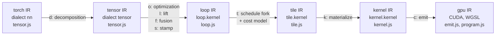
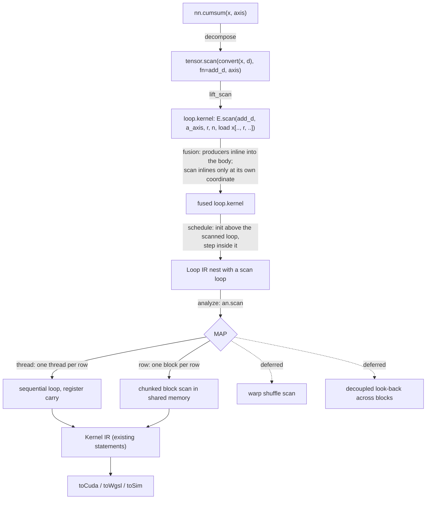

# Cumsum as a scan primitive: analysis, design and implementation guide

## 1. Executive summary

Kiln compiles `torch.cumsum` today by rewriting it as an ordinary reduction: output element `i` of a row is the sum over all `j` in the row of `x[j]` masked to zero where `j > i`. That rewrite reuses every existing part of the compiler and is correct: the KILN-005 GPU replay accepted the two integer families that use cumsum (tasks 28 and 64) along with the eight other typed families of that replay. Its cost is quadratic in the row length: a row of length `n` performs `n^2` masked additions instead of `n`. At the sequence lengths in the PassBench corpus (about 512) the quadratic cost is hidden by parallelism, but at 32,768 the cost model already predicts 6.3 ms for a single row, and in every probed shape with integer rows of 1,024 or more (8 or 64 rows) integer cumsum fails to compile, because the cost model maps it onto the matrix-product materializer, which has a dtype defect.

This guide proposes a scan primitive: a Tensor IR op `tensor.scan`, a Loop IR expression kind `scan` whose value at index `i` is the inclusive fold of its body over positions `0..i`, a scheduler rule that realizes that expression as an accumulator carried along an ordered loop, and two GPU mappings: one thread per row with a sequential loop, and one block per row with a shared-memory scan over chunks of the row. Both mappings can be written in the Kernel IR statements that already exist, so the CUDA, WGSL and simulator emitters need no new statement kinds in the first slice. Warp-shuffle scans and multi-block decoupled look-back scans are designed but deferred.

Almost all of this work can be done on a CPU. The Loop IR serial evaluator, the point evaluator, the SIMT simulator, the CUDA and WGSL source generators, the cost model and the PyTorch-backed importer tests all run on this machine. Two things need the GPU host (bling): compiling the emitted CUDA, because no CUDA compiler is installed here, and measuring time and comparing against PyTorch's CUDA cumsum. One CPU gap must be closed first: the SIMT simulator cannot execute integer kernels today, and cumsum's main use in the corpus is integer position ids.

## 2. Problem statement and scope

### 2.1 The problem

A prefix scan (also called a prefix sum when the operation is addition) takes a sequence `x[0..n)` and an associative binary operation `op` with identity `e`, and returns the sequence `y` with

```text
inclusive scan:  y[i] = x[0] op x[1] op ... op x[i]
exclusive scan:  y[i] = e op x[0] op ... op x[i-1]      (y[0] = e)
```

`torch.cumsum(x, dim)` is the inclusive scan with `op = +` along one axis of a tensor, applied independently to every row along that axis. The sequential algorithm is the recurrence `y[i] = y[i-1] op x[i]`, which costs `n - 1` operations per row and has a dependency chain of length `n`. Parallel algorithms trade extra work or extra passes for a shorter chain; they are described in section 6.6.

Kiln has no way to express the recurrence. Its Loop IR describes each output element as a pure function of that element's coordinates, so the only way to say "the sum of everything up to `i`" is a reduction whose body is masked by `j <= i`. The problem is to add a representation of prefix scans that the scheduler, cost model and GPU materializers understand, so that cumsum costs `O(n)` work per row, and so that the same mechanism serves `cumprod`, `cummax`, `cummin` and `logcumsumexp`.

### 2.2 Scope

In scope:

- The semantics and representation of an inclusive scan along one axis in Tensor IR and Loop IR.
- Scheduling, fusion legality and cost estimation for scan kernels.
- Two GPU mappings (sequential per thread, block-level per row) and the deferred design of two more (warp shuffle, decoupled look-back).
- Integer and f32 cumsum with the dtype rules that exist today (integers widen to int64; f16 and bf16 are refused).
- A validation plan that separates CPU-only checks from checks that require the GPU host.

Out of scope for this ticket:

- Reverse scans, segmented scans and scans that return indices (`cummax` returns values and indices in PyTorch). They are discussed only as extensions.
- f16 and bf16 cumsum. The refusal at `tensor.js:351` stays.
- The index-value expression node of KILN-010, which is a separate ticket; section 11 explains why it does not remove the quadratic cost.

## 3. System orientation

This section introduces the parts of Kiln a scan touches, in pipeline order. Each term is defined before later sections depend on it.

### 3.1 The pipeline

Kiln is a compiler from PyTorch-like programs to GPU kernels. A program passes through six intermediate representations (IRs), each a graph of nodes in a dialect, with a pass between consecutive IRs. The order is fixed in `packages/kiln/src/std/emmy.js:18-39`:



- **nn (torch IR)** is the frontend dialect. Its ops mirror PyTorch (`nn.cumsum`, `nn.softmax`, `nn.matmul`). Each op declares a type rule (`infer`) and a reference implementation (`eval`) in JavaScript. The builder object `N` (`tensor.js:440-460`) is how programs and the importer construct nn nodes; `N.cumsum(x, axis)` is at `tensor.js:453`.
- **tensor (Tensor IR)** is the canonical primitive set: elementwise ops (`tensor.ew`), reductions (`tensor.reduce`), index-map views (`tensor.view`), gathers and constants. Decomposition rules (`tensor.js:479-559`) rewrite every nn op into these primitives.
- **loop (Loop IR)** holds one `loop.kernel` node per GPU kernel. A kernel is a single scalar expression over its output coordinates, plus an output shape (`loop.js:276-286`). The lift pass turns each Tensor IR primitive into a one-op kernel, and the fusion pass inlines producer kernels into consumers.
- **tile (Tile IR)** attaches a GPU mapping to each kernel: which loops become blocks, threads or serial loops, and the values of tuning knobs (`tile.js:15-24`).
- **kernel (Kernel IR)** spells the chosen mapping out as statements over `tid` and `bid`, shared arrays, barriers and flat addresses (`kernel.js:1-8`).
- **gpu** holds the rendered CUDA and WGSL sources and the launch order (`program.js:12-43`).

### 3.2 Index expressions (IX)

Loop IR and Kernel IR address memory with index expressions from `packages/kiln/src/core/ix.js`. An `Ix` value is a constant `C(v)`, a variable `V(name)`, an arithmetic combination (`add`, `sub`, `mul`, `div`, `mod`, `ix.js:7-11`), a comparison yielding 0 or 1 (`lt`, `le`, `ge`, `eq`, `ix.js:14-18`), or a data-dependent load `LD(i, idx)` (`ix.js:27`) that reads an integer input. Output coordinates are named `a0, a1, ...` (`coordVars`, `ix.js:307`); reduction variables are named `r0, r1, ...`. An `IxMap` (`ix.js:300`) is a list of expressions, one per source axis, and is what a `tensor.view` stores.

### 3.3 Loop IR expressions and statements

A Loop IR kernel's expression is built from four kinds of node (`loop.js:50-64`):

| kind | constructor | meaning |
|---|---|---|
| `num` | `E.num(v)` | a numeric literal |
| `in` | `E.load(i, idx)` | input `i` read at index expressions `idx` |
| `op` | `E.op(fn, ...a)` | a scalar function from `fns.js` applied to operands |
| `red` | `E.red(fn, r, n, body)` | the fold of `body` with reducer `fn` over a fresh variable `r` in `0..n` |

Expressions are hash-consed: `intern` (`loop.js:18-23`) stores one frozen object per structurally distinct expression, with reduction variables renamed to de Bruijn distances in the key (`akey`, `loop.js:25-38`), so two copies of the same reduction are one value. `free(x)` (`loop.js:40-49`) returns the index variables an expression depends on.

The scheduler `schedule(expr, shape)` (`loop.js:96-159`) turns an expression into a loop nest made of five statement kinds (`loop.js:93-94`):

```text
for   {v, n, kind: "free" | "reduce", body}
let   {name, e: {k:"in", ...} | {k:"op", ...}}
init  {name, fn}                 -- accumulator := identity of fn
acc   {name, fn, val}            -- accumulator := fn(accumulator, val)
write {idx, val}                 -- out[idx] := val
```

It creates one free loop per non-unit output axis, outermost first (`loop.js:109`), places every reduction in the deepest scope that binds all of its free variables (`loop.js:116-129`), and places every other node at the deepest scope its variables require (`loop.js:130`). That rule is loop-invariant hoisting: a value that does not depend on an inner loop variable is computed outside that loop.

Two evaluators give Loop IR its reference semantics on the CPU. `compileSerial` (`loop.js:213-239`) compiles the whole nest to a JavaScript function; it is what `loop.kernel`'s `eval` runs (`loop.js:281`) and handles int64 through `BigInt` (`loop.js:234`). `compilePoint` (`loop.js:242-266`) computes a single output element from its flat index; the simulator check compares sampled GPU outputs against it (`program.js:58-61`).

### 3.4 Fusion

The fusion pass (`createFusionRule`, `loop.js:357-409`) visits producer kernels and inlines each one into its consumers with `inlineInto` (`loop.js:323-354`): every load of the producer in the consumer's expression is replaced by the producer's expression with the producer's output coordinates substituted by the load's index expressions. This substitution is sound because a Loop IR kernel's value at an index is a pure function of that index. A guard (`loop.js:391-407`) rejects an inlining whose estimated work (`workOf`, `loop.js:190-202`) grows by more than 2 percent, and `FusionIllegal` (`loop.js:321`) lets the rewrite refuse a producer it cannot express.

### 3.5 Tile IR: mappings, knobs and the cost model

`analyze(expr, shape, inShapes)` (`tile.js:31-99`) schedules a kernel and records facts the mappings need. The most important is the row depth `rd`: the depth of the outermost output scope that holds a reduction (`tile.js:41`). The output dimensions above `rd` form the "rows"; everything below is per-row work. `analyze` also finds stageable inputs (row slabs that can be copied into shared memory, `tile.js:53-74`) and recognizes contractions (a single reduction inside the two innermost output loops whose loads split into an A side and a B side, `tile.js:76-95`).

The `MAP` knob (`tile.js:15`) selects one of three mappings, and `legalMaps` (`tile.js:101-106`) says which apply:

- `MAP=thread`: one thread per output element; reductions run serially inside the thread.
- `MAP=row`: one block per row; the block's threads cooperate on each row reduction with a strided loop followed by a shared-memory tree combine (`treeCombine`, `kernel.js:106-120`).
- `MAP=tiled`: a contraction tiled into BM x BN output tiles with BK-deep shared-memory slabs (`matTiled`, `kernel.js:177-248`).

`forkTree` (`tile.js:107-130`) enumerates legal knob combinations. The decision chain (`emmy.js:12-17`) picks one per kernel from pins, measured evidence, then the analytic cost model `estimate` (`tile.js:205-285`), which counts flops, memory sectors, shared-memory wavefronts and warp instructions and converts them to microseconds with `timeModel` (`tile.js:154-197`). `predictedCost` (`tile.js:368-375`) sums those estimates over a whole Tile IR graph; the PassNet cost gate (`integrations/passnet/transformation_program.mjs:10-16`, kind `cost-gated`) uses predicted cost to choose between two compilations of a program.

### 3.6 Kernel IR, emitters and the simulator

The `KB` builder (`kernel.js:20-38`) appends Kernel IR statements: `let`, `iset` (integer temporary), `load`, `store`, `sload`/`sstore` (shared memory), `sync` (barrier), `for`, `if` and `note`. `emitNest` (`kernel.js:49-67`) walks a Loop IR nest and calls mapping-specific hooks (`onFree`, `onReduce`, `load`, `write`) so each materializer overrides only what differs. `valueTypes` (`kernel.js:258-303`) gives every value one static dtype and refuses mixtures, for example a temporary that holds both an i64 and an f32 value (`kernel.js:282`).

The emitters are tree walks over Kernel IR: `toCuda` (`emit.js:28-90`), `toWgsl` (`emit.js:117-168`) and `toSim` (`emit.js:174-283`). The simulator executes one block at a time in lockstep, every statement for all active threads before the next, with masks for divergent `if` and `for`. That is the semantics of a race-free, barrier-correct CUDA kernel, so a kernel that passes the simulator and has no barrier in divergent code (`SimMetrics.sync`, `emit.js:331`) is correct on hardware up to floating-point differences.

### 3.7 Scalar functions and typed reducers

`packages/kiln/src/std/fns.js` defines every scalar function with its JavaScript, CUDA and WGSL spellings, and the reducers (`REDUCERS`, `fns.js:93-104`) with their identities. Integer reductions use typed names chosen by `typedReducer` (`fns.js:106`): `add` over i64 is `add_i64` with identity `0n` and CUDA identity `0LL` (`fns.js:98`). A scan reuses exactly these reducers: a scan's operation and identity are a reducer's `op` and `init`.

## 4. Current state, with evidence

### 4.1 The frontend op and its reference

`nn.cumsum` is declared at `tensor.js:348-353`. Its type rule widens every integer dtype (including bool) to i64, keeps f32, and refuses anything else:

```js
.op("cumsum", { args: ["x"], attrs: { axis: -1 }, traits: ["pure"], infer: ({ x }) => {
    const d = dtypeOf(x);
    if (!INTEGER_DTYPES.has(d) && d !== "f32") throw new KilnError("TypeError", `cumsum over ${d} values is not lowered`);
    return T_(x.type.shape, INTEGER_DTYPES.has(d) ? "i64" : "f32");
  }, eval: ({ x, axis, type }) => cumsumRef(...), print: "cumsum({x}, axis={axis})" })
```

Its reference, `cumsumRef` (`tensor.js:102-111`), converts the input to the output dtype and runs the sequential recurrence with the typed reducer, so integer results are exact BigInts and f32 results are rounded after every addition in left-to-right order:

```js
out.data[e] = i === 0 ? x.data[e] : add(out.data[e - st[axis]], x.data[e]);
```

The importer lowers `torch.cumsum` and `Tensor.cumsum` with a static `dim` and refuses the `dtype` argument (`integrations/passnet/fx_import.py:211-217`).

### 4.2 The decomposition

The decomposition rule (`tensor.js:524-533`) is the heart of the current design:

```js
// out[..i..] = sum_j [j <= i] x[..j..]: a reduction over a new last axis, masked through a view of
// the table [1, 0] indexed by (i - j < 0), which needs no data proportional to the axis
decompose("nn.cumsum", ({ x, axis, out }) => {
  const a = lastAxis(x, axis), s = x.type.shape, n = s[a], d = out.type.dtype;
  const xs = convert(x, d), wide = [...s, n];
  const spread = T.view(xs, wide, (c) => c.slice(0, -1).map((v, i) => (i === a ? c.at(-1) : v)));
  const mask = T.view(tensor.const({ data: new Tensor([2], Float32Array.of(1, 0)), shape: [2] }), wide, (c) => [c[a].sub(c.at(-1)).lt(0)]);
  const masked = tensor.ew([mask, spread, T.bc(tensor.const({ value: 0, shape: [], dtype: d }), wide)], { fn: "select", dtype: d });
  return T.squeeze(T.reduce(masked, typedReducer("add", d), -1), -1);
}),
```

Read it in four steps. The input is first converted to the output dtype. `spread` is a view of shape `[...s, n]` whose element at `(.., i, .., j)` is `x[.., j, ..]`: the cumsum axis coordinate is replaced by the new last coordinate `j`. `mask` is a view of the two-element table `[1, 0]`: the index expression `c[a] - c[last] < 0` is 1 when `j > i` and 0 when `j <= i`, so the mask is 1 exactly for the terms that belong in the prefix. Using a two-element table rather than an `n x n` triangular constant means no constant data grows with `n`. Finally `select(mask, spread, 0)` zeroes the excluded terms and a typed `add` reduction over the new last axis sums them.

After lifting and fusion the whole thing is one Loop IR kernel. This is the observed nest for a 2x4 f32 input (probe `scripts/01-inspect-cumsum-lowering.mjs 2 4 f32 -v`):

```text
n14 = loop.kernel k_cumsum_reduce(x, n2)  -> (2, 4) f32
    for a0 in 0..2:  # free
        for a1 in 0..4:  # free
            acc0 = 0
            for r0 in 0..4:  # reduce
                in0 = load n2[a1 - r0 < 0]
                in1 = load x[a0, r0]
                v0 = select(in0, in1, 0)
                acc0 <- add(acc0, v0)
            out[a0, a1] = acc0
```

Every output element `a1` loops over all `n` positions `r0`. That is `n^2` loads, selects and additions per row.

### 4.3 What the cost model makes of it

Because the decomposition is an ordinary reduction, every existing mapping applies to it, and the cost model chooses among them by shape. The probe (target `SPECS.a100`) observed:

| shape, dtype | chosen mapping | grid x block | model estimate | modeled flops |
|---|---|---|---|---|
| 2x4 f32 | MAP=thread | 1 x 1024 | 2.52 us | 64 |
| 8x512 f32 | MAP=row, TPB=256, STAGE=all | 4096 x 256 | 14.87 us | 4,194,304 |
| 8x4096 f32 | MAP=tiled, BM=BN=16, BK=8 | 256 x 256 | 200.93 us | 536,870,912 |
| 64x2048 f32 | MAP=tiled, BM=BN=16, BK=8 | 512 x 256 | 136.85 us | 536,870,912 |
| 1x32768 f32 | MAP=row, TPB=1024 | 32768 x 1024 | 6334.09 us | 2,147,483,648 |

Three facts follow. First, at n = 512 the row mapping treats every output element as a "row" and launches one 256-thread block per element (4,096 blocks for 8 rows), each summing 512 masked terms. Second, at n >= 2048 `analyze` recognizes the masked sum as a contraction (`x`, which depends on `a0` and `r0`, is the A operand; the mask view, which depends on `a1` and `r0`, is the B operand; `tile.js:89-93`), so cumsum is compiled as a matrix product against a triangular 0/1 matrix. Third, the modeled flop count is `rows * n^2` times a per-term constant (2 under `MAP=row`, 4 under `MAP=tiled`, where the tiled model counts the body operations plus the accumulate), which confirms the quadratic work.

### 4.4 Correctness evidence on the GPU

The current lowering is correct where it compiles. The KILN-005 replay `typed-slice3-replay-gpu-v1` (`ttmp/2026/10/30/KILN-005-.../sources/typed-slice3-replay-gpu-v1/results-audit.json`) accepted 10 of 10 families and 45 of 45 graphs. The two families that use cumsum for position ids are task 28 (6 graphs, score 1.0488) and task 64 (1 graph, score 0.9568). The history of the decomposition is in KILN-005 diary volume 2, Step 259 (`reference/24-implementation-diary-volume-2-pi-agents-and-compiler-optimization.md:4976`), commit `07fb998`. The CPU tests that cover it are `packages/kiln/test/integer-arithmetic.mjs:32,43-64` (dtype, exactness through the pipeline, typed CUDA) and `integrations/passnet/test_fx_compose.py:89-95` (`test_integer_positions_match_torch`, exact match against PyTorch on CPU).

### 4.5 Two defects found while writing this guide

**Integer cumsum does not compile for long rows.** For each probed i64 input of shape 8x1024, 8x2048, 8x4096 or 64x2048 the pipeline fails:

```text
ERROR lowering/kernel/materialize at n14: tv holds both i64 and f32 values in k_cumsum_reduce
```

The cost model picks `MAP=tiled` for these shapes. `matTiled`'s `tileLoad` (`kernel.js:198-213`) declares its staging temporary with the fixed name `"tv"` (`kernel.js:205`) for every operand. The mask operand is an f32 table and the data operand is i64, so one name receives two dtypes and `valueTypes` refuses it (`kernel.js:282`). The defect is in the tiled materializer, not in cumsum, and would affect any integer contraction whose operands have different dtypes. A scan primitive removes cumsum from the tiled path entirely, but the naming defect should be fixed separately.

**The SIMT simulator cannot execute integer kernels.** Simulating the 8x512 i64 cumsum kernel throws `ReferenceError: F_g0 is not defined`. `toSim` allocates per-thread arrays only for `K.floats` (`emit.js:266`), and `materialize` removes integer-typed names from that list (`kernel.js:322`). Buffers and shared arrays are `Float32Array` as well (`emit.js:270`, `program.js:53`, `program.js:93`). The integer CPU gates in KILN-005 therefore checked integer kernels only through the Loop IR evaluator, never through their Kernel IR.

### 4.6 Summation order today

For integers, the order of additions does not matter: two's-complement addition modulo 2^64 is associative and commutative, so every order gives the bit-identical result. For f32, order matters, and the current lowering does not use the sequential order of `cumsumRef`. Under `MAP=row` each prefix is a strided partial sum per thread followed by a shared-memory tree; under `MAP=tiled` it is a sum of BK-deep slabs. The 8x512 f32 probe differs from its Loop IR reference by up to 1.43e-5. The PassBench acceptance (`correct_at` tolerances in the audit) is tolerance based, not bitwise, and the replay passed with this tree order.

## 5. Gap analysis

The table lists what a scan needs and what exists.

| need | exists today | gap |
|---|---|---|
| A Tensor IR op meaning "inclusive scan along an axis" | No; cumsum becomes `view`+`ew`+`reduce` | Add `tensor.scan`. |
| A Loop IR value "fold of body over positions 0..i" | Only `red` over a fixed `0..n` (`loop.js:63`) | Add an expression kind whose range ends at an output coordinate. |
| A statement that carries an accumulator across iterations of a free loop | No; every free-loop iteration is independent (`loop.js:138-153`) | The scheduler must hoist the scan's `init` above the scanned loop and keep that loop ordered. |
| Fusion that does not inline a scan at the wrong index | `inlineInto` substitutes at any index (`loop.js:345`) | A legality rule: a scan producer may be inlined only where it is read at the consumer's own scan coordinate. |
| A mapping whose parallel unit is a row, not an element | `MAP=thread` decodes one element per thread (`kernel.js:89-97`); `MAP=row` exists for reductions only (`tile.js:103`) | A scan-aware `analyze` field and materializers for the two scan mappings. |
| A cooperative scan inside a block | `treeCombine` reduces to one value (`kernel.js:106-120`) | A block scan that leaves every prefix in shared memory. |
| Cost estimates linear in `n` | `estimate` charges `n^2` for the masked sum | Estimate branches for scan mappings; `predictedCost` and the cost gate then follow automatically. |
| CPU execution of integer Kernel IR | The simulator is f32-only (section 4.5) | Typed arrays in `toSim`. |
| Warp-level data exchange | No shuffle statement in Kernel IR | Deferred: a `shfl` statement in Kernel IR and all three emitters. |
| Cross-block coordination | No atomics, flags or volatile loads in Kernel IR | Deferred: needed only for decoupled look-back. |

## 6. Proposed architecture and APIs

### 6.1 Overview

The design keeps the pipeline's division of labor. The decomposition says what is computed (`tensor.scan`), Loop IR says it as an expression with a precise meaning at every index, the scheduler turns that meaning into a carried accumulator, the Tile IR fork chooses between sequential and cooperative mappings, and the materializers write Kernel IR with existing statement kinds.



### 6.2 Tensor IR: `tensor.scan`

```js
// Tensor IR primitive (tensor.js, beside "reduce")
tensor.scan(x, { fn: "add" | "add_i64" | "add_i32" | "mul" | "max" | "min" | ..., axis: number })
//   type:   same shape as x; dtype = REDUCERS[fn].type ?? x's dtype
//   eval:   scanRef(x, fn, axis): the sequential recurrence with reducer(fn).js
```

`scanRef` generalizes `cumsumRef` (`tensor.js:102-111`): it is the same loop with `reducer(fn).js` in place of the typed add. `cumsumRef` becomes `scanRef(castRef(x, d), typedReducer("add", d), axis)`. The new decomposition is one line:

```js
decompose("nn.cumsum", ({ x, axis, out }) => tensor.scan(convert(x, out.type.dtype), { fn: typedReducer("add", out.type.dtype), axis: lastAxis(x, axis) })),
```

The axis is kept as an attribute rather than normalized to the last axis by transposition. Transposing would add a copy kernel and change the memory access pattern; the scheduler can instead order loops (section 6.4).

### 6.3 Loop IR: the `scan` expression kind

```js
// loop.js, in E
E.scan(fnName, v, r, n, body)
//   fnName: a reducer name (REDUCERS)
//   v:      the output coordinate being scanned, e.g. "a1"
//   r:      a fresh bound variable standing for the position being folded in
//   n:      the extent of v (for printing and checks)
//   body:   an expression in which r replaces v
// value at an output index:  fold_{r = 0..v} body        (inclusive)
```

The value of `E.scan` is defined index by index, which keeps the central Loop IR property: a kernel's value at an index is a pure function of that index. It is equal to `E.red(fn, r, v + 1, body)`, a reduction whose trip count is the output coordinate plus one, which is also how the point evaluator computes it. `akey` gets a case `scan:${fn}:${v}:${n}{${akey(body, [...bound, r])}}`, `free` returns `free(body) - {r} + {v}`, `substE` and `walkE` gain the obvious cases, and `printE` prints `scan_{r<=v} body`.

The lift rule mirrors `liftReduce` (`loop.js:305-310`):

```js
export const liftScan = k.rule("lift_scan").match(P.op("tensor.scan").as("n")).rewrite(({ n }) => {
  const x = n.arg("x"), s = x.type.shape, ax = n.attrs.axis, r = freshR();
  const cs = coords(s.length);
  const body = E.load(0, cs.map((c, i) => (i === ax ? IX.V(r) : c)));
  return mkKernel([x], E.scan(n.attrs.fn, "a" + ax, r, s[ax], body), s, n.attrs.origin, n.type.dtype);
});
```

### 6.4 Scheduling a scan

The scheduler must produce a nest in which the accumulator is initialized once per row, before the scanned loop, and stepped once per iteration inside it. Two changes to `schedule` (`loop.js:96-159`) achieve this.

1. **Loop order.** When the expression contains a scan over coordinate `v`, the free loop for `v` is made the innermost free loop. The output is written through explicit index expressions (`loop.js:151`), so loop order changes only the traversal, not the result. The first slice accepts at most one distinct scanned coordinate per kernel and raises `ScheduleError` otherwise.
2. **Placement.** A scan node is placed in the scope of `v` (it depends on `v`), and its accumulator's `init` is emitted in the parent of that scope, immediately before the `for v` statement. Inside the loop the scheduler emits a new statement kind `step`:

```text
step {name, fn, val}     -- name := fn(name, val); from here on, name is the prefix through v
```

`step` differs from `acc` in one respect that matters to every consumer of the nest: after an `acc` the accumulator is not a usable value until its reduction loop ends, while after a `step` the accumulator is the scan's value at the current `v` and is read by later statements in the same iteration, including the `write`. The loop gets `kind: "scan"` so that materializers know its iterations are ordered. Nodes that depend only on outer coordinates are still hoisted, and nodes inside the body that depend on `v` (through `r := v`) stay inside the loop.

The scheduled nest for a 2x4 cumsum becomes:

```text
for a0 in 0..2:  # free
    acc0 = 0
    for a1 in 0..4:  # scan
        in0 = load x[a0, a1]
        acc0 <~ add(acc0, in0)      # step
        out[a0, a1] = acc0
```

This is `n` loads and `n` additions per row. Restrictions in the first slice, each enforced with a `ScheduleError` naming the kernel:

- A scan may not appear inside a reduction body or inside another scan's body.
- A reduction may appear inside a scan body only if it does not depend on `r` (it is hoisted out). A body reduction over `r` would mean a per-position reduction, which the slice does not need.
- A kernel scans at most one coordinate.

`compileSerial` gains `step` (the same JavaScript as `acc`). `compilePoint` keeps computing the scan as a reduction to `v + 1`, so the point reference is independent of the carried-accumulator code and checks it. `workOf` counts `step` like `acc`, so the fusion guard sees linear work.

### 6.5 Fusion

Two directions need separate rules.

- **A producer into a scan's body** is always legal and costs no extra work: the body is evaluated once per position in the scheduled nest. This is how the bool-to-i64 conversion and the `ne(ids, 0)` mask of the position-id idiom become part of the scan kernel. `inlineInto` handles it unchanged because the body is an ordinary expression in which `r` stands for the scanned coordinate.
- **A scan producer into a consumer** is legal only if every load of the producer in the consumer reads it at the consumer's own coordinate along the scanned axis (the load's index expression on that axis is exactly `V(v)` after substitution). The position-id epilogue `(cumsum(mask) * mask) + 1` satisfies this and fuses into the scan kernel as statements after the `step`. A consumer that reads `cumsum[i - 1]`, or reduces over the scanned axis (`amax(cumsum(ids))`, `integer-arithmetic.mjs:49`), does not; `inlineInto` raises `FusionIllegal` and the scan stays a separate kernel. Without this rule the substitution would still be semantically correct (the value is defined at every index), but it would produce a scan inside a reduction, which the scheduler refuses, or a nest that recomputes a prefix per read.

### 6.6 Tile IR: analysis and mappings

`analyze` gains a field computed from the schedule:

```js
an.scan = {
  node,          // the scan expression
  v, n,          // scanned coordinate and its extent
  rows,          // product of the other non-unit output extents
  rowVars,       // the other output coordinates
  loop,          // the scan loop statement
} | null
```

When `an.scan` is set, `rd` is not used, the contraction test is skipped, and `legalMaps` returns the scan mappings. The meaning of `MAP` values stays "what one thread or block owns", with a scan reading:

| MAP | owner | algorithm | work per row | dependency chain per row |
|---|---|---|---|---|
| `thread` | one thread per row | sequential loop, register accumulator | n | n |
| `row` | one block of TPB threads per row | chunks of TPB elements; Hillis-Steele scan in shared memory per chunk; a carried block prefix between chunks | n log2 TPB | (n / TPB) log2 TPB |
| `warp` (deferred) | one warp per row | `__shfl_up_sync` scan per 32 elements, carried prefix | n log2 32 | (n / 32) * 5 |
| `lookback` (deferred) | several blocks per row | block scan, then decoupled look-back over predecessor block aggregates | about 2n | about n / tile + latency |

The sequential mapping is the right choice when there are many rows and short rows: every thread does the minimum work and memory accesses are independent. Its weakness is coalescing: adjacent threads read addresses `n` elements apart. The block mapping is the right choice when there are few rows or long rows: it exposes TPB-way parallelism inside each row and reads each chunk with consecutive threads at consecutive addresses.

**Hillis-Steele versus Blelloch.** The Hillis-Steele inclusive scan does `log2 T` rounds; in round `d` every thread `t >= 2^d` adds the value at `t - 2^d`. It performs `T log2 T` operations but every round is the same shape and all threads stay active. The Blelloch scan does an up-sweep and a down-sweep, `2 log2 T` rounds and about `2T` operations, but produces an exclusive scan and has more rounds with few active threads. For TPB of 256 or 1024 the difference in operation count is a factor of 4 to 5, but the kernel is memory bound for any reasonable row length (one load and one store per element against a few shared-memory operations), so the first slice uses Hillis-Steele for its simplicity and leaves Blelloch as a possible knob.

**Decoupled look-back** (Merrill and Garland, "Single-pass Parallel Prefix Scan with Decoupled Look-back", 2016; the algorithm behind CUB's `DeviceScan`) splits a row across many blocks. Each block scans its tile, publishes its aggregate with a status flag, and then reads its predecessors' flags and aggregates in reverse order until it finds an inclusive prefix. It is the only mapping that uses the whole GPU for a single long row. It requires Kernel IR features that do not exist: global status words written and read with memory ordering (atomics or volatile loads and `__threadfence`), and an assumption that earlier blocks make progress. It is deferred.

### 6.7 Kernel IR: the materializers

Both first-slice mappings use only existing statements. The block mapping (`MAP=row` for a scan) materializes as follows; `s_scan` is a shared array of TPB elements, `fn`/`e` are the reducer's operation and identity, and the inner `for d` loop is unrolled at materialization time the same way `treeCombine` unrolls its rounds (`kernel.js:112-118`):

```text
row  := decode(bid, rowDims)                 # one block per row
carry := e                                   # every thread holds the same carry
for c0 = 0; c0 < n; c0 += T:                 # uniform loop: all threads iterate together
    v := e
    if c0 + tid < n:
        v := body at position c0 + tid       # loads at consecutive addresses
    s_scan[tid] := v
    sync
    for d in 1, 2, 4, ..., T/2:              # unrolled; Hillis-Steele
        t := e
        if tid >= d:  t := s_scan[tid - d]
        sync
        s_scan[tid] := fn(s_scan[tid], t)    # reducers here are commutative; see 6.9 on order
        sync
    p := fn(carry, s_scan[tid])              # prefix through position c0 + tid
    if c0 + tid < n:
        out[row, c0 + tid] := epilogue(p)
    carry := fn(carry, s_scan[T - 1])
    sync                                     # s_scan is rewritten by the next chunk
```

Every barrier sits in code that all threads of the block reach: the chunk loop's bounds are uniform, and the `if` statements contain no barriers. That is the condition `SimMetrics.sync` checks (`emit.js:331`). The value written for each position combines the same terms in a fixed tree for a given TPB, so the result is deterministic across runs.

The sequential mapping (`MAP=thread` for a scan) decodes the row index from `bid * TPB + tid` over the non-scanned dimensions, guards `row < rows`, emits `init` as a register, and emits the scan loop as a serial `for` with the `step` and the epilogue and `write` inside. This is `matThread` (`kernel.js:86-103`) with `decode` applied to `an.scan.rowVars` instead of all dims and an `onFree` hook that emits the scan loop serially.

### 6.8 Cost model

`estimate` (`tile.js:205-285`) needs one branch per scan mapping. For the sequential mapping the walk is the `MAP=thread` walk with trips `rows` at the top and `rows * n` inside the scan loop, and the load stride for coalescing taken across `rowVars` (the lane-varying coordinate), which yields `n`-element strides for a last-axis scan. For the block mapping the counts are:

```text
traffic     = rows * n * (in_bytes + out_bytes), coalesced (stride 1 along v)
flops       = rows * n * (body_flops + log2(T) + 1)
smemWave    = rows * ceil(n / T) * T/32 * (2 + 2 log2 T)
warpInstr   = rows * ceil(n / T) * T/32 * (body_instr + 3 log2 T + 4)
syncs       = rows * ceil(n / T) * (2 log2 T + 2)
launch      = grid rows, block T, smem T * dtypeBytes(d)
```

`timeModel` already converts these counts into time. `launch` (`tile.js:133-144`) gains the two scan cases. Because `predictedCost` (`tile.js:368-375`) sums `estimate` over Tile IR kernels, the cost gate (`transformation_program.mjs:10-16`) sees the cheaper scan as soon as `estimate` covers it. Two estimates must not regress silently: the model must not rank the sequential mapping above the block mapping for a single row of 32,768, and must not rank the block mapping above the sequential mapping for 4,096 rows of 16. Both are test cases in section 10.

### 6.9 Dtypes and numerics

Integer scans are exact in any order, so all mappings agree bit for bit with `cumsumRef` and with PyTorch. f32 scans are order sensitive. PyTorch's CUDA `cumsum` does not use the sequential order either. To my understanding, its innermost-dimension kernel (ATen `ScanUtils.cuh`, `scan_innermost_dim`) assigns rows to blocks and scans chunks with an up-sweep and down-sweep in shared memory with a carried prefix, and contiguous whole-tensor scans call CUB `DeviceScan::InclusiveScan`, which uses decoupled look-back. I have not verified this against the PyTorch version on the GPU host; it is listed as an open question. The design target is therefore not bitwise equality with PyTorch for f32, which no algorithm here can guarantee, but tolerance-level agreement, which is what PassBench's acceptance measures (section 4.6).

Two f32 properties deserve explicit tests. The error of a sequential f32 prefix sum grows with the row length (each term's rounding error accumulates along the chain), while a tree-structured scan's error grows with the tree depth; the block mapping is therefore more accurate than the sequential one for long rows, and the tests should bound the error against an f64 reference rather than against `cumsumRef`. And the current masked lowering does not propagate a NaN or infinity at position `j` into prefixes `i < j`, because `select` discards the term; every scan mapping has the same property, since position `j` is not folded into earlier prefixes.

### 6.10 Reuse by other scan ops

A scan is parameterized by a reducer, so other PyTorch ops follow with frontend work only, once the primitive exists:

| op | reducer | notes |
|---|---|---|
| `cumsum` | `add`, `add_i64` | this ticket |
| `cumprod` | `mul` (and typed `mul_i64` if added to `REDUCERS`) | integer products overflow by wrapping, as in CUDA |
| `cummax`, `cummin` values | `max`, `min`, typed variants | the index output needs a pair-valued scan (value, index) with a lexicographic combine; deferred |
| `logcumsumexp` | a new reducer `logaddexp(a, b) = max(a, b) + log1p(exp(-abs(a - b)))` with identity `-inf` | associative up to rounding; needs the scalar function in `fns.js` |
| exclusive cumsum | `add`, with the write before the step | an `exclusive` attribute on `tensor.scan` and `E.scan` |
| reverse cumsum (`flip`-cumsum-`flip`) | any | a `reverse` attribute that runs the scan loop from `n - 1` down |

## 7. Decision records

### Decision: Represent a scan as a new Tensor IR op rather than keep the masked-reduction decomposition

- **Context:** The masked reduction compiles and is correct, but its work is quadratic, it is mapped onto the tiled matrix-product materializer at long rows, and it fails to compile for the probed integer shapes with rows of 1,024 or more (section 4.5).
- **Options considered:** (a) Keep the decomposition and add a rewrite that recognizes the masked pattern in Loop IR. (b) Add `tensor.scan` and decompose `nn.cumsum` into it. (c) Lower cumsum to a library call outside the Kiln pipeline.
- **Decision:** (b).
- **Rationale:** Recognizing a masked triangular reduction after fusion is fragile: fusion may merge the mask view and producers into forms the recognizer does not match. An explicit op states the intent where it is known. A library call would bypass fusion, the cost model and the CPU references, which are the reasons Kiln compiles kernels itself.
- **Consequences:** Tensor IR gains one primitive, which must be added to the strict dialect lists, the lift pass and any pass that enumerates primitives. The old decomposition can be removed once the scan path passes the replay; there is no compatibility requirement to keep it.
- **Status:** proposed

### Decision: Define `E.scan` by its value at each index, realized by a carried accumulator in the scheduler

- **Context:** Loop IR expressions are pure functions of output coordinates; fusion, hash-consing and the point evaluator rely on this. A scan is naturally a recurrence.
- **Options considered:** (a) An index-defined expression kind (`E.scan`), with the recurrence introduced only by the scheduler. (b) A statement-level construct only (a "carry" loop in the nest) with no expression form. (c) A reduction with a variable trip count `v + 1` and no carry, relying on the scheduler to discover the recurrence.
- **Decision:** (a).
- **Rationale:** Option (a) keeps every expression-level tool valid: `compilePoint` evaluates the definition directly and checks the carried code; `inlineInto` can substitute into a scan body; `akey` hash-conses scans. Option (b) would require fusion to operate on nests, which it does not. Option (c) has the right meaning but no reliable signal that the reduction should become a carry, and it still lets mappings treat it as an ordinary reduction.
- **Consequences:** The scheduler, `analyze` and all materializers must know the new kind. Fusion needs the legality rule of section 6.5.
- **Status:** proposed

### Decision: First-slice GPU mappings are sequential-per-row and block-per-row with Hillis-Steele in shared memory

- **Context:** The mappings must cover many short rows and few long rows, and should not require new Kernel IR statements in the first slice.
- **Options considered:** (a) Sequential only. (b) Sequential and block Hillis-Steele. (c) Add warp shuffles now. (d) Add decoupled look-back now.
- **Decision:** (b).
- **Rationale:** Both use existing statements (`kernel.js:5-7`) and therefore existing emitters and the simulator. Sequential is optimal in work for many rows; the block scan exposes parallelism within a row. Shuffles need a new statement in Kernel IR, CUDA, WGSL (subgroup operations, which are optional in WebGPU) and the simulator. Look-back needs memory-ordering primitives Kiln does not have.
- **Consequences:** A single very long row uses one block, so at most one SM. At n = 32,768 and TPB = 1,024 that is about 3.3e5 combine steps (n log2 TPB) against the masked lowering's 1.07e9 terms (n^2), but it is not peak throughput. Warp and look-back mappings remain deferred phases.
- **Status:** proposed

### Decision: Validate f32 scans by tolerance against an f64 reference, not bitwise against `cumsumRef` or PyTorch

- **Context:** f32 addition is not associative; every parallel mapping and PyTorch's CUDA kernel use orders that differ from the sequential reference.
- **Options considered:** (a) Bitwise equality with `cumsumRef`, forcing the sequential mapping for f32. (b) Bitwise equality with PyTorch's CUDA order, replicating its chunking. (c) Tolerance against an f64 reference, with error bounds that scale with the mapping's depth.
- **Decision:** (c).
- **Rationale:** (a) forbids the block mapping for f32, which is where long-row performance comes from. (b) ties Kiln to an unstable implementation detail of a library version. (c) matches how PassBench accepts results and gives a quantitative accuracy check.
- **Consequences:** Integer scans keep bitwise checks. f32 tests compute the reference in f64 and check `|got - ref| <= c * depth * eps * sum|x|` with depth `n` for the sequential mapping and `n / T + log2 T` for the block mapping.
- **Status:** proposed

### Decision: Extend the SIMT simulator to integer values before relying on it for scans

- **Context:** The simulator throws on every integer kernel (section 4.5), and cumsum's corpus use is integer.
- **Options considered:** (a) Validate integer scans only through the Loop IR evaluator and on the GPU host. (b) Add typed per-value arrays to `toSim`.
- **Decision:** (b).
- **Rationale:** The block scan's correctness depends on barrier placement and shared-memory indexing, which only the Kernel IR shows. Without (b) the only check of the integer Kernel IR would be on bling.
- **Consequences:** `toSim` needs per-dtype per-thread arrays (`BigInt64Array` for i64, `Int32Array` for i32, `Uint8Array` for bool), typed shared arrays from `K.smem[].dtype`, typed input and output buffers in `kernelInputs` and `simulateKernel`, and the typed functions' `js` implementations, which already exist in `fns.js`. The change benefits every integer kernel, not only scans.
- **Status:** proposed

## 8. Pseudocode and key flows

### 8.1 End-to-end flow for the position-id idiom

The PassBench families compute position ids as `(cumsum(ids != pad, dim=1) * mask) + 1`. With the scan primitive the whole expression becomes one kernel.

```mermaid
sequenceDiagram
  participant FX as fx_import.py lower_cumsum
  participant NN as nn dialect
  participant D as decomposition
  participant L as lift + fusion
  participant S as schedule
  participant T as tile fork + cost
  participant K as materialize
  FX->>NN: N.cumsum(N.cast(N.ne(ids, 1), "i32"), 1)
  NN->>D: nn.cumsum, dtype i64
  D->>L: tensor.scan(to_i64(...), fn=add_i64, axis=1)
  L->>L: inline ne/cast producers into the scan body
  L->>L: inline mul/add epilogue (reads scan at its own a1)
  L->>S: loop.kernel E.op(add_i64, E.op(mul_i64, E.scan(...), m), 1)
  S->>T: init above "for a1 # scan", step inside, write after
  T->>T: an.scan set; MAP in {thread, row}; estimate both
  T->>K: e.g. MAP=thread for 2 x 6, MAP=row for 1 x 32768
  K->>K: Kernel IR with existing statements
```

### 8.2 Scheduler changes

```text
schedule(expr, shape):
    dims := non-unit output dims
    S := scans in expr
    if |distinct S.v| > 1: ScheduleError("a kernel scans one coordinate")
    if S nonempty: move dim S.v to the innermost position of dims
    build scopes as today; mark scope(S.v).loop.kind = "scan"
    place reductions as today; refuse a reduction whose body contains a scan,
        and a scan inside a scan
    for each node n (post-order):
        if n is a scan: place n in scope(n.v); record initScope(n) = parent(scope(n.v))
        else: place n at deepest scope of free(n) as today
    emitScope(s):
        for each scan n with initScope(n) == s: emit init {name(n), n.fn}
        emit items of s as today; a scan item emits the lets of its body, then
            step {name(n), n.fn, opnd(body)}
        emit the free/scan child loop; emit write in the inner scope
```

### 8.3 Fusion legality for a scan producer

```text
inlineInto(c, p):
    if p.attrs.expr contains a scan over coordinate v:
        for each load L of p in c.expr:
            if L.idx[axis(v)] is not exactly V(v) after renaming: raise FusionIllegal
            if L sits inside a reduction or scan body of c: raise FusionIllegal
    proceed as today
```

### 8.4 Tile analysis and mapping choice

```text
analyze(expr, shape, inShapes):
    s := schedule(expr, shape)
    if s has a scan loop:
        an.scan := {v, n, rows, rowVars, loop}
        an.rd := null; an.contraction := null
legalMaps(an):
    if an.scan: return ["thread", "row"]          # thread: per row; row: block per row
forkTree: TPB for a scan row map: powers of two from 32 to min(maxT, pow2(n))
```

## 9. Implementation phases

Each phase is a reviewable commit or a small series, with the checks that gate it. "CPU" marks phases that need nothing but this machine.

1. **Phase 0 (CPU): prerequisites.** Fix the `tv` naming defect in `matTiled` (`kernel.js:205`) by naming the staging temporary per operand, with a regression test that compiles an 8x1024 i64 cumsum through the current lowering. Extend `toSim` and the simulator's buffers to integer dtypes and add a test that simulates the existing 8x512 i64 cumsum kernel and the integer kernels of `integer-arithmetic.mjs`.
2. **Phase 1 (CPU): Tensor IR and references.** Add `scanRef` and `tensor.scan` with type rule, eval and print; rewrite `cumsumRef` in terms of `scanRef`; switch the `nn.cumsum` decomposition to `tensor.scan`. Until Phase 2 lands, lifting `tensor.scan` is not possible, so this phase lands together with Phase 2 or behind a test-only pipeline.
3. **Phase 2 (CPU): Loop IR.** Add `E.scan` with `akey`, `free`, `substE`, `walkE`, `printE`; add `liftScan`; add the scheduler changes and the `step` statement; extend `compileSerial`, `compilePoint`, `printNest` and `workOf`. Gate: `loop.kernel` eval equals `cumsumRef` bit for bit for integers and to f32 tolerance on random shapes and axes.
4. **Phase 3 (CPU): fusion.** Add the scan legality rule to `inlineInto`. Gate: the position-id idiom fuses into one kernel; `amax(cumsum(ids))` keeps two kernels; existing fusion tests (`fusion-policy.mjs`, `fusion-region.mjs`, `selective-fusion.mjs`) pass unchanged.
5. **Phase 4 (CPU): Tile IR and cost model.** Add `an.scan`, the scan branches in `legalMaps`, `forkTree`, `launch`, `estimate` and `printTile`. Gate: the two ranking cases of section 6.8; `predictedCost` for the position-id program decreases relative to the masked lowering.
6. **Phase 5 (CPU): Kernel IR.** Add the sequential and block scan materializers. Gate: simulator equality (integers) and f64-tolerance (f32) over a shape grid covering `n < TPB`, `n = TPB`, `n` not a multiple of TPB, `n = 32768`, and axes other than the last; no out-of-bounds accesses and no barrier in divergent code; CUDA source contains no float literal in integer arithmetic (the existing `integer-arithmetic.mjs:71` check).
7. **Phase 6 (GPU host): compile, time, replay.** Compile the emitted CUDA on bling; run the KILN-005 typed-slice3 replay (tasks 28 and 64 and the other eight families) and require no regression in acceptance; measure cumsum alone at 8x512, 64x2048 and 1x32768 against the masked lowering and PyTorch; record the f32 error against an f64 reference on the device.
8. **Phase 7 (CPU, then GPU): reuse.** `cumprod` and `cummax`/`cummin` values through the importer; `logcumsumexp` with a new `logaddexp` reducer; exclusive and reverse attributes.
9. **Deferred phases.** A Kernel IR `shfl` statement with CUDA, WGSL subgroup and simulator support, and a `MAP=warp` scan; Kernel IR memory-ordering primitives and a decoupled look-back mapping for very long rows; pair-valued scans for `cummax` indices.

## 10. Test strategy

### 10.1 What runs where

| check | tool | CPU-only |
|---|---|---|
| Frontend dtype rules and references | `node packages/kiln/test/integer-arithmetic.mjs`, new `scan.mjs` | yes |
| Loop IR semantics (serial and point evaluators) | `compileSerial`, `compilePoint` | yes |
| Kernel IR correctness, barriers, bounds | `simulateKernel` (`program.js:83-111`); integers after Phase 0 | yes |
| CUDA and WGSL source shape | string assertions on `toCuda`/`toWgsl` output | yes |
| Cost-model ranking | `estimate` on fixed shapes | yes |
| Importer and PyTorch agreement | `python integrations/passnet/test_fx_compose.py` (CPU PyTorch) | yes |
| CUDA compiles | the CUDA toolchain on bling | no: no `nvcc` here |
| Time, PassBench replay, PyTorch CUDA numerics | bling | no |

The answer to "can we build it with CPU only" is therefore: yes for design, code generation and correctness, which is Phases 0 through 5 and the CPU half of Phase 7; no for the compile check, performance measurement and the final replay, which is Phase 6. Simulated timings exist (`metricsOf`, `program.js:113-128`) but are the cost model applied to simulated counts, not measurements.

### 10.2 New tests

- `packages/kiln/test/scan.mjs`: `scanRef` against hand-written cases for every reducer; `N.cumsum` through the pipeline equals `cumsumRef` for i64, i32-to-i64 and bool-to-i64 inputs, including values past 2^53 and wrapping at 2^63 (the pattern of `integer-arithmetic.mjs:37-39`); the Loop IR nest of a 2x4 cumsum prints as in section 6.4; a scan over axis 0 of a 3-D tensor; `ScheduleError` for two scanned coordinates and for a scan inside a reduction.
- Fusion: the position-id graph of `integer-arithmetic.mjs:44-54` compiles to one kernel for `pos`; `peak` compiles to two.
- Simulator grid: for each mapping, shapes `(rows, n)` in `{(1, 1), (3, 31), (4, 256), (2, 257), (1, 32768), (4096, 16)}`, integer exact and f32 within the bound of section 7.
- Cost model: the sequential mapping wins for `(4096, 16)`; the block mapping wins for `(1, 32768)`; the scan estimate at `(8, 4096)` is below the current masked estimate (200.93 us).
- Regression: the 8x1024 i64 cumsum compiles (Phase 0) and keeps compiling after the switch.
- Importer: extend `test_integer_positions_match_torch` with a longer row (for example 2x2048) so the CPU PyTorch comparison covers a length where the block mapping is chosen.

### 10.3 The probe script

`scripts/01-inspect-cumsum-lowering.mjs` in this ticket prints the IR at every level, the chosen mapping, the model estimate and the simulator result for a given shape and dtype. Run it before and after each phase:

```text
node ttmp/2026/11/01/KILN-008--kiln-cumsum-as-a-scan-primitive-intern-analysis-design-and-implementation-guide/scripts/01-inspect-cumsum-lowering.mjs 8 512 i64
node .../01-inspect-cumsum-lowering.mjs 1 32768 f32 --no-sim
```

## 11. Risks, alternatives and open questions

### 11.1 Risks

- **A single long row uses one SM.** The block mapping is linear in work but not in parallelism across the GPU. For workloads with one or two very long rows the deferred look-back mapping is required for peak throughput.
- **Scheduler complexity.** The carried accumulator is the first construct in Loop IR whose meaning depends on loop order. Code that reorders or parallelizes free loops (all three existing materializers) must refuse or handle `kind: "scan"`; an unhandled case would silently parallelize an ordered loop. Each materializer should assert that it does not receive a scan loop it does not implement.
- **Cost-model trust.** The estimate for the block scan is analytic; until Phase 6 measures it, the ranking at medium sizes is unvalidated, and the cost gate inherits that uncertainty.
- **f32 differences from PyTorch.** Families with f32 cumsum may see small changes in error relative to the current lowering. The replay must include f32 cumsum if the corpus has any; the ten typed-slice3 families are integer.

### 11.2 Alternatives

- **The index-value expression node (KILN-010).** An expression that yields an output coordinate as a value would let the mask be `le(r, a1)` instead of a load of the `[1, 0]` table. That removes one load and the constant input, but the reduction still runs over all `n` positions for each of `n` outputs, so the work stays quadratic. It is a simplification of the current lowering, not a replacement for a scan.
- **Recognizing the masked pattern after fusion.** Discussed in section 7. Rejected as fragile.
- **Blocked two-pass scan.** Pass 1 reduces fixed-size tiles of each row to their totals, pass 2 scans the totals, pass 3 adds the prefixes back. It needs no cross-block flags and uses many blocks per row, at the price of three kernels and 3n memory traffic. It can be expressed as three Loop IR kernels with the primitives of this design and is a reasonable intermediate step before look-back.

### 11.3 Open questions

1. Which algorithm does the PyTorch version on bling use for the corpus shapes (`scan_innermost_dim` or CUB), and how large is the f32 difference between it and each Kiln mapping? This needs the GPU host.
2. Does the PassBench corpus contain f32 cumsum, long rows, or cumsum over a non-last axis? The importer census can answer this on the CPU.
3. Should the scan mapping be a new `MAP` value or a reinterpretation of `thread` and `row`? This guide reinterprets them, which keeps the knob space small; a new value would make evidence records from the masked lowering and the scan lowering easier to tell apart.
4. Why does the bool cumsum today keep a separate `to_i64` kernel instead of fusing it (probe, 8x512 bool)? It does not affect this design, because a producer fuses into a scan body without work growth, but it may indicate a fusion-guard interaction worth understanding.

## 12. References

Source files (paths relative to the repository root `/home/manuel/code/wesen/kiln/worktrees/passnet`):

- `packages/kiln/src/std/tensor.js`: `cumsumRef` 102-111; `nn.cumsum` 348-353; `N.cumsum` 453; `decompose` 479-492; `convert` 496-503; cumsum decomposition 524-533.
- `packages/kiln/src/std/loop.js`: `E` 50-64; `schedule` 96-159; `workOf` 190-202; `compileSerial` 213-239; `compilePoint` 242-266; `liftReduce` 305-310; `inlineInto` 323-354; `createFusionRule` 357-409.
- `packages/kiln/src/std/tile.js`: knobs 15-24; `analyze` 31-99; `legalMaps` 101-106; `forkTree` 107-130; `launch` 133-144; `timeModel` 154-197; `estimate` 205-285; `predictedCost` 368-375.
- `packages/kiln/src/std/kernel.js`: `KB` 20-38; `emitNest` 49-67; `matThread` 86-103; `treeCombine` 106-120; `matRow` 121-174; `matTiled` 177-248 (`tv` at 205); `valueTypes` 258-303; `materialize` 305-327.
- `packages/kiln/src/std/emit.js`: `toCuda` 28-90; `toWgsl` 117-168; `toSim` 174-283; `SimMetrics` 286-333.
- `packages/kiln/src/std/program.js`: `referenceAt` 58-61; `simulateKernel` 83-111; `metricsOf` 113-128.
- `packages/kiln/src/std/fns.js`: `REDUCERS` 93-104; `typedReducer` 106; `reducer` 120.
- `packages/kiln/src/core/ix.js`: `Ix` 5-21; `C`, `V`, `LD` 23-27; `IxMap` 300; `coordVars` 307.
- `packages/kiln/src/std/emmy.js`: pipeline 18-39.
- `integrations/passnet/fx_import.py`: `lower_cumsum` 211-217.
- `integrations/passnet/transformation_program.mjs`: `cost-gated` 10-16.
- Tests: `packages/kiln/test/integer-arithmetic.mjs`; `integrations/passnet/test_fx_compose.py:89-95`; `integrations/passnet/test_fx_import.py:221-234`.

Evidence and history:

- KILN-005 replay: `ttmp/2026/10/30/KILN-005--reproduce-passnet-and-evaluate-reusable-kiln-compiler-transformations/sources/typed-slice3-replay-gpu-v1/results-audit.json`.
- KILN-005 diary volume 2, Step 259: `ttmp/2026/10/30/KILN-005-.../reference/24-implementation-diary-volume-2-pi-agents-and-compiler-optimization.md:4976`; commit `07fb998`.
- This ticket's probe: `scripts/01-inspect-cumsum-lowering.mjs`; its outputs are recorded in the diary, Step 2.
- Related tickets: KILN-010 (index values, factory ops and slice assignment).

External:

- D. Merrill and M. Garland, "Single-pass Parallel Prefix Scan with Decoupled Look-back", NVIDIA Technical Report NVR-2016-002, 2016.
- G. Blelloch, "Prefix Sums and Their Applications", CMU-CS-90-190, 1990.
- W. D. Hillis and G. L. Steele, "Data Parallel Algorithms", Communications of the ACM 29(12), 1986.
