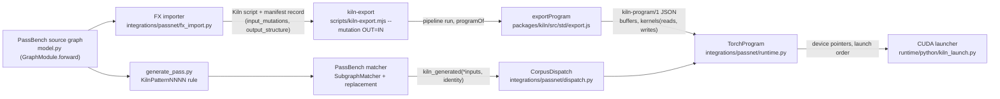
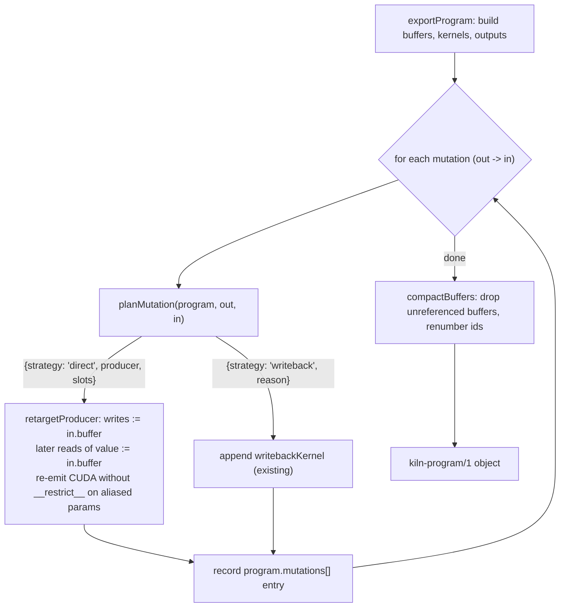

# Direct writes of mutated inputs: analysis, design and implementation guide

## 1. Executive summary

Some PyTorch graphs update one of their inputs in place: `x.relu_()`, `x += y`, `F.silu(x, inplace=True)`. When Kiln compiles such a graph for PassBench, the compiled program must perform that update itself, because PassBench wraps every tensor a replacement sees in a subclass that refuses all tensor operations except factories. Since commit 2be8918, Kiln does this with a **write-back kernel**. The exporter appends one copy kernel at the end of the program, `k_writeback__<hash>`, which copies the computed value from its scratch buffer into the input's own storage. The program's output for that mutation is then the input tensor itself.

The write-back is correct because it is the last launch: nothing can read the input after it overwrites it. It also costs something. Each mutated input adds one kernel launch, one full read of the value, one full write of the input, and one scratch allocation the size of the input. This guide designs the optimization that removes that cost. The **producer kernel**, the kernel that computes the new value, writes directly into the input's buffer whenever a static proof shows that no later launch reads the input's original contents and that the producer itself reads only the element it is about to overwrite.

This guide also covers a related failure that blocks one family of the same input-mutation wave. Family 162 (the jina reranker) never reaches Kiln's code because PassBench cannot construct its rule. The pattern contains an in-place call whose result is unused, and the matcher rejects any pattern with a node that has no users. An experiment for this guide found a second, independent blocker: the pattern and TorchDynamo spell `x.__eq__(0)` differently. Both fixes are designed here, and each was checked on CPU.

The design is staged as follows:

- **Existing behavior.** The write-back kernel is appended for every mutation (`packages/kiln/src/std/export.js:37-47`, `:98-105`). It is CUDA-only.
- **First implementation slice.** A launch-order and same-index analysis decides, for each mutation, whether the producer can write in place. When the analysis succeeds, the exporter retargets the producer, emits its CUDA without `__restrict__` on the aliased parameters, and drops the write-back. When it fails, the exporter keeps the write-back and records why. A CPU oracle executes the exported program with real buffer aliasing.
- **Family 162.** Kept in-place results are returned as extra pattern outputs, and the target's `__eq__` spelling is canonicalized.
- **Deferred design.** Deferred items are row-level in-place proofs (`x - mean(x)` in one kernel), tiled and multi-store kernels, WGSL in-place bindings, and harness-side input resets for accumulating families.

All of this work except the final acceptance run can be built and tested on a CPU-only machine. Section 10.4 explains exactly which parts need a GPU and why.

## 2. Problem statement and scope

### 2.1 The problem

Consider family 49, whose source graph calls `relu_` on an input. The compiled Kiln program for it today has this shape (from `scripts/04-kernel-reads-of-mutated-input.mjs`, described in Section 4.6):

```text
x is buffer 0
  0 k_y__...          reads [*0]   writes 1     (mean of relu(x), recomputes relu)
  1 k___mut0__...     reads [*0]   writes 2     (relu(x) -> scratch buffer 2)
  2 k_writeback__...  reads [2]    writes *0    (copy buffer 2 into x)
```

Kernel 2 exists only to move data that kernel 1 could have written to buffer 0 in the first place. For an input of n elements of b bytes, it adds one launch, n·b bytes read and n·b bytes written. The scratch buffer 2 also costs n·b bytes of device memory on every call. On the small subgraphs PassBench measures, launch overhead is often a large share of the total time, so one extra launch per mutation is a measurable cost.

### 2.2 Scope

This guide covers:

1. The analysis that decides whether a mutation's producer may write directly into the input buffer, both across launches (launch order) and within one kernel (same-index access).
2. The rewrite of the exported kiln-program/1 object when the analysis succeeds, including CUDA emission without `__restrict__` and buffer compaction.
3. A CPU test oracle that executes exported programs with aliasing.
4. The family 162 pattern fix (unused in-place results) and the `__eq__` spelling fix.
5. The validation plan, with the CPU/GPU split stated explicitly.

It does not cover:

- Changing PassBench. The shared-input limit (Section 4.8) is a property of the harness, and this guide only documents how to report it.
- In-place writes for intermediates that are not program inputs. Kiln already allocates those freely.
- WebGPU in-place execution. The write-back is CUDA-only today, and the direct write stays CUDA-only (Decision 7.5).

## 3. System orientation

This section defines the parts of the system a reader needs before the analysis makes sense. It follows one example, `x += y; out = x * 2`, from PyTorch source to GPU launch.

### 3.1 The pipeline in one picture



The figure has two paths. The compile path (A→B→C→D) turns a source graph into a kiln-program/1 artifact ahead of time. The match path (A→G→H→I→E) runs inside PassBench: a generated rule finds the subgraph in TorchDynamo's graph and replaces it with a call into `CorpusDispatch`, which selects the precompiled artifact by input metadata and launches it.

### 3.2 Terms

**Input mutation.** An in-place operation in the source graph whose target is a graph input. The importer records it as `{'input_index': i, 'output': '__mut<i>'}` (`fx_import.py:735`) and adds an extra program output `__mut<i>` that holds the new value (`fx_import.py:736`). The importer accepts a mutation only when the input has exactly one use, the in-place call itself (`fx_import.py:644`). Any other read of the input in the compiled program therefore comes from Kiln's fusion, which recomputes values inside consumer kernels, and never from the source graph.

**In-place rebinding.** An in-place call on a fresh intermediate value (one that no view aliases) is not an input mutation. The importer rebinds every name of that storage to the new value (`fx_import.py:713-718`). Family 162's `masked_fill_` is of this kind.

**kiln-program/1.** The export format, defined in `export.js` (`PROGRAM_FORMAT`, line 8). It is a JSON object with `inputs`, `outputs`, `buffers` and `kernels`. Each buffer has a dense integer `id` equal to its index. Each kernel record lists `reads`, the buffer id bound to each source parameter in order, and `writes`, the one buffer it stores to. Kernels appear in launch order. The CUDA launcher runs them in that order on one stream, passing `reads + [writes]` as the argument pointers (`kiln_launch.py:401-405`), so launch order is execution order.

**Producer kernel.** For a mutation whose value lives in buffer `b_v`, the producer is the unique kernel with `writes == b_v`. Every non-input buffer is written by exactly one kernel, because `exportProgram` allocates a fresh buffer per kernel (`export.js:74`).

**Write-back kernel.** The copy kernel `writebackKernel(from, to)` builds (`export.js:37-47`): `dst[e] = src0[e]` over all elements, thread-mapped, 256 threads per block.

**Loop IR (Kernel IR).** The per-kernel program Kiln emits CUDA, WGSL and a simulator from. Each kernel's `K` has `params` (role `in` or `out`), `grid`, `block` and a `body` of statements: `let`, `iset`, `load {buf, idx, n}`, `store {buf: "out", idx, e}`, `sload`/`sstore` (shared memory), `sync`, `for` and `if` (`emit.js:71-85`). A `load` with `buf: j` reads source parameter j, which `reads[j]` binds to a program buffer.

**Launch-order proof.** The argument that no kernel launched after the producer reads the input's buffer. If that holds, overwriting the input during the producer's launch cannot change what any later launch reads.

**Same-index access.** Inside the producer, every load from the input reads exactly the element that the same thread then stores. If a kernel reads `x[i']` for some `i' != i` while writing `x[i]`, another thread may already have overwritten `x[i']`.

**PosionDispatchTensor.** PassBench's tensor subclass (`pass_bench/torch/posion_dispatch_tensor.py:48`, spelled this way upstream). Its `__torch_dispatch__` admits creation operators (`empty_like`, `empty`, `zeros`, `ones`, `full` and their `_like` forms), `lift_fresh`, `alias`, `_to_copy` and metadata queries (lines 69-131), and raises `RuntimeError` for every other operator (134-136). A replacement therefore cannot call `copy_`, which is why the program writes the input itself.

### 3.3 The running example, end to end

Source graph (as Kiln's test case encodes it):

```python
def forward(self, x, y):
    x += y          # input mutation of x
    return x * 2
```

The importer emits a Kiln script with two outputs, `out0 = s * 2` and `__mut0 = s`, where `s = x + y`. The manifest record has `input_mutations: [{'input_index': 0, 'output': '__mut0'}]`. `corpus.compile_task` turns that record into `--mutation __mut0=v0` (`corpus.py:176-178`). The exporter currently produces:

```text
x is buffer 0, y is buffer 1
  0 k___mut0   reads [*0, 1]   writes 2      s = x + y
  1 k_out      reads [2]       writes 3      out = s * 2
  2 k_writeback reads [2]      writes *0     x <- s
outputs: out -> 3, __mut0 -> 0
```

At run time `TorchProgram.__call__` binds each input tensor's `data_ptr()` to its buffer and reuses that tensor for any output whose buffer is an input buffer (`runtime.py:32-43`). `__mut0` therefore comes back as the caller's own `x` tensor. `CorpusDispatch.__call__` asserts `outputs['__mut0'] is inputs[0]` (`dispatch.py:82-84`) and rebuilds the source's output structure, in which the mutated value appears as `{'input_alias': 0}`.

With the direct write designed here, the same program becomes:

```text
  0 k___mut0__inplace reads [*0, 1]  writes *0   x <- x + y   (same-index, no __restrict__)
  1 k_out             reads [*0]     writes 2    out = x * 2
outputs: out -> 2, __mut0 -> 0
```

One launch, 2·n·b bytes of traffic and one scratch buffer are gone. Kernel 1 now reads the updated x, which is the value it needs.

## 4. Current-state analysis

### 4.1 Importer: where a mutation is recognized

`Context.require_mutation_source(source, name)` (`fx_import.py:640-646`) is the gate for every in-place lowering (call sites at `fx_import.py:58, 66, 74, 110, 129, 156, 204`). It accepts two cases:

```python
if source in self.inputs and self.uses.get(source) == 1: return source          # input mutation
if source is not None and source in self.fresh and self.root(source) not in self.aliased: return source  # rebinding
raise ValueError(f'{name}: in-place operation requires a fresh unaliased producer or a single-use input')
```

The graph walk then splits the two cases (`fx_import.py:709-718`). An input mutation records `input_mutations[index] = var` and `output_alias_values[var] = index`. A rebinding sets `ctx.roots[name] = root` and rebinds every FX name with that root to the new Kiln variable. When outputs are flattened, a value that is a mutated input becomes `{'input_alias': index}` rather than a program output (`fx_import.py:732`), and each mutation adds a `__mut<i>` output (`fx_import.py:735-736`).

Two consequences matter for the design. The input's only FX use is the in-place call, so after import the original input value is semantically dead once the new value exists. Any later kernel that reads the input buffer is a Kiln fusion artifact: a consumer that recomputes the producer's expression from x instead of reading the producer's buffer. The second consequence is that a non-mutation output never names the mutated value directly, because it would have been turned into an `input_alias`.

### 4.2 Corpus: dead code and the compile command

`corpus.eliminate_dead_code(graph)` (`corpus.py:97-114`) removes FX nodes that do not reach the output. It keeps an in-place call with an unused result when the call updates a placeholder or a value read later (line 113). `compile_task` passes one `--mutation OUT=IN` per record (`corpus.py:176-178`), where IN is the Kiln input variable name at `input_index`.

### 4.3 Export: the write-back kernel

`exportProgram(run, prog, { …, mutations = {} })` (`export.js:49`) builds buffers and kernels in launch order (`63-84`) and checks the 32-bit index limits (`85-93`). It then handles mutations (`98-105`):

```js
for (const [outName, inName] of Object.entries(mutations)) {
  const o = outputs.find((x) => x.name === outName), i = inputs.find((x) => x.name === inName);
  // … existence and type checks (100-101)
  if (o.buffer === i.buffer) continue;        // value already lives in the input (no kernel computed it)
  kernels.push(writebackKernel(o, i));        // copy o.buffer -> i.buffer, appended last
  o.buffer = i.buffer;                        // the output *is* the input
}
```

The comment at `export.js:34-36` states the safety argument: "Every read of the original value is an earlier launch, so the write cannot race." That argument holds because the write-back is appended after every other kernel. The write-back record carries `wgslUnavailable: "input mutation write-back is emitted for CUDA only"` (`export.js:46`), so a mutated program runs only on CUDA.

Only `o.buffer` is re-pointed. Kernels that read the value read the scratch buffer, which is correct for write-back because the scratch buffer still holds the value.

### 4.4 Runtime: binding and launch

`TorchProgram.__call__` (`runtime.py:26-51`) binds the caller's input tensors by pointer (`36-37`). For each output, it reuses the input tensor when the output's buffer is an input buffer, and otherwise allocates (`39-43`). It allocates a fresh `uint8` tensor for every scratch buffer (`44-49`). The launcher's scratch set is "every buffer that is neither an input nor an output nor a constant" (`kiln_launch.py:351-352`). Launches run in kernel order with `reads + [writes]` as arguments (`kiln_launch.py:401-405`). An unreferenced buffer would still be allocated, and the launcher refuses to run if any buffer lacks a pointer (`kiln_launch.py:392-395`).

### 4.5 CUDA emission: `__restrict__`

Every emitted kernel is declared with restricted pointers (`emit.js:64`):

```c
extern "C" __global__ void __launch_bounds__(B) name(const float* __restrict__ src0, …, float* __restrict__ dst)
```

The write-back kernel uses the same qualifiers (`export.js:40`). `__restrict__` promises the compiler that the object behind one pointer is accessed through no other pointer for the kernel's duration. `const … __restrict__` additionally lets the compiler route loads through the non-coherent read-only data path. Binding the same buffer to `src0` and `dst` breaks both promises. The kernel's behavior is then undefined even when each thread reads and writes only its own element. An in-place kernel must be emitted without `__restrict__` on the aliased pair.

### 4.6 What the producer's kernel list looks like (CPU measurement)

`scripts/04-kernel-reads-of-mutated-input.mjs` exports four small programs through the real pipeline (target `rtx5090`) and prints each kernel's buffers, marking the input with `*`:

| Case | Kernels (reads → writes) | Direct write possible? |
|---|---|---|
| `y = mean(relu(x)); x.relu_()` | 0: `[*0]→1` (mean recomputes relu); 1: `[*0]→2` producer; 2: write-back | Yes. The only other reader of x is kernel 0, launched before the producer. |
| `x += y; out = x*2` | 0: `[*0,1]→2` producer; 1: `[2]→3`; 2: write-back | Yes. The producer's loads and store use the same index. |
| `x += y; out = softmax(x)` | 0: `[*0,1]→2` producer; 1: `[2]→3`; 2: write-back | Yes, for the same reason. |
| `x ← x − mean(x, -1)` | 0: `[*0]→1` fused reduce+elementwise producer; 1: write-back | No. The producer reads the whole row. |

The CUDA of the second case's producer shows the same-index property directly:

```c
in0 = src0[((e % 8) + (8 * (e / 8)))];
in1 = src1[((e % 8) + (8 * (e / 8)))];
v0 = (in0 + in1);
dst[((e % 8) + (8 * (e / 8)))] = v0;
```

The fourth case's producer is the in-kernel hazard:

```c
for (int r0 = 0; r0 < 8; r0 += 1) { in1 = src0[((8 * (e / 8)) + r0)]; acc0 = (acc0 + in1); }   // whole row
v0 = (0.125f * acc0);
in0 = src0[((e % 8) + (8 * (e / 8)))];
dst[((e % 8) + (8 * (e / 8)))] = (in0 - v0);                                                  // own element
```

Thread e reads every element of its row and writes only element e. If dst were src0, a thread in a different warp of the same row could store its result before thread e finished the reduction, and thread e would sum a mix of old and new values.

### 4.7 The CPU simulator does not detect intra-block races

Kiln's SIMT simulator runs "one block at a time in lockstep: every statement executes for all active threads before the next one" (`emit.js:171-173`). In the fourth case, every thread's loop of loads completes before any thread stores. A simulated in-place run would therefore produce the correct answer while the real kernel races. The simulator is a valid oracle for cross-block and cross-launch hazards, because blocks run one after another, but it cannot prove intra-block safety. The design therefore relies on a static rule, and the simulator only checks it (Section 10).

### 4.8 GPU evidence from KILN-005

KILN-005 reference 50 records the write-back replay: 8 of 14 input-mutation families and 90 of 126 graphs accepted, against 0 of 12 when the dispatcher called `copy_`. The idempotent and contractive mutations pass: clamp (45), `relu_` (49, 134, 161, 196) and `silu_` (92, 96, 131).

The accumulating families cannot pass under any faithful replacement. `pass_bench/torch/test_compiler.py::test_single_model` (lines 240-298) builds one `input_dict` (line 242) and passes it first to the compiled model (warmup plus trials, lines 260-269) and then to the eager model (293-297). For `x ← x + y; out = f(x)` with N calls per phase, the compiled output is `f(x0 + N·y)` and the eager output is `f(x0 + 2N·y)`. Reference 50 names families 94, 111, 172 and 176. This investigation confirmed a fifth, family 57 (CCNet, `in_3 += einsum(...)`; composed-ops replay `sources/composed-ops-replay-gpu-v1/results-audit.json`): all 6 graphs execute, none is accepted, and the log shows max_diff 0.248. A direct write cannot change these results, because it produces the same values as the write-back.

Family 162 appears in `sources/tf32-rne-requal-gpu-v1/results-audit.json` with 6 graphs, all `eager_fail`, and 0 accepted. Every benchmark log has:

```text
[PassMgrBackend] Pass KilnPattern0000 CRASHED with error: SubgraphMatcher cannot be initialized with an pattern with dead code
```

Kiln compiled all six programs (`compile.log`: return code 0), so the failure happens before any Kiln code runs.

### 4.9 Family 162: two matcher blockers (CPU measurement)

The source is:

```python
tmp_1 = in_1.cumsum(-1)
tmp_2 = tmp_1 - 1
tmp_3 = in_0.__eq__(0)
tmp_4 = tmp_2.masked_fill_(tmp_3, 1);  tmp_3 = tmp_4 = None
tmp_5 = tmp_2.unsqueeze(0)
… tmp_7 = tmp_6.to(device(type='cuda', index=0)) … tmp_13 = tmp_12 - 9
return (tmp_13, tmp_7)
```

`generate_pass.drop_dead_statements` (`generate_pass.py:36-62`) keeps the `masked_fill_` statement because its receiver `tmp_2` is live (lines 55-61), but `tmp_4` is not returned. The installed `torch.fx` `SubgraphMatcher.__init__` raises for any node that has no users and for which `node.is_impure()` is false. `Node.is_impure` returns False for every `call_method` node. The kept statement is therefore "dead code" to the matcher.

`scripts/01-reproduce-162-dead-code-pattern.py` reproduces the evaluator's error on CPU. With `--return-inplace`, which appends `tmp_4` to the returns, the matcher is constructed (`returns (node indices): [14, 8, 5]`). `scripts/02-dynamo-capture-162.py --meta-device` shows TorchDynamo keeps `%tmp_4 : [num_users=0] = call_method[target=masked_fill_]` in the target graph. `scripts/03-match-fixed-162-pattern.py` then found the second blocker: the fixed pattern still matched 0 times. The symbolically traced pattern records `in_0.__eq__(0)` as `call_function operator.eq`, while TorchDynamo records `call_method __eq__`. After rewriting the target's `__eq__` to `operator.eq` (`--canonical-eq`), the matcher finds exactly one match with returning nodes `['tmp_13', 'tmp_7', 'tmp_4']`. `fx_normalize.canonicalize_spellings` (`fx_normalize.py:49-58`) handles only one-argument `sigmoid` and `tanh`, so it does not cover this case.

## 5. Gap analysis

| Concern | Today | Needed |
|---|---|---|
| Launch count per mutation | +1 (write-back) | +0 when provable |
| Traffic per mutation | +2·n·b bytes | 0 when provable |
| Scratch memory per mutation | n·b bytes, allocated each call | none (buffer removed) |
| Safety argument | a code comment (`export.js:34-36`), true by construction | an explicit, tested analysis with a recorded reason when it refuses |
| In-kernel aliasing | never occurs | detected; refused unless same-index; `__restrict__` dropped on aliased pairs |
| CPU validation of the exported program | none (`endToEnd` checks the IR, `kiln-export.mjs:99`, before export) | an oracle that runs the exported kernels in launch order with shared buffers |
| Family 162 | matcher constructor raises | pattern returns kept in-place results; target `__eq__` canonicalized; output structures carry the extra value |

## 6. Proposed architecture and APIs

### 6.1 Where the change lives

Direct writes are a transformation of the exported program, applied inside `exportProgram` after kernels and outputs are built and before the mutation loop appends write-backs. It needs exactly the information that step already has: kernels in launch order with their `reads` and `writes`, each kernel's Loop IR `K`, and the input and output records. No pipeline pass, importer change or runtime change is required. The runtime already handles a kernel whose `writes` is an input buffer, and an output whose buffer is an input buffer.



### 6.2 New and changed APIs

All signatures are proposals for the first implementation slice.

**`planMutation(kernels, outputs, inputs, { outName, inName }) → MutationPlan`** (new, `packages/kiln/src/std/export.js` or a new `packages/kiln/src/std/inplace.js`).

```ts
type MutationPlan =
  | { strategy: "direct"; producer: number; slots: number[] }      // kernel index; source slots that read the input
  | { strategy: "writeback"; reason: string };                      // why direct was refused
```

It is a pure function over the export's own records. It never mutates them, so it can be unit-tested and called in report-only mode.

**`sameIndexSlots(K, slots) → { ok: true } | { ok: false, reason }`** (new). This is the in-kernel proof over Loop IR (Section 8.2). It uses the existing `IX.keyOf` and `IX.loadsOf` (`packages/kiln/src/core/ix.js`).

**`toCuda(K, { alias = [] } = {})`** (changed, `packages/kiln/src/std/emit.js:28`). `alias` lists the source parameter indices that share storage with `dst`. Those parameters and `dst` are declared without `__restrict__`, and the aliased sources without `const`. The default output is byte-identical to today's, so existing kernels and their identities do not change.

**`compactBuffers(program) → program`** (new). It removes buffers that no kernel reads or writes and that no input or output names, and renumbers the remaining ids densely. The launchers index pointers by id (`kiln_launch.py:353`, `ptrs[b["id"]]`), so ids must stay equal to positions.

**`exportProgram(run, prog, { …, mutations, mutationStrategy = "auto" })`** (changed). `"auto"` uses the plan, and `"writeback"` forces the existing path for A/B measurement and for bisecting a suspected aliasing bug. The CLI exposes it as `kiln-export --mutation-strategy auto|writeback` (`scripts/kiln-export.mjs`).

**kiln-program/1 additions** (backward-readable by both launchers, which ignore unknown fields):

```jsonc
{
  "kernels": [
    { "name": "k___mut0__<identity>", "identity": "<identity of the in-place variant>",
      "reads": [0, 1], "writes": 0,            // writes an input buffer
      "inPlace": { "input": "v0", "slots": [0] },
      "wgslUnavailable": "in-place input write is emitted for CUDA only", "cuda": "…" }
  ],
  "mutations": [
    { "output": "__mut0", "input": "v0", "strategy": "direct", "producer": 0 },
    { "output": "__mut1", "input": "v3", "strategy": "writeback", "reason": "kernel 2 reads v3 after producer 1" }
  ]
}
```

`program.mutations` makes the decision visible in every artifact. A reviewer can see from the JSON alone why a mutation kept its write-back.

**Family 162 APIs** (Python, `integrations/passnet`):

- `generate_pass.drop_dead_statements(function) → list[str]` (changed). It keeps its current behavior and also returns the names of kept in-place statements whose results are unused. `extract_pattern` appends those names to the pattern's return tuple, in statement order.
- `corpus.expose_inplace_results(graph) → list[Node]` (new, called by `translate_graph` right after `eliminate_dead_code`). It appends the same kept, unused in-place nodes to the FX output tuple, in graph order, so that `import_graph` produces an `output_structure` with one leaf per pattern return.
- `fx_normalize.canonicalize_spellings` (changed). It also rewrites `call_method __eq__` (and the other binary dunder comparisons that symbolic tracing records as `operator.*`) to the `call_function operator.*` spelling, on target graphs.

### 6.3 What does not change

- The importer's mutation rules (`require_mutation_source`) do not change.
- `CorpusDispatch` does not change. It still asserts `outputs[out] is inputs[i]`, which holds for both strategies, because the output's buffer is the input's buffer either way.
- `TorchProgram` does not change. It already reuses input tensors for outputs on input buffers (`runtime.py:40-42`).
- The write-back kernel stays. It is the fallback for every mutation the analysis cannot prove.

## 7. Decision records

### Decision 7.1: Prove at export time, over kiln-program/1, not in the fusion pipeline

- **Context:** The direct write needs launch order and per-kernel buffer bindings. These exist only once `programOf` has ordered the kernels and `exportProgram` has assigned buffers.
- **Options considered:** (a) A pipeline pass that marks the producer node as in-place before scheduling. (b) An analysis over the exported program's `kernels[].reads/writes` and `K`. (c) Asking the fusion pass to avoid recomputing from mutated inputs.
- **Decision:** (b).
- **Rationale:** The proof's premises are facts about the exported artifact, and the artifact is what runs. The analysis stays local to one function, which can be tested against fixed kernel lists. Option (a) would have to predict the scheduler's order. Option (c) changes fusion decisions for a benefit that (b) obtains without them.
- **Consequences:** A mutation whose producer is followed by a recomputing reader keeps its write-back even when a different schedule would have allowed a direct write. Phase 5 measurement shows how often this happens.
- **Status:** proposed

### Decision 7.2: Accept only structurally equal load/store indices in the first slice

- **Context:** A same-index proof in general requires reasoning about index expressions, loops, barriers and thread mapping (Section 4.6, fourth case).
- **Options considered:** (a) Structural equality of the `idx` expression of every load from an aliased slot and the single store, in the same statement list, with the load first. (b) Symbolic proof that the load and store index functions coincide per (block, thread, iteration). (c) Row-level proofs with `__syncthreads()` (a block owns a row and all reads precede a barrier before all writes).
- **Decision:** (a), with (b) and (c) deferred.
- **Rationale:** (a) covers every elementwise producer measured so far (Section 4.6, cases 1-3) and is easy to verify. A false negative only costs the write-back. A false positive corrupts results, so the rule must be conservative.
- **Consequences:** Fused reduce-then-elementwise producers keep the write-back. The rule must compare index expressions after the IR's own normalization (`IX`), not as printed strings.
- **Status:** proposed

### Decision 7.3: Drop `__restrict__` on the aliased pair instead of keeping the measured source

- **Context:** `export.js:23` notes that the exported CUDA "is otherwise exactly what the workbench measured". An in-place kernel binds one buffer to a `const __restrict__` source and to the `__restrict__` destination.
- **Options considered:** (a) Keep the source byte-identical and rely on same-index access being benign in practice. (b) Re-emit with `toCuda(K, { alias })`, removing `__restrict__` (and `const`) on the aliased parameters only. (c) Merge the aliased source into `dst` (load from `dst`), changing the kernel signature.
- **Decision:** (b).
- **Rationale:** (a) is undefined behavior under the CUDA programming model, and the read-only cache path makes it unsafe in principle. (c) changes the kernel's parameter list and therefore the launcher's argument contract (`reads + [writes]`). (b) keeps the signature and changes only qualifiers.
- **Consequences:** The in-place variant is a different executable, so it gets a distinct identity (Decision 7.4). Unaliased parameters keep `__restrict__`. Its performance must be measured rather than inherited from the measured kernel.
- **Status:** proposed

### Decision 7.4: Give the in-place variant its own identity

- **Context:** Kernel identity ties an exported kernel to its performance and correctness records (`exportedName`, `export.js:21`; `programOf`, `program.js:38`).
- **Options considered:** (a) Reuse the producer's identity. (b) Use `hash(identity + "|inplace:" + slots.join(","))`.
- **Decision:** (b).
- **Rationale:** Records keyed by identity describe the exact source. Sharing an identity between two sources would attach the measurements of one to the other.
- **Consequences:** Profiler symbols change for in-place kernels, which is the purpose. `inPlace` in the kernel record keeps the relation to the original computation readable.
- **Status:** proposed

### Decision 7.5: CUDA only

- **Context:** WGSL binds sources as `var<storage, read>` and the output as `var<storage, read_write>` (`emit.js:137-138`). WebGPU rejects a bind group in which one buffer is bound writable together with another binding of the same buffer in one dispatch. The write-back itself is already CUDA-only (`export.js:46`).
- **Options considered:** (a) Mark in-place kernels `wgslUnavailable`. (b) Emit a WGSL variant with a single `read_write` binding for the aliased pair.
- **Decision:** (a).
- **Rationale:** Mutated programs are CUDA-only today, so (a) loses nothing. (b) needs a different binding layout in `runtime/webgpu/launch.ts:90`.
- **Consequences:** A WebGPU consumer of a mutated program is no worse off than today.
- **Status:** proposed

### Decision 7.6: Refuse when another output names the value buffer

- **Context:** After the importer's `input_alias` handling (`fx_import.py:732`), a non-mutation output on the value buffer means the source returned a tensor that equals the new value but is distinct storage in PyTorch.
- **Options considered:** (a) Re-point that output to the input buffer too. (b) Keep the write-back for that mutation.
- **Decision:** (b).
- **Rationale:** (a) would return the caller's input tensor where PyTorch returns a fresh tensor. That aliasing difference is visible to any caller that mutates one of them.
- **Consequences:** The case is rare and costs only the existing write-back.
- **Status:** proposed

### Decision 7.7: Return kept in-place results from the pattern, with a real output

- **Context:** The matcher rejects a pattern node without users (Section 4.9). The fixed pattern returns three values, so the replacement must return three, and `output_permutation` (`generate_pass.py:137-146`) requires the variant's returns to cover the same nodes.
- **Options considered:** (a) Append the kept result to the pattern's return tuple and to the traced source graph's output, so that Kiln exports a real third output. (b) Append it to the pattern only and return `None` for that slot through a new output-structure leaf kind. (c) Drop the in-place statement from the pattern and leave the target's `masked_fill_` node unmatched.
- **Decision:** (a).
- **Rationale:** (a) keeps the existing invariant that the pattern and the compiled program describe the same computation with the same returns. `output_permutation`, `reorder_outputs` and `restore_outputs` then work unchanged. (b) adds a new leaf kind to the manifest and the dispatcher for a value nobody reads. (c) would leave an in-place node outside the match that reads and updates a value the replacement has already consumed, which changes semantics.
- **Consequences:** The program writes one extra output, `tmp_4` (`[B,S]` int64 for family 162). Its cost is one extra store of a small tensor. The 162 target node `tmp_4` has no users, so the replacement value is discarded.
- **Status:** proposed

### Decision 7.8: Canonicalize `__eq__` on the target side

- **Context:** The pattern records `operator.eq`, TorchDynamo records `call_method __eq__`, and the match count is 0 until they agree (Section 4.9).
- **Options considered:** (a) Rewrite the target's `call_method __eq__` to `call_function operator.eq` in `fx_normalize`. (b) Rewrite the pattern text to `torch.eq(...)`. (c) Rewrite both sides to `torch.eq`.
- **Decision:** (a), extended to the binary comparison dunders that symbolic tracing maps to `operator.*`.
- **Rationale:** Kiln's target normalization already runs in the evaluator (`[kiln-normalized-fx/1] target normalization []` in every 162 log), and `canonicalize_spellings` is where the existing aliases live. Pattern text is extracted verbatim from the source model and should stay so.
- **Consequences:** Every family whose target graph contains `__eq__` and similar spellings now matches more readily. Script 658 must be rerun over the whole census to show that no rule starts matching a graph that belongs to a different rule.
- **Status:** proposed

## 8. Pseudocode and key flows

### 8.1 The launch-order proof

```text
planMutation(kernels, outputs, inputs, outName, inName):
  o  := output named outName;  i := input named inName
  bv := o.buffer;  bx := i.buffer
  if bv == bx:                          return writeback("value already in the input")   # existing `continue` case
  if bv is an input or constant buffer: return writeback("value is not computed by a kernel")   # e.g. x.copy_(y)
  p  := the unique index with kernels[p].writes == bv
  if any output other than o has buffer bv:
                                        return writeback("output <name> also holds the value")   # Decision 7.6
  if any q with kernels[q].writes == bx:
                                        return writeback("input already written by kernel q")    # e.g. an earlier mutation
  for q in p+1 .. len(kernels)-1:
    if bx in kernels[q].reads:          return writeback("kernel q reads <inName> after producer p")
  slots := [ j for j, b in enumerate(kernels[p].reads) if b == bx ]
  if slots nonempty:
    r := sameIndexSlots(kernels[p].K, slots)
    if not r.ok:                        return writeback(r.reason)
  return direct(producer = p, slots = slots)
```

The proof has two parts, and both are needed. Kernels before p may read the original x freely, because they finish before p starts (one stream, in order). Kernels after p must not read x as the original value. With the rewrite they read x as the new value, through the re-pointed reads of `bv`, which is what they need.

### 8.2 The same-index proof over Loop IR

```text
sameIndexSlots(K, slots):
  stores := all statements s in K.body (recursively) with s.s == "store"
  if len(stores) != 1:                  return fail("kernel has <n> stores")      # tiled/unrolled kernels
  st := stores[0];  block := the statement list that contains st
  for each load ld in K.body (recursively) with ld.buf in slots:
    if ld is not in `block`:            return fail("load from slot j in a different loop/branch than the store")
    if position(ld) > position(st):     return fail("load after store")
    if IX.keyOf(ld.idx) != IX.keyOf(st.idx): return fail("load index differs from store index")
  for each index expression e anywhere in K (load idx, store idx, iset, for bounds, if conditions):
    if any l in IX.loadsOf(e) has l.v.i in slots:
                                        return fail("slot j is read inside an index expression")   # gather through x
  return ok
```

Requiring that the load and the store share one statement list ensures they run under the same loop variables and the same branch condition. Index equality uses `IX.keyOf` (`packages/kiln/src/core/ix.js:126-132`), the canonical key of an index expression. The affine normalizer sorts sum terms by that key (`ix.js:60`), so two differently associated forms of the same affine sum compare equal. Expressions outside the affine algebra compare structurally, which can only fail closed. In the measured example both sides are `((e % 8) + (8 * (e / 8)))`. Data-dependent index terms are `LD` nodes (`ix.js:27`) that read an integer input at a computed offset. `IX.loadsOf` (`ix.js:29`) collects them, and the CUDA emitter spells them with `ldSpell` (`emit.js:31-37`). If such a load names an aliased slot, the kernel reads x at an index other than the one it stores.

Why one store suffices: a valid kernel never has two threads store the same element, otherwise the original program would race on `dst`. Each element of x is therefore written by exactly one (thread, iteration) pair. That pair reads the element before writing it, and no other pair reads it. Grid-stride loops are covered because the load and the store are in the same loop body.

### 8.3 The rewrite

```text
retargetProducer(program, plan, o, i):
  p := plan.producer;  bv := o.buffer;  bx := i.buffer
  kernels[p].writes := bx
  for q in p+1 .. : kernels[q].reads := [ (b == bv ? bx : b) for b in kernels[q].reads ]
  o.buffer := bx
  K := original Loop IR of kernel p
  kernels[p].identity := hash(kernels[p].identity + "|inplace:" + plan.slots)
  kernels[p].name     := cname(K.name) + "__" + kernels[p].identity
  kernels[p].cuda     := renameCuda(toCuda(K, { alias: plan.slots }), cname(K.name), kernels[p].name)
  kernels[p].wgsl     := null;  kernels[p].wgslUnavailable := "in-place input write is emitted for CUDA only"
  kernels[p].inPlace  := { input: i.name, slots: plan.slots }

exportProgram(...):
  ... build buffers, kernels, outputs (unchanged, export.js:50-97)
  for (outName, inName) in mutations:
    plan := (mutationStrategy == "writeback") ? writeback("forced") : planMutation(...)
    if plan.strategy == "direct": retargetProducer(program, plan, o, i)
    else if o.buffer != i.buffer: kernels.push(writebackKernel(o, i)); o.buffer := i.buffer
    program.mutations.push({ output: outName, input: inName, ...plan })
  compactBuffers(program)
```

Processing mutations in order and re-running `planMutation` on the updated records handles two mutations that share a value buffer. The first may go direct. The second then sees its value on an input buffer and falls back to a write-back, which correctly copies from the first input.

### 8.4 Run-time flow after the change

```mermaid
sequenceDiagram
  participant PB as PassBench replacement
  participant D as CorpusDispatch
  participant T as TorchProgram
  participant L as CUDA launcher
  PB->>D: kiln_generated(x, y, identity)
  D->>T: program(x, y)
  T->>T: pointers[x] = x.data_ptr(); out buffer 0 is an input buffer -> result['__mut0'] = x
  T->>L: launch(stream, scratch, x=…, y=…, out=…, __mut0=x.data_ptr())
  L->>L: k___mut0__inplace(src0=x, src1=y, dst=x)   x <- x + y
  L->>L: k_out(src0=x, dst=out)                      out <- 2x
  T-->>D: {'out': out, '__mut0': x}
  D->>D: assert outputs['__mut0'] is inputs[0]
  D-->>PB: restore_outputs(structure) -> out
```

### 8.5 Family 162 flow

```text
generate_pass.extract_pattern(source):
  … PreserveAdd, then
  kept_unused := drop_dead_statements(function)          # ['tmp_4'] for family 162
  return value := (tmp_13, tmp_7) + tuple(kept_unused)   # (tmp_13, tmp_7, tmp_4)
  … trace, key, returns = [14, 8, 5]

corpus.translate_graph(graph):
  traced := trace_module(model);  eliminate_dead_code(traced.graph)
  expose_inplace_results(traced.graph)                   # output node args += (masked_fill_,)
  … import_graph -> output_structure {'tuple': [out0, out1, out2]}; out2 is the filled tmp_2

fx_normalize.canonicalize_spellings(target):
  call_method __eq__(a, b)  ->  call_function operator.eq(a, b)
```

`expose_inplace_results` must select exactly the statements that `drop_dead_statements` keeps unused, in the same order. Otherwise `output_permutation` raises `Rule and variant return different values`. The AST rule (`generate_pass.py:55-61`) and the FX rule (`corpus.py:107-113`) already encode the same keep condition, and the new functions inherit it. A unit test must assert agreement over every graph in the census (Section 10.2).

## 9. Implementation phases

Each phase ends with a validated, committable state. Phases 1-4 need no GPU.

**Phase 0 (existing, commit 2be8918).** Write-back kernel, `--mutation`, dispatcher identity assertion. Nothing to do.

**Phase 1: Analysis in report-only mode.**
1. Implement `planMutation` and `sameIndexSlots` (with `IX.keyOf` and `IX.loadsOf`) in `packages/kiln/src/std/export.js` or a new `inplace.js`.
2. Call it in `exportProgram` and record `program.mutations[]` with the strategy it *would* choose, while still always appending the write-back.
3. Add unit tests over the four cases of Section 4.6 and over synthetic kernel lists (later reader, earlier writer, shared value buffer, other output on the value buffer, gather through x).
4. Recompile the input-mutation corpus on CPU (`kiln-export` runs on Node) and tabulate `direct` and `writeback` decisions with their reasons. This table predicts Phase 5's benefit before any GPU time is spent.

**Phase 2: CPU program oracle.**
1. Add `simulateProgram(program, inputs)` in `packages/kiln/src/std/program.js`. It executes the exported kernels in launch order with `toSim`, over one shared buffer table indexed by buffer id, so aliasing is real.
2. In instrumented mode, record per (block, thread) the addresses each kernel loads from and stores to the aliased buffer, and fail if any address loaded by one thread is stored by another. This dynamic check catches intra-block races that lockstep execution hides (Section 4.7).
3. Compare the oracle's outputs, including the mutated input, with `g.eval` on the same inputs for every mutation test case.

**Phase 3: The rewrite.**
1. Add `toCuda(K, { alias })` with a byte-identity test for `alias = []`.
2. Implement `retargetProducer`, `compactBuffers` and `mutationStrategy`, plus `--mutation-strategy` in `scripts/kiln-export.mjs`.
3. Extend `packages/kiln/test/export.mjs`. Direct cases must have no `k_writeback__`, the producer must write the input buffer, later reads must be re-pointed, no unreferenced buffer may remain, and the in-place CUDA must have no `__restrict__` on the aliased pair while keeping it on the other parameters. Refused cases must keep the write-back with the expected reason.
4. Run the Phase 2 oracle on every test case and over the full input-mutation corpus.

**Phase 4: Family 162 matcher fixes.**
1. `drop_dead_statements` returns the kept unused in-place names, and `extract_pattern` appends them to the return.
2. `corpus.expose_inplace_results` is called in `translate_graph`.
3. `fx_normalize.canonicalize_spellings` gains the binary comparison spellings.
4. Add tests in `integrations/passnet/test_pass_generation.py` (pattern returns the kept result; matcher constructs), in `test_fx_import.py` (output structure has the extra leaf), and an agreement test between the AST and FX keep rules.
5. Rerun KILN-005 script 658 over the census to confirm that every graph still selects its own rule exactly once, with family 162 now included. Graphs that call `.to(cuda)` need either a CUDA host for capture or the `--meta-device` substitution used in `scripts/02`/`03` (structure only).

**Phase 5: GPU acceptance and measurement.**
1. Replay the 14 input-mutation families and family 162 with the original evaluator, with `--mutation-strategy auto`.
2. Expected results: acceptance unchanged for the 8 accepted families, the 5 accumulating families (57, 94, 111, 172, 176) still failing for the shared-input reason, and family 162 newly evaluated.
3. Measure per-graph GPU time with `auto` against `writeback` on the same host and record the launch count per program.

## 10. Test strategy

### 10.1 Unit tests (CPU, Node)

- `planMutation` is tested on synthetic kernel lists covering each refusal reason in Section 8.1 and on the four real cases of Section 4.6.
- `sameIndexSlots` is tested on Loop IR from real kernels: elementwise add (ok), fused mean-subtract (refused, "load index differs"), a row reduction (refused), a gather through an integer input (refused), and a two-store tiled kernel (refused).
- `toCuda(K)` must equal `toCuda(K, { alias: [] })` byte for byte over every kernel in `packages/kiln/test`.
- `compactBuffers` must leave ids dense, with every input, output, constant, read and write still referring to the same data.

### 10.2 Integration tests (CPU, Python)

- `test_dispatch.py` keeps its current contract test (`program` must return the input tensor).
- `test_pass_generation.py` covers the 162 source shape. The pattern must return the kept result, the matcher must construct, and `output_permutation` must equal the identity.
- An agreement test runs `drop_dead_statements` and `expose_inplace_results` over every census graph and requires the same kept names in the same order.

### 10.3 Program oracle (CPU)

`simulateProgram` runs on every exported mutation program in the corpus. For each, it compares outputs and the final input contents with the graph evaluation, and the instrumented hazard check must report no cross-thread read-after-write on an aliased buffer.

### 10.4 Can this be built CPU-only?

Yes, up to the final acceptance run. The reasons are specific:

- **Compilation is CPU code.** `kiln-export` is a Node program. The analysis and the rewrite transform its JSON output, and so does every check of buffers, kernels and CUDA text.
- **Correctness is checkable on CPU.** `endToEnd` already evaluates the IR on CPU (`kiln-export.mjs:99`). The Phase 2 oracle extends this to the exported program with real aliasing, and its instrumented mode supplies the intra-block hazard check that lockstep simulation alone lacks.
- **Rule selection is checkable on CPU.** Script 658 runs the upstream `SubgraphMatcher` with PassBench's settings over TorchDynamo graphs captured on meta tensors. This guide's scripts 01-03 used the same approach on this CPU-only host (`torch.cuda.is_available() == False`) to reproduce the 162 error and test both fixes.
- **The exception is device-literal graphs.** Graphs that call `.to(device('cuda'))` cannot be captured without a CUDA driver (`RuntimeError: Found no NVIDIA driver on your system`, script 02). Family 162 is one of them. On CPU the `--meta-device` substitution checks matcher structure only.
- **The GPU is needed only for the final steps.** It is needed to compile the CUDA source with NVRTC on the real architecture and observe that `__restrict__` removal compiles, to run PassBench's evaluator for acceptance, and to measure the time saved. PassBench acceptance is defined by its CUDA evaluator, so it cannot be claimed from CPU evidence.

### 10.5 GPU acceptance (Phase 5)

- PassBench replay of the 14 input-mutation families plus 162, with the KILN-005 audit format (`results-audit.json`).
- An A/B timing comparison of `auto` and `writeback` on the same host, with launch counts taken from the artifacts.

## 11. Risks, alternatives and open questions

### 11.1 Risks

- **A false positive in `sameIndexSlots` corrupts results silently.** Both the conservative rule and the instrumented oracle address this. Any widening of the rule (deferred row-level proofs) needs its own oracle cases.
- **Index equality may be too weak or too strong.** A too-weak equality, which fails to identify equal expressions, only refuses more often. A too-strong one, which treats unequal expressions as equal, is a correctness bug. `IX.keyOf` is a structural key over the normalized form, so it errs on the weak side. Do not replace it with a numeric sampling test.
- **Dropping `__restrict__` may slow the producer.** The kernel loses the read-only data path for the aliased source. Phase 5 must compare the direct variant against write-back, not assume a gain. The saving (one launch plus 2·n·b bytes) usually dominates for small elementwise producers, which is an inference that must be measured.
- **The spelling change may create new matches.** It can make a rule match a graph it did not match before. Script 658 over the census is the guard.
- **torch version drift.** The evaluator runs torch 2.12 (`compile_framework_version: 2.12.0a0`), and this host has 2.11. Whether `Node.is_impure` treats in-place `call_method` nodes as impure in 2.12 was not checked. If it does, the dead-code half of the 162 fix is harmless there but not required.

### 11.2 Alternatives considered and set aside

- **A dispatcher-side copy.** Refused by PassBench's dispatch subclass (Section 3.2). This is the reason for the current design.
- **Changing fusion so consumers never recompute from a mutated input.** This would let more mutations go direct, but it changes fusion decisions globally (Decision 7.1).
- **Always writing in place and relying on the simulator.** Unsafe, because lockstep simulation hides intra-block races (Section 4.7).

### 11.3 Deferred design

- **Row-level in-place proofs** for producers in which one block owns a row, all reads of the row precede a `__syncthreads()`, and all writes follow it. The fused `x - mean(x)` kernel has this shape only if the row-to-block mapping is guaranteed. In the measured kernel (TPB=1024 over a [4, 8] input), several rows share one block and each thread reduces its own row without a barrier.
- **Multi-store and tiled producers.** These need a per-store index proof.
- **WGSL in-place bindings** (Decision 7.5).
- **Harness-side input reset** for accumulating families. This is a PassBench change and outside Kiln.

### 11.4 Open questions

1. Should `mutationStrategy` default to `auto` immediately, or stay in report-only mode until Phase 5 timing shows a net gain on the measured hosts?
2. Is `IX.keyOf` equality canonical enough for every producer that should qualify? This was partly answered: `keyOf` exists and the affine normalizer sorts terms (`ix.js:45-60`). Whether every Loop IR load and store index passes through that normalizer before emission was not verified.
3. How many mutation programs in the corpus go `direct` under the first-slice rule? Phase 1's table answers this on CPU.
4. Does family 162 pass numerically once it matches? Its `cumsum` over int64 compiled (`compile.log` return code 0), but its outputs have not been compared on GPU. KILN-008 covers the scan primitive.

## 12. References

### Code

- `packages/kiln/src/std/export.js:8` defines `PROGRAM_FORMAT`; `:21` `exportedName`; `:24-28` `renameCuda`; `:34-47` `writebackKernel`; `:49-111` `exportProgram` (mutation loop at `:98-105`).
- `packages/kiln/src/std/emit.js:26` defines `CUDA_STORAGE`; `:28-90` `toCuda` (restrict qualifiers at `:64`, load/store emission at `:76-77`); `:137-138` WGSL bindings; `:171-174` the lockstep SIMT simulator.
- `packages/kiln/src/std/program.js:29-43` defines `programOf` (kernel identity at `:38`); `:130-135` `simulateFull`.
- `packages/kiln/test/export.mjs:85-96` is the write-back test.
- `scripts/kiln-export.mjs:51-55` is argument parsing (`--mutation`); `:97-106` the internal check and the export call.
- `integrations/passnet/fx_import.py:581-646` defines `Context` and `require_mutation_source`; `:663-740` `import_graph` (mutations at `:709-718`, outputs at `:727-740`).
- `integrations/passnet/corpus.py:43-94` defines `translate_graph`; `:97-114` `eliminate_dead_code`; `:163-186` `compile_task`.
- `integrations/passnet/generate_pass.py:29-33` defines `inplace_call`; `:36-62` `drop_dead_statements`; `:65-134` `extract_pattern`; `:137-157` `output_permutation`, `reorder_outputs`.
- `integrations/passnet/fx_normalize.py:41-58` handles spelling aliases; `:61-92` `normalize_arguments`; `:95-105` `trace_pattern`.
- `integrations/passnet/dispatch.py:74-85` is `CorpusDispatch.__call__`.
- `integrations/passnet/runtime.py:26-51` is `TorchProgram.__call__`.
- `integrations/passnet/test_dispatch.py` is the mutation contract test.
- `runtime/python/kiln_launch.py:314-405` covers CUDA program buffers, scratch and launch order.
- `runtime/webgpu/launch.ts:90` is the WebGPU bind group construction.

### Upstream PassBench (KILN-005 `sources/upstream/pass_bench/`)

- `torch/posion_dispatch_tensor.py:48-136` is the factory-only dispatch.
- `torch/test_compiler.py:240-298` is `test_single_model` (shared `input_dict`).

### Evidence

- KILN-005 `reference/50-input-mutation-replay-result-and-the-shared-input-limit.md` records the write-back replay, 8/14 families.
- KILN-005 `reference/24-implementation-diary-volume-2-pi-agents-and-compiler-optimization.md`, Step 257, records the write-back implementation.
- KILN-005 `sources/tf32-rne-requal-gpu-v1/results-audit.json` and `results/task-162/benchmark.log` record the family 162 matcher error.
- KILN-005 `sources/composed-ops-replay-gpu-v1/results-audit.json` and `results/task-057/benchmark.log` record family 57's shared-input failure.
- KILN-005 `scripts/658-simulate-pattern-dispatch-identity.py` is the CPU rule-selection simulation.
- This ticket's `scripts/01-reproduce-162-dead-code-pattern.py`, `02-dynamo-capture-162.py`, `03-match-fixed-162-pattern.py` and `04-kernel-reads-of-mutated-input.mjs` are the CPU experiments behind Sections 4.6 and 4.9.
