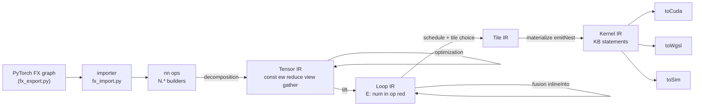

# Index values, factory ops and slice assignment: analysis, design and implementation guide

## 1. Executive summary

Kiln compiles a tensor program into GPU kernels by representing every kernel as one scalar expression over its output coordinates. Today those coordinates exist only as *addresses*: they appear inside the index expressions that say which element a load reads, but no scalar computation can use a coordinate as a *value*. PyTorch programs use coordinates as values constantly. `torch.arange(n)` is the coordinate itself; `meshgrid`, relative-position tables, causal masks and `argmax` are arithmetic on coordinates. Kiln currently works around the gap with small data tables (the cumsum mask reads a two-element table `[1, 0]`; concatenation reads a 0/1 mask tensor), and refuses the rest.

This guide designs one new Loop IR expression kind, the **index value** `E.ix(e, dtype)`, whose value is the integer index expression `e` evaluated at the current loop coordinates. On top of it, it designs a Tensor IR primitive `tensor.ixval` (a tensor whose element at coordinate `c` is `e(c)`), frontend factory ops (`arange`, typed `full`/`zeros`/`ones`, and `meshgrid` as broadcast views), a functional slice-assignment op `nn.assign` (`x[region] = y` as `select(in_region(c), y[clamp(c - offset)], x[c])`), and importer support for `operator.setitem` and in-place arithmetic on views. Three existing refusals become small lowerings: argmax as a reduction over an index-valued key with first-index tie-breaking, `is_causal=True` attention as `select(j <= i, s, -inf)`, and the cumsum mask without a data table.

The research found that the 17 corpus graphs blocked by `get_attr` are not constant-bearing graphs. Kiln's own symbolic tracer evaluates their input-independent factory code eagerly and stores the result as `_tensor_constant0` (up to 1,050,625 elements). TorchDynamo, which feeds the PassBench evaluator, keeps the factory calls as nodes. A prototype tracer that proxies the factory functions removes every `get_attr`, and the BEiT and ConViT tables were verified on CPU to equal closed-form coordinate expressions. Everything in this design except NVRTC compilation and PassBench replays can be built and validated on a CPU-only machine.

## 2. Problem statement and scope

### 2.1 Problems

The user's request lists four consumers of one design:

1. **BEiT-style relative-position families.** 17 graphs (three families: BEiT, ConViT, MPNet) fail import with `_tensor_constant0: unsupported FX node kind get_attr` (`integrations/passnet/fx_export.py:59-60`).
2. **Causal attention.** `scaled_dot_product_attention(..., is_causal=True)` is refused (`integrations/passnet/fx_compose.py:132-134`).
3. **`max(dim)[1]` / argmax.** The indices result of `torch.max(x, dim)` is bound to `None` (`integrations/passnet/fx_import.py:241`) and refused when used (`fx_import.py:270`).
4. **A simpler cumsum mask.** `nn.cumsum` decomposes through a view of a data constant `[1, 0]` indexed by a comparison (`packages/kiln/src/std/tensor.js:524-533`).

The user also asked whether these can be built CPU-only. Section 10.4 answers that explicitly.

### 2.2 Scope

In scope:

- The `E.ix` node through every Loop IR, Tile IR, Kernel IR and emitter stage.
- `tensor.ixval` and its reference semantics, view folding and lifting.
- Frontend ops `nn.arange`, typed splats (`N.full`, `N.zeros`, `N.ones`), `nn.assign`, `nn.argmax`, and the `N.*` builders.
- Importer: factory-preserving tracing, `torch.arange`, `torch.zeros/ones/full`, `full_like`, `new_zeros`, `meshgrid`, `operator.setitem`, in-place arithmetic on basic-index views, `contiguous` ownership, causal SDPA, argmax.
- Three latent bugs found during research that block integer factories (Section 4.3, 4.8).

Out of scope, owned elsewhere:

- Integer floor division and modulo on *data* values (KILN-011). Index values already have floor `/` and `%` by constants inside the IX algebra; KILN-011 is about tensor values.
- Fused attention kernels (KILN-007). This guide only supplies the causal mask expression they will reuse.
- Cumsum as a scan primitive (KILN-008). This guide only replaces the mask table in the current quadratic decomposition.
- Writing mutated inputs in place (KILN-009). `setitem` on a graph input produces an input mutation through the existing mechanism; how it is written back is KILN-009's design.
- PassBench pattern matching of factory regions (open question Q1).

## 3. System orientation

This section defines the terms the rest of the guide depends on, in dependency order, and follows one small program through the pipeline.

### 3.1 The pipeline

Kiln is a JavaScript compiler framework. A program is a graph of typed values; passes rewrite the graph from one dialect to the next. The dialects relevant here are:

| Dialect | Defined in | What a node means |
|---|---|---|
| `nn` (frontend, "Torch IR") | `packages/kiln/src/std/tensor.js:276-363` | A PyTorch-like op with a reference implementation (`eval`) and type rule (`infer`). Built with the `N.*` helpers (`tensor.js:409-466`). |
| `tensor` ("Tensor IR") | `tensor.js:365-375` | Five primitives: `const` (splat or data), `ew` (elementwise function), `reduce` (one axis), `view` (index map), `gather` (data-dependent index map). |
| `loop` ("Loop IR") | `packages/kiln/src/std/loop.js:276-286` | One kernel: a scalar expression over output coordinates, scheduled into a loop nest. |
| `tile` | `packages/kiln/src/std/tile.js` | The chosen GPU mapping (`MAP=thread`, `row` or `tiled`) and its knobs. |
| `kernel` ("Kernel IR") | `packages/kiln/src/std/kernel.js:357-366` | Threads, shared memory, syncs and flat addresses made explicit. |
| emitters | `packages/kiln/src/std/emit.js` | CUDA C++ (`toCuda`), WGSL (`toWgsl`) and a lockstep SIMT simulator in JS (`toSim`). |

The passes between them are decomposition (`nn` → `tensor`, `tensor.js:504-561`), optimization (`tensor.js:615`), lifting (`tensor` → `loop`, `loop.js:292-317`), fusion (`loop.js:321-411`), scheduling choice (`tile.js`), and materialization (`kernel.js:305-327`).



### 3.2 Index expressions (IX)

An **index expression** is an immutable integer expression built by `packages/kiln/src/core/ix.js`. Its leaves are constants `C(v)`, variables `V(name)` and a data-dependent leaf `LD(i, idx)` ("the integer stored in kernel input `i` at index `idx`", `ix.js:25-27`). Its operators are `+`, `*`, floor `/`, floor `%`, `min`, `max`, the comparisons `<`, `<=`, `==` (which evaluate to 0 or 1), and `&&`, `||` (`ix.js:3`, `106-115`). Every constructor simplifies: `add` and `mul` normalize to a sum of coefficient × term plus a constant (`ix.js:39-82`), and `/`, `%` by a positive constant cancel what divides exactly (`ix.js:83-105`).

The functions an implementer will use:

- `IX.subst(e, env)` replaces variables (`ix.js:151-158`).
- `IX.mapLoads(e, f)` and `IX.remapLoads(e, f)` rewrite or renumber data-dependent leaves (`ix.js:160-168`).
- `IX.evalIx(e, env)` evaluates with floor semantics (`ix.js:169-187`).
- `IX.interval(e, extent)` bounds `e` when each variable ranges over `[0, extent(v))` (`ix.js:189-216`).
- `IX.emit(e, lang, name, load)` spells `e` in `"c"`, `"wgsl"` or `"js"` (`ix.js:259-278`); `IX.toJs(e)` spells it with exact `evalIx` semantics (`ix.js:281-297`).
- `IxMap` is a list of index expressions over output coordinates `a0, a1, …`; it is what `tensor.view` carries (`ix.js:300-315`).

The **coordinate variables** of a kernel are `a0 … a{n-1}`, one per output axis. A **reduction variable** is a fresh name `r<k>` bound by one reduction (`loop.js:15`).

### 3.3 Loop IR expressions

A Loop IR kernel holds one expression `E` (`loop.js:50-64`). There are four kinds:

- `num`: a literal.
- `in` (built with `E.load(i, idx)`): input `i` read at index expressions `idx`.
- `op`: a scalar function from the table in `packages/kiln/src/std/fns.js` applied to sub-expressions.
- `red`: a reduction `E.red(fn, r, n, body)` binding variable `r` over `[0, n)`.

Expressions are **hash-consed**: `intern` (`loop.js:18-23`) returns the same frozen object for structurally equal expressions, keyed by `akey`, which renames bound reduction variables to de Bruijn distances so that two copies of the same reduction are one value (`loop.js:24-38`). `free(x)` returns the variables an expression depends on (`loop.js:40-49`). `schedule(expr, shape)` turns the expression into a loop nest and places every node at the outermost loop where all its free variables are bound, which is loop-invariant hoisting (`loop.js:96-159`).

### 3.4 Kernel IR and value types

The materializer walks the scheduled nest with `emitNest` (`kernel.js:49-67`) and writes statements into a `KB` builder (`kernel.js:20-38`). Statements include `let` (a float-expression temporary), `iset` (an integer index variable), `load`, `store`, shared loads and stores, `for` and `if`. Kernel IR *float expressions* are `{k:"num"}`, `{k:"var"}` and `{k:"op"}` only (`kernel.js:8`, `17`). `valueTypes` then assigns each named temporary a static type (`kernel.js:258-303`): a load takes its buffer's dtype, a typed function its declared result type, and integer arithmetic through an untyped (float) function is refused.

### 3.5 Typed scalar functions

`fns.js` holds one entry per scalar function, with its JS reference, CUDA spelling, WGSL spelling and flop count (`fns.js:17-63`). Typed integer functions (`add_i64`, `sub_i32`, `max_i64`, …) and comparisons (`eq_f32`, `lt_i64`, …) declare their operand and result dtypes (`fns.js:65-89`). Integer reducers such as `add_i64` and `min_i64` exist (`fns.js:93-104`). Integer values in references are BigInt for `i64` and numbers for `i32` and `bool`. PyTorch's type promotion is resolved into these names at the frontend by `resolveEw` (`tensor.js:213-227`).

### 3.6 New terms introduced by this design

- An **index value** is an integer (or bool) *scalar value* equal to an index expression evaluated at the current coordinates. It is to coordinates what a load is to memory: a leaf of the scalar expression.
- A **factory op** creates a tensor from shape and constants, without tensor inputs: `arange`, `zeros`, `full`, `meshgrid`.
- **Slice assignment** is `x[index] = y`. Kiln programs are functional, so it is represented as a new value `x'` equal to `x` outside the indexed **region** and to (broadcast) `y` inside it.

### 3.7 A small worked example

Consider `out = x + torch.arange(4)` with `x: f32[3, 4]`. With this design:

1. The importer emits `N.add(x, N.arange(0, 4, 1, "i64"))`.
2. `nn.arange` decomposes to `tensor.ixval({shape: [4], expr: a0, dtype: "i64"})`. Promotion makes the `add` an f32 add whose second operand is converted with `to_f32`.
3. Lifting gives two kernels: `E.ix(a0, "i64")` and `add(in0[a0, a1], to_f32(in1[a1]))`.
4. Fusion inlines the producer: the consumer's `in1[a1]` becomes `E.ix(a1, "i64")`. One kernel remains, with one load:

```text
for a0 in 0..3:  # free
    for a1 in 0..4:  # free
        in0 = load x[a0, a1]
        x0 = ix a1 : i64
        v0 = to_f32(x0)
        v1 = add(in0, v0)
        out[a0, a1] = v1
```

5. CUDA spells `x0` as `x0 = ((long long)((e % 4)));` after decoding the thread's flat index `e` (the decode of the last axis is `e % 4`, `kernel.js:41-46`). The simulator would spell it as JS arithmetic over the per-thread integer array `I_e[t]`, once it supports integer temporaries (Section 8.3).

The data table that arange would otherwise need never exists, and the cost model counts one load instead of two.

## 4. Current-state analysis (with evidence)

### 4.1 Coordinates are addresses only

Every place a coordinate variable appears today is an index position: `E.load` index expressions (`loop.js:52`), `write` statements (`loop.js:151`), `iset` statements and `if` conditions in Kernel IR (`kernel.js:25`, `37`). `E.op` operands must be expressions, and no expression kind holds an `Ix` as a value (`loop.js:50-64`). The Kernel IR has integer variables (`KB.int`, `kernel.js:25`), spelled by every emitter (`emit.js:75`, `153`, `206`), but a float expression cannot reference one: `{k:"var"}` names a float temporary, and the simulator spells it `F_name[t]` (`emit.js:183`) while integer variables live in `I_name[t]` (`emit.js:186`).

### 4.2 Two data-table workarounds

The cumsum decomposition turns the triangular mask into a load:

```js
// tensor.js:524-533
const mask = T.view(tensor.const({ data: new Tensor([2], Float32Array.of(1, 0)), shape: [2] }), wide,
                    (c) => [c[a].sub(c.at(-1)).lt(0)]);
const masked = tensor.ew([mask, spread, T.bc(tensor.const({ value: 0, shape: [], dtype: d }), wide)], { fn: "select", dtype: d });
```

The comparison `i - j < 0` is 0 or 1, and indexes the table `[1, 0]`; the loaded float drives `select`. The table is an extra kernel input buffer exported as FP32 data (`export.js:68-70`).

Concatenation uses a data mask the size of the concatenation axis (`packages/kiln/src/std/concat.js:42-46`). The same file states the memory-safety rule this design relies on: "Eager branch evaluation may load every input. Clamp even the unselected reads to valid addresses; masking alone does not establish memory safety" (`concat.js:37-39`).

### 4.3 Splat constants exist but lose their dtype

`tensor.const` with no `data` is a **splat**: a constant value broadcast to a shape, with a dtype (`tensor.js:366-368`). This is already `full`/`zeros`/`ones`. Three defects prevent integer splats from surviving:

- `N.const(v, shape)` has no dtype parameter (`tensor.js:465`).
- `foldSplatView` rebuilds `tensor.const({ value, shape })` without `dtype` (`tensor.js:568-570`), so a view of an int64 zeros tensor becomes f32.
- `foldSplatEw` does the same for constant-folded arithmetic (`tensor.js:574-576`).

A splat that is a program output becomes a zero-input kernel (`liftSplatOut`, `loop.js:314-315`), and a splat operand of an elementwise op becomes `E.num` (`loop.js:296`). Zero-input kernels are therefore already supported.

### 4.4 Why the 17 graphs contain `get_attr`

The KILN-005 census `sources/views-ops-import-v1.json` (200 tasks, 2060 graph records, 1931 imported, 129 blocked) lists 17 records with the `get_attr` error, in three families:

| Family (sample) | Graphs | Constant (float32 variant) | Source operations |
|---|---|---|---|
| BEiT relative position (`ac39…`) | 6 | int64 `[332929]` for base-384 | arange, meshgrid, stack, flatten, broadcast subtract, permute, contiguous, in-place `+=`/`*=` on views, setitem, zeros(int64), sum(-1), view(-1) |
| ConViT positional (`035b…`) | 6 | float32 `[1, 196, 196, 3]` | zeros (float32), arange, view, subtract, repeat, repeat_interleave, `** 2`, add, unsqueeze, setitem |
| MPNet relative buckets (`f126…`) | 5 | int64 `[7, 7]` | arange(int64), index views, subtract, neg, `< 0`, `.to(int64)`, `* 16`, abs, `.float()`, divide, log, full_like, min, where, `+=` |

None of the source files contains a constant. The importer traces `model.py` with `torch.fx` symbolic tracing (`integrations/passnet/corpus.py:57`, `fx_trace.py:25-31`). Symbolic tracing passes proxies only for the forward's tensor arguments; `torch.arange(24)` receives Python integers, returns a real tensor, and every later operation on it is real. When the result reaches the graph output, FX stores it as an attribute `_tensor_constant0` and emits `get_attr`. The ticket script `scripts/01-trace-get-attr.py` confirms this: in each family the traced graph has one `get_attr` whose only user is the output.

TorchDynamo, which is how the PassBench evaluator's `torch.compile` backend receives graphs (and what KILN-005's `scripts/658-simulate-pattern-dispatch-identity.py` uses by default), keeps the factory calls. `scripts/02-dynamo-capture-factories.py` captured BEiT as 32 nodes including `arange ×2, meshgrid, setitem ×7, zeros`, with no `get_attr`.

### 4.5 Importer gaps along those graphs

- `operator.setitem` is not registered. Its FX node has `tensor_meta` `None`, and the graph walk rejects nodes without dict metadata (`fx_import.py:705-706`). `torch.fx.Proxy` has no `__setitem__` at all; the prototype tracer had to add one (diary Step 4).
- In-place arithmetic on a view (`tmp_13 = tmp_12[:, :, 0]; tmp_13 += 23`) writes into the view's root. The importer's in-place rule (`require_mutation_source`, `fx_import.py:640-646`) accepts only a single-use input or a fresh unaliased value, and `getitem` is registered `fresh=False` (`fx_import.py:258`), so the view is aliased and refused. The rebinding machinery the design reuses is at `fx_import.py:709-718`: after an accepted mutation, every FX name sharing the root is rebound to the new Kiln value.
- `contiguous` is registered `fresh=False` (`fx_import.py:428-431`), so BEiT's `tmp_12 = tmp_11.contiguous()` (of a permuted, non-contiguous tensor) is treated as an alias, and every write into `tmp_12` would be refused.
- `torch.arange`, `torch.zeros`, `torch.ones`, `torch.full`, `full_like`, `new_zeros` (3 graphs in the census, GAE and RECT_L), `meshgrid`, `repeat` and `repeat_interleave` are not registered.
- `nn.concat` requires floating dtypes (`tensor.js:277-281`), and `concatReference` allocates f32 storage (`concat.js:18`); `torch.stack` lowers through concat (`fx_layout.py:79-91`), so BEiT's stack of two int64 grids is refused.
- Integer `abs`, `square` and `pow` do not exist: integer functions are add, sub, mul, neg, max, min (`fns.js:72-80`).

### 4.6 Causal attention

`lower_sdpa` (`fx_compose.py:126-149`) builds `softmax(q kᵀ · scale + mask) v` from `N.matmul`, `N.softmax` and `N.select`. A bool `attn_mask` becomes `N.select(mask, scores, -Infinity)` (`fx_compose.py:146`). `is_causal=True` is refused together with dropout and GQA (`fx_compose.py:132-134`). PyTorch defines the causal mask as the lower triangle of ones(L, S), that is, position `(i, j)` is kept when `j <= i`. The census in Section 4.4 contains no graph blocked by `is_causal`, so this consumer has code evidence but no counted graphs.

### 4.7 Argmax

`lower_max_min` (`fx_import.py:220-241`) lowers `torch.max(x, dim)` to `[values, None]`; `getitem` on the `None` slot raises "argmax/argmin indices is not lowered" (`fx_import.py:270`). Kiln's reducers are scalar (`init`, combine, CUDA initial value; `fns.js:93-104`): there is no pair reducer. The census contains no graph blocked by argmax.

### 4.8 Materialization constraints that affect this design

- Row reductions combine through one shared array named `s_red` (`kernel.js:106-120`), and `valueTypes` refuses a shared array that holds two dtypes (`kernel.js:290-293`). A kernel with an f32 row reduction and an i64 row reduction (two-pass argmax) is refused in `MAP=row` today.
- The tiled contraction test lists node kinds `in`, `op`, `red` (`tile.js:86-87`) to reject operands hoisted out of the contraction loop; a new kind must be added there.
- Index arithmetic in kernels is 32-bit (`export.js:13`, `INT32_INDEX_LIMIT`; CUDA `int` index variables, `emit.js:70`).
- `IX.emit` spells `/` and `%` as C truncating operators unless the dividend contains a data-dependent leaf (`ix.js:267-270`): correct only for nonnegative dividends.
- WGSL refuses every non-f32 output and every typed integer function (`emit.js:94-116`; integer entries have `w: null`, `fns.js:77`).
- Data constants export as FP32 only (`export.js:68-70`).

## 5. Gap analysis

| Need | Exists today | Gap | Closed by |
|---|---|---|---|
| Coordinate as a scalar value | Coordinates in index positions only | No expression kind | `E.ix` (Phase 1) |
| Index value in Kernel IR | `iset` integer variables | Float expressions cannot read them | `{k:"ix"}` kernel expression (Phase 1) |
| Tensor-level index tensor | None; data tables in cumsum and concat | No primitive | `tensor.ixval` (Phase 2) |
| `arange` | None | No op | `nn.arange` (Phase 2) |
| `zeros`/`full` typed | Splat `tensor.const` | dtype lost in `N.const`, `foldSplatView`, `foldSplatEw` | Phase 0 fixes, `N.full` (Phase 2) |
| `meshgrid`, `stack` of int | `expand`, views; float-only concat | Integer concat; meshgrid lowering | Phase 2-3 |
| Slice assignment | `select`, views, clamped reads (concat) | No op, no importer lowering | `nn.assign` (Phase 3) |
| In-place on views | In-place on fresh values and inputs | Views are aliases and refused | View-region tracking (Phase 3) |
| Factories visible to importer | Symbolic tracer folds them | `get_attr` | Factory-preserving tracer (Phase 3) |
| Argmax | Scalar reducers | No index-valued key | `nn.argmax` via `E.ix` (Phase 4) |
| Mixed-dtype row reductions | One `s_red` | Refused | Per-dtype combine arrays (Phase 4) |
| Causal SDPA | Bool mask path | Refusal | Causal mask via `tensor.ixval` (Phase 5) |
| Integer abs/square | add, sub, mul, neg, max, min | Missing typed functions | Phase 3 (MPNet, ConViT) |

## 6. Proposed architecture and APIs

### 6.1 Loop IR: `E.ix`

```js
// loop.js (new)
// An index value: the integer index expression e at the current coordinates, as a scalar of dtype
// "i64", "i32" or "bool". e may mention coordinates a0…, reduction variables and data-dependent LD terms.
E.ix = (e, dtype = "i64") => intern({ k: "ix", e: IX.lift(e), dtype });
```

Every stage that switches on `x.k` gains one case. The rule is uniform: an index value behaves like a load with no memory access. Its index expression is rewritten exactly as a load's index expressions are.

| Site | Change |
|---|---|
| `akey` (`loop.js:25-38`) | `ix:${dtype}:${keyOf(e)}`, with bound reduction variables renamed exactly as the `in` case does. |
| `free` (`loop.js:40-49`) | `IX.vars(x.e)`. |
| `substE` (`loop.js:66-75`) | `E.ix(IX.subst(remapIn ? IX.remapLoads(x.e, remapIn) : x.e, env), x.dtype)`. |
| `walkE` (`loop.js:76-82`) | Leaf; no change beyond visiting. |
| `printE` (`loop.js:83-90`) | `ix(${IX.print(e)}):${dtype}`. |
| `schedule` (`loop.js:113-147`) | Collected like `in`; named `x0, x1, …`; emitted as `{ s: "let", name, e: { k: "ix", e, dtype } }`. |
| `printNest` (`loop.js:169-186`) | `x0 = ix a1 : i64`. |
| `workOf` (`loop.js:190-202`) | Weight 1 (integer arithmetic), never `W_MEM`. |
| `compileSerial`/`compilePoint` (`loop.js:213-266`) | `const x0 = ${wrap(js(e))}` using `jsIndex` (so `LD` terms read inputs); `wrap` is `BigInt(…)` for i64, identity for i32 and bool. |
| `inlineInto` (`loop.js:340-350`) | `case "ix": return E.ix(remapIdx(IX.subst(x.e, ren)), x.dtype)`. |

The `inlineInto` case is the one that matters most. Fusion renames reduction variables (`ren`) and renumbers inputs (`remapIdx`); an index value that skipped either rewrite would silently refer to another loop's variable or another input after fusion.

Two invariants are checked at construction:

- `dtype` is one of `i64`, `i32`, `bool`. A `bool` index value must be a comparison or `&&`/`||` (value 0 or 1).
- When the kernel's extents are known (at `schedule`), `IX.interval(e, extent)` must lie within the int32 range, because the value is computed in the kernel's 32-bit index arithmetic and then widened. An unbounded interval (an `LD` term) is accepted for `i64` only if `e` is a bare `LD` (a widening read) and refused otherwise. The refusal names the expression.

### 6.2 Kernel IR: the `ix` float expression

```js
// kernel.js
kx.ix = (e, dtype) => ({ k: "ix", e: IX.lift(e), dtype });
// emitNest (kernel.js:49-67), new branch before the generic let:
if (st.s === "let" && st.e.k === "ix")
  ctx.vals.set(st.name, kx.v(kb.let(kx.ix(IX.subst(st.e.e, ctx.env), st.e.dtype), ctx.nm(st.name))));
```

`ctx.env` already maps each coordinate and reduction variable to its kernel spelling (thread decode, row decode, tile offsets; `kernel.js:60`, `93`, `126`, `239`), so the substitution is the same one `ctx.flat` applies to load addresses (`kernel.js:78`). Data-dependent terms in `e` are spelled by the emitters' existing `load` callbacks.

`valueTypes` (`kernel.js:263-278`) gains `if (e.k === "ix") return e.dtype;`, so the temporary is declared as `long long`, `int` or `bool` by `toCuda`'s typed declarations (`emit.js:69`).

Emitter spellings:

| Target | Spelling of `{k:"ix", e, dtype}` |
|---|---|
| CUDA (`emit.js:41-47`) | `((long long)(${ix(e)}))`, `((int)(${ix(e)}))`, or `((${ix(e)}) != 0)` for bool. |
| Simulator (`emit.js:183`) | `(${IX.emit(e, "js", iname)})`, wrapped in `BigInt` for i64 when the store target is BigInt storage. |
| WGSL (`emit.js:94-116`) | Refused in `wgslUnavailableReason` with "WGSL index values not implemented", like other integer values. |
| Printer (`kernel.js:332`) | `ix(${IX.print(e)})`. |

`IX.emit` spells `/` and `%` with C truncation for dividends without data-dependent terms (`ix.js:269-270`). For an index value that is wrong whenever the dividend can be negative. The fix belongs in `IX.emit`: spell floor semantics when `IX.interval(dividend)` is not known to be nonnegative. The `emit` signature gains an optional `extent` argument; when absent, the current behavior (coordinates are nonnegative) is kept for addresses, and index values always pass the extent.

### 6.3 Tensor IR: `tensor.ixval`

```js
// tensor.js, tensor dialect
.op("ixval", { attrs: { shape: [], map: null, dtype: "i64" }, traits: ["pure"],
  // map: an IxMap with n = shape.length and exactly one expression
  infer: ({ shape, dtype }) => T_(shape, dtype),
  eval: ({ shape, map, dtype }) => ixvalRef(shape, map.exprs[0], dtype),
  print: ({ map, dtype }) => `ixval ${IX.print(map.exprs[0])} : ${dtype}` })
```

`ixvalRef` evaluates `IX.evalIx` at every coordinate and stores BigInt for i64, numbers otherwise.

New optimization rules in `optimization` (`tensor.js:615`):

- `fold_view_of_ixval`: `tensor.view(ixval(e), map)` → `ixval(subst(e, map))`. This collapses `meshgrid`, `stack`, `flatten`, `permute`, `unsqueeze` and `view(-1)` chains over arange into one expression before lifting.
- `fold_ixval_arith` (optional, Phase 6): `tensor.ew` with an integer typed function (`add_i64`, `sub_i64`, `mul_i64`, `neg_i64`, comparisons, `select` over bool conditions) whose operands are all `ixval` or integer splats → one `ixval`. The select folds as `c * a + (1 - c) * b`, which is exact for integers. This is an optimization only; fusion produces the same single kernel without it, but the folded form gives the tile cost model and `IX.bounded` a single expression to simplify.

Lifting (`loop.js:292-317`) gains:

```js
export const liftIxval = k.rule("lift_ixval").match(P.op("tensor.ixval").as("n"))
  .rewrite(({ n }) => mkKernel([], E.ix(n.attrs.map.exprs[0], n.attrs.dtype), n.attrs.shape, n.attrs.origin, n.attrs.dtype));
```

### 6.4 Frontend ops and builders

```js
// nn dialect
nn.arange  { attrs: { start: 0, end: 1, step: 1, dtype: "i64" } }       // integer start/end/step in slice 1
nn.assign  { args: ["x", "y"], attrs: { index: [] } }                  // x with x[index] replaced by y
nn.argmax  { args: ["x"], attrs: { axis: -1, keepdim: false } }        // int64 indices, first maximum

// N builders
N.arange(start, end, step = 1, dtype = "i64")
N.full(shape, value, dtype = "f32")      // a typed splat tensor.const; zeros/ones are N.full(shape, 0|1, dtype)
N.zeros(shape, dtype = "f32"), N.ones(shape, dtype = "f32")
N.indexValue(shape, fn, dtype = "i64")   // escape hatch: tensor.ixval over a lambda of coordinates
N.assign(x, index, y)
N.argmax(x, axis = -1, keepdim = false)
N.causalMask(L, S)                       // N.indexValue([L, S], ([i, j]) => j.le(i), "bool")
```

`index` for `nn.assign` is normalized by the importer to one entry per axis of `x`:

```text
{ slice: [start, stop, step] }   // start, stop clamped to [0, d]; step >= 1
{ at: k }                         // an integer index; the axis is absent from y's region shape
```

Reference semantics of `nn.assign`: copy `x`; for every coordinate in the region, write `y` broadcast to the region shape, converted to `x`'s dtype (PyTorch `copy_` semantics: truncation toward zero for float → int, as `castRef` does, `tensor.js:95-101`).

Decompositions:

```text
arange(start, end, step, dtype):
  n = ceil((end - start) / step)
  ixval(shape [n], expr start + step * a0, dtype)

assign(x, index, y):
  R      = region shape (slice lengths; `at` axes dropped)
  inR(c) = AND over axes a of
             slice: start <= c[a] && c[a] < stop && (c[a] - start) % step == 0
             at:    c[a] == k
  mask   = ixval(shape x.shape, expr inR, dtype bool)
  yr     = T.bc(convert(y, x.dtype), R)
  yv     = view(yr, x.shape, c -> [ for each slice axis a:
                                      min((max(c[a] - start, 0)) / step, len_a - 1) ])
  out    = ew select(mask, yv, x)  with dtype x.dtype

argmax(x, axis):  (Section 6.6)
```

The clamp `min(max(c - start, 0) / step, len - 1)` keeps every read of `y` in bounds for coordinates outside the region, because `select` evaluates both operands. Clamping before the division keeps the dividend nonnegative, so C truncation and floor agree. This is the same rule `lowerConcat` follows (`concat.js:37-39`).

`nn.concat` is generalized to integer and bool dtypes with typed reference storage, and its 0/1 data mask (`concat.js:42-45`) is replaced by an `ixval` bool mask `start <= c[dim] < start + width`.

### 6.5 Importer

**Factory-preserving tracing** (`fx_trace.py`). While `MutationTracer` traces, `torch.arange`, `torch.zeros`, `torch.ones`, `torch.full`, `torch.meshgrid` and `torch.functional.meshgrid` are replaced by wrappers that emit `call_function` nodes targeting the original functions, and `MutationProxy` gains `__setitem__` recording `operator.setitem`. The replacement is restored in a `finally`. `get_attr` remains an explicit refusal in `fx_export.py:59-60`. The prototype is `scripts/04-factory-preserving-trace.py`.

**New lowerings** (`fx_import.py`):

| FX target | Lowering |
|---|---|
| `torch.arange` | Bind `start, end, step, dtype`; integer arguments and int64 result (PyTorch's dtype when all are ints). Float arange is refused in slice 1. |
| `torch.zeros`, `torch.ones`, `torch.full`, `full_like`, `new_zeros` | `N.full(shape, value, dtype)` from `tensor_meta`. |
| `torch.meshgrid`, `torch.functional.meshgrid` | `indexing='ij'` (and `'xy'` by swapping the first two inputs): a list result `[N.expand(N.reshape(t_k, shape_k), full), …]`, bound like `partition` (`fx_import.py:698-704`). |
| `repeat`, `repeat_interleave` (static repeats) | Views: `repeat` reads `c[a] % d`, `repeat_interleave(r)` reads `c[a] / r`. |
| `_operator.setitem` | `N.assign(root, index, value)`, then rebind (below). |
| `contiguous` | `fresh=True` when the source `tensor_meta.strides` are not row-major (a copy), otherwise an alias as now. |
| `abs`, `square`, `pow(int, 2)` over int64 | New typed functions `abs_i64`, `abs_i32`; `x ** 2` over integers as `mul_i64(x, x)`. |

**Setitem and in-place on views.** The importer records a **view region** for every `getitem` whose index is basic (integers, slices, `None`, `...`) and whose source is a fresh root:

```python
ctx.view_regions[name] = (root, normalized_index)   # set by lower_getitem
```

Then:

- `operator.setitem(target, index, value)`: if `target` is a fresh root (or a single-use graph input), lower to `N.assign(target_var, index, value)`. If `target` is a recorded view, compose its region with `index` and assign into the root. Bind the result under the target's metadata (the node's own metadata is `None`) and apply the existing rebinding (`fx_import.py:713-718`): every FX name whose root is the target's root reads the new value.
- In-place arithmetic on a recorded view (`iadd`, `imul`, `isub`, `add_`, …): lower to `N.assign(root, region, N.add(view, operand))` and rebind the root and the view's name.
- A write through any other alias (a `permute` or `reshape` view, a view of a view whose region is not basic) is refused with the existing message.

### 6.6 Consumers

**Argmax.** For `x` with reduced axis of length `n`, a single integer reduction over an index-valued key gives PyTorch's first-index rule, including NaN rows:

```text
m      = max_{r < n} x[.., r, ..]                       (existing f32 reducer)
key(r) = isnan(x_r) ? r : (x_r == m ? n + r : 2n)        (i64 select over E.ix(r))
k      = min_i64_{r < n} key(r)
idx    = k < n ? k : k - n                               (first NaN if any, else first maximum; matches eager PyTorch, scripts/05)
```

Hash-consing makes `m` one value; scheduling hoists it to the row scope, so `MAP=thread` computes two passes per row with no extra memory. `nn.argmax` decomposes to this Tensor IR: a `reduce max`, a view of `m` back across the axis, an `ixval` of the axis coordinate, comparisons `ne_f32(x, x)` and `eq_f32(x, m)`, two selects, an `add_i64`, and a `reduce min_i64`. `lower_max_min` then returns `[values, N.argmax(...)]` instead of `[values, None]`. `torch.argmax` and `argmin` reuse it with `min` and `<` mirrored.

The row map requires a per-dtype combine array: `treeCombine` names its array `s_red_${dtype}` (`kernel.js:107-108`), so the f32 and i64 combines no longer share storage.

**Causal attention.** In `lower_sdpa`, when `is_causal` is true and `attn_mask` is null (PyTorch rejects both together), `L = q.shape[-2]`, `S = k.shape[-2]`:

```python
scores = f'N.select(N.causalMask({L}, {S}), {scores}, -Infinity)'
```

Row 0 always keeps `j = 0`, so no row is fully masked and softmax never divides by zero. `scripts/05-argmax-and-causal-probe.py` compares this formulation with `is_causal=True` SDPA on CPU for `(L, S)` = (3, 5), (4, 4), (5, 3): maximum absolute differences 8.9e-8, 3.6e-7, 2.7e-7, so the mask is top-left aligned (`j <= i`) for `L ≠ S` as well. KILN-007 (fused attention) consumes the same `N.causalMask`.

**Cumsum mask.** The decomposition at `tensor.js:526-533` replaces the table view with:

```js
const mask = tensor.ixval({ shape: wide, map: IX.map(wide.length, (c) => [c.at(-1).le(c[a])]), dtype: "bool" });
```

The `[1, 0]` input buffer disappears from every cumsum kernel.

## 7. Decision records

### Decision: A new Loop IR expression kind rather than a data table

- **Context:** Coordinates must become scalar values; Kiln already simulates this with small data tables (cumsum, concat).
- **Options considered:** (a) Keep data tables, generating an `arange` buffer of length `n` per factory. (b) Encode a coordinate as `E.load` of an implicit "iota" input. (c) A new expression kind `E.ix(e, dtype)`.
- **Decision:** (c).
- **Rationale:** (a) costs a buffer and a load per element, and the BEiT-large table would need 1,050,625 values (8.4 MB as int64). (b) makes every stage believe a memory access exists, which corrupts the cost model and staging analysis (`tile.js:53-73`). (c) is one case per switch, with substitution semantics already provided by `IX.subst` and `IX.remapLoads`.
- **Consequences:** About fifteen switch sites change (Section 6.1, 6.2). Every one must be covered by a test, because a missed site fails silently (for example `schedule` would emit the node as a reduction).
- **Status:** proposed

### Decision: A dedicated Kernel IR expression `{k:"ix"}` rather than an `iset` plus conversion

- **Context:** Kernel IR float expressions cannot reference integer variables.
- **Options considered:** (a) Emit `iset i = e` and `let x = to_i64(var i)`. (b) A new float-expression kind `{k:"ix", e, dtype}`.
- **Decision:** (b).
- **Rationale:** (a) breaks in the simulator, where `{k:"var"}` reads `F_i[t]` but integer variables live in `I_i[t]` (`emit.js:183`, `186`), and `valueTypes` would type `var i` as f32 (`kernel.js:265`). (b) keeps the integer expression visible to every emitter, which can spell it directly.
- **Consequences:** Three emitters and two Kernel IR utilities (`valueTypes`, `printKernelBody`) gain one case each.
- **Status:** proposed

### Decision: One general `tensor.ixval` primitive, with `arange` and masks as instances

- **Context:** Factories, masks and region predicates are all integer functions of coordinates.
- **Options considered:** (a) `tensor.iota { shape, axis }` plus elementwise arithmetic. (b) `tensor.ixval { shape, map, dtype }` holding an arbitrary index expression.
- **Decision:** (b).
- **Rationale:** (b) composes with `tensor.view` by substitution (`fold_view_of_ixval`), so meshgrid/stack/permute chains collapse into one expression at Tensor IR, where `IX` simplification and `IX.bounded` (`ix.js:219-228`) apply. With (a) each mask would be a chain of `ew` nodes the optimizer cannot simplify.
- **Consequences:** An `ixval` holds an `IxMap` with one expression; printing and keys reuse `IxMap` methods.
- **Status:** proposed

### Decision: Slice assignment as a functional select with clamped reads

- **Context:** Kiln values are immutable; PyTorch `x[idx] = y` mutates storage.
- **Options considered:** (a) A destination-passing "scatter into region" kernel that writes only the region. (b) `select(in_region(c), y[clamp(c - offset)], x[c])` over the full shape.
- **Decision:** (b) for this ticket; (a) is deferred.
- **Rationale:** (b) uses only existing primitives (`select`, views) plus `ixval`, fuses with producers and consumers, and has an obvious reference. It rewrites the whole tensor, which is the same traffic as PyTorch's preceding `zeros`/`contiguous` materialization in the observed graphs. (a) needs buffer aliasing in the runtime, which is KILN-009's territory.
- **Consequences:** A chain of `k` assignments fuses into nested selects; each read of `y` must be clamped because both select operands are evaluated.
- **Status:** proposed

### Decision: Preserve factory calls in the symbolic tracer rather than import Dynamo graphs

- **Context:** Symbolic tracing folds factory regions into `get_attr` constants.
- **Options considered:** (a) Export `get_attr` constants as data constants. (b) Switch the importer to Dynamo capture. (c) Proxy factory functions during symbolic tracing.
- **Decision:** (c) now; (a) remains the documented fallback for genuinely constant attributes.
- **Rationale:** (a) needs typed data-constant export (`export.js:68-70` writes FP32 only) and ships megabytes per graph. (b) changes every graph's node targets and the pattern-generation contract at once. (c) was prototyped: zero `get_attr` and node counts equal to Dynamo's for BEiT (32) and ConViT (23).
- **Consequences:** The patch is process-global during tracing and must be restored in `finally`. Code that binds `from torch import arange` at import time bypasses it and still folds; the `get_attr` refusal stays.
- **Status:** proposed

### Decision: Argmax as one integer reduction over an index-valued key

- **Context:** Kiln reducers are scalar; argmax needs (value, index).
- **Options considered:** (a) A pair reducer with a two-register accumulator and a pair tree combine. (b) Max, then `min` over `select(x == m, r, n)`. (c) Max, then `min` over the NaN-aware key of Section 6.6.
- **Decision:** (c) in this ticket; (a) deferred.
- **Rationale:** (b) and (c) need no new reducer machinery and get first-index tie-breaking from `min`. (b) returns `n`, an out-of-range index, for a row containing NaN; (c) returns the first NaN, which is what eager PyTorch returns: `scripts/05-argmax-and-causal-probe.py` gives `[1, 0, 2, 0]` for `torch.max(x, -1).indices`, `torch.argmax` and the key formula alike, on rows with ties, leading NaN, a NaN after an earlier maximum, and all-equal values. (a) halves the row reads but touches `REDUCERS`, every materializer and the tree combine.
- **Consequences:** Two passes over each row; `treeCombine` needs per-dtype arrays.
- **Status:** proposed

## 8. Pseudocode and key flows

### 8.1 BEiT end to end

The BEiT graph (base-384, `W = 24`, `N = 577`) after the importer is, in `N.*` terms:

```js
const g  = N.arange(0, 24);                         // int64 [24]
const [h, w] = meshgrid(g, g);                      // views: h[i,j] = i, w[i,j] = j
const flat = N.reshape(stack([h, w]), [2, 576]);    // ixval after view folding
const rel = N.sub(view(flat, [2,576,1]), view(flat, [2,1,576]));
let t = N.reshape(N.transpose(...rel...), [576, 576, 2]);   // contiguous: fresh
t = N.assign(t, [all, all, {at: 0}], N.add(view(t, ..., 0), N.int(23)));
t = N.assign(t, [all, all, {at: 1}], N.add(view(t, ..., 1), N.int(23)));
t = N.assign(t, [all, all, {at: 0}], N.mul(view(t, ..., 0), N.int(47)));
let z = N.full([577, 577], 0, "i64");
z = N.assign(z, [{slice: [1, 577, 1]}, {slice: [1, 577, 1]}], N.sum(t, -1, false));
z = N.assign(z, [{at: 0}, all], N.int(2209));
z = N.assign(z, [all, {at: 0}], N.int(2210));
z = N.assign(z, [{at: 0}, {at: 0}], N.int(2211));
out1 = N.reshape(z, [332929]);
```

After decomposition, view folding and fusion, the second output is one zero-input kernel. Its scalar expression is nested selects over `E.ix` predicates, an inner reduction of length 2 (the `sum(-1)`), and index values. Diary Step 3 (`scripts/03-closed-forms.py`) verified on CPU that the folded table equals:

```text
i = p - 1, j = q - 1
inner = ((i / 24 - j / 24) + 23) * 47 + ((i % 24 - j % 24) + 23)
out[p, q] = p == 0 && q == 0 ? 2211 : q == 0 ? 2210 : p == 0 ? 2209 : inner
```

```mermaid
sequenceDiagram
  participant FX as fx_trace (factory proxies)
  participant IMP as fx_import
  participant NN as nn / decomposition
  participant TIR as Tensor IR optimization
  participant LIR as Loop IR lift + fusion
  participant KIR as materialize + emit
  FX->>IMP: arange, meshgrid, getitem, iadd, setitem, zeros, sum, view
  IMP->>IMP: record view regions, rebind roots after each assign
  IMP->>NN: N.arange, N.expand, N.assign, N.full, N.sum, N.reshape
  NN->>TIR: tensor.ixval, view, ew select, reduce add_i64, const splat i64
  TIR->>TIR: fold_view_of_ixval collapses meshgrid/stack/permute
  TIR->>LIR: lift_ixval: kernels with E.ix and no inputs
  LIR->>LIR: inlineInto substitutes E.ix through every consumer
  LIR->>KIR: one kernel, zero loads, x_k = ix(...) temporaries
  KIR->>KIR: CUDA long long temporaries; simulator BigInt values
```

### 8.2 Fusion of an index value

```text
inlineInto(c, p):
  for each node x of c.expr:
    case in where x reads p:  env = { a_j: x.idx[j] };  return substE(p.expr, env, renumber_p)
    case ix:                  return E.ix(remapIdx(IX.subst(x.e, ren)), x.dtype)
    case red:                 r' = fresh(); return E.red(fn, r', n, rw(body, ren + {r: r'}))
substE(E.ix(e, d), env, remap) = E.ix(IX.subst(remap ? IX.remapLoads(e, remap) : e, env), d)
```

If `p.expr` is `E.ix(a0)` and `c` reads `p` at `[a1]`, the result is `E.ix(a1)`; if `c` reads it at `[r5]` inside a reduction, it becomes `E.ix(r5)`, and the scheduler places it inside that reduction's loop because `free` now contains `r5`.

### 8.3 Materialization of an index value

```text
emitNest(stmts, ctx):
  let x = ix(e, d):  kb.let({k:"ix", e: subst(e, ctx.env), dtype: d}, name)
valueTypes: typeOf({k:"ix", dtype}) = dtype
toCuda:     long long x0 = 0; ...; x0 = ((long long)((e % 4)));
toSim:      F_x0 is replaced by a typed per-thread array for integer temporaries
```

The simulator is float-only today, and this is a larger gap than it first appears. `toSim` declares per-thread arrays only for `K.floats` (`emit.js:266`), and `materialize` removes integer-typed temporaries from `K.floats` (`kernel.js:322`), so a kernel with an integer temporary references an undeclared `F_name`. `simulateKernel` also writes into a `Float32Array` output (`program.js:93`). Integer kernels are therefore validated today by the Loop IR reference and CUDA compilation, not by the simulator. Phase 1 adds integer temporaries to `toSim` (per-thread `Float64Array`, exact to 2^53, which covers 32-bit index arithmetic; `BigInt64Array` where a value can exceed 2^53) and typed output storage in `simulateKernel`.

## 9. Implementation phases

Each phase ends at a validation boundary listed in Section 10. Phases 0 to 5 are CPU-only work; Phase 6 needs the GPU host.

**Phase 0: Typed splat fixes.**

1. `N.const(v, shape, dtype)` and `N.full/zeros/ones`.
2. `foldSplatView` and `foldSplatEw` keep `dtype` (and `foldSplatEw` folds integer functions exactly).
3. Tests: a view and an arithmetic fold of an i64 splat keep i64.

**Phase 1: `E.ix` through the stack.**

1. `E.ix` and the Loop IR cases (Section 6.1), including the int32 interval check.
2. Kernel IR `kx.ix`, `emitNest`, `valueTypes`, `printKernelBody`; CUDA and simulator spellings; WGSL refusal.
3. `tile.js` contraction test includes `"ix"`; estimate treats it as zero-load.
4. `IX.emit` floor spelling for possibly negative dividends in index values.
5. Simulator integer temporaries and typed output storage (`emit.js:264-270`, `program.js:93`). Until this lands, integer-output kernels are checked by the Loop IR reference only.

**Phase 2: `tensor.ixval` and factories.**

1. `tensor.ixval`, `ixvalRef`, `lift_ixval`, `fold_view_of_ixval`.
2. `nn.arange` with integer arguments, `N.indexValue`.
3. Cumsum mask via `ixval`; concat mask via `ixval`; integer and bool concat.

**Phase 3: Slice assignment and the importer.**

1. `nn.assign` with reference, decomposition, clamped reads.
2. Factory-preserving tracer with `__setitem__`; lowerings for arange, zeros/ones/full, full_like, new_zeros, meshgrid, repeat, repeat_interleave.
3. View-region tracking, setitem, in-place on views, `contiguous` freshness.
4. `abs_i64`, `abs_i32`; integer `x ** 2` as multiply.
5. Re-run the import census on the three families.

**Phase 4: Argmax.**

1. `nn.argmax` decomposition (Section 6.6); `lower_max_min` returns indices; `torch.argmax/argmin`.
2. Per-dtype `treeCombine` arrays.

**Phase 5: Causal attention.**

1. `N.causalMask`; `lower_sdpa` accepts `is_causal=True` without `attn_mask`.

**Phase 6: GPU validation (GPU host).**

1. NVRTC compile of every new kernel shape (index values in thread, row and tiled maps).
2. PassBench replays for the three families once Q1 is resolved; a causal SDPA and an argmax fixture replay.

**Deferred design.**

- Float `arange` (PyTorch computes `start + i * step` in double, then casts).
- A pair reducer for single-pass argmax.
- Destination-passing slice assignment that writes only the region (with KILN-009).
- WGSL integer values.
- `fold_ixval_arith` (index-arithmetic folding into one `ixval`).

## 10. Test strategy

### 10.1 Unit tests (Kiln, `node` test runner)

Tests live in `packages/kiln/test/*.mjs` and run with `node ../../scripts/run-node-tests.mjs test` from `packages/kiln` (`packages/kiln/package.json`). The pattern to follow is `test/gather.mjs`: trace a program with `k.trace`, run the pipeline with a target spec, and compare the frontend reference, the fused Loop IR reference and the simulator.

- `E.ix` invariants: hash-consing of α-equivalent reductions over `E.ix(r)`; `substE` and `inlineInto` rename reduction variables inside `ix`; `schedule` names and emits `x…` lets; interval refusal past int32.
- Every switch site: a test program that puts an index value inside a reduction body, in an epilogue of a tiled contraction, and in a row-mapped sweep.
- `tensor.ixval`: reference values; view folding equals the unfolded reference.
- `nn.arange`, `N.full` with each dtype; cumsum and concat outputs unchanged, with one input buffer fewer.
- `nn.assign`: slices with steps, integer indices, broadcast `y`, dtype conversion, and an out-of-region coordinate that would read out of range without the clamp (checked by the instrumented simulator's out-of-bounds report, `emit.js:208`, `SimMetrics.oob`).
- `nn.argmax`: ties (first index), all-equal rows, rows with NaN, keepdim; thread and row maps.
- Causal mask: `L < S`, `L == S`, `L > S`.

### 10.2 Importer tests (Python)

Tests in `integrations/passnet/test_fx_import.py` style (`test_fx_import.py`, `test_fx_compose.py`). Each new lowering gets a positive case and a refusal case: setitem through a `permute` alias is refused; in-place on a basic view of a fresh root is accepted and rebinds the root.

### 10.3 Corpus-level checks

- Import census over the KILN-005 corpus: the 17 `get_attr` records and the 3 `new_zeros` records change status; no previously imported record regresses.
- Exact equality of the BEiT and ConViT outputs against eager PyTorch on CPU (extending `scripts/03-closed-forms.py` to run the Kiln reference).

### 10.4 Can it be built CPU-only?

Yes, for everything except two kinds of evidence. The table states what each check needs.

| Work or check | CPU-only? | Why |
|---|---|---|
| Design, IR changes, decompositions, importer lowerings | Yes | JavaScript and Python only. |
| Frontend references (`nn` `eval`) and Loop IR references (`compileSerial`, `compilePoint`) | Yes | They are JS functions (`loop.js:213-266`). |
| CUDA source generation (`toCuda`) | Yes | String generation; no compiler call. |
| SIMT simulation of the Kernel IR, including out-of-bounds and barrier checks | Yes, after Phase 1 item 5 | `toSim` runs in JS (`emit.js:174-283`) but is float-only today (Section 8.3). |
| FX tracing, ShapeProp, Dynamo capture of the corpus graphs | Yes | Verified on this machine with torch 2.11.0+cu130 on CPU (`scripts/01`, `02`, `04`). |
| Eager PyTorch references for exact comparison | Yes | `scripts/03-closed-forms.py` runs on CPU. |
| PassBench rule-selection simulation (KILN-005 `scripts/658-simulate-pattern-dispatch-identity.py`) | Yes | Its docstring: matcher-identity simulation on meta tensors, "not PassBench evidence". |
| NVRTC compilation of generated CUDA | No | Needs the CUDA toolkit and driver on the GPU host. The census shows 59 records failing with "Found no NVIDIA driver" when run without one. |
| Numerical acceptance and timing in PassBench | No | The evaluator runs on CUDA. |

The practical consequence is that Phases 0 to 5 can be implemented and validated to the level of "the simulator and the references agree, and the importer produces the program" on a laptop, and Phase 6 is a batch run on the GPU host.

## 11. Risks, alternatives and open questions

### 11.1 Risks

- **Missed switch site.** A Loop IR consumer that does not know `ix` either throws (good) or treats it as another kind (bad: `schedule` would emit a reduction, `tile.js:86` would accept a hoisted operand). Mitigation: a grep-driven checklist (Section 6.1 table) and one test per site.
- **Negative dividends.** Index values can be negative (BEiT's `i - j`), and `IX.emit` spells `/` as C truncation (`ix.js:269`). Mitigation: Section 6.2 extent-aware spelling; tests with negative dividends compared against `evalIx`.
- **32-bit overflow.** Index arithmetic is `int`. Mitigation: the interval check at `schedule`.
- **Eager select reads.** Every select operand is evaluated. Mitigation: clamp every region read; the instrumented simulator reports out-of-bounds accesses.
- **Process-global tracer patch.** Mitigation: `finally` restore and a test that `torch.arange` is the original after a failing trace.

### 11.2 Alternatives not chosen

- Treating the folded `get_attr` tensors as data constants. It would unblock import of the 17 graphs without index values, but needs typed constant export (`export.js:68-70`) and ships up to 8.4 MB per graph, and it hides the computation PassBench's Dynamo graphs contain.
- Lowering slice assignment to `concat` of pieces. Works for one axis only and does not handle strided or integer indices.

### 11.3 Open questions

- **Q1 (PassBench matching).** Rule patterns are generated from `model.py` and traced by `fx_normalize.trace_pattern` with a plain `torch.fx.Tracer` (`fx_normalize.py:95-105`). If that folds the factory region into a `get_attr`, the pattern cannot match the Dynamo target graph, which contains `arange` nodes. Does the pattern tracer need the same factory proxies? This decides whether the 17 graphs can be claimed in PassBench, and needs a run of the 658 simulation on these families.
- **Q2 (Kiln max and NaN).** The argmax *indices* are settled (scripts/05). The *values* are not: the `max` reducer's JS reference is `a > b ? a : b` (`fns.js:95`), which propagates a NaN that arrives as the second operand but drops one held in the accumulator, and CUDA uses `fmaxf`, which drops NaN. The values output of `max(dim)` therefore already differs from PyTorch on NaN rows. Is that accepted corpus-wide, or should the max reducer be made NaN-propagating?
- **Q3 (is_causal on the GPU path).** CPU SDPA matches the top-left mask for `L ≠ S` (scripts/05). The CUDA flash and memory-efficient backends should agree, but this is unverified until Phase 6.
- **Q4 (float factories).** ConViT's `zeros` is float32 and receives int64 values through setitem; the conversion is exact for these magnitudes. Float `arange` is deferred; is there corpus evidence for it?

## 12. References

Source files (line numbers at the time of writing):

- `packages/kiln/src/core/ix.js:5-36` (Ix nodes, `LD`), `151-168` (`subst`, `mapLoads`, `remapLoads`), `169-228` (`evalIx`, `interval`, `bounded`), `259-278` (`emit`).
- `packages/kiln/src/std/loop.js:18-90` (`intern`, `akey`, `free`, `E`, `substE`, `walkE`, `printE`), `96-159` (`schedule`), `190-266` (`workOf`, `compileSerial`, `compilePoint`), `292-317` (lifting), `323-354` (`inlineInto`).
- `packages/kiln/src/std/tensor.js:213-227` (`resolveEw`), `276-375` (dialects), `465` (`N.const`), `524-533` (cumsum), `565-576` (view and splat folding).
- `packages/kiln/src/std/fns.js:65-122` (typed functions, reducers).
- `packages/kiln/src/std/kernel.js:17-67` (`kx`, `KB`, `emitNest`), `106-120` (`treeCombine`), `258-303` (`valueTypes`).
- `packages/kiln/src/std/emit.js:28-90` (`toCuda`), `94-116` (WGSL refusals), `174-283` (`toSim`).
- `packages/kiln/src/std/tile.js:76-96` (contraction detection), `205-240` (`estimate`).
- `packages/kiln/src/std/concat.js:32-51` (clamped reads, data mask).
- `packages/kiln/src/std/export.js:13`, `68-70` (index limit, FP32 data constants).
- `integrations/passnet/fx_export.py:49-72`, `fx_trace.py:1-31`, `corpus.py:43-82`.
- `integrations/passnet/fx_import.py:52-58` (in-place binary), `220-241` (max/min), `258-281` (getitem), `428-431` (contiguous), `581-646` (Context), `663-740` (graph walk).
- `integrations/passnet/fx_compose.py:126-149` (SDPA).

Ticket scripts (all run on CPU from the worktree root; scripts 01-04 take the repository root as argument, `python3 <script> $PWD`):

- `scripts/01-trace-get-attr.py`: explains the `get_attr` nodes.
- `scripts/02-dynamo-capture-factories.py`: Dynamo keeps the factory nodes.
- `scripts/03-closed-forms.py`: BEiT and ConViT tables equal closed-form coordinate expressions.
- `scripts/04-factory-preserving-trace.py`: prototype tracer with factory proxies and `__setitem__`.
- `scripts/05-argmax-and-causal-probe.py`: PyTorch argmax ties/NaN and `is_causal` semantics against the designed formulas.

Evidence and related tickets:

- KILN-005 `sources/views-ops-import-v1.json` (census), `reference/37-scalar-layout-batch-and-typed-frontier.md` (constant sizes 49 to 1,050,625), `reference/45-resident-expert-architecture-review-and-direction.md` (FP32-only constant export), `scripts/658-simulate-pattern-dispatch-identity.py`.
- KILN-007 (fused attention), KILN-008 (cumsum scan), KILN-009 (mutated inputs), KILN-011 (integer floor division and modulo).
- The diary for this ticket: `reference/01-diary.md`.
