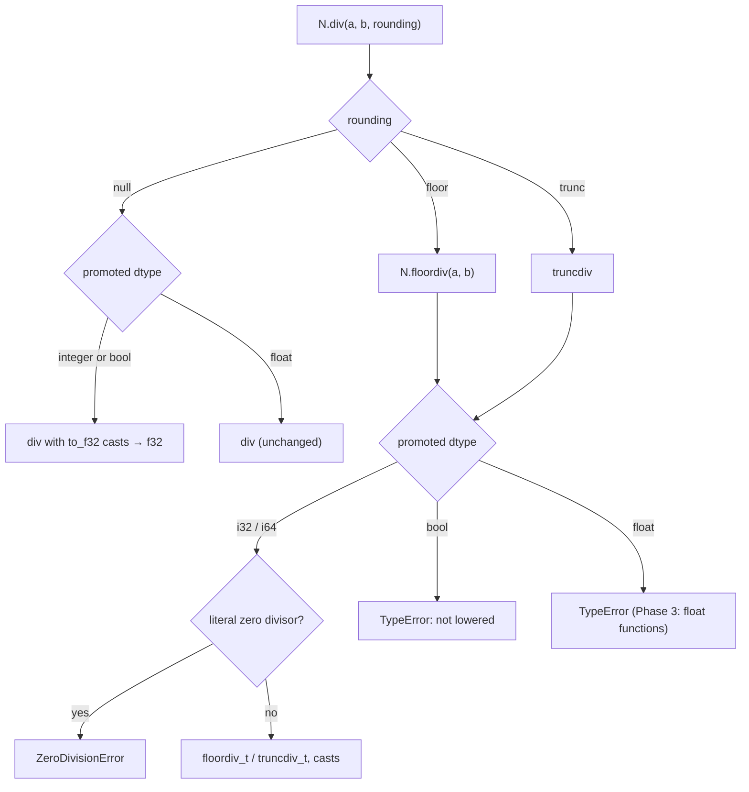

# Integer floor division and modulo: analysis, design and implementation guide

## 1. Executive summary

Kiln can add, subtract, multiply, compare and convert integer tensors exactly, but it cannot divide them. Every integer division a PyTorch program can express (`a // b`, `a % b`, `torch.div(a, b, rounding_mode="trunc")`, `torch.fmod`, and even plain `a / b`) is refused today with an error of the form `div over i64 values is not lowered`. This guide explains the parts of Kiln involved in typed scalar arithmetic, specifies PyTorch's semantics for every sign, zero and overflow case from observations on the installed torch build, and proposes a phased plan that adds four integer operations as typed functions in the same style as the existing ones.

The difficulty is entirely in the signs. C and CUDA integer `/` and `%` truncate toward zero; Python and PyTorch `//` and `%` round toward negative infinity. The two agree whenever the dividend and divisor have the same sign, which is why the bug is easy to miss: every use found in the PassNet corpus has a nonnegative dividend and a positive constant divisor. The design therefore defines the floor operations with a correction applied to the truncating result, encoded once in the JS reference and once in a CUDA helper function, and tests it on a sign table rather than on corpus data.

The corpus demand is small. The KILN-005 census population (2060 sampled fusible subgraphs) contains no tensor-level floor division or modulo. Across all 67150 upstream `model.py` files, 25 graphs perform tensor floor division, modulo or rounded division, all of them in the sole-op lists. This is a correctness-completeness item that makes the importer honest, not a benchmark unlock.

All of the work except NVRTC compilation and GPU replay can be built and validated on a CPU-only machine. Section 10 lists which checks run where.

## 2. Problem statement and scope

PyTorch programs use integer division for index arithmetic on data: splitting a flat detection index into a class and an anchor (`idx // 80`, `idx % 80` in yolov10l), bucketing positions (`pos % 16` in long-t5), or computing frame counts (`torch.div(len, 14, rounding_mode="trunc")` in a NeMo conformer). The Kiln importer (`integrations/passnet/fx_import.py`) has no mapping for these operations, and the Kiln frontend has no function to map them to.

In scope:

- Integer floor division (`//`, `torch.floor_divide`, `torch.div(..., rounding_mode="floor")`) over i32 and i64.
- Integer floor modulo (`%`, `torch.remainder`), whose result has the sign of the divisor.
- Integer truncating division (`torch.div(..., rounding_mode="trunc")`) and `torch.fmod`, whose result has the sign of the dividend.
- True division of integers (`a / b`, `torch.div(a, b)`), which PyTorch promotes to the default float dtype; Kiln currently refuses it.
- The behavior at division by zero and at `INT_MIN` divided by `-1`.
- The importer mappings for each FX target and method spelling.

Out of scope for the first slice, with design notes in Section 9 (Phase 3) and Section 11:

- Floor division and remainder over floating operands (including mixed int/float operands, which promote to float). One corpus graph uses `float32 // 2`.
- WGSL lowering. Typed integer functions already have `w: null` and WGSL already refuses i32/i64 storage.
- Unsigned dtypes other than the existing `u8` storage type.

## 3. System orientation

This section introduces the parts of Kiln that integer division touches, in the order a value passes through them. Each term is defined before later sections depend on it.

### 3.1 Levels of IR

Kiln compiles a traced program through several intermediate representations (IRs). Three matter here.

- **Frontend (nn) level.** A program is a graph of `nn.*` operations such as `nn.ew` (elementwise), `nn.reduce` and `nn.cast`. The `N` object in `packages/kiln/src/std/tensor.js:409-466` is the user-facing API that builds these nodes: `N.add(a, b)`, `N.int(3)`, `N.cast(x, "i32")`.
- **Tensor level.** Decomposition rules (`tensor.js:504-523`) rewrite frontend operations into `tensor.ew`, `tensor.view`, `tensor.reduce` and `tensor.const` nodes. The `T` object (`tensor.js:395-405`) builds these.
- **Loop level.** Lowering turns tensor operations into scalar expressions inside loop nests. Scalar expressions are built with `E.op(fnName, ...args)` in `packages/kiln/src/std/loop.js:50-64`. A kernel body is then emitted as CUDA (`toCuda`), WGSL (`toWgsl`), or a JS simulator (`toSim`), all in `packages/kiln/src/std/emit.js`.

### 3.2 The function table

Every scalar operation at every level is a named entry in one table, `FNS`, in `packages/kiln/src/std/fns.js:17-89`. An entry carries:

- `n`, the arity;
- `js`, the reference implementation, which defines the semantics;
- `c` and `w`, the CUDA and WGSL spelling templates, with `{0}`, `{1}` standing for operands (`fill` at `fns.js:121`);
- `flops`, a cost estimate used by the simulator metrics;
- for typed functions only, `args` (the operand dtype, or `"*"` for any) and `type` (the result dtype).

An **untyped function** such as `div` (`fns.js:31`) computes in f32. A **typed function** such as `add_i64` names its operand and result dtypes. Typed integer functions were added in P3a slice 3 (`fns.js:65-92`): `{add, sub, mul, neg, max, min}_{i32, i64}`, comparisons `{eq, ne, lt, le, gt, ge}_{f32, i32, i64, bool}` returning `bool`, and conversions `to_{f32, i32, i64, bool}`.

The reference values follow fixed conventions (`fns.js:65-73`). An i64 value is a JS `BigInt`, computed exactly and wrapped to 64 bits with `BigInt.asIntN(64, x)`, which matches CUDA's two's-complement wraparound. An i32 value is a JS number kept in range with `| 0` and `Math.imul`. A bool is the number 0 or 1.

### 3.3 Type promotion and resolution

PyTorch decides the dtype of `a + b` by **type promotion**: categories are ordered bool < integer < floating; dimensioned tensors take priority over 0-dim tensors, which take priority over Python scalars; a lower-priority operand changes the result only if its category is higher, and a Python scalar then contributes its category's default dtype (i64 or f32). Kiln implements this in `promoteDtypes` (`tensor.js:183-204`).

A **Python scalar** in the importer output is spelled `N.int(v)` or `N.bool(v)` (`tensor.js:434-435`), a 0-dim `tensor.const` with dtype i64 or bool. A bare JS number is a float scalar. The distinction matters: `int32_tensor // 3` stays int32 in PyTorch, while `int32_tensor // 3.0` becomes float32.

**Resolution** is the step that turns a frontend operation name into one typed function plus a list of operand conversions. `resolveEw(fn, xs)` (`tensor.js:213-227`) promotes the operand dtypes, picks the compute dtype, and returns `{ fn, casts }`: for example `N.add(i32x, i64y)` resolves to `{ fn: "add_i64", casts: ["i64", null] }`. The `nn.ew` node stores that pair (`tensor.js:329-330`), and the decomposition inserts the conversions with `convert` (`tensor.js:496-503`, `520-523`).

### 3.4 Static value typing in kernels

After lowering, each named value in a kernel has exactly one dtype. `valueTypes` (`packages/kiln/src/std/kernel.js:255-302`) assigns them: a typed function's result has its declared `type`; an untyped function must receive only f32 operands, and an integer operand there raises `... (integer arithmetic needs a typed function)` (`kernel.js:276`). The CUDA emitter then declares one C variable per value with its storage type (`emit.js:69`) and spells literals in the dtype their context requires: `ilit` (`emit.js:16-22`) prints `7LL` for an i64 context, `7` for i32, `true`/`false` for bool, and refuses a non-integral literal.

### 3.5 Index arithmetic is a separate algebra

Kiln has a second integer arithmetic that is easy to confuse with value arithmetic. **Index expressions** (`packages/kiln/src/core/ix.js`) describe coordinate maps, loop bounds and addresses. They support `/` and `%` with floor semantics (`ix.js:3`, `83-105`), simplify them algebraically, and spell them in C as truncating `/` and `%` because coordinates are nonnegative, except when a dividend contains a data-dependent load term (`ld`), where they spell a sign-correct floor (`ix.js:257`, `267-270`).

Integer division of tensor values does not go through `ix.js`. A tensor value `idx // 80` is an `nn.ew` operation whose function lives in `FNS`. The two meet only when a computed integer tensor is later used as a gather index, at which point it becomes an `ld` term inside an index expression. The design below leaves `ix.js` unchanged.

### 3.6 The end-to-end path

```mermaid
flowchart LR
  A["PyTorch FX graph<br/>operator.floordiv(idx, 80)"] --> B["fx_import.py<br/>BINARY table, operand()"]
  B --> C["Kiln script<br/>N.floordiv(v0, N.int(80))"]
  C --> D["resolveEw<br/>promoteDtypes → i64<br/>fn floordiv_i64, casts"]
  D --> E["nn.ew {fn, casts}<br/>frontend reference eval"]
  E --> F["decompose nn.ew<br/>convert + T.ew → tensor.ew"]
  F --> G["Loop IR<br/>E.op('floordiv_i64', ...)<br/>constant folding"]
  G --> H["valueTypes<br/>static i64 value"]
  H --> I["toCuda<br/>kiln_floordiv_i64(in0, 80LL)"]
```



Boxes B to H run on any machine. Box I produces CUDA source text on any machine; compiling it with NVRTC and running it requires the GPU host.

## 4. Current-state analysis

### 4.1 What exists

- `FNS.div` (`fns.js:31`) and `FNS.divide` (`fns.js:32`) are untyped f32 division. `FNS.floor` (`fns.js:57`) is untyped f32 `floorf`.
- There is no typed division of any kind: `div_i64`, `div_i32`, a floor division and a modulo do not exist in `FNS`. A node probe confirms `"div_i64" in FNS === false`.
- `resolveEw` (`tensor.js:222-225`) builds the name `${fn}_${compute}` for every non-comparison operation over an integer compute dtype and throws `KilnError("TypeError", "${fn} over ${compute} values is not lowered")` when that name is missing or the compute dtype is bool.
- The test `packages/kiln/test/integer-arithmetic.mjs:34` asserts this refusal for `N.div(x, x)` over i64.
- The importer maps `_operator.truediv` and method `div` to `N.div` (`fx_import.py:163-168`) and in-place `itruediv` to `div` (`fx_import.py:52-54`). It has no entry for `operator.floordiv`, `operator.mod`, `torch.div` as a function, `torch.floor_divide`, `torch.remainder` or `torch.fmod`. `fx_trace.py:21` registers in-place proxies for `floordiv` and `mod` but no lowering consumes them.

### 4.2 Observed behavior of the current code

A probe against `packages/kiln/src` (recorded in the diary, Step 3) gives:

| Expression | Kiln result today | PyTorch result |
|---|---|---|
| `N.div(i64, i64)` | throws `div over i64 values is not lowered` | float32 true quotient |
| `N.div(i64, N.int(2))` | throws the same | float32 |
| `N.div(i64, 2.0)` | f32 | float32 |
| `N.floor(i64)` | throws `floor over i64 values is not lowered` | int64, unchanged |
| `E.op("add_i64", E.num(2**60), E.num(1)).v` | `1152921504606847000` | `1152921504606846977` |

The last row is a pre-existing defect in the loop-level constant folder. `E.op` folds an all-literal typed integer application into `E.num(Number(result))` (`loop.js:57`), and `E.num` stores `+v` (`loop.js:51`) with no exact field. The kernel-builder literal `kx.num` (`kernel.js:16-17`) does carry an `exact` decimal string for BigInt values, and `ilit` honors it (`emit.js:18`), so the defect is confined to folding. Integer division makes it worse in two ways: quotients of large i64 literals would be rounded, and a folded division by zero would throw a raw `RangeError: Division by zero` from `BigInt` arithmetic.

### 4.3 The existing floor spelling in `ix.js`

`ix.js:257` defines `floorMod(a, b) = (((a % b) + b) % b)`. It is correct for either sign of `b` (for `b < 0` the result is in `(b, 0]`), but it costs two `%` operations and can overflow in `a % b + b` when `b` is near the type's limit. It is used only for index expressions with data-dependent loads, whose divisors are positive extents. It is a useful cross-check, not the spelling to reuse for values.

### 4.4 PyTorch semantics, as observed

All values below come from torch `2.11.0+cu130` on this host (CPU only; `torch.cuda.is_available()` is `False`). The C++ definitions are in `torch/include/c10/util/generic_math.h:25-108`.

Sign table, `a = [7, -7, 7, -7, 0, 6, -6]`, `b = [2, 2, -2, -2, 3, -3, 3]`:

| Operation | Result | Rounding | Sign of nonzero remainder |
|---|---|---|---|
| `a // b`, `floor_divide`, `div(..., "floor")` | `[3, -4, -4, 3, 0, -2, -2]` | toward −∞ | — |
| `div(..., "trunc")` | `[3, -3, -3, 3, 0, -2, -2]` | toward 0 | — |
| `a % b`, `remainder` | `[1, 1, -1, -1, 0, 0, 0]` | — | divisor's |
| `fmod` | `[1, -1, 1, -1, 0, 0, 0]` | — | dividend's |
| `a / b`, `div(a, b)` | `[3.5, -3.5, -3.5, 3.5, 0.0, -2.0, -2.0]`, float32 | true | — |

Promotion: `i32 // 3` is int32; `i32 // (0-dim i64)` is int32; `i32 // (1-d i64)` is int64; `i64 // 2.0` is float32 (`[3., -4., 3., -4., 0., 3., -3.]`); `bool // 2` is int64; `i64 / 1` on `2**24 + 1` gives `16777216.0` (the integers convert to float32 before dividing).

Bool operands: `bool // bool`, `bool % bool` and `fmod(bool, bool)` raise `NotImplementedError: "div_floor_cpu" not implemented for 'Bool'` (respectively `remainder_cpu`, `fmod_cpu`). `bool / bool` is float32.

Division by zero on CPU: `//`, `%`, `fmod` and trunc `div` raise `RuntimeError: ZeroDivisionError`, for a Python `0` divisor and for a zero tensor divisor, in i32 and i64. CUDA behavior was not observable on this host (Section 11).

`INT_MIN` by `-1`: `INT64_MIN // -1` returns `INT64_MIN`, `INT64_MIN % -1` returns `0`, `fmod(INT64_MIN, -1)` returns `0`, `INT32_MIN // -1` returns `INT32_MIN`. `generic_math.h:63-67` special-cases floor division. `torch.div(INT64_MIN, -1, rounding_mode="trunc")` kills the Python process with SIGFPE (exit status 136): the trunc path executes the raw x86 `idiv`, which traps.

Float floor division is not `floor(a / b)`: `1.0 // 0.1` is `9.0` while `floor(1.0 / 0.1)` is `10.0`, and 427 of 200000 random float32 pairs disagree. PyTorch computes `(a - fmod(a, b)) / b` with fix-ups (`div_floor_floating`, `generic_math.h:36-59`) to keep `a == (a // b) * b + a % b`.

## 5. Gap analysis

| Need | Present? | Gap |
|---|---|---|
| Typed integer floor division, floor modulo, trunc division, fmod | No | Four new `FNS` families over i32 and i64. |
| A correct floor spelling in CUDA | Only for index expressions | A value-level helper, guarded for `b == -1`. |
| Integer true division | Refused | `resolveEw` must promote `div` over integers to f32. |
| Division-by-zero policy | None | A defined reference behavior and a compile-time refusal for a literal zero divisor. |
| Exact constant folding of typed integers | Lossy for i64 | `E.num` must carry an exact BigInt value; folding must not leak raw `RangeError`s. |
| Frontend API | `N.div(a, b)` only | `N.floordiv`, `N.remainder`, `N.fmod`, and `N.div(a, b, rounding)`. |
| Importer coverage | `truediv` and method `div` only | FX function and method targets for each spelling, the `rounding_mode` keyword, and in-place forms. |
| Tests | Refusal assertion only | A CPU sign-table test, importer tests, a numeric harness test, a GPU replay script. |

## 6. Proposed architecture and APIs

The design adds operations in the existing shape: each is a set of typed `FNS` entries; `resolveEw` maps a frontend name to them; the `N` API exposes them; the emitters spell them. No new IR node kind is needed.

### 6.1 Function names and semantics

| Frontend name | Typed functions | Reference semantics | CUDA spelling |
|---|---|---|---|
| `floordiv` | `floordiv_i32`, `floordiv_i64` | quotient rounded toward −∞; `INT_MIN // -1` wraps to `INT_MIN` | `kiln_floordiv_{i32,i64}({0}, {1})` |
| `remainder` | `remainder_i32`, `remainder_i64` | `a - b * floordiv(a, b)`; sign of `b`; `x % -1 = 0` | `kiln_remainder_{i32,i64}({0}, {1})` |
| `truncdiv` | `truncdiv_i32`, `truncdiv_i64` | quotient rounded toward 0; `INT_MIN / -1` wraps to `INT_MIN` | `kiln_truncdiv_{i32,i64}({0}, {1})` |
| `fmod` | `fmod_i32`, `fmod_i64` | `a - b * truncdiv(a, b)`; sign of `a`; `x fmod -1 = 0` | `kiln_fmod_{i32,i64}({0}, {1})` |
| `div` over integers | none new | true division in f32: `div(to_f32(a), to_f32(b))` | existing `({0} / {1})` |

Each typed entry has `n: 2`, `args: t`, `type: t`, `w: null`, as the existing integer entries do (`fns.js:77`).

### 6.2 Frontend API

```js
N.floordiv(a, b)              // a // b, torch.floor_divide, torch.div(a, b, rounding_mode="floor")
N.remainder(a, b)             // a % b, torch.remainder
N.fmod(a, b)                  // torch.fmod
N.div(a, b, rounding = null)  // null: true division; "floor" → N.floordiv; "trunc" → truncdiv
```

`N.div` keeps its current two-argument behavior for floats. Its third argument selects the rounding mode; an unknown mode throws `KilnError("TypeError", ...)`. `truncdiv` is reached only through `N.div(..., "trunc")`, as in PyTorch.

### 6.3 Resolution rules

`resolveEw` gains three rules, applied before the existing typed-name construction:

1. `div` over an integer or bool compute dtype resolves to the untyped f32 `div` with both operands cast to f32. This matches PyTorch's true division.
2. `floordiv`, `remainder`, `truncdiv` and `fmod` over a bool compute dtype throw `KilnError("TypeError", "floordiv over bool values is not lowered")`, which the existing code already produces (`tensor.js:224`). Mixed bool/int operands promote to i64 and are accepted.
3. A divisor that is a literal zero (`tensor.const` with value 0 and no data) for any of the four integer operations throws `KilnError("ZeroDivisionError", "integer division by zero")` at construction.

Over a floating compute dtype, the first slice throws `KilnError("TypeError", "floordiv over f32 values is not lowered")` instead of the current `unknown function` error. Phase 3 replaces the refusal with float functions.

### 6.4 Reference implementations

```js
// fns.js, beside INTEGER_OPS. i64 operands are BigInt; i32 operands are int32-valued numbers.
const zeroDivide = () => { throw new KilnError("ZeroDivisionError", "integer division by zero"); };
const floorFix = (q, r, b, one) => (r != 0 && (r < 0) !== (b < 0) ? q - one : q);

const I64_DIV = {
  floordiv:  (a, b) => { a = big(a); b = big(b); if (b === 0n) zeroDivide(); return wrap64(floorFix(a / b, a % b, b, 1n)); },
  remainder: (a, b) => { a = big(a); b = big(b); if (b === 0n) zeroDivide(); const r = a % b; return r !== 0n && (r < 0n) !== (b < 0n) ? r + b : r; },
  truncdiv:  (a, b) => { a = big(a); b = big(b); if (b === 0n) zeroDivide(); return wrap64(a / b); },
  fmod:      (a, b) => { a = big(a); b = big(b); if (b === 0n) zeroDivide(); return a % b; },
};
const I32_DIV = {
  // |a|, |b| < 2^31: Math.trunc(a / b) is exact, and q * b is exact in a double
  floordiv:  (a, b) => { if (b === 0) zeroDivide(); const q = Math.trunc(a / b); return floorFix(q, a - q * b, b, 1) | 0; },
  remainder: (a, b) => { if (b === 0) zeroDivide(); const r = a - Math.trunc(a / b) * b; return (r !== 0 && (r < 0) !== (b < 0) ? r + b : r) | 0; },
  truncdiv:  (a, b) => { if (b === 0) zeroDivide(); return Math.trunc(a / b) | 0; },
  fmod:      (a, b) => { if (b === 0) zeroDivide(); return (a - Math.trunc(a / b) * b) | 0; },
};
```

`BigInt` `/` and `%` truncate toward zero and give `%` the dividend's sign, so `I64_DIV.truncdiv` and `I64_DIV.fmod` are the bare operators. `wrap64` turns the one overflowing quotient, `INT64_MIN / -1 = 2^63`, into `INT64_MIN`; `| 0` does the same for i32. JS `%` on `-0`-producing cases is avoided in the i32 path by computing `a - q * b`, which never yields `-0` for integer operands.

### 6.5 CUDA helpers

A C `/` with a zero divisor or with `INT_MIN / -1` is undefined behavior, and CUDA has no hardware integer divide, so the helpers make the `-1` case explicit and leave the zero case as the hardware sequence produces it.

```c
__device__ __forceinline__ long long kiln_floordiv_i64(long long a, long long b) {
  if (b == -1) return (long long)(0ULL - (unsigned long long)a);   // -a, wrapping INT64_MIN to itself
  long long q = a / b, r = a % b;                                    // one division; r = a - q * b
  return q - (long long)((r != 0) & ((r ^ b) < 0));                  // signs differ and inexact: step down
}
__device__ __forceinline__ long long kiln_remainder_i64(long long a, long long b) {
  if (b == -1) return 0;
  long long r = a % b;
  return r + (((r != 0) & ((r ^ b) < 0)) ? b : 0);
}
__device__ __forceinline__ long long kiln_truncdiv_i64(long long a, long long b) {
  return b == -1 ? (long long)(0ULL - (unsigned long long)a) : a / b;
}
__device__ __forceinline__ long long kiln_fmod_i64(long long a, long long b) {
  return b == -1 ? 0 : a % b;
}
// i32 versions are identical with int / unsigned int.
```

The fix-up derivation: C guarantees `a == q * b + r` with `q` truncated and `r` carrying the sign of `a` (or zero). The floor quotient differs from `q` exactly when `r != 0` and `r` and `b` have opposite signs; then `a == (q - 1) * b + (r + b)`, and `r + b` has the sign of `b` and magnitude below `|b|`. Because `r != 0` is tested first, `(r ^ b) < 0` is a sign-bit comparison that needs no branch. The compiler derives `r` from the same division as `q`, so a floor division costs one integer division plus a multiply-subtract, a compare, an xor, a logical and and a subtract. When `b` is a literal, which is every corpus case, NVRTC folds the `b == -1` test and replaces the division with a multiply-high sequence; this should be confirmed in PTX on the GPU host (Section 10.3).

The emitter injects each helper once, when the kernel body uses its function, following the existing `kiln_round_tf32` preamble at `emit.js:61`. A small `helper` field on the `FNS` entry, collected by `toCuda`, replaces the string search used there.

### 6.6 Constant folding

`E.op` (`loop.js:53-62`) must keep folded integer results exact and must not leak engine errors.

```js
// loop.js
num: (v) => typeof v === "bigint" ? intern({ k: "num", v: Number(v), exact: String(v) }) : intern({ k: "num", v: +v }),
// in E.op, the typed-integer fold:
const spec = F(fnName);
if (INTEGER_DTYPES.has(spec.type)) {
  const operands = a.map((x) => (x.exact != null ? BigInt(x.exact) : x.v));
  return E.num(spec.js(...operands));       // a KilnError from zeroDivide propagates as a compile error
}
```

The intern key must include `exact`: `akey` keys a literal as `"#" + o.v` (`loop.js:18-28`), so two i64 literals that differ only beyond 2^53 would otherwise share one node.

## 7. Decision records

### Decision: Four named functions rather than a rounding attribute on `div`

- **Context:** PyTorch exposes one function (`torch.div`) with a `rounding_mode` keyword plus separate operators (`//`, `%`, `fmod`, `remainder`). Kiln's `nn.ew` stores only `{fn, casts}`.
- **Options considered:** (a) a `rounding` attribute on `nn.ew` for `div`; (b) separate function names `floordiv`, `remainder`, `truncdiv`, `fmod`.
- **Decision:** (b).
- **Rationale:** Every level already keys behavior on the function name: `FNS`, `valueTypes`, the emitters and the folder. An attribute would need to be threaded through each, and modulo has no natural place in a `div` attribute.
- **Consequences:** `N.div(a, b, rounding)` is a thin dispatcher. Four integer families add eight `FNS` entries.
- **Status:** proposed

### Decision: Integer true division resolves to f32 division

- **Context:** PyTorch's `a / b` on integers returns float32. Kiln throws.
- **Options considered:** (a) keep the refusal; (b) cast both operands to f32 and divide.
- **Decision:** (b).
- **Rationale:** This is PyTorch's observed behavior, including its precision loss (`(2**24 + 1) / 1 == 16777216.0`). The casts reuse `convert` and `to_f32`.
- **Consequences:** `integer-arithmetic.mjs:34` changes from a refusal assertion to a dtype assertion. Large i64 values lose precision in exactly the way PyTorch's do.
- **Status:** proposed

### Decision: Division by zero raises in the reference and is unspecified in kernels

- **Context:** PyTorch CPU raises `ZeroDivisionError`; C and CUDA integer division by zero is undefined; PyTorch CUDA kernels are not observed to check divisors (inferred from `div_floor_integer`, which has no zero test, and not verified on a GPU).
- **Options considered:** (a) raise in the reference, leave kernels unguarded; (b) define a value (for example 0 or -1) everywhere and guard kernels with a select; (c) raise in the reference and add a device-side check.
- **Decision:** (a), plus a construction-time `ZeroDivisionError` for a literal zero divisor.
- **Rationale:** A reference that raises matches the CPU oracle used by the numeric harness and never fabricates a value. A guard costs a compare and select per element to produce a value no PyTorch program can rely on.
- **Consequences:** Replay inputs must avoid zero divisors, or tests must expect an error. Whether PyTorch CUDA and Kiln CUDA return the same garbage for a zero divisor is unknown and not required.
- **Status:** proposed

### Decision: Make `INT_MIN / -1` explicit in the helpers

- **Context:** PyTorch special-cases `INT_MIN // -1` (`generic_math.h:63-67`) but its trunc path traps on CPU. In C this is undefined behavior.
- **Options considered:** (a) rely on whatever the hardware sequence returns; (b) test `b == -1` and return the wrapping negation.
- **Decision:** (b), for all four functions.
- **Rationale:** The reference defines the result by `wrap64` and `| 0`; the kernel must agree with the reference without depending on undefined behavior. NVRTC removes the test for literal divisors.
- **Consequences:** For a data divisor, one extra compare per element.
- **Status:** proposed

### Decision: Helper functions rather than inline expression templates

- **Context:** Templates such as `max_i64`'s `(({0}) > ({1}) ? ({0}) : ({1}))` (`fns.js:78`) repeat operand text. A floor fix-up references each operand two or three times.
- **Options considered:** (a) inline templates; (b) `__device__ __forceinline__` helpers injected once per kernel.
- **Decision:** (b).
- **Rationale:** Operand subexpressions are evaluated once and generated code stays readable. `__forceinline__` gives the same machine code as an inline expression.
- **Consequences:** The emitter needs a helper-collection step. That step can also absorb the existing `kiln_round_tf32` special case.
- **Status:** proposed

### Decision: Leave `ix.js` unchanged

- **Context:** `ix.js` already has floor `/` and `%`.
- **Options considered:** (a) route value division through `Ix`; (b) keep value and index arithmetic separate.
- **Decision:** (b).
- **Rationale:** `Ix` is an algebra over coordinates with simplification rules that assume positive constant divisors (`ix.js:86-103`). Tensor values are runtime data of any sign and need typed storage, which `Ix` does not model.
- **Consequences:** Two floor implementations exist; the value-level one is tested on negative operands.
- **Status:** proposed

## 8. Pseudocode and key flows

### 8.1 Resolution

```js
export function resolveEw(fn, xs, rounding) {
  // ... select handling unchanged ...
  const t = promoteDtypes(xs);
  if (fn === "div" && INTEGER_DTYPES.has(t))
    return { fn: "div", casts: xs.map((x) => (dtypeOf(x) === "f32" ? null : "f32")) };
  if (INTEGER_DIVISIONS.has(fn)) {                 // floordiv, remainder, truncdiv, fmod
    if (!INTEGER_DTYPES.has(t) || t === "bool") throw new KilnError("TypeError", `${fn} over ${t} values is not lowered`);
    if (isLiteralZero(xs[1])) throw new KilnError("ZeroDivisionError", "integer division by zero");
  }
  // ... existing typed-name construction: `${fn}_${compute}` ...
}
```



### 8.2 A worked example

The yolov10l sole-op graph `yolov10l_start685_end686_685` computes `tmp_0 = in_0 // 80` on an int64 tensor of shape `[1, 300]`.

1. The importer emits `N.floordiv(v0, N.int(80))`, because `operand()` (`fx_import.py:41-48`) spells the Python int as `N.int(80)`.
2. `promoteDtypes` sees a dimensioned i64 tensor and an i64 Python scalar; the result is i64. `resolveEw` returns `{ fn: "floordiv_i64", casts: [null, null] }`.
3. The frontend reference evaluates `I64_DIV.floordiv` per element: `179n` gives `2n`, and a hypothetical `-1n` would give `-1n`.
4. Decomposition produces `tensor.ew([v0, const 80 i64], { fn: "floordiv_i64" })`; lowering produces `E.op("floordiv_i64", load(0, [i0, i1]), E.num(80))`.
5. `valueTypes` records the value as i64. `toCuda` spells the literal through `ilit` as `80LL`, and the body line becomes `v3 = kiln_floordiv_i64(in0, 80LL);`, with the helper in the kernel preamble.

## 9. Implementation phases

Phases 0 to 3 need only a CPU machine with Node and CPU PyTorch. Phase 4 needs the GPU host.

1. **Phase 0: Exact integer constant folding.** Give `E.num` an exact BigInt path and fold typed integer applications without `Number()` (`loop.js:51`, `57`). Add a test that `E.op("add_i64", E.num(2n**60n), E.num(1n))` keeps `exact === "1152921504606846977"` and spells `1152921504606846977LL` in CUDA.
2. **Phase 1: Typed functions, resolution and CUDA spelling.** Add the eight `FNS` entries (`fns.js`), the resolution rules (`tensor.js:213-227`), `N.floordiv`, `N.remainder`, `N.fmod` and the `rounding` argument of `N.div` (`tensor.js:441`), the CUDA helpers with a helper-collection step (`emit.js`), and integer `flops` estimates marked as unmeasured. Replace the refusal assertion at `integer-arithmetic.mjs:34`. Add `packages/kiln/test/integer-division.mjs`.
3. **Phase 2: Importer.** In `fx_import.py`, map `_operator.floordiv`, `torch.floor_divide`, method `floor_divide` and `__floordiv__` to `N.floordiv`; `_operator.mod`, `torch.remainder`, method `remainder` and `__mod__` to `N.remainder`; `torch.fmod` and method `fmod` to `N.fmod`; `torch.div` and method `div` with an optional `rounding_mode` keyword to `N.div(a, b, mode)`; in-place `_operator.ifloordiv` and `_operator.imod` beside `itruediv` (`fx_import.py:52-58`). Add tests to `test_fx_import.py` and a numeric test to `test_fx_compose.py` with `atol=0, rtol=0`.
4. **Phase 3: Float operands.** Add untyped f32 `floordiv` and `remainder` ported from `div_floor_floating` and `div_mod` (`generic_math.h:36-97`), f32 `fmod` (`fmodf`) and `truncdiv` (`truncf(a / b)`), so mixed int/float operands promote and resolve. Make `floor`, `ceil`, `round` and `trunc` of an integer the identity, as PyTorch does.
5. **Phase 4: GPU validation.** Export a program with each function over i32 and i64, compile it with NVRTC, and replay it against PyTorch CUDA in a new `integrations/passnet/check_integer_division_cuda.py`, modeled on `check_typed_arithmetic_cuda.py`. Record PyTorch CUDA's results for zero divisors and `INT_MIN / -1` in each mode. Inspect PTX for a literal divisor to confirm the `b == -1` test and the division are folded. Run the 25 tensor-level sole-op corpus graphs through import, compile and replay.

## 10. Test strategy

### 10.1 CPU-only tests (Phases 0-3)

`packages/kiln/test/integer-division.mjs` should contain:

- The sign table from Section 4.4 for each function over i32 and i64, at the frontend reference and at the loop level (`pipe.run(g).at("loop").eval(...)`), compared with exact equality.
- `INT_MIN` with divisor `-1` and `1` for each function and dtype.
- i64 operands beyond 2^53 (for example `-(2n**62n) - 3n` modulo `2n**40n`, which PyTorch gives as `1099511627773`), proving the reference does not round through doubles.
- Promotion cases: `i32 // N.int(3)` is i32; `i32 // i64` is i64; `bool // N.int(2)` is i64; `N.div(i64, i64)` is f32; `N.floordiv(bool, bool)` throws; `N.floordiv(x, N.int(0))` throws `ZeroDivisionError`.
- A data zero divisor makes the frontend reference throw `ZeroDivisionError`.
- CUDA text assertions: the kernel contains `kiln_floordiv_i64(`, the helper definition appears once, and integer contexts contain no float literals (the same regex as `integer-arithmetic.mjs:71`).

The loop evaluator is the CPU oracle for kernels. The GPU simulator is not: `toSim` keeps values in `Float32Array` registers (`emit.js:266-270`), so it cannot represent i64 values exactly and should not be used to validate these functions.

The Python numeric harness (`test_fx_compose.py:27-37`, `kiln_eval.mjs`) runs the model on CPU PyTorch and the imported script on the Kiln frontend and loop levels. It converts results to float64 (`kiln_eval.mjs:20`, `test_fx_compose.py:35`), so it is exact only for magnitudes below 2^53; keep large-value cases in the JS test.

### 10.2 Pseudocode already validated on CPU

The reference functions of Section 6.4 and the helpers of Section 6.5 were checked during this research, before any Kiln code changed.

- `scripts/02-torch-expected.py` generates PyTorch CPU results for the sign table, `INT_MIN` and `INT_MAX` edge cases and 4000 random pairs per dtype (full-range and small values, divisors `±1` and `±2` included, zero excluded).
- `scripts/02-validate-reference-pseudocode.mjs` runs the Section 6.4 JS functions on those inputs: 31974 cases, 0 mismatches, and all 8 functions raise on a zero divisor.
- `scripts/03-validate-c-helpers.c` compiles the Section 6.5 helpers for the host with `gcc -O2 -fsanitize=undefined -fno-sanitize-recover=all`: 31976 cases (including trunc `INT_MIN / -1`, which PyTorch CPU cannot produce), 0 mismatches and no undefined-behavior report.

The host check validates the C logic, not NVRTC's code generation; Phase 4 still has to replay on the GPU.

### 10.3 GPU-host checks (Phase 4)

| Check | Needs GPU host? |
|---|---|
| Reference semantics, promotion, errors | No |
| Loop-level evaluation | No |
| CUDA source text generation | No |
| Importer and numeric harness against CPU PyTorch | No |
| NVRTC compilation of the generated source | Yes |
| Replay against PyTorch CUDA, PTX inspection, timing | Yes |

## 11. Risks, alternatives and open questions

### Risks

- A sign error in the fix-up is invisible on corpus data, where every dividend is nonnegative and every divisor a positive literal. The sign table in the JS test is the only guard; review it against Section 4.4.
- Fixing `E.num` changes intern keys for every literal. Run the full `packages/kiln` suite after Phase 0, not only the new test.
- Integer division is a multi-instruction software sequence on CUDA, and i64 division is substantially longer than i32. The `flops` values assigned in Phase 1 are placeholders until Phase 4 measures them.

### Alternatives considered

- Spelling floor modulo as `((a % b) + b) % b`, as `ix.js:257` does. It costs a second division and can overflow; the fix-up form needs one division.
- Computing integer floor division through float: `floorf((float)a / (float)b)`. It is wrong for i32 values beyond 2^24 and for all large i64 values.

### Open questions

- What does PyTorch CUDA return for integer division by zero, and for `INT_MIN / -1` with `rounding_mode="trunc"`? The design does not depend on the answer, but the GPU replay must avoid or expect it.
- PyTorch CPU float `%` returns a zero with the dividend's sign (`-2.0 % 1.0 == -0.0`), while its header `div_mod` returns `copysign(0, b)`. Which does PyTorch CUDA follow? This affects only the sign of zero in Phase 3, which `torch.allclose` does not distinguish.
- Should the PassBench evaluation population include sole-op graphs? Until it does, this ticket changes no census count.

## 12. References

### Kiln source

- `packages/kiln/src/std/fns.js:17-89` — the `FNS` table, typed integer functions, conversions.
- `packages/kiln/src/std/fns.js:93-106` — typed reducers and `typedReducer`.
- `packages/kiln/src/std/tensor.js:183-227` — `promoteDtypes`, `elementwiseDtype`, `resolveEw`.
- `packages/kiln/src/std/tensor.js:329-330` — the `nn.ew` operation and its reference evaluation.
- `packages/kiln/src/std/tensor.js:409-466` — the `N` frontend API, including `N.int` and `N.div`.
- `packages/kiln/src/std/tensor.js:496-523` — `convert` and the `nn.ew` decomposition.
- `packages/kiln/src/std/kernel.js:16-17`, `255-302` — `kx.num` with exact literals; `valueTypes`.
- `packages/kiln/src/std/emit.js:16-22`, `41-47`, `61`, `94-104`, `174-270` — `ilit`, `fx`, the TF32 helper preamble, WGSL refusal, the simulator.
- `packages/kiln/src/std/loop.js:18-28`, `50-62` — `intern` and `akey` literal keys; `E.num` and constant folding in `E.op`.
- `packages/kiln/src/core/ix.js:83-105`, `256-295` — index-level floor `/` and `%`, `floorMod`, `toJs`.
- `packages/kiln/test/integer-arithmetic.mjs` — the existing typed-integer test.

### Importer and harness

- `integrations/passnet/fx_import.py:41-58`, `163-176` — `operand`, in-place binary, `BINARY`.
- `integrations/passnet/fx_trace.py:21` — in-place proxies, including `floordiv` and `mod`.
- `integrations/passnet/test_fx_compose.py:27-37`, `89-95` and `integrations/passnet/kiln_eval.mjs` — the numeric harness.
- `integrations/passnet/check_typed_arithmetic_cuda.py` — the pattern for a GPU replay check.

### PyTorch

- `torch/include/c10/util/generic_math.h:25-108` in the installed torch 2.11 — `div_floor_floating`, `div_floor_integer`, `div_mod`.

### Ticket evidence

- `scripts/02-torch-expected.py`, `scripts/02-validate-reference-pseudocode.mjs`, `scripts/03-validate-c-helpers.c` — CPU validation of the proposed reference and CUDA helper logic (Section 10.2).
- `scripts/01-census-div-mod.py` and `sources/01-census-div-mod.out` — corpus counts: 399 `model.py` files match; 374 are symbolic-shape arithmetic (`torch.sym_*`), 30 of which are in the census and imported; 25 are tensor operations, none in the census, all in `hf_sole_op_subgraphs*.txt`.
- `scripts/04-probe-kiln-current.mjs` — the probe behind the table in Section 4.2.
- `reference/01-diary.md` — the investigation diary with all probe commands and results.
